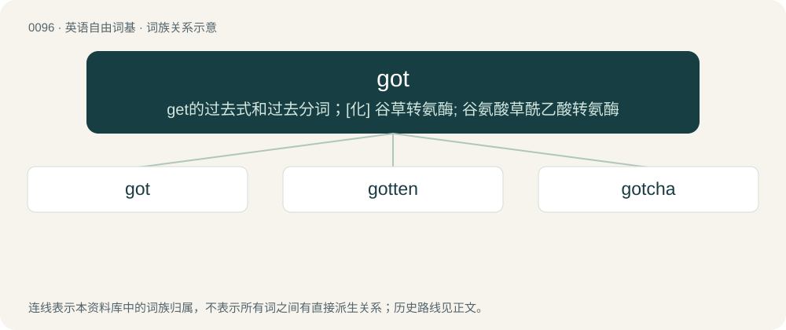

# 0099 · got — get的过去式和过去分词；\[化\] 谷草转氨酶; 谷氨酸草酰乙酸转氨酶

[总目录](../00_总目录_按常用程度.md)

**类型**：英语自由词基　｜　**来源语言**：见词源记录

## 核心含义与来源

- 核心含义：get的过去式和过去分词；\[化\] 谷草转氨酶; 谷氨酸草酰乙酸转氨酶
- 英文含义：Have; there is (indicates the possession or existence of something).
- 词形：got

**来源记录 1**（动词；Have; there is (indicates the possession or existence of something).）

Analogous to Chinese 有, such as Hokkien 有 (ū), Cantonese 有 (jau⁵), Mandarin 有 (yǒu). Sense 1 is also comparable to Malay ada.

## 词族图

## 单词速览（常用到不常用）

| 单词 | 音标 | 释义 |
|---|---|---|
| [got](#w-1) | 英 /ɡɒt/；美 /ɡɑt/ | get的过去式和过去分词；\[化\] 谷草转氨酶; 谷氨酸草酰乙酸转氨酶 |
| [gotten](#w-2) | 英 /ˈɡɒt.n̩/；美 /ˈɡɑ.tən/ | get的过去分词 |
| [gotcha](#w-3) | 英 /ˈɡɒ.tʃə/；美 /ˈɡɑ.tʃə/ | &lt;口&gt;=(I have)got you |

## 逐词详解

### 1. got

**词性**：动词　｜　**音标**：英 /ɡɒt/；美 /ɡɑt/

**中文释义**：get的过去式和过去分词；\[化\] 谷草转氨酶; 谷氨酸草酰乙酸转氨酶

**英文义项**：Have; there is (indicates the possession or existence of something). / Marks the completive or experiential aspect.

**词源与演化**：

Analogous to Chinese 有, such as Hokkien 有 (ū), Cantonese 有 (jau⁵), Mandarin 有 (yǒu). Sense 1 is also comparable to Malay ada.

**例句**：

> I got go Taiwan next year.

该用例对应义项：Used as a marker of realis modality.

### 2. gotten

**词性**：形容词　｜　**音标**：英 /ˈɡɒt.n̩/；美 /ˈɡɑ.tən/

**中文释义**：get的过去分词

**英文义项**：Obtained, acquired.

**构词拆分**：got + -en

**词源与演化**：

Morphologically got + -en.

**例句**：

> I'd still be spinning my wheels if I hadn't gotten that scholarship.

### 3. gotcha

**词性**：名词　｜　**音标**：英 /ˈɡɒ.tʃə/；美 /ˈɡɑ.tʃə/

**中文释义**：&lt;口&gt;=(I have)got you

**英文义项**：A potential problem or source of trouble. / A feature of a system or a program that works in the way it is documented but is counter-intuitive and almost invites mistake or non-function.

**构词拆分**：From got + -cha.

**词源与演化**：

From got + -cha.

**例句**：

> They change the number at random intervals and if you miss a sign. What a gotcha!

该用例对应义项：An instance of publicly tricking someone or exposing them to ridicule, especially by means of an elaborate deception.
