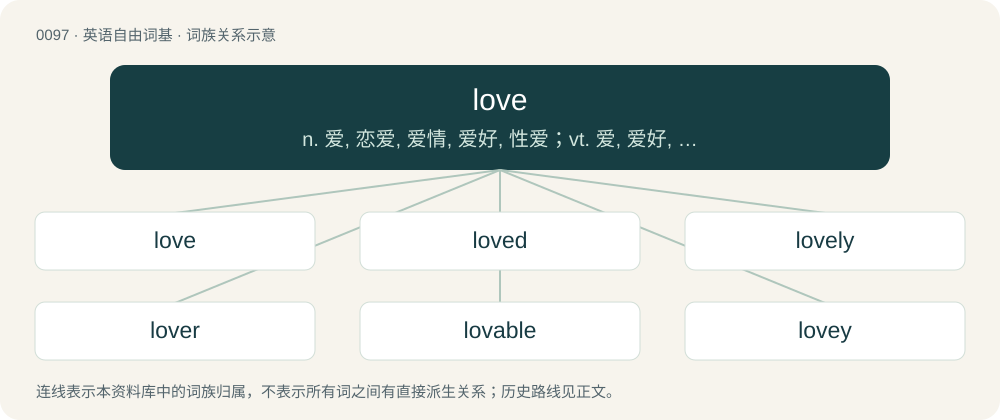

# 0100 · love — n. 爱, 恋爱, 爱情, 爱好, 性爱；vt. 爱, 爱好, 爱慕；vi. 爱

[总目录](../00_总目录_按常用程度.md)

**类型**：英语自由词基　｜　**来源语言**：见词源记录

## 核心含义与来源

- 核心含义：n. 爱, 恋爱, 爱情, 爱好, 性爱；vt. 爱, 爱好, 爱慕；vi. 爱
- 英文含义：A deep caring for the existence of another.
- 词形：love

**来源记录 1**（名词；A deep caring for the existence of another.）

From Middle English love, luve, from Old English lufu, from Proto-West Germanic \*lubu, from Proto-Germanic \*lubō, from Proto-Indo-European \*lewbʰ- (“love, care, desire”). The close of a letter sense is presumably a truncation of With love or the like. Eclipsed non-native English amour (“love”), borrowed from Norman amour (“love”). Cognates Cognate with Scots luve (“love”), Saterland Frisian ljo, ljoo, ljoof (“dear, sweet”), Ljoote, Ljoowe (“love”), West Frisian leaf (“friendly, kind, cordial”), leafde (“love”), Dutch lief (“lovely, nice, sweet”), liefde (“love”), German lieb (“dear; lovable”), Liebe (“love”), German Low German Leevde, Lieve (“love”), Luxembourgish léif (“lovely, kind, nice, sweet”), Léift (“love”), Vilamovian łiwa (“love”), Yiddish ליב (lib, “nice; kind”), Icelandic ljúfur (“beloved, dear”), Norwegian Nynorsk, Swedish ljuv (“lovely, sweet”), Gothic 𐌻𐌹𐌿𐍆𐍃 (liufs, “beloved, dear”), Albanian lyp (“to beg”), Russian любовь (ljubovʹ, “love”), Lithuanian liaupsė (“praise”), Latin libido (“desire, lust”), Polish lubić (“to like”), Persian آلفتن (âloftan, “to enamor”), Sanskrit लोभ (lobha, “desire, greed”).

## 词族图

## 单词速览（常用到不常用）

| 单词 | 音标 | 释义 |
|---|---|---|
| [love](#w-1) | 英 /ˈlʌv/ | n. 爱, 恋爱, 爱情, 爱好, 性爱；vt. 爱, 爱好, 爱慕；vi. 爱 |
| [loved](#w-2) | /lʌvd/ | v. 热爱（love的过去分词） |
| [lovely](#w-3) | /ˈlʌv.li/ | a. 可爱的, 有趣的 |
| [lover](#w-4) | 英 /ˈlʌvə/；美 /ˈlʌvɚ/ | n. 爱人, 爱好者 |
| [lovable](#w-5) | /ˈlʌvəbəl/ | a. 可爱的, 惹人爱的 |
| [lovey](#w-6) | /ˈlʌvi/ | n. 宝贝；亲爱的（对爱人的昵称） |
| [loveless](#w-7) | /ˈlʌvlis/ | a. 无爱情的, 不可爱的 |
| [lovemaking](#w-8) | /ˈlʌvmeikiŋ/ | n. 调情, 寄情, 求婚 |
| [lovesick](#w-9) | /ˈlʌvsɪk/ | a. 害相思病的, 苦恋的 |
| [lovelock](#w-10) | 英 /ˈlʌvˌlɒk/ | 【英文】A lock of hair that hangs down and is worn apart from the hair that remains. |
| [lovelorn](#w-11) | 美 /lʌvˈlɔɹn/ | a. 失恋的, 害相思病的 |
| [loveday](#w-12) | /ˈlʌvdeɪ/ | 【英文】A day devoted to love. |

## 逐词详解

### 1. love

**词性**：名词　｜　**音标**：英 /ˈlʌv/

**中文释义**：n. 爱, 恋爱, 爱情, 爱好, 性爱；vt. 爱, 爱好, 爱慕；vi. 爱

**英文义项**：A deep caring for the existence of another. / A profound and caring affection towards someone.

**词源与演化**：

From Middle English love, luve, from Old English lufu, from Proto-West Germanic \*lubu, from Proto-Germanic \*lubō, from Proto-Indo-European \*lewbʰ- (“love, care, desire”). The close of a letter sense is presumably a truncation of With love or the like. Eclipsed non-native English amour (“love”), borrowed from Norman amour (“love”). Cognates Cognate with Scots luve (“love”), Saterland Frisian ljo, ljoo, ljoof (“dear, sweet”), Ljoote, Ljoowe (“love”), West Frisian leaf (“friendly, kind, cordial”), leafde (“love”), Dutch lief (“lovely, nice, sweet”), liefde (“love”), German lieb (“dear; lovable”), Liebe (“love”), German Low German Leevde, Lieve (“love”), Luxembourgish léif (“lovely, kind, nice, sweet”), Léift (“love”), Vilamovian łiwa (“love”), Yiddish ליב (lib, “nice; kind”), Icelandic ljúfur (“beloved, dear”), Norwegian Nynorsk, Swedish ljuv (“lovely, sweet”), Gothic 𐌻𐌹𐌿𐍆𐍃 (liufs, “beloved, dear”), Albanian lyp (“to beg”), Russian любовь (ljubovʹ, “love”), Lithuanian liaupsė (“praise”), Latin libido (“desire, lust”), Polish lubić (“to like”), Persian آلفتن (âloftan, “to enamor”), Sanskrit लोभ (lobha, “desire, greed”).

**例句**：

> My husband’s love is the most important thing in my life.

该用例对应义项：A profound and caring affection towards someone.

### 2. loved

**词性**：形容词　｜　**音标**：/lʌvd/

**中文释义**：v. 热爱（love的过去分词）

**英文义项**：Being the object of love.

**构词拆分**：love + -ed

**词源与演化**：

From Middle English loved, luvd, from Old English lufode, first and third person singular past indicative of lufian; and Middle English loved, iloved, from Old English ġelufod, past participle of lufian; both equivalent to love + -ed.

**例句**：

> Mary is so nice a girl that she is loved by everybody.

### 3. lovely

**词性**：形容词　｜　**音标**：/ˈlʌv.li/

**中文释义**：a. 可爱的, 有趣的

**英文义项**：Delightful for beauty, harmony, or grace. / Nice; wonderful.

**构词拆分**：love + -ly

**词源与演化**：

From Middle English lovely, luvelich, lufli, from Old English luflīċ, luflīc (“amiable, loving, lovable”), equivalent to love + -ly.

**例句**：

> The castle garden enchants visitors with its lovely blooms.

该用例对应义项：Delightful for beauty, harmony, or grace.

### 4. lover

**词性**：名词　｜　**音标**：英 /ˈlʌvə/；美 /ˈlʌvɚ/

**中文释义**：n. 爱人, 爱好者

**英文义项**：One who loves and cares for another person in a romantic way; a sweetheart, love, soulmate, boyfriend, girlfriend, or spouse. / A sexual partner, especially one with whom someone is having an affair.

**构词拆分**：love + -er

**词源与演化**：

From Middle English lovere, luffer, lufere, equivalent to love + -er.

**例句**：

> All right, my lover?

该用例对应义项：An informal term of address for any friend.

### 5. lovable

**词性**：形容词　｜　**音标**：/ˈlʌvəbəl/

**中文释义**：a. 可爱的, 惹人爱的

**英文义项**：Inspiring or deserving love or affection; adorable or cute.

**构词拆分**：love + -able

**词源与演化**：

From Middle English lovable, loveable, luffeabill, lufabul, equivalent to love + -able.

**例句**：

> A mischievous but lovable child.

该用例对应义项：having characteristics that attract love or affection

### 6. lovey

**词性**：名词　｜　**音标**：/ˈlʌvi/

**中文释义**：n. 宝贝；亲爱的（对爱人的昵称）

**英文义项**：An informal mode of address (associated most often with actors and the like). / A baby's toy, blanket, or other object of affection.

**构词拆分**：love + -y

**词源与演化**：

From love + -y.

### 7. loveless

**词性**：形容词　｜　**音标**：/ˈlʌvlis/

**中文释义**：a. 无爱情的, 不可爱的

**英文义项**：Without love.

**构词拆分**：love + -less

**词源与演化**：

From Middle English loveles; equivalent to love + -less.

**例句**：

> Theirs was a loveless marriage: they stayed together even though they didn't care for each other.

该用例对应义项：Without love.

### 8. lovemaking

**词性**：名词　｜　**音标**：/ˈlʌvmeikiŋ/

**中文释义**：n. 调情, 寄情, 求婚

**英文义项**：Sexual intercourse. / Courtship; amorous advances.

**构词拆分**：love + making

**词源与演化**：

From love + making.

**例句**：

> His lovemaking disgusted her.

该用例对应义项：sexual activities (often including sexual intercourse) between two people

### 9. lovesick

**词性**：形容词　｜　**音标**：/ˈlʌvsɪk/

**中文释义**：a. 害相思病的, 苦恋的

**英文义项**：Behaving oddly, or as though in distress, due to being overcome by feelings of unrequited or unfulfilled love. / Having an aching desire for one's beloved.

**构词拆分**：love + sick

**词源与演化**：

From love + sick.

**例句**：

> Strong men behaving like lovesick boys.

该用例对应义项：languishing because of love

### 10. lovelock

**词性**：名词　｜　**音标**：英 /ˈlʌvˌlɒk/

**英文义项**：A lock of hair that hangs down and is worn apart from the hair that remains. / A flowing lock of hair that is dressed apart from the hair that remains.

**构词拆分**：love + lock

**词源与演化**：

From love + lock.

**例句**：

> The name Gaia for planet Earth was coined by the scientist James Lovelock from the eponymous Greek goddess.

### 11. lovelorn

**词性**：形容词　｜　**音标**：美 /lʌvˈlɔɹn/

**中文释义**：a. 失恋的, 害相思病的

**英文义项**：Abandoned or forsaken by one's lover; having constant bad luck in romance; desperate for love. / Unloved, bereft of love.

**构词拆分**：love + lorn

**词源与演化**：

From love + lorn.

**例句**：

> He halted, waved to her, sighed with his hand on his heart, and looked altogether very lovelorn.

### 12. loveday

**词性**：名词　｜　**音标**：/ˈlʌvdeɪ/

**英文义项**：A day devoted to love.

**构词拆分**：love + day

**词源与演化**：

Inherited from Middle English loveday; equivalent to love + day.
