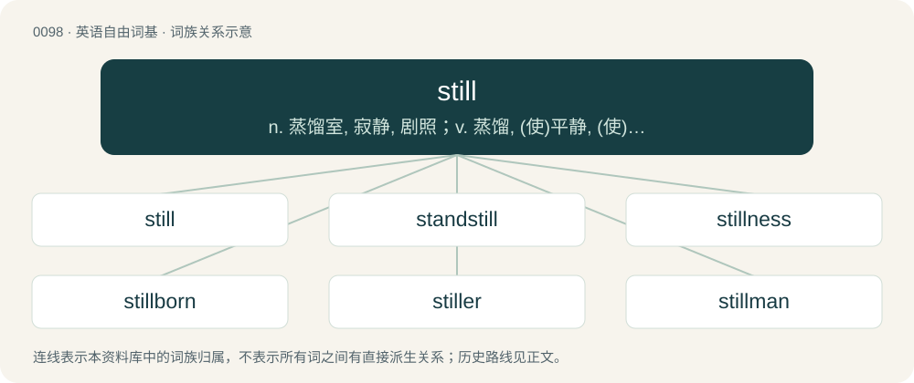

# 0102 · still — n. 蒸馏室, 寂静, 剧照；v. 蒸馏, (使)平静, (使)静止；a. 静止的, 不动的, 静寂的, 不起泡的, 静物摄影的

[总目录](../00_总目录_按常用程度.md)

**类型**：英语自由词基　｜　**来源语言**：见词源记录

## 核心含义与来源

- 核心含义：n. 蒸馏室, 寂静, 剧照；v. 蒸馏, (使)平静, (使)静止；a. 静止的, 不动的, 静寂的, 不起泡的, 静物摄影的
- 英文含义：Not moving; calm.
- 词形：still

**多个词源／构词路径**：同一拼写可能有不同来源；以下按词性和含义分别列出。

**来源记录 1**（形容词；Not moving; calm.）

From Middle English stille (“motionless, stationary”), from Old English stille (“still, quiet”), from Proto-West Germanic \*stillī, from Proto-Indo-European \*(s)telH- (“to be silent; to be still”). Cognate with Scots stil (“still”), Saterland Frisian stil (“motionless, calm, quiet”), West Frisian stil (“quiet, still”), Dutch stil (“quiet, silent, still”), Low German still (“quiet, silent, still”), German still (“still, quiet, tranquil, silent”), Swedish stilla (“quiet, silent, peaceful”), Icelandic stilltur (“set, quiet, calm, still”). Related to stall. (noun: Falkland Islander): Military slang, short for still a Benny, since the military had been instructed not to refer to the islanders by the derogatory term Benny (which see).

**来源记录 2**（名词；A device for distilling liquids.）

Via Middle English stillen, clip of distillen; Old French distiller; Latin distillare, from dis- + stillare, from Latin stilla.

**来源记录 3**（动词；To calm down, to quiet.）

Inherited from Old English stillan.

**来源记录 4**（动词；To cause to fall by drops.）

Aphetic form of distil, or from Latin stillare.

## 词族图

## 单词速览（常用到不常用）

| 单词 | 音标 | 释义 |
|---|---|---|
| [still](#w-1) | /ˈstɪl/ | n. 蒸馏室, 寂静, 剧照；v. 蒸馏, (使)平静, (使)静止；a. 静止的, 不动的, 静寂的, 不起泡的, 静物摄影的 |
| [standstill](#w-2) | 英 /ˈstændˌstɪl/ | n. 停止, 停顿；\[医\] 停顿 |
| [stillness](#w-3) | /ˈstɪlnəs/ | n. 静止, 沉静 |
| [stillborn](#w-4) | /ˈstɪlbɔː(ɹ)n/ | a. 生下来已死的, 死产的；\[医\] 死产的 |
| [stiller](#w-5) |  | n. 蒸馏器；a. 更寂静的 |
| [stillman](#w-6) |  | n. (Stillman)人名；(英、芬、瑞典)斯蒂尔曼 |
| [stillbirth](#w-7) | /ˈstilbəːθ/ | n. 死产, 死胎；\[医\] 死产 |

## 逐词详解

### 1. still

**词性**：形容词　｜　**音标**：/ˈstɪl/

**中文释义**：n. 蒸馏室, 寂静, 剧照；v. 蒸馏, (使)平静, (使)静止；a. 静止的, 不动的, 静寂的, 不起泡的, 静物摄影的

**英文义项**：Not moving; calm. / Not effervescing; not sparkling.

**词源与演化**：

From Middle English stille (“motionless, stationary”), from Old English stille (“still, quiet”), from Proto-West Germanic \*stillī, from Proto-Indo-European \*(s)telH- (“to be silent; to be still”). Cognate with Scots stil (“still”), Saterland Frisian stil (“motionless, calm, quiet”), West Frisian stil (“quiet, still”), Dutch stil (“quiet, silent, still”), Low German still (“quiet, silent, still”), German still (“still, quiet, tranquil, silent”), Swedish stilla (“quiet, silent, peaceful”), Icelandic stilltur (“set, quiet, calm, still”). Related to stall. (noun: Falkland Islander): Military slang, short for still a Benny, since the military had been instructed not to refer to the islanders by the derogatory term Benny (which see).

**例句**：

> Sit there and stay still!

该用例对应义项：Not moving; calm.

### 2. standstill

**词性**：名词　｜　**音标**：英 /ˈstændˌstɪl/

**中文释义**：n. 停止, 停顿；\[医\] 停顿

**英文义项**：A complete immobility; a halt.

**构词拆分**：stand + still

**词源与演化**：

From stand + still, a deverbal from stand still. Compare Dutch stilstand (“a standstill”), German Stillstand (“a standstill”), Danish stilstand (“a standstill”).

**例句**：

> The wreck brought traffic to a standstill for hours.

该用例对应义项：A complete immobility; a halt.

### 3. stillness

**词性**：名词　｜　**音标**：/ˈstɪlnəs/

**中文释义**：n. 静止, 沉静

**英文义项**：The quality or state of being still. / Habitual silence or quiet; taciturnity.

**构词拆分**：still + -ness

**词源与演化**：

From Middle English stilnesse, from Old English stilnes (“stillness, quiet; absence of noise or disturbance, release, relaxation; silence, abstention from speech; absence of disturbance or molestation, tranquility, peace, security; that which appeases”), equivalent to still + -ness.

**例句**：

> Gustavo embraced the stillness of the woods, finding peace in the absence of noise.

### 4. stillborn

**词性**：形容词　｜　**音标**：/ˈstɪlbɔː(ɹ)n/

**中文释义**：a. 生下来已死的, 死产的；\[医\] 死产的

**英文义项**：Dead at birth. / Ignored, without influence, or unsuccessful from the outset; abortive.

**构词拆分**：still + born

**词源与演化**：

From English still + born. First attested in 1597.

**例句**：

> My botched sentence must be the stillborn child of an aborted copy and paste.

### 5. stiller

**词性**：名词

**中文释义**：n. 蒸馏器；a. 更寂静的

**英文义项**：One who stills, or quiets.

**构词拆分**：still + -er

**词源与演化**：

From still + -er.

### 6. stillman

**词性**：名词

**中文释义**：n. (Stillman)人名；(英、芬、瑞典)斯蒂尔曼

**英文义项**：The person who operates a still (device for distilling liquids).

**构词拆分**：still + -man

**词源与演化**：

From still + -man.

### 7. stillbirth

**词性**：名词　｜　**音标**：/ˈstilbəːθ/

**中文释义**：n. 死产, 死胎；\[医\] 死产

**英文义项**：The birth of a dead fetus; the delivery of an infant which is dead at birth. / The birth of a dead fetus after 20 weeks of gestation.

**构词拆分**：still + birth

**词源与演化**：

From still + birth.

**例句**：

> Prevention of stillbirth is very difficult, as many causes of stillbirth remain either unknown or untreatable.
