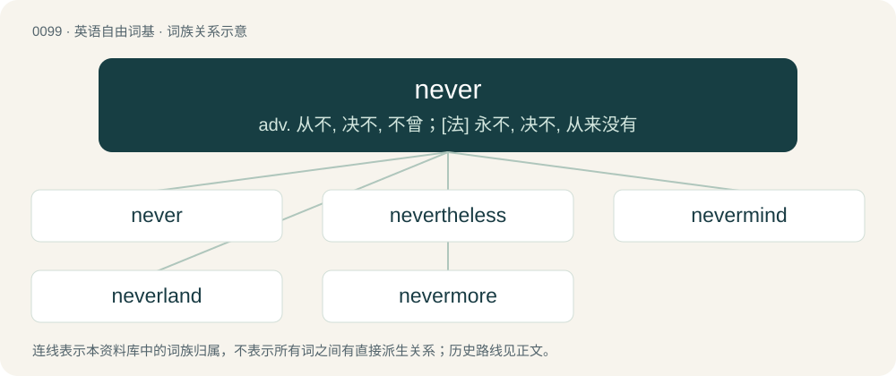

# 0103 · never — adv. 从不, 决不, 不曾；\[法\] 永不, 决不, 从来没有

[总目录](../00_总目录_按常用程度.md)

**类型**：英语自由词基　｜　**来源语言**：见词源记录

## 核心含义与来源

- 核心含义：adv. 从不, 决不, 不曾；\[法\] 永不, 决不, 从来没有
- 英文含义：At no time; on no occasion; in no circumstance.
- 词形：never

**来源记录 1**（副词；At no time; on no occasion; in no circumstance.）

From Middle English nevere, navere, nævere, from Old English nǣfre (“never”), equivalent to ne + ever.

## 词族图

## 单词速览（常用到不常用）

| 单词 | 音标 | 释义 |
|---|---|---|
| [never](#w-1) | 英 /ˈnɛv.ə/；美 /ˈnɛv.ɚ/ | adv. 从不, 决不, 不曾；\[法\] 永不, 决不, 从来没有 |
| [nevertheless](#w-2) | 英 /ˌnɛvəðəˈlɛs/；美 /ˌnɛvɚðəˈlɛs/ | adv. 然而, 虽然如此；conj. 然而 |
| [nevermind](#w-3) | /ˈnevəˈmaind/ | 注意, 留意, 理会 |
| [neverland](#w-4) | /ˈnevəlænd/ | n. 梦幻岛；永无乡（等于never-never land, 童话故事里彼得·潘生活的地方） |
| [nevermore](#w-5) | /.nevəˈmɒː/ | adv. 决不再 |

## 逐词详解

### 1. never

**词性**：副词　｜　**音标**：英 /ˈnɛv.ə/；美 /ˈnɛv.ɚ/

**中文释义**：adv. 从不, 决不, 不曾；\[法\] 永不, 决不, 从来没有

**英文义项**：At no time; on no occasion; in no circumstance. / Not at any other time; not on any other occasion; not previously.

**构词拆分**：ne + ever

**词源与演化**：

From Middle English nevere, navere, nævere, from Old English nǣfre (“never”), equivalent to ne + ever.

**例句**：

> You said you were going to mow the lawn today. – I never!

该用例对应义项：Negative particle (used to negate verbs in the simple past tense; also used absolutely).

### 2. nevertheless

**词性**：副词　｜　**音标**：英 /ˌnɛvəðəˈlɛs/；美 /ˌnɛvɚðəˈlɛs/

**中文释义**：adv. 然而, 虽然如此；conj. 然而

**英文义项**：In spite of what preceded; yet.

**构词拆分**：By surface analysis, never (“not at all”) + the + less

**词源与演化**：

From Middle English nevertheles, never-þe-les, nevere-þe-lesse. By surface analysis, never (“not at all”) + the + less; compare never the wiser.

**例句**：

> It's just five in the morning, but nevertheless it is light out.

### 3. nevermind

**词性**：名词　｜　**音标**：/ˈnevəˈmaind/

**中文释义**：注意, 留意, 理会

**英文义项**：Attention, heed. / Concern, affair.

**构词拆分**：never + mind

**词源与演化**：

From never + mind (in never mind).

**例句**：

> Where is my wallet? Nevermind! I just found it under the couch.

### 4. neverland

**词性**：名词　｜　**音标**：/ˈnevəlænd/

**中文释义**：n. 梦幻岛；永无乡（等于never-never land, 童话故事里彼得·潘生活的地方）

**英文义项**：An ideal, fantastical, imaginary, or dreamlike place.

**构词拆分**：Never + land

**词源与演化**：

From Never + land. The term was most famously used in J.M. Barrie's Book, Peter Pan, as the name of the fictional island that the Darling children visit with the title character. Compare utopia, which is semantically Ancient Greek οὐ (ou, “not, no”) + τόπος (tópos, “place, region”), suggesting a nonexistent place.

### 5. nevermore

**词性**：副词　｜　**音标**：/.nevəˈmɒː/

**中文释义**：adv. 决不再

**英文义项**：Never again; at no time in the future.

**构词拆分**：never + -more

**词源与演化**：

From Middle English nevermore, from the Old English phrase nǣfre mā. Equivalent to never + -more.

**例句**：

> Quoth the raven, nevermore!

该用例对应义项：at no time hereafter
