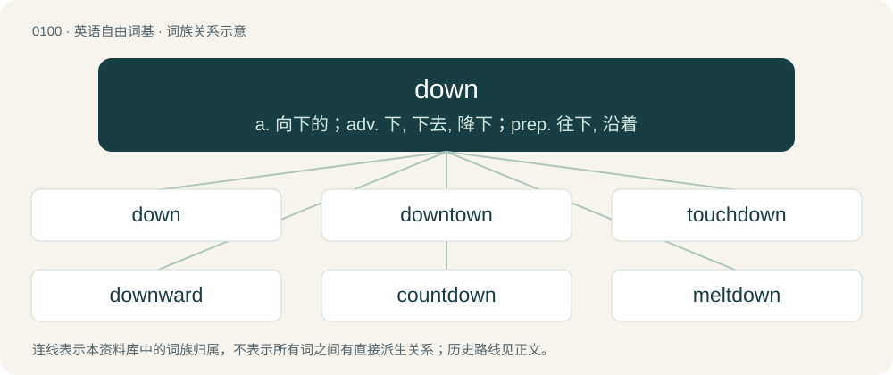

# 0104 · down — a. 向下的；adv. 下, 下去, 降下；prep. 往下, 沿着

[总目录](../00_总目录_按常用程度.md)

**类型**：英语自由词基　｜　**来源语言**：见词源记录

## 核心含义与来源

- 核心含义：a. 向下的；adv. 下, 下去, 降下；prep. 往下, 沿着
- 英文含义：From a higher position to a lower one; downwards.
- 词形：down

**多个词源／构词路径**：同一拼写可能有不同来源；以下按词性和含义分别列出。

**来源记录 1**（副词；From a higher position to a lower one; downwards.）

From Middle English doun, doune (“down”), from Old English dūne (“down”), aphetic form of adūne (“down, downward”), from earlier ofdūne (“down”, literally “off the hill”), from of (“of, off of”) + dūn (“hill, mount, dune, down”). More at Etymology 2 below. For the development from directional phrases to prepositions, compare Old Frisian dene (“down”, adverb, literally “(to the) floor”), Middle Low German dāle (“down, downwards”, literally “(in/to the) dale/valley”), whence German Low German dal (“down”). Compare also Saterland Frisian deel (“down”, literally “to/into the dale”), West Frisian del (“down”). Cognate with Scots doon (“down”).

**来源记录 2**（名词；A hill; in England, especially a chalk hill.）

From Middle English doune, from Old English dūn, from Proto-West Germanic \*dūn (“sandhill, dune”), of uncertain origin. Perhaps from Proto-Germanic \*dūnaz, \*dūnǭ (“pile, heap”), from Proto-Indo-European \*dʰewh₂- (“smoke, haze, dust”). Alternatively, perhaps borrowed from Proto-Celtic \*dūnom (“hill; hillfort”) (compare Welsh din (“city, fort, stronghold”), Irish dún (“hill, fort”)), from Proto-Indo-European \*dʰewh₂- (“to finish, come full circle”). Cognate with West Frisian dún (“dune, sandhill”), Dutch duin (“dune, sandhill”), German Düne (“dune”). More at town; akin to dune. Doublet of Down.

**来源记录 3**（名词；Soft, fluffy immature feathers which grow on young birds. Used as insulating material in duvets, sleeping bags and jackets.）

From Middle English doun, from Old Norse dúnn, from Proto-Germanic \*dūnaz (“down”), which is related to \*dauniz (“(pleasant) smell”), from Proto-Indo-European \*dʰowh₂-nis, from the root \*dʰewh₂-. Cognate with Saterland Frisian Duune (“fluff, down”), German Daune (“down”) and Danish dun (“down”).

## 词族图

## 单词速览（常用到不常用）

| 单词 | 音标 | 释义 |
|---|---|---|
| [down](#w-1) | 英 /ˈdaʊ̯n/；/ˈdæʊ̯n/ | a. 向下的；adv. 下, 下去, 降下；prep. 往下, 沿着 |
| [downtown](#w-2) | 英 /ˈdaʊ̯nˌtaʊ̯n/；/ˈdæʊ̯nˌtæʊ̯n/ | n. 市中心区；a. 市中心的；adv. 往闹市区 |
| [touchdown](#w-3) | /ˈtʌt͡ʃ.daʊn/ | n. 触地, 触地得分, 着地 |
| [downward](#w-4) | 英 /ˈdaʊnwəd/；美 /ˈdaʊnwɚd/ | a. 向下的 |
| [countdown](#w-5) | /ˈkaʊntˌdaʊn/ | n. 倒计数；\[电\] 指示串联中的操作数固定的记录减少 |
| [meltdown](#w-6) | 英 /ˈmɛltdaʊn/；美 /ˈmɛltˌdaʊn/ | \[经\] 销毁(货币等), 变卖(财产) |
| [downside](#w-7) | /ˈdaʊnˌsaɪd/ | n. 底侧；下降趋势 |
| [showdown](#w-8) | 美 /ˈʃoʊˌdaʊn/ | n. 摊牌, 暴露, 紧要关头 |
| [smackdown](#w-9) | 英 /ˈsmækdaʊn/；美 /ˈsmækˌdaʊn/ | 【英文】A physical or emotional confrontation; a battle, a fight; also, a bitter rivalry. |
| [downtime](#w-10) | 英 /ˈdaʊntaɪm/；美 /ˈdaʊnˌtaɪm/ | n. 停工期；\[计\] 故障停机时间 |
| [downwards](#w-11) | 英 /ˈdaʊnwədz/；美 /ˈdaʊnwɚdz/ | adv. 向下 |
| [downer](#w-12) | 英 /ˈdaʊnə/；美 /ˈdaʊnɚ/ | n. 镇定剂, 令人沮丧的人 |
| [sundown](#w-13) | /ˈsʌnˌdaʊn/ | n. 日落, 阔边女帽 |
| [knockdown](#w-14) | /ˈnɒkdaun/ | a. 击倒的, 可拆卸的, 廉价的；n. 压倒, 可拆卸家具 |
| [lowdown](#w-15) | /ˈləjdajn/ | n. 内幕, 真相 |
| [downy](#w-16) | /ˈdaʊni/ | a. 绒毛的, 柔和的, 有草丘陵地的 |
| [downbeat](#w-17) | /ˈdaʊnbiːt/ | n. 强拍, 下降, 低沉, 衰退；a. 悲观的, 低沉的 |
| [downforce](#w-18) |  | 【英文】Any force (produced by aerodynamics or gravity etc) that acts downwards |
| [downstate](#w-19) | /ˈdaunˈsteit/ | n. 在州里的南部；a. 在州的南部的；adv. 在州的南部 |
| [hoedown](#w-20) | 美 /ˈhoʊdaʊn/ | n. 方形舞, 方形舞舞会 |
| [downtempo](#w-21) |  | 【英文】A genre of house music and ambient music with an ethereal sound and a driving beat. |
| [downrange](#w-22) | /ˈdajnˈreindʒ/ | a. 发射中心和沿着试验航向的；adv. 发射中心和沿着试验航向地 |

## 逐词详解

### 1. down

**词性**：形容词　｜　**音标**：英 /ˈdaʊ̯n/；/ˈdæʊ̯n/

**中文释义**：a. 向下的；adv. 下, 下去, 降下；prep. 往下, 沿着

**英文义项**：Facing downwards. / At a lower level than before.

**词源与演化**：

From Middle English doun, doune (“down”), from Old English dūne (“down”), aphetic form of adūne (“down, downward”), from earlier ofdūne (“down”, literally “off the hill”), from of (“of, off of”) + dūn (“hill, mount, dune, down”). More at Etymology 2 below. For the development from directional phrases to prepositions, compare Old Frisian dene (“down”, adverb, literally “(to the) floor”), Middle Low German dāle (“down, downwards”, literally “(in/to the) dale/valley”), whence German Low German dal (“down”). Compare also Saterland Frisian deel (“down”, literally “to/into the dale”), West Frisian del (“down”). Cognate with Scots doon (“down”).

**例句**：

> She's been down on clams since a bad case of food poisoning; she's lost her appetite for them.

该用例对应义项：Negative about; hostile to.

### 2. downtown

**词性**：形容词　｜　**音标**：英 /ˈdaʊ̯nˌtaʊ̯n/；/ˈdæʊ̯nˌtæʊ̯n/

**中文释义**：n. 市中心区；a. 市中心的；adv. 往闹市区

**英文义项**：Of, relating to, or situated in the central business district.

**构词拆分**：down + town

**词源与演化**：

From down + town.

**例句**：

> John walked every day to his downtown job.

该用例对应义项：Of, relating to, or situated in the central business district.

### 3. touchdown

**词性**：名词　｜　**音标**：/ˈtʌt͡ʃ.daʊn/

**中文释义**：n. 触地, 触地得分, 着地

**英文义项**：A six-point score occurring when the ball enters possession of a team's player in the opponent's end zone. / A defensive action of grounding the ball in the team's own in-goal to stop the play.

**构词拆分**：From touch + down.

**词源与演化**：

From touch + down.

**例句**：

> The passengers audibly relaxed at touchdown.

该用例对应义项：The moment when an aircraft or spacecraft makes first or final contact with the ground during a landing.

### 4. downward

**词性**：形容词　｜　**音标**：英 /ˈdaʊnwəd/；美 /ˈdaʊnwɚd/

**中文释义**：a. 向下的

**英文义项**：Moving, sloping or oriented down. / Located at a lower level.

**构词拆分**：down + -ward

**词源与演化**：

From down + -ward.

**例句**：

> He spoke with a downward glance.

该用例对应义项：Moving, sloping or oriented down.

### 5. countdown

**词性**：名词　｜　**音标**：/ˈkaʊntˌdaʊn/

**中文释义**：n. 倒计数；\[电\] 指示串联中的操作数固定的记录减少

**英文义项**：A count backward in fixed units to the time of some event, especially the launch of a space vehicle. / The acts of preparation carried out during this period.

**构词拆分**：count + down

**词源与演化**：

From count + down.

**例句**：

> Sami and Layla celebrated the New Year's countdown at a bar.

### 6. meltdown

**词性**：名词　｜　**音标**：英 /ˈmɛltdaʊn/；美 /ˈmɛltˌdaʊn/

**中文释义**：\[经\] 销毁(货币等), 变卖(财产)

**英文义项**：An act or process of melting. / Severe uncontrolled overheating and melting of the fuel in the core of a nuclear reactor, with the potential for radiation to escape; (countable) an instance of this.

**构词拆分**：melt (verb) + down (adverb)

**词源与演化**：

From melt (verb) + down (adverb), a deverbal from melt down (verb).

**例句**：

> There is little likelihood of a meltdown comparable to the American banking collapse in March 1933.

该用例对应义项：a disaster comparable to a nuclear meltdown

### 7. downside

**词性**：名词　｜　**音标**：/ˈdaʊnˌsaɪd/

**中文释义**：n. 底侧；下降趋势

**英文义项**：A disadvantageous aspect of something that is normally advantageous. / A downward tendency, especially in the price of shares etc.

**构词拆分**：down + side

**词源与演化**：

Compound of down + side.

**例句**：

> The downside of obtaining a higher rank is that far more work is expected.

该用例对应义项：A disadvantageous aspect of something that is normally advantageous.

### 8. showdown

**词性**：名词　｜　**音标**：美 /ˈʃoʊˌdaʊn/

**中文释义**：n. 摊牌, 暴露, 紧要关头

**英文义项**：The final battle between two opponents, in which there can be only one victor. / The final round in a poker match, where all of the remaining players' cards have to be put down on the table and shown.

**构词拆分**：show + down

**词源与演化**：

From show + down.

**例句**：

> This could be the showdown of the century.

### 9. smackdown

**词性**：名词　｜　**音标**：英 /ˈsmækdaʊn/；美 /ˈsmækˌdaʊn/

**英文义项**：A physical or emotional confrontation; a battle, a fight; also, a bitter rivalry. / A significant or humiliating setback or defeat; a beating, a thrashing.

**构词拆分**：smack (“sharp blow, slap”, noun) + down

**词源与演化**：

Deverbal from smack down (“to defeat utterly and decisively, especially in a humiliating way”), from smack (“sharp blow, slap”, noun) + down. Influenced by earlier throwdown. Popularized by: \* the United States professional wrestling television programme WWF SmackDown! (first broadcast on April 29, 1999), now called WWE SmackDown and produced by World Wrestling Entertainment; and \* the phrase lay (or put) the smack down (“to start a fight”).

### 10. downtime

**词性**：名词　｜　**音标**：英 /ˈdaʊntaɪm/；美 /ˈdaʊnˌtaɪm/

**中文释义**：n. 停工期；\[计\] 故障停机时间

**英文义项**：Time lost due to the failure of some system or machinery, such as a computer crash or power outage. / A period of time when work or other activity is less intense or stops.

**构词拆分**：down (“out of order; out of service; inoperable”) + time

**词源与演化**：

From down (“out of order; out of service; inoperable”) + time.

**例句**：

> I’ve been working all weekend. I need some downtime.

该用例对应义项：A period of time set aside for relaxation and rest; leisure time, free time.

### 11. downwards

**词性**：副词　｜　**音标**：英 /ˈdaʊnwədz/；美 /ˈdaʊnwɚdz/

**中文释义**：adv. 向下

**英文义项**：Towards a lower place; towards what is below. / Towards something which is lower in order, smaller, inferior, etc.

**构词拆分**：From down + -wards.

**词源与演化**：

From down + -wards.

**例句**：

> After the rise in oil prices, the economy headed downwards.

该用例对应义项：Towards something which is lower in order, smaller, inferior, etc.

### 12. downer

**词性**：名词　｜　**音标**：英 /ˈdaʊnə/；美 /ˈdaʊnɚ/

**中文释义**：n. 镇定剂, 令人沮丧的人

**英文义项**：A negative drug trip. / Any drug that has depressant qualities.

**构词拆分**：down + -er

**词源与演化**：

From down + -er.

**例句**：

> Normally those pills give me a boost, but last night they gave me a downer.

该用例对应义项：A negative drug trip.

### 13. sundown

**词性**：名词　｜　**音标**：/ˈsʌnˌdaʊn/

**中文释义**：n. 日落, 阔边女帽

**英文义项**：Sunset. / A hat with a wide brim to shade the eyes from sunlight.

**构词拆分**：sun + down

**词源与演化**：

From sun + down.

**例句**：

> We’ll meet by the pier at sundown.

该用例对应义项：Sunset.

### 14. knockdown

**词性**：名词　｜　**音标**：/ˈnɒkdaun/

**中文释义**：a. 击倒的, 可拆卸的, 廉价的；n. 压倒, 可拆卸家具

**英文义项**：An act of knocking down or the condition of being knocked down. / An overwhelming blow.

**构词拆分**：knock + down

**词源与演化**：

From knock + down.

### 15. lowdown

**词性**：名词　｜　**音标**：/ˈləjdajn/

**中文释义**：n. 内幕, 真相

**英文义项**：inside information, the story or truth. / A lowlife, a despicable person.

**构词拆分**：low + down

**词源与演化**：

Compound adjective of low + down in the sense of "humble" recorded in the 1540s, in the sense of "vulgar, far down the social scale" in 1888. Recorded as a noun in 1915 in the slang sense of secret or inside information.

**例句**：

> All the reporters hoped to be the first to get the lowdown on the celebrity's marriage plans.

该用例对应义项：inside information, the story or truth.

### 16. downy

**词性**：形容词　｜　**音标**：/ˈdaʊni/

**中文释义**：a. 绒毛的, 柔和的, 有草丘陵地的

**英文义项**：Having down, covered with a soft fuzzy coating as of small feathers or hair. / Sharp-witted, perceptive.

**构词拆分**：down + -y

**词源与演化**：

From down + -y.

**例句**：

> The chick's downy coat of feathers formed almost immediately to keep it warm.

该用例对应义项：Having down, covered with a soft fuzzy coating as of small feathers or hair.

### 17. downbeat

**词性**：名词　｜　**音标**：/ˈdaʊnbiːt/

**中文释义**：n. 强拍, 下降, 低沉, 衰退；a. 悲观的, 低沉的

**英文义项**：The accented beat at the beginning of a bar (indicated by a conductor with a downward stroke).

**构词拆分**：down + beat

**词源与演化**：

From down + beat.

**例句**：

> Everyone was exhausted, so the party was a somewhat downbeat affair.

### 18. downforce

**词性**：名词

**英文义项**：Any force (produced by aerodynamics or gravity etc) that acts downwards

**构词拆分**：down + force

**词源与演化**：

From down + force.

**例句**：

> The car's aerodynamics produce a huge amount of downforce.

### 19. downstate

**词性**：名词　｜　**音标**：/ˈdaunˈsteit/

**中文释义**：n. 在州里的南部；a. 在州的南部的；adv. 在州的南部

**英文义项**：The southern region of certain US states, particularly Michigan, New York, and Illinois. / A period during sleep when somebody is not primed and not ready to learn.

**构词拆分**：down + state

**词源与演化**：

From down + state.

**例句**：

> The final election returns from downstate may not be available until late Wednesday morning.

该用例对应义项：The southern region of certain US states, particularly Michigan, New York, and Illinois.

### 20. hoedown

**词性**：名词　｜　**音标**：美 /ˈhoʊdaʊn/

**中文释义**：n. 方形舞, 方形舞舞会

**英文义项**：A type of American folk or square dance. / The type of music typically played for such a dance

**构词拆分**：hoe + down

**词源与演化**：

1835–45, Americanism; hoe + down, a social gathering taking place once work is over, i.e., when tillers and farm workers put their hoes down.

### 21. downtempo

**词性**：名词

**英文义项**：A genre of house music and ambient music with an ethereal sound and a driving beat.

**构词拆分**：down + tempo

**词源与演化**：

From down + tempo.

### 22. downrange

**词性**：形容词　｜　**音标**：/ˈdajnˈreindʒ/

**中文释义**：a. 发射中心和沿着试验航向的；adv. 发射中心和沿着试验航向地

**英文义项**：In the horizontal direction away from the launch site of a rocket or projectile in the direction of its travel.

**构词拆分**：down + range

**词源与演化**：

From down + range.
