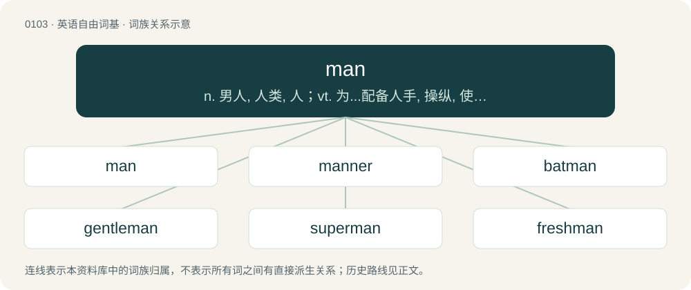

# 0107 · man — n. 男人, 人类, 人；vt. 为...配备人手, 操纵, 使振奋；\[计\] 城域网, 手册

[总目录](../00_总目录_按常用程度.md)

**类型**：英语自由词基　｜　**来源语言**：见词源记录

## 核心含义与来源

- 核心含义：n. 男人, 人类, 人；vt. 为...配备人手, 操纵, 使振奋；\[计\] 城域网, 手册
- 英文含义：An adult male human.
- 词形：man

**多个词源／构词路径**：同一拼写可能有不同来源；以下按词性和含义分别列出。

**来源记录 1**（名词；An adult male human.）

From Middle English man, from Old English mann m (“human being, person, man”), from Proto-West Germanic \*mann, from Proto-Germanic \*mann- (“man”), from Proto-Indo-European \*mon- (“human being, man”). Doublet of mann and Manu. Cognates This word has many cognates, in every Germanic language (whether extant or extinct), with similarities in form and meaning. Virtually all the words below mean “man” and “husband”, with some specific cases noted. In Ingvaeonic (the languages closest to English): :\* Low German Mann :\* North Frisian maan, man, moon, muon :\* Saterland Frisian Mon :\* Scots man :\* West Frisian man :\* Yola man In the remainder of West Germanic: :\* Alemannic German ma, Maa, Mann, mo, mà, Mànn :\* Bavarian Mo, mon, moon, Må, mònn :\* Cimbrian man, mann, månn :\* Dutch, Limburgish, and Zealandic man :\* German and Luxembourgish Mann :\* Mòcheno mònn :\* Vilamovian maon, mon, mōn :\* Yiddish מאַן (man) In East Germanic: :\* Gothic 𐌼𐌰𐌽𐌽𐌰 (manna), which meant “man”, “human“ and “person”, but likely also “husband” In North Germanic: :\* Danish mand :\* Faroese and Icelandic maður, both additionally meaning “human” and “person”, as in Old Norse :\* Gutnish and Swedish man :\* Norn, Norwegian Bokmål, and Norwegian Nynorsk mann :\* Norwegian Nynorsk mainnj :\* Old Norse maðr Outside Germanic: : Indo-Iranian: ::\* Avestan 𐬨𐬀𐬥𐬎𐬱 (manuš, “human”) ::\* Sanskrit मनुस् (manus, “human”), मनु (manu, “human; humanity; thought”; “thinking; wise; intelligent”) ::\* Also Sanskrit म॒नु॒ष्य॑ (manuṣyà, “human; man; huband”, whence English manusya) : Slavic (all of these mean “man” and “husband”, though in some cases the former is no longer part of the modern standard): ::\* Belarusian, Russian, and Ukrainian муж (muž) ::\* Bulgarian мъж (măž) ::\* Czech and Slovak muž ::\* Macedonian маж (maž) ::\* Polish mąż (“husband”; the meaning “man” is obsolete, akin to English wife) ::\* Serbo-Croatian му̑ж, mȗž ::\* Slovene mož

**来源记录 2**（动词；To supply (something) with staff or crew (of either sex).）

From Middle English mannen, from Old English mannian, ġemannian (“to man, supply with men, populate, garrison”), from mann (“human being, man”). Cognates \* Dutch bemannen (“to man”) \* German bemannen (“to man”) \* Danish bemande (“to man”) \* Swedish bemanna (“to man”) \* Icelandic manna (“to supply with men, to man”)

## 词族图

## 单词速览（常用到不常用）

| 单词 | 音标 | 释义 |
|---|---|---|
| [man](#w-1) | 英 /ˈmæn/ | n. 男人, 人类, 人；vt. 为...配备人手, 操纵, 使振奋；\[计\] 城域网, 手册 |
| [manner](#w-2) | 英 /ˈmænə/；美 /ˈmænɚ/ | 【英文】Something involving or requiring the specified number of men or people. |
| [batman](#w-3) | 英 /ˈbæt.mən/ | n. 勤务兵 |
| [gentleman](#w-4) | /ˈd͡ʒɛn.təl.mən/ | n. 绅士, 先生 |
| [superman](#w-5) | 英 /ˈs(j)uːpəmæn/；美 /ˈsupɚmæn/ | n. 具有超人能力的人, 超人 |
| [freshman](#w-6) | /ˈfɹɛʃ.mən/ | n. 新手, 生手, 大学一年级学生, (美)中学一年级学生 |
| [mankind](#w-7) | /mænˈkaɪnd/ | n. 人类, 男性 |
| [spokesman](#w-8) | /ˈspəuksmən/ | n. 发言人, 代言者 |
| [mans](#w-9) | /mænz/ | abbr. 自然科学学会会员（Member of the Academy of Sciences） |
| [manly](#w-10) | /ˈmænli/ | a. 象男人的, 强壮的, 适于男人的 |
| [foreman](#w-11) | /ˈfɔː(ɹ).mən/ | n. 领班, 工头, 陪审长；\[经\] 领班, 工头 |
| [manpower](#w-12) | /ˈmænpauə/ | n. 人力；\[经\] 人力 |
| [manslaughter](#w-13) | 英 /ˈmænˌslɔːtə/；美 /ˈmænˌslɔtɚ/ | n. 杀人, 过失杀人罪 |
| [spiderman](#w-14) | /ˈspaidəmæn/ | n. &lt;主英&gt;高空作业的建筑工人 |
| [baseman](#w-15) | /ˈbeismən/ | n. 守垒员 |
| [ironman](#w-16) | /ˈaɪənmæn/ | 钢铁人；钢铁侠 |
| [manhood](#w-17) | /ˈmænhʊd/ | n. 成年, 勇气, 男儿；\[法\] 成年身分, 成年, 男子 |
| [horseman](#w-18) | 英 /ˈhɔːsmən/；美 /ˈhɔɹsmən/ | n. 骑马者, 马术师, 养马者 |
| [portman](#w-19) |  | n. 波特曼（姓氏） |
| [manhunt](#w-20) | 美 /ˈmænˌhʌnt/ | n. 搜捕；\[法\] 搜索逃犯 |
| [nobleman](#w-21) | 英 /ˈnəʊbl̩mən/；美 /ˈnoʊbl̩mən/ | n. 贵族 |
| [freedman](#w-22) | /ˈfriːdmæn/ | n. 自由民, 被解放的奴隶 |
| [layman](#w-23) | /ˈleɪmən/ | n. 俗人, 门外汉, 凡人；\[医\] 外行, 业外人 |
| [caveman](#w-24) | 美 /ˈkeɪvˌmæn/ | n. 穴居人 |
| [mailman](#w-25) | 美 /ˈmeɪl.mæn/；/ˈmeɪl.mɛən/ | n. 邮递员 |
| [marksman](#w-26) | 美 /ˈmɑɹksmən/ | n. 射手, 狙击兵, 神射手；\[法\] 按手印者, 不能用笔署名者 |
| [middleman](#w-27) | /ˈmidlmæn/ | n. 中间人；\[法\] 调解人, 中间人, 中人 |
| [swordsman](#w-28) | 英 /ˈsɔːdsmən/；美 /ˈsɔɹdsmən/ | n. 剑术家, 剑客, 武士 |
| [hillman](#w-29) | 英 /ˈhɪlmən/ | n. 住在山区的人 |
| [manhole](#w-30) | 英 /ˈmænhəʊl/ | n. 人孔；\[化\] 人孔; 进人孔 |
| [hardman](#w-31) |  | 【英文】A man who is particularly tough or muscular |
| [anchorman](#w-32) | /ˈæŋkəmæn/ | n. 末棒运动员, 成绩倒数第一名, 新闻节目主持人 |
| [hellman](#w-33) |  | 赫尔曼（姓氏） |
| [helmsman](#w-34) | /ˈhɛlmz.mən/ | n. 舵手 |
| [footman](#w-35) | /ˈfutmən/ | n. 马夫, 仆役 |
| [wolfman](#w-36) | /ˈwʊlfmæn/ | n. 有着狼的意志的人 |
| [deadman](#w-37) | /ˈdedmæn/ | n. 木桩或水泥桩, 临时支撑物 |
| [churchman](#w-38) | 英 /ˈt͡ʃɜːt͡ʃmən/ | n. 牧师 |
| [merman](#w-39) | /ˈməːmæn/ | n. 男性人鱼, 善泳的男子 |
| [kingsman](#w-40) |  | 【英文】The lowest enlisted rank in the Duke of Lancaster's Regiment of the British Army, equivalent to private in the rest of the British Army. |
| [peterman](#w-41) | /ˈpiːtəmæn/ | 渔夫 |
| [infantryman](#w-42) | /ˈinfəntrimən/ | n. 步兵 |
| [bellman](#w-43) | /ˈbelmən/ | n. 敲钟者, 男听差, 更夫 |
| [pressman](#w-44) | /ˈpresmən/ | n. 印刷工, 新闻记者 |
| [manhunter](#w-45) |  | \[法\] 搜索逃犯者 |
| [leman](#w-46) | /ˈlɛmən/ | 【英文】A paramour. |
| [taxman](#w-47) | 英 /ˈtæksmæn/ | 收税员,税收检查员 |
| [manservant](#w-48) | /ˈmænˌsɜː(ɹ)vənt/ | n. 仆役, 男仆 |
| [megaman](#w-49) |  | 【英文】A very large or powerful man. |
| [plowman](#w-50) | 英 /ˈplaʊ.mən/ | n. 农夫 |
| [bookman](#w-51) | /ˈbukmən/ | n. 学者, 文人, 书商 |
| [swingman](#w-52) | /sˈwɪŋmæn/ | 代班人 |
| [leatherman](#w-53) |  | \[人名\] 莱瑟曼 |
| [backman](#w-54) |  | n. 辅助工；后方；n. (Backman)人名；(英、瑞典)巴克曼 |
| [bossman](#w-55) | 英 /ˈbɒsmæn/；美 /ˈbɔsmæn/ | n. \[美国口语\]；老板 |
| [badman](#w-56) | /ˈbædmæn/ | n. 偷牲口贼, 不法之徒 |
| [cavalryman](#w-57) | 美 /ˈkævəlɹi.mən/ | n. 骑兵 |
| [landsman](#w-58) | /ˈlændzmən/ | n. 同胞, 未出过海的人 |
| [youngman](#w-59) |  | \[人名\] \[英格兰人姓氏\] 扬曼 Yeoman的变体 |
| [overman](#w-60) | /ˈəuvəmən/ | n. 工头, 师傅, 仲裁人；vt. 人员配置过多 |
| [reman](#w-61) | /ɹiːˈmæn/ | vt. 重新配备人员, 重新获得勇气 |
| [frontiersman](#w-62) | /ˈfrʌn,tiəzmən/ | n. 边疆居民 |
| [cattleman](#w-63) | /ˈkætlmən/ | n. 牧牛人, 养牛人 |
| [manhandle](#w-64) | /ˈmænˌhæn.dəl/ | vt. 人工推动, 粗暴地对付 |

## 逐词详解

### 1. man

**词性**：名词　｜　**音标**：英 /ˈmæn/

**中文释义**：n. 男人, 人类, 人；vt. 为...配备人手, 操纵, 使振奋；\[计\] 城域网, 手册

**英文义项**：An adult male human. / All human males collectively: mankind.

**词源与演化**：

From Middle English man, from Old English mann m (“human being, person, man”), from Proto-West Germanic \*mann, from Proto-Germanic \*mann- (“man”), from Proto-Indo-European \*mon- (“human being, man”). Doublet of mann and Manu. Cognates This word has many cognates, in every Germanic language (whether extant or extinct), with similarities in form and meaning. Virtually all the words below mean “man” and “husband”, with some specific cases noted. In Ingvaeonic (the languages closest to English): :\* Low German Mann :\* North Frisian maan, man, moon, muon :\* Saterland Frisian Mon :\* Scots man :\* West Frisian man :\* Yola man In the remainder of West Germanic: :\* Alemannic German ma, Maa, Mann, mo, mà, Mànn :\* Bavarian Mo, mon, moon, Må, mònn :\* Cimbrian man, mann, månn :\* Dutch, Limburgish, and Zealandic man :\* German and Luxembourgish Mann :\* Mòcheno mònn :\* Vilamovian maon, mon, mōn :\* Yiddish מאַן (man) In East Germanic: :\* Gothic 𐌼𐌰𐌽𐌽𐌰 (manna), which meant “man”, “human“ and “person”, but likely also “husband” In North Germanic: :\* Danish mand :\* Faroese and Icelandic maður, both additionally meaning “human” and “person”, as in Old Norse :\* Gutnish and Swedish man :\* Norn, Norwegian Bokmål, and Norwegian Nynorsk mann :\* Norwegian Nynorsk mainnj :\* Old Norse maðr Outside Germanic: : Indo-Iranian: ::\* Avestan 𐬨𐬀𐬥𐬎𐬱 (manuš, “human”) ::\* Sanskrit मनुस् (manus, “human”), मनु (manu, “human; humanity; thought”; “thinking; wise; intelligent”) ::\* Also Sanskrit म॒नु॒ष्य॑ (manuṣyà, “human; man; huband”, whence English manusya) : Slavic (all of these mean “man” and “husband”, though in some cases the former is no longer part of the modern standard): ::\* Belarusian, Russian, and Ukrainian муж (muž) ::\* Bulgarian мъж (măž) ::\* Czech and Slovak muž ::\* Macedonian маж (maž) ::\* Polish mąż (“husband”; the meaning “man” is obsolete, akin to English wife) ::\* Serbo-Croatian му̑ж, mȗž ::\* Slovene mož

**例句**：

> I wanted to be a guitar man on a road tour, but instead I’m a flag man on a road crew.

该用例对应义项：A person, usually male, who has duties or skills associated with a specified thing.

### 2. manner

**词性**：名词　｜　**音标**：英 /ˈmænə/；美 /ˈmænɚ/

**英文义项**：Something involving or requiring the specified number of men or people.

**构词拆分**：man + -er

**词源与演化**：

From man + -er.

### 3. batman

**词性**：名词　｜　**音标**：英 /ˈbæt.mən/

**中文释义**：n. 勤务兵

**英文义项**：A servant or valet to a military officer. / A personal assistant or supporter.

**构词拆分**：bat (“packsaddle”) + man

**词源与演化**：

From bat (“packsaddle”) + man. The element bat is from French bât, from Old French bast, from Late Latin bastum, possibly from Ancient Greek βαστάζω (bastázō, “to bear, carry, lift”).

**例句**：

> The thing you have to know about Batman is, he's a superhero.

### 4. gentleman

**词性**：名词　｜　**音标**：/ˈd͡ʒɛn.təl.mən/

**中文释义**：n. 绅士, 先生

**英文义项**：Any well-bred, well-mannered, or charming man. / Any man.

**构词拆分**：gentle + man

**词源与演化**：

From Middle English gentilman, morphologically gentle + man, partial calque of Old French gentilhome.

**例句**：

> Please escort this gentleman to the gentlemen's room.

该用例对应义项：Any man.

### 5. superman

**词性**：名词　｜　**音标**：英 /ˈs(j)uːpəmæn/；美 /ˈsupɚmæn/

**中文释义**：n. 具有超人能力的人, 超人

**英文义项**：An imagined superior type of human being representing a new stage of human development; an übermensch; (loosely), a man of extraordinary powers. / Someone likened to the comics character Superman; a man of seemingly superhuman powers.

**构词拆分**：super- + man

**词源与演化**：

A calque of German Übermensch; super- + man. The German word was introduced by the philosopher Friedrich Nietzsche (1844–1900) in his work Also sprach Zarathustra (Thus Spoke Zarathustra, 1883), and rendered in English as superman by Irish playwright George Bernard Shaw (1856–1950) in the play Man and Superman (1903) and by Thomas Common (1850–1919) in his 1909 translation of Nietzsche’s work. The “person of extraordinary powers” sense was reinforced by the DC Comics’ character Superman, who first appeared in Action Comics #1 dated June 1938.

**例句**：

> Nietzsche wrote of the coming of the superman.

该用例对应义项：An imagined superior type of human being representing a new stage of human development; an übermensch; (loosely), a man of extraordinary powers.

### 6. freshman

**词性**：名词　｜　**音标**：/ˈfɹɛʃ.mən/

**中文释义**：n. 新手, 生手, 大学一年级学生, (美)中学一年级学生

**英文义项**：a person (of either sex) entering the first year of an institution, especially a high school (ninth grade for US, grade 9 for Canada, grade 7 for Philippines), a university, or legislative body

**构词拆分**：fresh + man

**词源与演化**：

From fresh + man.

**例句**：

> At the time I was a wide-eyed freshman, but I was soon to grow jaded and cynical.

该用例对应义项：a person (of either sex) entering the first year of an institution, especially a high school (ninth grade for US, grade 9 for Canada, grade 7 for Philippines), a university, or legislative body

### 7. mankind

**词性**：名词　｜　**音标**：/mænˈkaɪnd/

**中文释义**：n. 人类, 男性

**英文义项**：The human race in its entirety. / Men collectively, as opposed to all women.

**构词拆分**：man + kin；man + -kind

**词源与演化**：

From Middle English mankynde, alteration (due to kynde = “kind, nature, sort”) of earlier mankyn, from Old English mancynn. Equivalent to man + kin, and/or man + -kind. Cognate with Scots mankind, Middle High German mankünne, Danish mandkøn, Icelandic mannkyn (“mankind”). See also mankin.

**例句**：

> One small step for a man can be a giant leap for mankind.

该用例对应义项：The human race in its entirety.

### 8. spokesman

**词性**：名词　｜　**音标**：/ˈspəuksmən/

**中文释义**：n. 发言人, 代言者

**英文义项**：One who speaks as the voice of another person or a group of people.

**构词拆分**：spoke (“past participle of speak”) + -s- + man

**词源与演化**：

From spoke (“past participle of speak”) + -s- + man.

**例句**：

> Tom wasn't sure why he was considered the spokesman for the group.

### 9. mans

**词性**：名词　｜　**音标**：/mænz/

**中文释义**：abbr. 自然科学学会会员（Member of the Academy of Sciences）

**英文义项**：Synonym of man.

**构词拆分**：man + -s

**词源与演化**：

From man + -s (hypocoristic suffix).

**例句**：

> Whose mans is this?

该用例对应义项：Synonym of man.

### 10. manly

**词性**：形容词　｜　**音标**：/ˈmænli/

**中文释义**：a. 象男人的, 强壮的, 适于男人的

**英文义项**：Having the characteristics of a man. / Having qualities viewed as befitting a man; masculine, manful, courageous, resolute, noble.

**构词拆分**：man + -ly (adjectival suffix)

**词源与演化**：

From Middle English manli, manlich, manly, from Old English \*manlīċ (suggested by adverb manlīċe (“in a way befitting a person; nobly, stately”)), from Proto-West Germanic \*mannlīk, from Proto-Germanic \*mannlīkaz, equivalent to man + -ly (adjectival suffix). Cognate with Old High German manlīh (“manly”) (whence German männlich), Dutch mannelijk, Old Norse mannligr (“human”) (Danish mandlig, Swedish manlig).

**例句**：

> It is not manly to speak ill of others behind their backs.

### 11. foreman

**词性**：名词　｜　**音标**：/ˈfɔː(ɹ).mən/

**中文释义**：n. 领班, 工头, 陪审长；\[经\] 领班, 工头

**英文义项**：The leader of a work crew. / The boss or manager of a particular workplace or section of a workplace, particularly a factory.

**构词拆分**：By surface analysis, fore- + man

**词源与演化**：

From Middle English foremon, forman. Compare West Frisian foarman, Dutch voorman, German Vormann, Danish formand, Swedish förman, Icelandic formaður. By surface analysis, fore- + man.

**用法示例／搭配（非完整句）**：

> factory foreman

该用例对应义项：The boss or manager of a particular workplace or section of a workplace, particularly a factory.

### 12. manpower

**词性**：名词　｜　**音标**：/ˈmænpauə/

**中文释义**：n. 人力；\[经\] 人力

**英文义项**：The total number of all available workers; the workforce. / The power exerted by a single person.

**构词拆分**：man + power

**词源与演化**：

From man + power.

**用法示例／搭配（非完整句）**：

> canals dug entirely by manpower

该用例对应义项：The power exerted by a single person.

### 13. manslaughter

**词性**：名词　｜　**音标**：英 /ˈmænˌslɔːtə/；美 /ˈmænˌslɔtɚ/

**中文释义**：n. 杀人, 过失杀人罪

**英文义项**：The unlawful killing of a human, either in negligence or incidentally to the commission of some unlawful act, but without specific malice, or upon a sudden excitement of anger; considered less culpable than murder, but more culpable than justifiable homicide.

**构词拆分**：man + slaughter

**词源与演化**：

From Middle English manslaȝter, manslauter, equivalent to man + slaughter, or taken as an adaptation of Old English mansliht (“murder; killing of a person”), from mann (“person”) + sliht (“killing”), see manslaught. Cognate with Scots manslauchter (“homicide”). Compare also Old Frisian monslaga (“murder”).

**例句**：

> Sami is not guilty of murder. He's instead guilty of manslaughter.

### 14. spiderman

**词性**：名词　｜　**音标**：/ˈspaidəmæn/

**中文释义**：n. &lt;主英&gt;高空作业的建筑工人

**英文义项**：A steeplejack. / A free climber.

**构词拆分**：spider + man

**词源与演化**：

From spider + man; in reference to Spider-Man, a superhero who can climb walls.

**例句**：

> Sami was wearing a blue Spiderman shirt.

### 15. baseman

**词性**：名词　｜　**音标**：/ˈbeismən/

**中文释义**：n. 守垒员

**英文义项**：A player positioned at or near a base: first baseman, second baseman or third baseman.

**构词拆分**：base + man

**词源与演化**：

From base + man.

**例句**：

> The first baseman is the Achilles heel of our team.

### 16. ironman

**词性**：名词　｜　**音标**：/ˈaɪənmæn/

**中文释义**：钢铁人；钢铁侠

**英文义项**：An extremely tough and strong athlete, especially one who competes in extreme athletic competitions or in a large number of games consecutively. / A form of surf lifesaving competition which combines swimming, board paddling, ski paddling and running.

**构词拆分**：iron + man

**词源与演化**：

From iron + man. First applied to Joe McGinnity, a baseball player who pitched 48 complete games in one season and worked in an iron foundry during the offseason.

**例句**：

> Carlos's birthday party was themed after his favorite superhero, Ironman.

### 17. manhood

**词性**：名词　｜　**音标**：/ˈmænhʊd/

**中文释义**：n. 成年, 勇气, 男儿；\[法\] 成年身分, 成年, 男子

**英文义项**：The state or condition of being a human being. / The state or condition of being a man, as contrasted with being a boy, woman, girl, or nonbinary.

**构词拆分**：man + -hood

**词源与演化**：

From Middle English manhode, also manhede (&gt; obsolete English manhead), equivalent to man + -hood. Cognate with Middle Dutch manheit (“manhood”), Middle Low German manheit (whence German Low German Mannheit (“manhood”)), German Mannheit (“manhood”).

**例句**：

> The failure of William's business seems to have been quite damaging to his manhood.

该用例对应义项：The self-concept of a man being with respect to his possession of the various qualities traditionally and ideally ascribed to manliness; a man's sense or view of himself as being more or less manly.

### 18. horseman

**词性**：名词　｜　**音标**：英 /ˈhɔːsmən/；美 /ˈhɔɹsmən/

**中文释义**：n. 骑马者, 马术师, 养马者

**英文义项**：A man who rides a horse. / A soldier on horseback, especially a cavalryman.

**构词拆分**：horse + man

**词源与演化**：

From Middle English horsman, equivalent to horse + man.

**例句**：

> The horse of the fourth horseman of the Apocalypse was actually green.

### 19. portman

**词性**：名词

**中文释义**：n. 波特曼（姓氏）

**英文义项**：A burgess of a port, especially of one of the Cinque Ports.

**构词拆分**：port + man

**词源与演化**：

From Middle English portman, from Old English portman, portmann (“townsman, burgher, citizen”), equivalent to port + man.

### 20. manhunt

**词性**：名词　｜　**音标**：美 /ˈmænˌhʌnt/

**中文释义**：n. 搜捕；\[法\] 搜索逃犯

**英文义项**：An organized search for a criminal or enemy. / A variant of hide and seek in which a player who is caught by the seeker themselves becomes a seeker, and the final player remaining is declared the winner.

**构词拆分**：man + hunt

**词源与演化**：

From man + hunt.

**例句**：

> After the murderer escaped, there was a full-scale manhunt to catch him.

该用例对应义项：An organized search for a criminal or enemy.

### 21. nobleman

**词性**：名词　｜　**音标**：英 /ˈnəʊbl̩mən/；美 /ˈnoʊbl̩mən/

**中文释义**：n. 贵族

**英文义项**：A peer; an aristocrat; ranks range from baron to king to emperor.

**构词拆分**：noble + man

**词源与演化**：

From noble + man.

**例句**：

> But these jovial sounds fell sadly on the ear of the ruined nobleman.

### 22. freedman

**词性**：名词　｜　**音标**：/ˈfriːdmæn/

**中文释义**：n. 自由民, 被解放的奴隶

**英文义项**：A man who has been released from a condition of slavery.

**构词拆分**：freed + man

**词源与演化**：

From freed + man.

**例句**：

> Delmonico’s, America’s very first restaurant, is also one of its most influential, according to Yale University history professor Paul Freedman.

### 23. layman

**词性**：名词　｜　**音标**：/ˈleɪmən/

**中文释义**：n. 俗人, 门外汉, 凡人；\[医\] 外行, 业外人

**英文义项**：Layperson, someone who is not an ordained cleric or member of the clergy. / Someone who is not a professional in a given field.

**构词拆分**：lay (“non-clergy”) + man

**词源与演化**：

From Middle English layman, lay man, equivalent to lay (“non-clergy”) + man. Cognate with Old Frisian lēkmann, lēkmonn (“layman”), obsolete Dutch leekeman (“layman”), Old High German leihman (“layman”), Danish lægmand (“layman”), Swedish lekman (“layman”), Norwegian lekmann (“layman”), Icelandic leikmaður (“layman”).

**例句**：

> Carmen is not a professional anthropologist, but strictly a layman.

该用例对应义项：Someone who is not a professional in a given field.

### 24. caveman

**词性**：名词　｜　**音标**：美 /ˈkeɪvˌmæn/

**中文释义**：n. 穴居人

**英文义项**：An early human or closely related species, popularly held to reside in caves. / A person with backward, primitive behavior, opinions, or interests.

**构词拆分**：cave + man

**词源与演化**：

From cave + man, based on the supposition that early humans dwelt in caves.

**例句**：

> The political cartoon showed the politician as a caveman, clubbing the budget depicted as a mammoth.

该用例对应义项：An early human or closely related species, popularly held to reside in caves.

### 25. mailman

**词性**：名词　｜　**音标**：美 /ˈmeɪl.mæn/；/ˈmeɪl.mɛən/

**中文释义**：n. 邮递员

**英文义项**：Someone who delivers mail to, and/or collects mail from, residential or commercial addresses, or from public mailboxes.

**构词拆分**：mail + man

**词源与演化**：

From mail + man.

**例句**：

> The second the mailman comes, he rushes out to pick up his mail.

### 26. marksman

**词性**：名词　｜　**音标**：美 /ˈmɑɹksmən/

**中文释义**：n. 射手, 狙击兵, 神射手；\[法\] 按手印者, 不能用笔署名者

**英文义项**：A man or person skilled at hitting targets, as with a firearm, bow, or thrown object. / Goalscorer.

**构词拆分**：mark + -s- + man

**词源与演化**：

From mark + -s- + man.

**例句**：

> At that instant Holmes sprang like a tiger on to the marksman’s back, and hurled him flat upon his face.

### 27. middleman

**词性**：名词　｜　**音标**：/ˈmidlmæn/

**中文释义**：n. 中间人；\[法\] 调解人, 中间人, 中人

**英文义项**：An intermediary, agent between two (or more) parties. / An intermediate dealer between the manufacturer and the retailer or customer.

**构词拆分**：middle + man

**词源与演化**：

From Middle English myddil man, equivalent to middle + man.

**例句**：

> The farmer sold his produce directly to stores without a middleman.

该用例对应义项：An intermediate dealer between the manufacturer and the retailer or customer.

### 28. swordsman

**词性**：名词　｜　**音标**：英 /ˈsɔːdsmən/；美 /ˈsɔɹdsmən/

**中文释义**：n. 剑术家, 剑客, 武士

**英文义项**：A person skilled at using swords in sport or combat; a fencer. / A person who fights with a sword.

**构词拆分**：sword + -s- + man

**词源与演化**：

From sword + -s- + man.

**例句**：

> Archers attempted to take down an unknown swordsman.

该用例对应义项：A person who fights with a sword.

### 29. hillman

**词性**：名词　｜　**音标**：英 /ˈhɪlmən/

**中文释义**：n. 住在山区的人

**英文义项**：A native or inhabitant of hilly or mountainous country; a tribesman who lives in the mountains. / A supernatural being, such as a dwarf, that lives beneath a hill.

**构词拆分**：hill + man

**词源与演化**：

From hill + man.

### 30. manhole

**词性**：名词　｜　**音标**：英 /ˈmænhəʊl/

**中文释义**：n. 人孔；\[化\] 人孔; 进人孔

**英文义项**：A hole in the ground used to access the sewers or other underground vaults and installations. / A hole providing access to the inside of a boiler, tank etc.

**构词拆分**：man + hole

**词源与演化**：

From man + hole.

**例句**：

> Tom was injured by a manhole cover explosion.

### 31. hardman

**词性**：名词

**英文义项**：A man who is particularly tough or muscular / A rugby player

**构词拆分**：hard + man

**词源与演化**：

From hard + man.

**例句**：

> He's just a wannabe hardman.

该用例对应义项：A man who is particularly tough or muscular

### 32. anchorman

**词性**：名词　｜　**音标**：/ˈæŋkəmæn/

**中文释义**：n. 末棒运动员, 成绩倒数第一名, 新闻节目主持人

**英文义项**：The main host of a television or radio program, particularly one relating to the broadcast of news. / The most reliable runner in a relay team, usually the one that runs last.

**构词拆分**：anchor + man

**词源与演化**：

From anchor + man. Senses 1 and 4 derive from sense 2, sense 3 is literal.

**例句**：

> The anchorman had an audience with the king.

### 33. hellman

**词性**：名词

**中文释义**：赫尔曼（姓氏）

**英文义项**：A daredevil. / Evil man; devil.

**构词拆分**：hell + man

**词源与演化**：

From hell + man.

### 34. helmsman

**词性**：名词　｜　**音标**：/ˈhɛlmz.mən/

**中文释义**：n. 舵手

**英文义项**：A member of a ship's crew who is responsible for steering. / A leader.

**构词拆分**：helm + -s- + man

**词源与演化**：

From helm + -s- + man.

**例句**：

> You only get to know a good helmsman in a storm.

### 35. footman

**词性**：名词　｜　**音标**：/ˈfutmən/

**中文释义**：n. 马夫, 仆役

**英文义项**：A man in waiting; a male servant whose duties are to attend the door, the carriage, the table, etc. / A metallic stand with four feet, for keeping anything warm before a fire.

**构词拆分**：foot + man

**词源与演化**：

From Middle English fotman, footman, foteman (“foot soldier, running footman”), from Old English \*fōtman, \*fōtmann (attested only as Old English fēþman, fēþemann (“footman”), equivalent to foot + man.

**例句**：

> The footman announced the arrival of the duchess.

### 36. wolfman

**词性**：名词　｜　**音标**：/ˈwʊlfmæn/

**中文释义**：n. 有着狼的意志的人

**英文义项**：A male werewolf or lycanthrope.

**构词拆分**：wolf + man

**词源与演化**：

From wolf + man.

### 37. deadman

**词性**：名词　｜　**音标**：/ˈdedmæn/

**中文释义**：n. 木桩或水泥桩, 临时支撑物

**英文义项**：A long object, often a timber or log, buried to serve as an anchor for a wall or for stays. / A cutout device that operates in the event that an operator releases the control handles, leaves the operator's seat, or otherwise seems to be no longer present and alert.

**构词拆分**：dead + man

**词源与演化**：

From dead + man. In the sense referring to a safety switch, the notion of an operator who is dead is the figurative archetype representing any incapacitation, absence, or inattention. See also Dead Hand in that regard.

**用法示例／搭配（非完整句）**：

> a deadman device

该用例对应义项：A cutout device that operates in the event that an operator releases the control handles, leaves the operator's seat, or otherwise seems to be no longer present and alert.

### 38. churchman

**词性**：名词　｜　**音标**：英 /ˈt͡ʃɜːt͡ʃmən/

**中文释义**：n. 牧师

**英文义项**：A person (originally a man) of authority in a Christian religious organization (a church). / A member or adherent of an established church, especially the Church of England.

**构词拆分**：church + man

**词源与演化**：

From church + man. Compare kirkman and German Kirchmann.

**例句**：

> The bishop, a highly placed churchman, stated the religion's opinion.

该用例对应义项：A person (originally a man) of authority in a Christian religious organization (a church).

### 39. merman

**词性**：名词　｜　**音标**：/ˈməːmæn/

**中文释义**：n. 男性人鱼, 善泳的男子

**英文义项**：A legendary creature, human male from the waist up, fishlike from the waist down.

**构词拆分**：mer- + man

**词源与演化**：

From Middle English mereman, from Old English \*meremann (“merman”) (suggested by Old English meremenn, meremennen, meremenin (“mermaid, siren”)), equivalent to mer- + man. Cognate with Dutch meerman (“merman”), German Meermann (“merman”).

**例句**：

> The Merman King had been for many years a widower.

### 40. kingsman

**词性**：名词

**英文义项**：The lowest enlisted rank in the Duke of Lancaster's Regiment of the British Army, equivalent to private in the rest of the British Army.

**构词拆分**：king + -s- + man

**词源与演化**：

From king + -s- + man.

### 41. peterman

**词性**：名词　｜　**音标**：/ˈpiːtəmæn/

**中文释义**：渔夫

**英文义项**：A safecracker.

**构词拆分**：peter (“a safe, cash box”) + man

**词源与演化**：

From peter (“a safe, cash box”) + man (the former being 17th-century slang, still in use).

### 42. infantryman

**词性**：名词　｜　**音标**：/ˈinfəntrimən/

**中文释义**：n. 步兵

**英文义项**：a soldier employed in an infantry role / a male soldier of the infantry

**构词拆分**：infantry + man

**词源与演化**：

From infantry + man.

**例句**：

> The infantryman had the rare opportunity to break his head against a tree.

### 43. bellman

**词性**：名词　｜　**音标**：/ˈbelmən/

**中文释义**：n. 敲钟者, 男听差, 更夫

**英文义项**：A town crier. / A bellhop or bellboy.

**构词拆分**：bell + man

**词源与演化**：

From Middle English belleman, equivalent to bell + man.

**例句**：

> Yanni was working hard as a bellman at an Algerian beach resort.

### 44. pressman

**词性**：名词　｜　**音标**：/ˈpresmən/

**中文释义**：n. 印刷工, 新闻记者

**英文义项**：Someone who operates a printing press. / A journalist or newspaper reporter.

**构词拆分**：press + man

**词源与演化**：

From press + man.

**用法示例／搭配（非完整句）**：

> a tailor's pressman

该用例对应义项：One who presses clothes.

### 45. manhunter

**词性**：名词

**中文释义**：\[法\] 搜索逃犯者

**英文义项**：Someone who hunts down a target in a manhunt. / A person who seeks men as sexual partners.

**构词拆分**：man + hunter

**词源与演化**：

From man + hunter.

### 46. leman

**词性**：名词　｜　**音标**：/ˈlɛmən/

**英文义项**：A paramour.

**构词拆分**：lief + man

**词源与演化**：

From Middle English lemman, variant of leofman, from Old English \*lēofmann ("lover; sweetheart"; attested as a personal name), equivalent to lief + man ("beloved person"). In the past, incorrectly asserted to derive from French l'aimant (“the \[male\] lover”).

### 47. taxman

**词性**：名词　｜　**音标**：英 /ˈtæksmæn/

**中文释义**：收税员,税收检查员

**英文义项**：A tax collector. / A tax-collecting organ, personified.

**构词拆分**：tax + man

**词源与演化**：

From tax + man.

### 48. manservant

**词性**：名词　｜　**音标**：/ˈmænˌsɜː(ɹ)vənt/

**中文释义**：n. 仆役, 男仆

**英文义项**：A male servant.

**构词拆分**：man + servant

**词源与演化**：

From Middle English man servant, man servaunt; equivalent to man + servant.

**例句**：

> I asked my manservant to attend to the washing and cleaning.

该用例对应义项：A male servant.

### 49. megaman

**词性**：名词

**英文义项**：A very large or powerful man.

**构词拆分**：mega- + man

**词源与演化**：

From mega- + man.

### 50. plowman

**词性**：名词　｜　**音标**：英 /ˈplaʊ.mən/

**中文释义**：n. 农夫

**英文义项**：A man who plows land with a plow.

**构词拆分**：plow + man

**词源与演化**：

From Middle English plowman, ploghmon, plouȝman, equivalent to plow + man. Compare Middle Dutch ploechman.

**例句**：

> The rats eat the best of the lazy plowman.

### 51. bookman

**词性**：名词　｜　**音标**：/ˈbukmən/

**中文释义**：n. 学者, 文人, 书商

**英文义项**：A studious or learned man; a scholar; a student of books. / One who sells or publishes books; a bookseller.

**构词拆分**：book + man

**词源与演化**：

From Middle English bocman, from Old English bōcmann (“bookman, a holder of bookland”), equivalent to book + man.

### 52. swingman

**词性**：名词　｜　**音标**：/sˈwɪŋmæn/

**中文释义**：代班人

**英文义项**：A player who can swing between two different positions, often the small forward and shooting guard positions in basketball.

**构词拆分**：swing + man

**词源与演化**：

From swing + man.

### 53. leatherman

**词性**：名词

**中文释义**：\[人名\] 莱瑟曼

**英文义项**：A member of a homosexual male subculture that grew out of male-only motorcycle clubs formed by homosexual veterans returning from World War II, stressing masculinity in contradiction to androgynous and effeminate gay stereotypes, characterized by a fetish for leather gear and clothing, a sense of hierarchy, and a fraternal, militaristic code of protocol and behavior, often involving BDSM practices.

**构词拆分**：leather + man

**词源与演化**：

From leather + man. In the gay subculture sense, since the mid-twentieth century. In the leather dealer sense, since centuries earlier; archaic today.

### 54. backman

**词性**：名词

**中文释义**：n. 辅助工；后方；n. (Backman)人名；(英、瑞典)巴克曼

**英文义项**：A defender in Australian rules football.

**构词拆分**：back + man

**词源与演化**：

From back + man.

### 55. bossman

**词性**：名词　｜　**音标**：英 /ˈbɒsmæn/；美 /ˈbɔsmæn/

**中文释义**：n. \[美国口语\]；老板

**英文义项**：A male boss or employer. / Used as a term of address for an unfamiliar, possibly distrusted man: bud, buddy, friend.

**构词拆分**：boss + man

**词源与演化**：

From boss + man.

**例句**：

> You really showed them, bossman. What’s your name?

该用例对应义项：Used as a term of address for a man who appears courageous: boss.

### 56. badman

**词性**：名词　｜　**音标**：/ˈbædmæn/

**中文释义**：n. 偷牲口贼, 不法之徒

**英文义项**：A gangster.

**构词拆分**：bad + man

**词源与演化**：

From bad + man.

### 57. cavalryman

**词性**：名词　｜　**音标**：美 /ˈkævəlɹi.mən/

**中文释义**：n. 骑兵

**英文义项**：A soldier in the cavalry.

**构词拆分**：cavalry + man

**词源与演化**：

From cavalry + man.

**例句**：

> A cavalryman always takes good care of his mount.

该用例对应义项：a soldier mounted on horseback

### 58. landsman

**词性**：名词　｜　**音标**：/ˈlændzmən/

**中文释义**：n. 同胞, 未出过海的人

**英文义项**：A person who does not go to sea, who lacks the skills of a sailor or who is uncomfortable on ships or boats. / A person who negotiates leases, contracts and other business deals between producers and landowners.

**构词拆分**：land + -s- + man

**词源与演化**：

From land + -s- + man. In meanings 3 and 4, influenced by Yiddish לאַנדסמאַן (landsman). Compare also German Landsmann, Norwegian landsmann. Doublet of lantzman.

### 59. youngman

**词性**：名词

**中文释义**：\[人名\] \[英格兰人姓氏\] 扬曼 Yeoman的变体

**英文义项**：A younger lover or sexual partner.

**构词拆分**：young + man

**词源与演化**：

From young + man. Possible doublet of yeoman.

### 60. overman

**词性**：名词　｜　**音标**：/ˈəuvəmən/

**中文释义**：n. 工头, 师傅, 仲裁人；vt. 人员配置过多

**英文义项**：A person who supervises others; a supervisor, especially in a mine.

**构词拆分**：By surface analysis, over- + man

**词源与演化**：

From Middle English overman (“a superior; leader; master”). Compare superman. By surface analysis, over- + man.

### 61. reman

**词性**：动词　｜　**音标**：/ɹiːˈmæn/

**中文释义**：vt. 重新配备人员, 重新获得勇气

**英文义项**：To supply with new personnel.

**构词拆分**：re- + man

**词源与演化**：

From re- + man.

### 62. frontiersman

**词性**：名词　｜　**音标**：/ˈfrʌn,tiəzmən/

**中文释义**：n. 边疆居民

**英文义项**：A person who lives on the borders of a country, or in a wild and undeveloped area on the fringes of civilization.

**构词拆分**：frontiers + man

**词源与演化**：

From frontiers + man.

### 63. cattleman

**词性**：名词　｜　**音标**：/ˈkætlmən/

**中文释义**：n. 牧牛人, 养牛人

**英文义项**：A cattle rancher. / A cowboy.

**构词拆分**：cattle + man

**词源与演化**：

From cattle + man.

**例句**：

> The pasture is owned by a local cattleman.

### 64. manhandle

**词性**：动词　｜　**音标**：/ˈmænˌhæn.dəl/

**中文释义**：vt. 人工推动, 粗暴地对付

**英文义项**：To move something heavy by force of men, without aid of levers, pulleys, machine, or tackles. / To assault or beat up a person.

**构词拆分**：man (“male person”) + handle

**词源与演化**：

From Middle English manne-handlen, man handelen, equivalent to man (“male person”) + handle.
