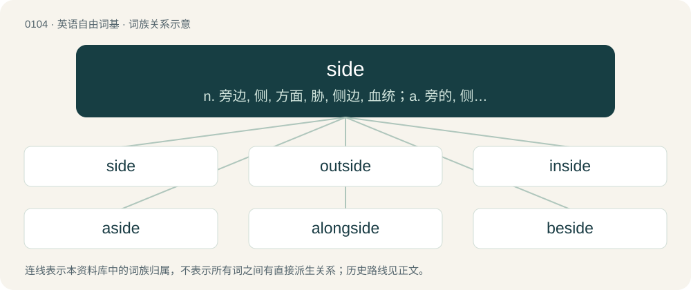

# 0108 · side — n. 旁边, 侧, 方面, 胁, 侧边, 血统；a. 旁的, 侧的, 次要的；vt. 同意, 支持

[总目录](../00_总目录_按常用程度.md)

**类型**：英语自由词基　｜　**来源语言**：见词源记录

## 核心含义与来源

- 核心含义：n. 旁边, 侧, 方面, 胁, 侧边, 血统；a. 旁的, 侧的, 次要的；vt. 同意, 支持
- 英文含义：A bounding straight edge of a two-dimensional shape.
- 词形：side

**多个词源／构词路径**：同一拼写可能有不同来源；以下按词性和含义分别列出。

**来源记录 1**（名词；A bounding straight edge of a two-dimensional shape.）

From Middle English side, from Old English sīde (“side, flank”), from Proto-Germanic \*sīdǭ (“side, flank, edge, shore”), derived from \*sīdaz, probably from Proto-Indo-European \*seh₁- (“long, lasting”). Cognate with Saterland Frisian Siede (“side”), West Frisian side (“side”), Dutch zijde, zij (“side”), German Low German Sied (“side”), German Seite (“side”), Danish, Norwegian Bokmål, and Norwegian Nynorsk side (“side”), Swedish sida (“side”). The LGBTQ slang sense was coined by sex therapist and author Joe Kort in 2010 and popularized in 2013. The sense was coined by analogy with top and bottom and based on the metaphor of a box which has a top, bottom, and sides.

**来源记录 2**（形容词；Far; distant.）

From Middle English side, syde, syd, from Old English sīd (“wide, broad, spacious, ample, extensive, vast, far-reaching”), from Proto-West Germanic \*sīd, from Proto-Germanic \*sīdaz (“drooping, hanging, low, excessive, extra”), from Proto-Indo-European \*sēy- (“to send, throw, drop, sow, deposit”). Cognate with obsolete Dutch zijd (“wide, vast”), Low German sied (“low”), Swedish sid (“long, hanging down”), Icelandic síður (“low hanging, long”).

## 词族图

## 单词速览（常用到不常用）

| 单词 | 音标 | 释义 |
|---|---|---|
| [side](#w-1) | /ˈsaɪ̯d/ | n. 旁边, 侧, 方面, 胁, 侧边, 血统；a. 旁的, 侧的, 次要的；vt. 同意, 支持 |
| [outside](#w-2) | /aʊtˈsaɪd/ | n. 外面, 外表, 外界；a. 外面的, 外表的, 外界的；adv. 外面, 外表, 外界 |
| [inside](#w-3) | /ˈɪnsaɪd/ | n. 内部, 内脏, 内幕；a. 内部的, 秘密的, 户内的；adv. 在里面 |
| [aside](#w-4) | /əˈsaɪd/ | n. 小声说的话, 旁白；adv. 在一边, 离开, 另外 |
| [alongside](#w-5) | 英 /əˌlɒŋˈsaɪd/；美 /əˌlɔŋˈsaɪd/ | adv. 在旁边, 靠拢着；prep. 在...旁边, 与...在一起 |
| [beside](#w-6) | 英 /bɪˈsaɪd/；美 /bɪˈsaɪd/ | prep. 在旁边 |
| [upside](#w-7) | /ˈʌpˌsaɪd/ | n. 上侧, 上段, 上部；\[机\] 上侧, 上部 |
| [sided](#w-8) | /ˈsaɪdɪd/ | a. 有边的, 有面的 |
| [sidewalk](#w-9) | 英 /ˈsaɪdwɔːk/；美 /ˈsaɪdwɔk/ | n. 人行道 |
| [riverside](#w-10) | 美 /ˈɹɪvɚˌsaɪd/ | n. 河边, 河畔 |
| [seaside](#w-11) | /ˌsiːˈsaɪd/ | a. 海边的, 海滨的；n. 海滨 |
| [downside](#w-12) | /ˈdaʊnˌsaɪd/ | n. 底侧；下降趋势 |
| [sideways](#w-13) | /ˈsaɪdweɪz/ | adv. 向旁边, 向侧面地；a. 旁边的, 向侧面的 |
| [siding](#w-14) | /ˈsaɪdɪŋ/ | n. 侧线, 旁轨, 边宽 |
| [hillside](#w-15) | 美 /ˈhɪlˌsaɪd/ | n. 山坡, 山腹 |
| [sideline](#w-16) | /ˈsaɪdlaɪn/ | n. 副业, 旁线, 界线, 兼职, 旁观者看法；vt. 使退出比赛场地 |
| [offside](#w-17) | /ɒfˈsaɪd/ | n. 外侧, 越位 |
| [sidekick](#w-18) | /ˈsaɪdkɪk/ | n. 伙伴, 插袋 |
| [underside](#w-19) | 英 /ˈʌndəˌsaɪd/；美 /ˈʌndɚˌsaɪd/ | n. 下面, 下侧, 底面 |
| [backside](#w-20) | /ˈbækˌsaɪd/ | n. 背部, 背后, 后方 |
| [sidebar](#w-21) | /ˈsaidbɑː(r)/ | n. 其他选项,工具条 |
| [westside](#w-22) | 英 /ˈwɛst.saɪd/ | \[地名\] \[美国\] 韦斯特赛德 |
| [wayside](#w-23) | /ˈweɪsaɪd/ | n. 路旁；a. 路旁的 |
| [sideshow](#w-24) | 美 /ˈsaɪdˌʃoʊ/ | n. 杂耍, 附属活动, 枝节问题 |
| [southside](#w-25) | /ˈsaʊθˌsaɪd/ | \[电影\]荒诞拳击手 |
| [broadside](#w-26) | 英 /ˈbrɔːdsaɪd/；美 /ˈbrɔdˌsaɪd/ | n. 猛烈的攻击/谴责, 连珠炮似的攻讦/谴责, 舷侧；adv. 无目标地, 胡乱地 |
| [eastside](#w-27) |  | a. 纽约市曼哈顿东区的 |
| [sideboard](#w-28) | /ˈsaidbɒːd/ | n. 餐具柜 |
| [onside](#w-29) | /ˈɒnˈsaid/ | n. 不越位 |
| [mountainside](#w-30) | /ˈmauntinsaid/ | n. 山腹, 山腰 |
| [northside](#w-31) |  | \[地名\] \[基里巴斯\] 诺斯赛德 |
| [fireside](#w-32) | /ˈfaiəsaid/ | n. 炉边, 家庭, 家庭生活；a. 在火炉边的, 非正式的 |
| [bayside](#w-33) |  | 贝赛德（美国地名） |
| [sidestep](#w-34) | /ˈsaɪdˌstɛp/ | n. 横跨的一步, 台阶；vt. 横跨一步躲避, 回避；vi. 回避问题, 躲避打击 |
| [flipside](#w-35) | 英 /ˈflɪpˌsaɪd/ | n. 另一面；反面 |
| [blindside](#w-36) | /ˈblaɪndˌsaɪd/ | vt. 攻其不备, 出其不意地袭击; 使遭受意外打击 |
| [sidecar](#w-37) | /ˈsaɪdkɑɹ/ | n. (摩托车的)边车 |
| [beachside](#w-38) | 美 /ˈbit͡ʃˌsaɪd/ | n. 海滨地区；a. 靠海滨的 |
| [sidewinder](#w-39) | 美 /ˈsaɪd.waɪn.dɚ/ | n. 侧击, 横击, (美)(非正式)保镖, 花钱雇用的打手 |
| [sidearm](#w-40) | 美 /ˈsaɪdˌɑɹm/ | a. 侧投球的 |
| [darkside](#w-41) | 英 /ˈdɑːk.saɪd/；美 /ˈdɑɹkˌsaɪd/ | 【英文】The side of something that is in darkness or unlit, or has less illumination. |
| [topside](#w-42) | 美 /ˈtɑp.saɪd/ | n. 干舷部 |
| [parkside](#w-43) |  | n. 园畔酒店 |
| [sidewall](#w-44) |  | n. 边墙, 侧壁, 轮胎侧壁 |
| [quayside](#w-45) | /ˈkiːsaɪd/ | n. 码头区 |
| [sider](#w-46) | /ˈsaidə/ | n. 支持者, 帮派成员 |
| [brookside](#w-47) |  | \[地名\] \[美国\] 布鲁克赛德 |
| [cliffside](#w-48) | /klɪfˈsaɪd/ | n. 悬崖的边或面 |
| [sideman](#w-49) | /ˈsaidmæn/ | n. 伴奏者 |
| [frontside](#w-50) |  | n. 正视图；进料侧 |
| [bankside](#w-51) |  | 【英文】The land by a riverbank. |
| [sidle](#w-52) | 英 /ˈsaɪdl/；美 /ˈsaɪdəl/ | v. 横着走, 悄悄贴近, 侧身而行；n. 侧走, 挨近 |

## 逐词详解

### 1. side

**词性**：名词　｜　**音标**：/ˈsaɪ̯d/

**中文释义**：n. 旁边, 侧, 方面, 胁, 侧边, 血统；a. 旁的, 侧的, 次要的；vt. 同意, 支持

**英文义项**：A bounding straight edge of a two-dimensional shape. / A flat surface of a three-dimensional object; a face.

**词源与演化**：

From Middle English side, from Old English sīde (“side, flank”), from Proto-Germanic \*sīdǭ (“side, flank, edge, shore”), derived from \*sīdaz, probably from Proto-Indo-European \*seh₁- (“long, lasting”). Cognate with Saterland Frisian Siede (“side”), West Frisian side (“side”), Dutch zijde, zij (“side”), German Low German Sied (“side”), German Seite (“side”), Danish, Norwegian Bokmål, and Norwegian Nynorsk side (“side”), Swedish sida (“side”). The LGBTQ slang sense was coined by sex therapist and author Joe Kort in 2010 and popularized in 2013. The sense was coined by analogy with top and bottom and based on the metaphor of a box which has a top, bottom, and sides.

**例句**：

> I just want to see what's on the other side — James said there was a good film on tonight.

该用例对应义项：A television channel, usually as opposed to the one currently being watched (from when there were only two channels).

### 2. outside

**词性**：名词　｜　**音标**：/aʊtˈsaɪd/

**中文释义**：n. 外面, 外表, 外界；a. 外面的, 外表的, 外界的；adv. 外面, 外表, 外界

**英文义项**：The part of something that faces out; the outer surface. / The external appearance of someone or something.

**构词拆分**：out + side

**词源与演化**：

From out + side.

**例句**：

> On a motorway, you should always overtake other vehicles on the outside.

该用例对应义项：The part of a road towards the central division: towards the right if one drives on the left, or towards the left if one drives on the right.

### 3. inside

**词性**：名词　｜　**音标**：/ˈɪnsaɪd/

**中文释义**：n. 内部, 内脏, 内幕；a. 内部的, 秘密的, 户内的；adv. 在里面

**英文义项**：The interior or inner part. / The left-hand side of a road if one drives on the left, or right-hand side if one drives on the right.

**构词拆分**：in- + side

**词源与演化**：

From Middle English ynneside; equivalent to in- + side. Compare German Innenseite (“inside”), Danish inderside (“inside”), Swedish insida (“inside”), Dutch binnenzijde (“inside”), German Low German Binnensied, Binnersied (“inside”), Saterland Frisian Binnersiede (“inside”).

**例句**：

> The car in front drifted wide on the bend, so I darted up the inside to take the lead.

该用例对应义项：The side of a curved road, racetrack etc. that has the shorter arc length; the side of a racetrack nearer the interior of the course or some other point of reference.

### 4. aside

**词性**：副词　｜　**音标**：/əˈsaɪd/

**中文释义**：n. 小声说的话, 旁白；adv. 在一边, 离开, 另外

**英文义项**：To or on one side so as to be out of the way. / Excluded from consideration.

**构词拆分**：a- + side

**词源与演化**：

From Middle English aside, asyde, a-side, oside, from Middle English on side, from Old English on sīdan (literally “on (the) side (of)”), equivalent to a- + side. Compare beside.

**例句**：

> Move aside, please, so that these people can come through.

该用例对应义项：To or on one side so as to be out of the way.

### 5. alongside

**词性**：副词　｜　**音标**：英 /əˌlɒŋˈsaɪd/；美 /əˌlɔŋˈsaɪd/

**中文释义**：adv. 在旁边, 靠拢着；prep. 在...旁边, 与...在一起

**英文义项**：Along the side; by the side; side by side; abreast.

**构词拆分**：along + side

**词源与演化**：

From along + side; compare alongsides.

**例句**：

> All of a sudden, another car drew up alongside.

该用例对应义项：Along the side; by the side; side by side; abreast.

### 6. beside

**词性**：介词　｜　**音标**：英 /bɪˈsaɪd/；美 /bɪˈsaɪd/

**中文释义**：prep. 在旁边

**英文义项**：Next to; at the side of. / Not relevant to.

**构词拆分**：By surface analysis, be- + side

**词源与演化**：

From Middle English beside, besiden, bisyde (also besides &gt; besides), from Old English be sīdan, bī sīdan (“by the side (of), on the side (of)”). Compare Saterland Frisian biesiede (“aside”), German Low German bisied (“aside”), German beiseite (“aside, to one side”). Compare also Dutch terzijde (“aside”). By surface analysis, be- + side.

**例句**：

> That is beside the point / beside the topic / beside the subject / beside the focus of this discussion.

该用例对应义项：Not relevant to.

### 7. upside

**词性**：名词　｜　**音标**：/ˈʌpˌsaɪd/

**中文释义**：n. 上侧, 上段, 上部；\[机\] 上侧, 上部

**英文义项**：The highest or uppermost side or portion of something. / A favourable aspect of something that also has an unfavourable aspect.

**构词拆分**：up + side

**词源与演化**：

From up + side.

**例句**：

> What was the idea of leaving the cup upside down last time?

### 8. sided

**词性**：形容词　｜　**音标**：/ˈsaɪdɪd/

**中文释义**：a. 有边的, 有面的

**英文义项**：Having the specified type of side or sides or number of sides.

**构词拆分**：side (noun) + -ed (“having”)

**词源与演化**：

From side (noun) + -ed (“having”).

**例句**：

> He sided with the opposition group in the argument.

### 9. sidewalk

**词性**：名词　｜　**音标**：英 /ˈsaɪdwɔːk/；美 /ˈsaɪdwɔk/

**中文释义**：n. 人行道

**英文义项**：A paved footpath located at the side of a road, for the use of pedestrians. / Any paved footpath, even if not located at the side of a road.

**构词拆分**：side + walk

**词源与演化**：

From side + walk.

**例句**：

> Stay on the sidewalk.

该用例对应义项：A paved footpath located at the side of a road, for the use of pedestrians.

### 10. riverside

**词性**：名词　｜　**音标**：美 /ˈɹɪvɚˌsaɪd/

**中文释义**：n. 河边, 河畔

**英文义项**：A bank or side of a river.

**构词拆分**：river + side

**词源与演化**：

From river + side.

**例句**：

> Gonna lay down my burden; Down by the riverside...

该用例对应义项：A bank or side of a river.

### 11. seaside

**词性**：名词　｜　**音标**：/ˌsiːˈsaɪd/

**中文释义**：a. 海边的, 海滨的；n. 海滨

**英文义项**：The area by and around the sea; including the beach, promenade or cliffs.

**构词拆分**：sea + side

**词源与演化**：

From Middle English see-syde, sey-syde, see syde, se side, equivalent to sea + side. Compare waterside.

**例句**：

> This summer, I'm going to the seaside at Weymouth. I'm very excited about it!

该用例对应义项：The area by and around the sea; including the beach, promenade or cliffs.

### 12. downside

**词性**：名词　｜　**音标**：/ˈdaʊnˌsaɪd/

**中文释义**：n. 底侧；下降趋势

**英文义项**：A disadvantageous aspect of something that is normally advantageous. / A downward tendency, especially in the price of shares etc.

**构词拆分**：down + side

**词源与演化**：

Compound of down + side.

**例句**：

> The downside of obtaining a higher rank is that far more work is expected.

该用例对应义项：A disadvantageous aspect of something that is normally advantageous.

### 13. sideways

**词性**：形容词　｜　**音标**：/ˈsaɪdweɪz/

**中文释义**：adv. 向旁边, 向侧面地；a. 旁边的, 向侧面的

**英文义项**：Moving or directed toward one side. / Positioned sideways (with a side to the front).

**构词拆分**：side + -ways

**词源与演化**：

From side + -ways.

**例句**：

> There was a stack of papers in front of each seat at the table, but each stack was sideways.

该用例对应义项：Positioned sideways (with a side to the front).

### 14. siding

**词性**：名词　｜　**音标**：/ˈsaɪdɪŋ/

**中文释义**：n. 侧线, 旁轨, 边宽

**英文义项**：A building material which covers and protects the sides of a house or other building.

**构词拆分**：side + -ing

**词源与演化**：

From side + -ing (“material, collection”).

**例句**：

> Ugh. If there's one thing I can't stand it's cheesy vinyl siding.

该用例对应义项：A building material which covers and protects the sides of a house or other building.

### 15. hillside

**词性**：名词　｜　**音标**：美 /ˈhɪlˌsaɪd/

**中文释义**：n. 山坡, 山腹

**英文义项**：The side of a hill.

**构词拆分**：hill + side

**词源与演化**：

From hill + side.

**例句**：

> Tom and Mary sat on a hillside and watched the fireworks together.

### 16. sideline

**词性**：名词　｜　**音标**：/ˈsaɪdlaɪn/

**中文释义**：n. 副业, 旁线, 界线, 兼职, 旁观者看法；vt. 使退出比赛场地

**英文义项**：A line at the side of something. / Something that is additional or extra or that exists around the edges or margins of a main item.

**构词拆分**：side + line

**词源与演化**：

From side + line.

**例句**：

> Soup need not be just a sideline to a meal; if you like, it can be the main course.

该用例对应义项：Something that is additional or extra or that exists around the edges or margins of a main item.

### 17. offside

**词性**：名词　｜　**音标**：/ɒfˈsaɪd/

**中文释义**：n. 外侧, 越位

**英文义项**：An offside play. / The side of a road vehicle furthest from the kerb: the right side if one drives on the left of the road.

**构词拆分**：off- + side

**词源与演化**：

From off- + side. Compare German Abseite (“remote area, backside”), German abseits (“out of the way, apart, aside”, adverb), Dutch afzijdig (“neutral, impartial”).

**例句**：

> My offside wing mirror got snapped off.

该用例对应义项：The side of a road vehicle furthest from the kerb: the right side if one drives on the left of the road.

### 18. sidekick

**词性**：名词　｜　**音标**：/ˈsaɪdkɪk/

**中文释义**：n. 伙伴, 插袋

**英文义项**：An assistant to another person, especially to a superior or more important person. / In literature, theatre, etc., a good foil of the protagonist, a character who helps emphasize the traits of the main character.

**构词拆分**：side + kick

**词源与演化**：

From side + kick, which in the late 19th and early 20th century was a slang term for the front side pocket of a pair of trousers, known as the pocket safest from theft. Thus, by analogy, a "side-kick" was a person's closest companion.

**例句**：

> Tom has a sidekick named John.

### 19. underside

**词性**：名词　｜　**音标**：英 /ˈʌndəˌsaɪd/；美 /ˈʌndɚˌsaɪd/

**中文释义**：n. 下面, 下侧, 底面

**英文义项**：The side that is below or underneath, the bottom.

**构词拆分**：under- + side

**词源与演化**：

From under- + side.

**例句**：

> A spider can produce a silky substance from tiny openings on its underside.

### 20. backside

**词性**：名词　｜　**音标**：/ˈbækˌsaɪd/

**中文释义**：n. 背部, 背后, 后方

**英文义项**：The back side of anything, the part opposite its front, particularly / The back side of an estate: the backyard and outbuildings behind a main house, especially (UK dialect, euphemistic) an outhouse.

**构词拆分**：back + side

**词源与演化**：

From back + side.

**例句**：

> Having ridden the horse all day for the first time, I had painful blisters on my backside.

该用例对应义项：A person's buttocks.

### 21. sidebar

**词性**：名词　｜　**音标**：/ˈsaidbɑː(r)/

**中文释义**：n. 其他选项,工具条

**英文义项**：A short news story printed alongside a larger one. / A block of information placed at the side of a printed page.

**构词拆分**：side + bar

**词源与演化**：

From side + bar.

**例句**：

> If you need more room on the screen, you can hide the sidebar.

### 22. westside

**词性**：名词　｜　**音标**：英 /ˈwɛst.saɪd/

**中文释义**：\[地名\] \[美国\] 韦斯特赛德

**英文义项**：The western side of a building, street, area etc.

**构词拆分**：west + side

**词源与演化**：

From west + side.

### 23. wayside

**词性**：名词　｜　**音标**：/ˈweɪsaɪd/

**中文释义**：n. 路旁；a. 路旁的

**英文义项**：The side of a road or path. / A rest area.

**构词拆分**：way + side

**词源与演化**：

From Middle English waye syde, equivalent to way + side.

**例句**：

> Many wild flowers grew on the wayside.

该用例对应义项：The side of a road or path.

### 24. sideshow

**词性**：名词　｜　**音标**：美 /ˈsaɪdˌʃoʊ/

**中文释义**：n. 杂耍, 附属活动, 枝节问题

**英文义项**：A minor attraction at a larger event such as a circus, fair or music festival. / An incidental spectacle that diverts attention from a larger concern.

**构词拆分**：side + show

**词源与演化**：

From side + show.

**例句**：

> Instruction is not an educational sideshow.

该用例对应义项：a subordinate incident of little importance relative to the main event

### 25. southside

**词性**：名词　｜　**音标**：/ˈsaʊθˌsaɪd/

**中文释义**：\[电影\]荒诞拳击手

**英文义项**：The southern side of a building, street, city, area, etc.

**构词拆分**：south + side

**词源与演化**：

From south + side.

### 26. broadside

**词性**：名词　｜　**音标**：英 /ˈbrɔːdsaɪd/；美 /ˈbrɔdˌsaɪd/

**中文释义**：n. 猛烈的攻击/谴责, 连珠炮似的攻讦/谴责, 舷侧；adv. 无目标地, 胡乱地

**英文义项**：One side of a ship above the waterline. / All the guns on one side of a warship.

**构词拆分**：broad + side

**词源与演化**：

From broad + side.

**例句**：

> The ship was broadside to the dock.

该用例对应义项：the whole side of a vessel from stem to stern

### 27. eastside

**词性**：名词

**中文释义**：a. 纽约市曼哈顿东区的

**英文义项**：The east side of a district or city.

**构词拆分**：east + side

**词源与演化**：

From east + side.

### 28. sideboard

**词性**：名词　｜　**音标**：/ˈsaidbɒːd/

**中文释义**：n. 餐具柜

**英文义项**：A piece of dining room furniture having drawers and shelves for linen and tableware; originally for serving food. / A board or similar barrier that forms part of the side of something.

**构词拆分**：side + board

**词源与演化**：

From side + board.

**例句**：

> At Thanksgiving, the turkey took pride of place while the other dishes were relegated to the sideboard.

### 29. onside

**词性**：形容词　｜　**音标**：/ˈɒnˈsaid/

**中文释义**：n. 不越位

**英文义项**：Not in an offside position; in the part of the playing area where one can legally play the ball, puck, etc. / Within bounds.

**构词拆分**：on + side

**词源与演化**：

From on + side.

**例句**：

> The goal was allowed because the attacker was onside.

该用例对应义项：Not in an offside position; in the part of the playing area where one can legally play the ball, puck, etc.

### 30. mountainside

**词性**：名词　｜　**音标**：/ˈmauntinsaid/

**中文释义**：n. 山腹, 山腰

**英文义项**：The sloping side of a mountain.

**构词拆分**：mountain + side

**词源与演化**：

From mountain + side.

**例句**：

> The melted snowpack seeps down to fill mountainside indentations to form glacial lakes.

### 31. northside

**词性**：名词

**中文释义**：\[地名\] \[基里巴斯\] 诺斯赛德

**英文义项**：The northern side of a building, street, area etc.

**构词拆分**：north + side

**词源与演化**：

From north + side.

### 32. fireside

**词性**：名词　｜　**音标**：/ˈfaiəsaid/

**中文释义**：n. 炉边, 家庭, 家庭生活；a. 在火炉边的, 非正式的

**英文义项**：The area near a domestic fire or hearth. / One's home.

**构词拆分**：fire + side

**词源与演化**：

From fire + side.

**例句**：

> The fireside evoked a pleasant warmth against the chill of mid-winter.

### 33. bayside

**词性**：形容词

**中文释义**：贝赛德（美国地名）

**英文义项**：Located along a bay

**构词拆分**：bay + side

**词源与演化**：

From bay + side.

### 34. sidestep

**词性**：动词　｜　**音标**：/ˈsaɪdˌstɛp/

**中文释义**：n. 横跨的一步, 台阶；vt. 横跨一步躲避, 回避；vi. 回避问题, 躲避打击

**英文义项**：To step to the side. / To avoid or dodge.

**构词拆分**：side + step

**词源与演化**：

From side + step.

**例句**：

> I managed to sidestep every pitfall.

### 35. flipside

**词性**：名词　｜　**音标**：英 /ˈflɪpˌsaɪd/

**中文释义**：n. 另一面；反面

**英文义项**：The reverse, in contrast to the obverse. / The B-side of a phonograph record.

**构词拆分**：flip + side

**词源与演化**：

From flip + side.

**例句**：

> Walking to work is definitely healthier – on the flipside, though, it takes twice as long.

该用例对应义项：A necessary consequence or corollary of something that acts as a negation or counterbalance; especially one seen as opposite, or as pro versus con.

### 36. blindside

**词性**：名词　｜　**音标**：/ˈblaɪndˌsaɪd/

**中文释义**：vt. 攻其不备, 出其不意地袭击; 使遭受意外打击

**英文义项**：A driver's field of blindness around an automobile; the side areas behind the driver. / A tram/train driver's field of blindness around a tram (trolley/streetcar) or a train; the side areas behind the tram/train driver.

**构词拆分**：blind + side

**词源与演化**：

From blind + side.

**例句**：

> The blindside packs down at the scrum on the blindside.

该用例对应义项：The blindside flanker, a position in rugby union, usually number 6.

### 37. sidecar

**词性**：名词　｜　**音标**：/ˈsaɪdkɑɹ/

**中文释义**：n. (摩托车的)边车

**英文义项**：A one-wheeled attachment to the side of a motorcycle to allow for a separate seat for a passenger or cargo space. / A cocktail made with cognac (or brandy), triple sec liqueur, and lemon juice.

**构词拆分**：side + car

**词源与演化**：

From side + car.

### 38. beachside

**词性**：形容词　｜　**音标**：美 /ˈbit͡ʃˌsaɪd/

**中文释义**：n. 海滨地区；a. 靠海滨的

**英文义项**：Bordering a beach

**构词拆分**：beach + side

**词源与演化**：

From beach + side.

**用法示例／搭配（非完整句）**：

> beachside property

该用例对应义项：Bordering a beach

### 39. sidewinder

**词性**：名词　｜　**音标**：美 /ˈsaɪd.waɪn.dɚ/

**中文释义**：n. 侧击, 横击, (美)(非正式)保镖, 花钱雇用的打手

**英文义项**：A North American rattlesnake, Crotalus cerastes, that inhabits lowland deserts. / A person who is untrustworthy and dangerous.

**构词拆分**：side + winder (“one who winds or wends, traveller”)

**词源与演化**：

From side + winder (“one who winds or wends, traveller”), from the sideways, looping manner in which they move.

### 40. sidearm

**词性**：名词　｜　**音标**：美 /ˈsaɪdˌɑɹm/

**中文释义**：a. 侧投球的

**英文义项**：A personal weapon, either a firearm (handgun type) or a cold weapon (such as a sword), carried on the hip in a belt, sheath, holster, etc., for rapid access.

**构词拆分**：side + arm

**词源与演化**：

From side + arm.

### 41. darkside

**词性**：名词　｜　**音标**：英 /ˈdɑːk.saɪd/；美 /ˈdɑɹkˌsaɪd/

**英文义项**：The side of something that is in darkness or unlit, or has less illumination. / The side of something that is metaphorically dark, i.e. evil, distressing or otherwise undesirable; the negative aspect of something.

**构词拆分**：dark + side

**词源与演化**：

From dark + side. Sense 2.1 (“side that is evil”) was popularized by the film Star Wars (1977; later retitled Star Wars: Episode IV – A New Hope) where the term was used to describe the aspect of a metaphysical power called the Force which could be used to act aggressively and perpetrate evil.

### 42. topside

**词性**：名词　｜　**音标**：美 /ˈtɑp.saɪd/

**中文释义**：n. 干舷部

**英文义项**：The side or part of something that is at the top. / The surface of a ship’s hull that is above the water line.

**构词拆分**：top + side

**词源与演化**：

From top + side.

### 43. parkside

**词性**：形容词

**中文释义**：n. 园畔酒店

**英文义项**：By the side of a park.

**构词拆分**：park + side

**词源与演化**：

From park + side.

### 44. sidewall

**词性**：名词

**中文释义**：n. 边墙, 侧壁, 轮胎侧壁

**英文义项**：The side of a tire. / The wall forming the side of a structure; a side wall.

**构词拆分**：side + wall

**词源与演化**：

From side + wall.

**例句**：

> If the puncture had been in the tread I could have had the tire patched, but it was in the sidewall and they can't fix that: they have to replace the whole tire.

该用例对应义项：The side of a tire.

### 45. quayside

**词性**：名词　｜　**音标**：/ˈkiːsaɪd/

**中文释义**：n. 码头区

**英文义项**：An area alongside a quay.

**构词拆分**：quay + side

**词源与演化**：

From quay + side.

**例句**：

> I noticed that all day long men were working on the quayside.

### 46. sider

**词性**：名词　｜　**音标**：/ˈsaidə/

**中文释义**：n. 支持者, 帮派成员

**英文义项**：One who takes a side.

**构词拆分**：side + -er

**词源与演化**：

From side + -er (agent noun suffix).

**例句**：

> They didn't go up to At Sider.

### 47. brookside

**词性**：形容词

**中文释义**：\[地名\] \[美国\] 布鲁克赛德

**英文义项**：On the side of a brook.

**构词拆分**：brook + side

**词源与演化**：

From brook + side.

### 48. cliffside

**词性**：名词　｜　**音标**：/klɪfˈsaɪd/

**中文释义**：n. 悬崖的边或面

**英文义项**：The side of a cliff.

**构词拆分**：cliff + side

**词源与演化**：

From cliff + side.

**例句**：

> We strolled along the cliffside.

该用例对应义项：The side of a cliff.

### 49. sideman

**词性**：名词　｜　**音标**：/ˈsaidmæn/

**中文释义**：n. 伴奏者

**英文义项**：A soloist playing with a band or group of which he is not a regular member. / Somebody who is unimportant or irrelevant.

**构词拆分**：side + -man

**词源与演化**：

From side + -man.

### 50. frontside

**词性**：名词

**中文释义**：n. 正视图；进料侧

**英文义项**：The obverse, in contrast to the reverse.

**构词拆分**：front + side

**词源与演化**：

From front + side.

### 51. bankside

**词性**：名词

**英文义项**：The land by a riverbank.

**构词拆分**：bank + side

**词源与演化**：

From bank + side.

### 52. sidle

**词性**：动词　｜　**音标**：英 /ˈsaɪdl/；美 /ˈsaɪdəl/

**中文释义**：v. 横着走, 悄悄贴近, 侧身而行；n. 侧走, 挨近

**英文义项**：To (cause something to) move sideways. / In the intransitive sense often followed by up: to (cause something to) advance in a coy, furtive, or unobtrusive manner.

**构词拆分**：side + -le (frequentative suffix)

**词源与演化**：

The verb is from side + -le (frequentative suffix), possibly a back-formation from sideling (“in a sidelong direction; askew, obliquely”, adverb), treating that word as the present participle of sidle. The noun is derived from the verb.

**例句**：

> The young man began to sidle near the pretty girl sitting on the log.

该用例对应义项：move unobtrusively or furtively
