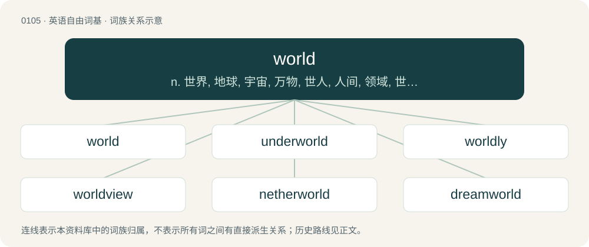

# 0109 · world — n. 世界, 地球, 宇宙, 万物, 世人, 人间, 领域, 世事, 世故, 社会生活, 大量；\[法\] 世界, 地球, 世人

[总目录](../00_总目录_按常用程度.md)

**类型**：英语自由词基　｜　**来源语言**：见词源记录

## 核心含义与来源

- 核心含义：n. 世界, 地球, 宇宙, 万物, 世人, 人间, 领域, 世事, 世故, 社会生活, 大量；\[法\] 世界, 地球, 世人
- 英文含义：The subjective human experience, regarded collectively; human collective existence; existence in general; the reality we live in.
- 词形：world

**来源记录 1**（名词；The subjective human experience, regarded collectively; human collective existence; existence in general; the reality we live in.）

From Middle English world, from Old English weorold (“world”), from Proto-West Germanic \*weraldi, from Proto-Germanic \*weraldiz (“lifetime, human existence, world”, literally “age/era of man”), equivalent to wer (“man”) + eld (“age”). Eclipsed non-native Middle English mounde (“world”), from Old French monde, munde (“world”). Cognates Cognate with Scots warld (“world”), North Frisian Wārel, wäält, wråål (“world”), Saterland Frisian Waareld (“world”), West Frisian wrâld (“world”), Afrikaans wêreld (“world”), Bavarian Wöd (“world”), Dutch wereld (“world”), German, Luxembourgish Welt (“world”), German Low German Wereld, Werld (“world”), Vilamovian wełt (“world”), Yiddish וועלט (velt, “world”), Danish verden (“world”), Elfdalian wärd (“world”), Faroese verð, verøld (“world”), Icelandic veröld (“world”), Norn vrildan (“the earth”), Norwegian Bokmål verd, verden (“(the) world”), Norwegian Nynorsk verd (“world”), Swedish värld (“world”).

## 词族图

## 单词速览（常用到不常用）

| 单词 | 音标 | 释义 |
|---|---|---|
| [world](#w-1) | 英 /wɜːld/；美 /wɝld/ | n. 世界, 地球, 宇宙, 万物, 世人, 人间, 领域, 世事, 世故, 社会生活, 大量；\[法\] 世界, 地球, 世人 |
| [underworld](#w-2) | 英 /ˈʌndəˌwɜːld/；美 /ˈʌndɚˌwɚld/ | n. 下层社会, 地狱, 下流社会 |
| [worldly](#w-3) | /ˈwɜː(ɹ)ldli/ | a. 世间的, 世俗的, 世上的 |
| [worldview](#w-4) | /ˈwɜːldvjuː/ | n. 看; 视力; 观点; 目的 |
| [netherworld](#w-5) |  | n. 阴间, 下层社会 |
| [dreamworld](#w-6) | /ˈdriːmwɜːld/ | n. 梦样世界, 幻想世界; 梦境 |
| [otherworld](#w-7) | 美 /ˈʌðɚˌwɝld/ | n. 冥界, 来世 |
| [overworld](#w-8) | /ˈəuvəˈwəːld/ | 上流社会 |
| [transworld](#w-9) | /ˈtrænsw\\\\ːld,ˈtrænz-,ˈtrɑːn-/ | a. 环球旅游的, 遍及全球的, 世界范围的 |
| [waterworld](#w-10) |  | 未来水世界 |
| [worldbuilding](#w-11) |  | 【英文】The conception and description of a fictional world, often as the setting of a work of fiction, particularly in speculative fiction. |

## 逐词详解

### 1. world

**词性**：名词　｜　**音标**：英 /wɜːld/；美 /wɝld/

**中文释义**：n. 世界, 地球, 宇宙, 万物, 世人, 人间, 领域, 世事, 世故, 社会生活, 大量；\[法\] 世界, 地球, 世人

**英文义项**：The subjective human experience, regarded collectively; human collective existence; existence in general; the reality we live in. / The subjective human experience, regarded individually.

**词源与演化**：

From Middle English world, from Old English weorold (“world”), from Proto-West Germanic \*weraldi, from Proto-Germanic \*weraldiz (“lifetime, human existence, world”, literally “age/era of man”), equivalent to wer (“man”) + eld (“age”). Eclipsed non-native Middle English mounde (“world”), from Old French monde, munde (“world”). Cognates Cognate with Scots warld (“world”), North Frisian Wārel, wäält, wråål (“world”), Saterland Frisian Waareld (“world”), West Frisian wrâld (“world”), Afrikaans wêreld (“world”), Bavarian Wöd (“world”), Dutch wereld (“world”), German, Luxembourgish Welt (“world”), German Low German Wereld, Werld (“world”), Vilamovian wełt (“world”), Yiddish וועלט (velt, “world”), Danish verden (“world”), Elfdalian wärd (“world”), Faroese verð, verøld (“world”), Icelandic veröld (“world”), Norn vrildan (“the earth”), Norwegian Bokmål verd, verden (“(the) world”), Norwegian Nynorsk verd (“world”), Swedish värld (“world”).

**例句**：

> In retrospect, the process of economic globalization has meant the end of the world as we knew it.

该用例对应义项：The subjective human experience, regarded collectively; human collective existence; existence in general; the reality we live in.

### 2. underworld

**词性**：名词　｜　**音标**：英 /ˈʌndəˌwɜːld/；美 /ˈʌndɚˌwɚld/

**中文释义**：n. 下层社会, 地狱, 下流社会

**英文义项**：The world of the dead, located underneath the world of the living; the afterlife. / That part of society that is engaged in crime or vice, and particularly those involved in organized crime.

**构词拆分**：under- + world

**词源与演化**：

From under- + world.

**例句**：

> In Hindu scriptures, the four-eyed dogs Śārvara and Śyāma guard the underworld's entrance.

该用例对应义项：The world of the dead, located underneath the world of the living; the afterlife.

### 3. worldly

**词性**：形容词　｜　**音标**：/ˈwɜː(ɹ)ldli/

**中文释义**：a. 世间的, 世俗的, 世上的

**英文义项**：Concerned with human or earthly matters, physical as opposed to spiritual. / Concerned with secular rather than sacred matters.

**构词拆分**：world + -ly

**词源与演化**：

From Middle English worldly, worldlich, wordly (adjective), from Old English woruldlīċ, worldlīċ, weoroldlīċ (“worldly; earthly; temporal; mundane; secular”), from Proto-Germanic \*weraldilīkaz, equivalent to world + -ly. Cognate with Dutch wereldlijk (“worldly; secular”), German Low German weltlik (“worldly”), German weltlich (“worldly”), Danish verdslig (“worldly”), Swedish världslig (“worldly”), Icelandic veraldlegur (“worldly; secular”).

**例句**：

> The benefits of his worldly wisdom.

该用例对应义项：very sophisticated especially because of surfeit; versed in the ways of the world

### 4. worldview

**词性**：名词　｜　**音标**：/ˈwɜːldvjuː/

**中文释义**：n. 看; 视力; 观点; 目的

**英文义项**：An individual's, ingroup's or society's view of the world and how it is to be interpreted. / The totality of one's beliefs about reality.

**构词拆分**：world + view

**词源与演化**：

A calque of German Weltanschauung, equivalent to world + view.

**例句**：

> The Elizabethan worldview differs from a modern worldview.

该用例对应义项：A general philosophy or view of life.

### 5. netherworld

**词性**：名词

**中文释义**：n. 阴间, 下层社会

**英文义项**：The place to which one's spirit descends upon death, conceived as below the surface of the earth. / The locale of the spirit world or afterlife, whether deemed to be situated below the world of the living or not.

**构词拆分**：nether- + world

**词源与演化**：

From nether- (“beneath, lower”) + world.

**例句**：

> While I was astrally projecting, I felt my soul pass through many insubstantial netherworlds.

该用例对应义项：The locale of the spirit world or afterlife, whether deemed to be situated below the world of the living or not.

### 6. dreamworld

**词性**：名词　｜　**音标**：/ˈdriːmwɜːld/

**中文释义**：n. 梦样世界, 幻想世界; 梦境

**英文义项**：An imaginary world, such as experienced while dreaming. / Synonym of dreamland (“ideal but unrealistic fantasy world”).

**构词拆分**：dream + world

**词源与演化**：

From dream + world. Compare West Frisian dreamwrâld (“dreamworld”), Dutch droomwereld, dromenwereld (“dreamworld”), German Traumwelt (“dreamworld”), Danish drømmeverden (“dreamworld”), Swedish drömvärld (“dreamworld”).

### 7. otherworld

**词性**：名词　｜　**音标**：美 /ˈʌðɚˌwɝld/

**中文释义**：n. 冥界, 来世

**英文义项**：A world beyond death; an afterlife. / A world other than the everyday world.

**构词拆分**：other + world

**词源与演化**：

From Middle English othyr world, oþerr werelld, oþer world, from Old English ōþer weoruld, equivalent to other + world.

**例句**：

> We'll meet again in the otherworld.

### 8. overworld

**词性**：名词　｜　**音标**：/ˈəuvəˈwəːld/

**中文释义**：上流社会

**英文义项**：The celestial world. / The community of law-abiding citizens.

**构词拆分**：over- + world

**词源与演化**：

From over- + world. Compare underworld.

**例句**：

> I love the overworld music in this game.

### 9. transworld

**词性**：形容词　｜　**音标**：/ˈtrænsw\\\\ːld,ˈtrænz-,ˈtrɑːn-/

**中文释义**：a. 环球旅游的, 遍及全球的, 世界范围的

**英文义项**：Spanning possible worlds.

**构词拆分**：trans- + world

**词源与演化**：

From trans- + world.

### 10. waterworld

**词性**：名词

**中文释义**：未来水世界

**英文义项**：A planet or other large environment that is dominated by water.

**构词拆分**：water + world

**词源与演化**：

From water + world.

### 11. worldbuilding

**词性**：名词

**英文义项**：The conception and description of a fictional world, often as the setting of a work of fiction, particularly in speculative fiction.

**构词拆分**：world + building

**词源与演化**：

From world + building.
