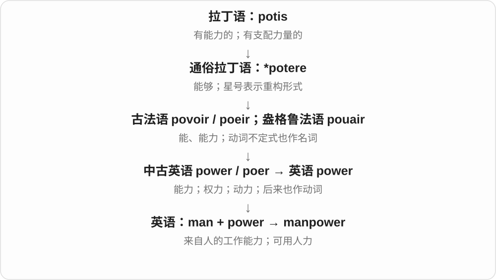
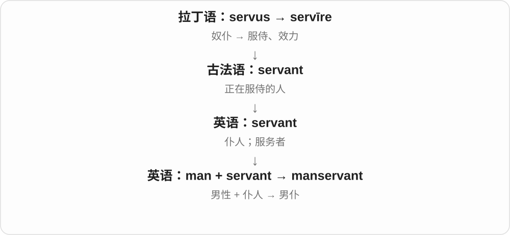

# 0114 · man — 人；男子；复合词里的身份、角色

[逐词精讲目录](../00_逐词精讲目录.md) · [总目录](../00_总目录_按常用程度.md)

## 核心词根与来源

man 接古英语 man、mann，早期可泛指人，也有男性义。现代独立 man 常指成年男子；mankind、manslaughter 等保留人的泛义，职业复合词中的 -man 则有各自沿用习惯，不能一刀切。复数常变为 -men，非重读词尾 -man 常弱读 /mən/。

**MAN：先认出人，再看前面限定了什么角色**

同样站着一个人，前面换成 mail、horse、middle，身份就变成邮递员、骑手或中间人。

- **人及自身扩展**：man · manhood · manly · mankind · manpower · manhandle
- **现代及一般社会角色**：freshman · foreman · spokesman · layman · middleman · mailman · taxman · anchorman · gentleman · nobleman
- **家宅、教会与历史身份**：manservant · footman · churchman · freedman · frontiersman
- **骑乘、技艺与职业**：horseman · helmsman · swordsman · marksman · cavalryman · infantryman · plowman · cattleman
- **形象与其他复合词**：caveman · merman · superman · manhole · manhunt · manslaughter
- **gentleman → gentlemen：礼貌人物称呼的复数**：gentleman · gentlemen · man · men
- **dude：从讲究穿着的男子，到哥们、家伙**：dude · dudes

## 词形与演化规律

把自身扩展 manhood、manly、mankind 放在前面，再按社会工作、骑乘技艺、历史身份和其他构词展开。manner 来自法语及拉丁语的另一条历史，不能因为写着 man- 就当成本页的“人”。spokesman 的 spoke 接说话，merman 的 mer- 接旧时海、水域成分。

中古英语 gentle 与 man 组合，可能仿法语 gentilhomme；复数只变 man 为 men。

与 man 比较称呼、语气，不是现代 man 的派生。dude 早为纽约俚语，来历未定；Yankee Doodle 的缩变是研究分析，不当成无争议结论。

## 单词速览（按词族由简到繁）

同一基础词的相关扩展放在一起，先读基础形式，再读扩展；各组之间优先读常用的。具体词源关系见各词讲解。

| 单词 | 音标 | 核心意思 |
|---|---|---|
| [man](#w-1) | /mæn/ | 成年男子；人〔部分泛称、旧用法〕；配备人员 |
| [mankind](#w-7) | /mænˈkaɪnd/ | 人类 |
| [manly](#w-10) | /ˈmænli/ | 有男子气概的；带有传统男性特征的 |
| [manpower](#w-12) | 英 /ˈmænˌpaʊə/；美 /ˈmænˌpaʊər/ | 人力；可调配的劳动力 |
| [manslaughter](#w-13) | 英 /ˈmænslɔːtə/；美 /ˈmænslɔːtər/ | 非谋杀类的非法杀人；常译过失杀人等〔法律〕 |
| [manhood](#w-17) | /ˈmænhʊd/ | 成年男子的阶段；男子气概 |
| [manhunt](#w-20) | /ˈmænhʌnt/ | 搜捕；大规模寻人 |
| [manhole](#w-30) | 英 /ˈmænhəʊl/；美 /ˈmænhoʊl/ | 检修井口；人孔 |
| [manservant](#w-48) | 英 /ˈmænsɜːvənt/；美 /ˈmænsɜːrvənt/ | 男仆 |
| [manhandle](#w-64) | /ˈmænhændəl/ | 粗暴地推搡；用人力搬动 |
| [gentleman](#w-4) | /ˈdʒentəlmən/ | 绅士；有礼貌的男子；先生 |
| [gentlemen](#w-66) | /ˈdʒentəlmən/ | 先生们；绅士〔复数〕 |
| [superman](#w-5) | 英 /ˈsuːpəmæn/；美 /ˈsuːpərmæn/ | 能力超常的人；超人；超人理念〔哲学〕 |
| [freshman](#w-6) | /ˈfreʃmən/ | 一年级新生；新任者〔尤美〕 |
| [spokesman](#w-8) | 英 /ˈspəʊksmən/；美 /ˈspoʊksmən/ | 发言人；代言某种立场的人 |
| [foreman](#w-11) | 英 /ˈfɔːmən/；美 /ˈfɔːrmən/ | 工头；领班；陪审团代表 |
| [horseman](#w-18) | 英 /ˈhɔːsmən/；美 /ˈhɔːrsmən/ | 骑手；善骑马的人 |
| [nobleman](#w-21) | 英 /ˈnəʊblmən/；美 /ˈnoʊblmən/ | 男性贵族 |
| [freedman](#w-22) | /ˈfriːdmən/ | 获释的原奴隶〔历史〕 |
| [layman](#w-23) | /ˈleɪmən/ | 外行；非神职人员 |
| [caveman](#w-24) | /ˈkeɪvmæn/ | 穴居人；粗野落伍的男人〔比喻〕 |
| [mailman](#w-25) | /ˈmeɪlmæn/，也弱读 /ˈmeɪlmən/ | 邮递员〔尤美〕 |
| [marksman](#w-26) | 英 /ˈmɑːksmən/；美 /ˈmɑːrksmən/ | 神枪手；射击准确的人 |
| [middleman](#w-27) | /ˈmɪdəlmæn/ | 中间商；中介人 |
| [swordsman](#w-28) | 英 /ˈsɔːdzmən/；美 /ˈsɔːrdzmən/ | 剑客；善用剑的人 |
| [anchorman](#w-32) | 英 /ˈæŋkəmæn/；美 /ˈæŋkərmæn/ | 男新闻主播；接力赛最后一棒队员 |
| [helmsman](#w-34) | /ˈhelmzmən/ | 舵手；掌舵者 |
| [footman](#w-35) | /ˈfʊtmən/ | 男仆〔历史、传统大宅语境〕 |
| [churchman](#w-38) | 英 /ˈtʃɜːtʃmən/；美 /ˈtʃɜːrtʃmən/ | 教会人士；神职人员；忠实教徒 |
| [merman](#w-39) | 英 /ˈmɜːmæn/；美 /ˈmɜːrmæn/ | 男性人鱼 |
| [infantryman](#w-42) | 英 /ˈɪnfəntrimən/；美 /ˈɪnfəntrimən/ | 步兵；步兵士兵 |
| [taxman](#w-47) | /ˈtæksmæn/ | 税务人员；税务部门〔非正式〕 |
| [plowman](#w-50) | /ˈplaʊmən/ | 犁田的人；扶犁耕作者 |
| [cavalryman](#w-57) | /ˈkævəlrimən/ | 骑兵 |
| [frontiersman](#w-62) | 英 /frʌnˈtɪəzmən/；美 /frʌnˈtɪrzmən/ | 边疆居民；拓居边疆者〔历史〕 |
| [cattleman](#w-63) | /ˈkætəlmən/ | 养牛者；牧牛业者 |
| [men](#w-65) | /men/ | 成年男子们；man 的不规则复数 |
| [dude](#w-67) | /duːd/ | 家伙、哥们；嘿、老兄〔口语称呼〕 |
| [dudes](#w-68) | /duːdz/ | 家伙们、哥们儿〔复数，口语〕 |

## 逐词讲解

### 1. man — 成年男子；人〔部分泛称、旧用法〕；配备人员

**音标**：/mæn/

**先抓住这个画面**

眼前可以是一名男子；放进一些历史形成的词里，也可能只是说一个人。

**怎么拆**

接古英语 man、mann，经中古英语延续；复数 men /men/ 是历史元音变化留下的形式，不是加普通 -s。作动词的 man 从名词发展，表示给岗位、设备配人。

**怎么变成今天的意思**

**古英语 man / mann → 中古英语 man**  
人；也用于成年男性

↓

**英语 man**  
男子；部分旧词保留人的泛义

a young man 指年轻男子，mankind 保留整个人类的泛义；man the desk 是派人值守服务台，不要求值守者必须为男性。现代泛指人可直接用 person、people。

**常见搭配与例句**

a young man；men and women；man the reception desk；a man of few words。

> A young man offered to carry her bag.

一名年轻男子提出帮她提包。

> Two volunteers will man the information desk.

两名志愿者将值守咨询台。

**别混淆**

man、male、human 侧重点不同：man 常指成年男子，male 是性别分类，human 指人类。不能把所有带 man 的词都解释成只限成年男性。

### 2. mankind — 人类

**音标**：/mænˈkaɪnd/

**先抓住这个画面**

把地球上的人看成同一个物种、同一个整体，不分国别与性别。

**怎么拆**

接中古英语 mankind / mankynde，与更早 mankin 及古英语 mancynn“人类”相连；后半受 kind“种类、族类”影响。这里 kind 不是“善良”。

**怎么变成今天的意思**

**古英语 mancynn → 中古英语 mankin / mankynde**  
人这一族类

↓

**英语 mankind**  
整个人类

常与历史、发现、未来等大话题相连。现代也常用 humankind、humanity 来泛指人类；mankind 不等于 men 的集合。

**常见搭配与例句**

the history of mankind；the future of mankind；benefit mankind。

> The discovery changed mankind’s understanding of the universe.

这项发现改变了人类对宇宙的认识。

> The exhibition explores the history of mankind.

展览探讨了人类历史。

**别混淆**

mankind 是整个人类，manhood 是男性成年阶段或角色；共同开头不能替代后半的意义。

### 3. manly — 有男子气概的；带有传统男性特征的

**音标**：/ˈmænli/

**先抓住这个画面**

说话者把勇敢、刚毅或某种外表看作有男子气概，再用这个词评价。

**怎么拆**

man + -ly，在这里 -ly 构成形容词；上接古英语 manlīċ 等形式，不是所有 -ly 都是副词。

**怎么变成今天的意思**

**古英语 man / mann → 中古英语 man**  
人；也用于成年男性

↓

**英语 man**  
男子；部分旧词保留人的泛义

↓

**古英语 manlīċ → 英语 manly**  
被看作有男性气概的

a manly voice 可说低沉有男性特征的声音，manly courage 是传统表达。评价带有文化和个人眼光，不能据此给勇气划性别边界。

**常见搭配与例句**

a manly voice；a manly appearance；a manly handshake。

> He spoke in a deep, manly voice.

他说话声音低沉，带着男子气概。

> The advertisement presents a very traditional image of manly strength.

广告呈现了很传统的男性力量形象。

**别混淆**

manly 带气概、形象的评价；male 多作性别分类。a male patient 是男性病人，不需要改成 a manly patient。

### 4. manpower — 人力；可调配的劳动力

**音标**：英 /ˈmænˌpaʊə/；美 /ˈmænˌpaʊər/

**先抓住这个画面**

manpower 是把眼前的工作摆出来，再看有多少人的时间和力气能投入。

**怎么拆**

man + power 的英语复合词；这里传统上指人力总体，不限定男性。

**怎么变成今天的意思**

a shortage of manpower 是缺人手。这个词常见于组织工作、工程和军队；现代职场也常用 staff、staffing 或 workforce，按句子选择更具体的表达。

**常见搭配与例句**

a shortage of manpower；manpower requirements；available manpower。

> The project stalled because we lacked the necessary manpower.

项目因缺少必要人手而停滞。

> Better tools reduced the manpower needed for the job.

更好的工具减少了这项工作所需的人力。

**别混淆**

workforce 常指人员群体；manpower 偏把人看作完成任务所需的工作力量。

### 5. manslaughter — 非谋杀类的非法杀人；常译过失杀人等〔法律〕

**音标**：英 /ˈmænslɔːtə/；美 /ˈmænslɔːtər/

**先抓住这个画面**

同样造成他人死亡，法律还会区分行为、心态和具体情节，不是只看“有人死了”。

**怎么拆**

中古英语 manslaȝter 等形式，由 man（人，泛义）+ slaughter（杀害）组成，与更早英语“杀人”表达相连；不指只杀害男性。

**怎么变成今天的意思**

**英语 man；slaughter**  
人；杀害

↓

**中古英语 manslaȝter → 英语 manslaughter**  
非法致人死亡的一类罪名用语

英文法律报道中常与 murder 对比。不能把 manslaughter 一概当纯粹意外：不同法域与分类中也可涉及主动行为或故意情形；具体法律结论需按该案法域。

**常见搭配与例句**

a manslaughter charge；be convicted of manslaughter；voluntary / involuntary manslaughter。

> The article explains the difference between murder and manslaughter.

文章解释了 murder 与 manslaughter 两类罪名的区别。

> The court convicted him of manslaughter.

法院认定他犯有 manslaughter 罪。

**别混淆**

murder 和 manslaughter 不是只靠是否提前计划就能区分。中文常见“过失杀人”不能覆盖所有英语制度中的用法，先识别它是特定杀人罪分类。

### 6. manhood — 成年男子的阶段；男子气概

**音标**：/ˈmænhʊd/

**先抓住这个画面**

从男孩长大成人，也会面对社会对成年男性角色的期待。

**怎么拆**

man + -hood，-hood 表身份、时期或状态；中古英语已有 manhode 等形式。不是 hood“兜帽”套在 man 头上。

**怎么变成今天的意思**

**古英语 man / mann → 中古英语 man**  
人；也用于成年男性

↓

**英语 man**  
男子；部分旧词保留人的泛义

↓

**man + -hood → manhood**  
成年男性的身份、阶段及相关观念

reach manhood 是长大成人；a view of manhood 是对男性角色的看法。某些语境另有身体委婉义，读时按上下文判断。

**常见搭配与例句**

reach manhood；a passage into manhood；ideas of manhood。

> The novel follows him from childhood into manhood.

小说写了他从童年到成年的人生。

> The film questions traditional ideas of manhood.

影片反思了传统的男性角色观念。

**别混淆**

manhood 说阶段或身份，manly 是评价某种举止有男子气概；二者都不表示某一套性格是所有男性必须具备的事实。

### 7. manhunt — 搜捕；大规模寻人

**音标**：/ˈmænhʌnt/

**先抓住这个画面**

许多人一起追查某人的下落，重点是找人这场行动。

**怎么拆**

man（人）+ hunt（搜寻、追捕），把猎寻的动作转用于找人。man 在此不必把被搜寻者限定为男性。

**怎么变成今天的意思**

**英语 man；hunt**  
并列组合的两部分

↓

**man + hunt → manhunt**  
以人为对象的搜寻、追捕行动

新闻中常见 a manhunt for a suspect；也可按语境说寻找失踪者。是否刑事追捕，要看对象和报道内容。

**常见搭配与例句**

launch a manhunt；a nationwide manhunt；a manhunt for a suspect。

> Police launched a manhunt for the escaped prisoner.

警方展开了对逃犯的搜捕。

> The report described a manhunt that lasted several days.

报道描述了一场持续数日的搜捕。

**别混淆**

manhunt 是寻找人的行动，manhandle 是直接用力搬弄、推搡；hunt 与 handle 决定不同动作。

### 8. manhole — 检修井口；人孔

**音标**：英 /ˈmænhəʊl/；美 /ˈmænhoʊl/

**先抓住这个画面**

路面或设备上留一个够人进入的口，方便到里面检查维修。

**怎么拆**

man（人）+ hole（孔、洞），按可供人进入的用途命名；不是所有有人经过的洞都这样叫。

**怎么变成今天的意思**

**英语 man；hole**  
并列组合的两部分

↓

**man + hole → manhole**  
供人进入地下或设备内部检修的开口

街上常看见 manhole cover 检修井盖。地下设施、罐体等也可有 manhole，形状不一定都是圆形。

**常见搭配与例句**

a manhole cover；an open manhole；a manhole in the road。

> Workers lifted the manhole cover for an inspection.

工人掀开检修井盖进行检查。

> A barrier stood around the open manhole.

敞开的检修井口周围立着围栏。

**别混淆**

manhole 侧重检修入口，drain 可指排水管、排水口；能排水的格栅未必是供人进入的 manhole。

### 9. manservant — 男仆

**音标**：英 /ˈmænsɜːvənt/；美 /ˈmænsɜːrvənt/

**先抓住这个画面**

旧式大宅中受雇服侍起居、料理家务的男性仆人。

**怎么拆**

man + servant，英语复合词；传统复数是 menservants。

**怎么变成今天的意思**

多见于历史或文学语境。它说明性别与服务身份，并不专指某一套职务。

**常见搭配与例句**

a personal manservant；the household’s manservant；menservants。

> In the novel, a manservant opens the door.

小说中，一名男仆打开了门。

> The household employed two menservants.

这户人家雇了两名男仆。

**别混淆**

butler 常是负责特定管家事务的男管家；manservant 是更宽的男仆称呼。

### 10. manhandle — 粗暴地推搡；用人力搬动

**音标**：/ˈmænhændəl/

**先抓住这个画面**

不是轻轻操作，而是直接动手、用力拽推，搬箱子和推搡人都可能这样说。

**怎么拆**

man + handle，历史有动手处理、操纵等意思，后发展出费力搬动和粗暴对待。handle 是处理、搬弄，不是仅指把手这一名词。

**怎么变成今天的意思**

**英语 man；handle**  
并列组合的两部分

↓

**man + handle → manhandle**  
用人力搬动；粗暴地对待

manhandle equipment 可以强调设备笨重，需要人力挪动；manhandle someone 通常含粗暴动作，是负面描述。

**常见搭配与例句**

manhandle a heavy crate；manhandle equipment；be manhandled。

> They had to manhandle the heavy crate through the doorway.

他们不得不费力把沉重的箱子搬过门口。

> The witness said she had been manhandled by the guards.

证人说她遭到警卫粗暴推搡。

**别混淆**

handle 范围宽，正常处理也可；manhandle 强调用力甚至粗暴。不能把客服“处理问题”常规写成 manhandle a problem。

### 11. gentleman — 绅士；有礼貌的男子；先生

**音标**：/ˈdʒentəlmən/

**先抓住这个画面**

早期靠出身称人，后来更多靠举止和礼貌称人。

**怎么拆**

中古英语 gentle + man，可能仿古法语 gentilhomme；gentle 当时仍有出身高贵的意思。

**怎么变成今天的意思**

**拉丁 gignere、genitus；同族 genus、gener-**  
生出、产生；种类、出身

↓

**拉丁 gēns → gentīlis → 古法语 gentil**  
氏族 → 同族的；出身高贵的

↓

**中古英语 gentilman → gentleman**  
出身良好的男子 → 有礼貌的人；男子敬称

He is a gentleman 常赞体贴有礼；the gentleman at the door 也可只是礼貌指门口那位先生。复数 gentlemen 的后半部分仍弱读 /mən/。

**常见搭配与例句**

a perfect gentleman；ladies and gentlemen；the gentleman in blue。

> He acted like a gentleman and made sure everyone had a seat.

他举止很有风度，确保每个人都有座位。

> The gentleman by the window has a question.

窗边那位先生有个问题。

**别混淆**

man 是普通男子；gentleman 可能含赞许、敬称或历史身份，不需要每次都译成贵族。

### 12. gentlemen — 先生们；绅士〔复数〕

**音标**：/ˈdʒentəlmən/

**先抓住这个画面**

正式、礼貌地称几位成年男性，可以用 gentlemen；谈举止时，又可以说有礼貌、有风度的绅士。

**怎么拆**

gentleman 的复数只把 man 变为 men：gentlemen，非重读末尾仍常读 /mən/。gentle + man 在中古英语组合，可能仿法语 gentilhomme；gentle 早有出身高贵的意思。

**怎么变成今天的意思**

**中古英语 gentle + man → gentleman**  
高贵出身的男性称呼 → 绅士、礼貌称呼

↓

**gentleman → gentlemen**  
复数变 man 为 men，其他部分保留

ladies and gentlemen 女士们、先生们；two elderly gentlemen 两位老先生；gentlemen at the table 桌旁的先生们。

**常见搭配与例句**

Good evening, gentlemen. 各位先生，晚上好；the gentlemen’s room 男洗手间的较正式称呼。

> Two gentlemen were waiting near the entrance.

两位先生在入口附近等候。

> “Ladies and gentlemen, welcome,” the host said.

主持人说：“女士们、先生们，欢迎。”

**别混淆**

gentlemen 是复数，gentleman 是单数。现代礼貌称呼不要求对方真有旧式贵族身份；词义随社会用法扩大了。

### 13. superman — 能力超常的人；超人；超人理念〔哲学〕

**音标**：英 /ˈsuːpəmæn/；美 /ˈsuːpərmæn/

**先抓住这个画面**

把一个人的能力想象成超过普通人的极限；日常也常反过来说“我不是超人”，承认做不到一切。

**怎么拆**

super- + man；哲学用法曾用于意译德语 Übermensch，后来漫画角色 Superman 强化了超能力形象。这些概念与角色不宜完全混为一个定义。

**怎么变成今天的意思**

**拉丁 super**  
在上方、超过、越过

↓

**英语构词成分 super-**  
超出一般程度；在上、额外或超过某界限

↓

**英语 super- + man → superman；并用于意译德语 Übermensch**  
超出普通人的人；后来广泛联系超能力角色

小写可泛说能力非凡的人，大写 Superman 常指特定漫画角色。哲学语境要联系作者论述，不能直接套成披斗篷的英雄。

**常见搭配与例句**

I’m not superman；a literary superman；the character Superman。

> I cannot finish all of this tonight; I am not superman.

我今晚做不完所有这些事，我又不是超人。

> The essay compares different translations of Nietzsche’s superman.

这篇文章比较了尼采超人概念的不同译法。

**别混淆**

superhero 是一类英雄人物；Superman 是其中一个特定角色名称。

### 14. freshman — 一年级新生；新任者〔尤美〕

**音标**：/ˈfreʃmən/

**先抓住这个画面**

刚加入这个阶段，经验还是新的；学生是新生，议员也可说初任者。

**怎么拆**

fresh（新来的、初入的）+ man（人），早期用于新手、新学生，后来成为美式学校年级称呼。复数 freshmen，词尾通常弱读 /mən/。

**怎么变成今天的意思**

**英语 fresh；man**  
并列组合的两部分

↓

**fresh + man → freshman**  
新来的人 → 一年级新生、初任者

a college freshman 通常是大学一年级学生；美式高中也使用 freshman。a freshman senator 是初任参议员。此词不只指男学生。

**常见搭配与例句**

a college freshman；freshman year；a freshman senator。

> She met her closest friend during freshman year.

她在大学一年级时认识了最亲近的朋友。

> The freshman senator gave her first major speech.

这位初任参议员发表了首次重要演说。

**别混淆**

freshman 指特定新入阶段，newcomer 更泛；英国大学日常也常说 first-year student。不能把每个转校生都当一年级 freshman。

### 15. spokesman — 发言人；代言某种立场的人

**音标**：英 /ˈspəʊksmən/；美 /ˈspoʊksmən/

**先抓住这个画面**

别人负责做事，他负责把这个团体要说的话说出来。

**怎么拆**

spoke（与 speak 的旧分词形式有关）+ 连接的 -s- + man，不是车轮辐条 spoke 在说话。现代也常用 spokesperson。

**怎么变成今天的意思**

**英语 speak 的 spoke 相关形式；man**  
说话；人

↓

**spoke + -s- + man → spokesman**  
代表团体说话的人

a spokesman for the company 表示公司发言人；也可说某人代表一类人的观点。具体是否正式获授权，要看上下文。

**常见搭配与例句**

a spokesman for；a government spokesman；act as a spokesman。

> A spokesman for the company confirmed the opening date.

公司发言人确认了开业日期。

> He became a spokesman for local small businesses.

他成了当地小企业的代言人。

**别混淆**

spokesman 重点是代表谁发言，speaker 只需在讲话。会上发言的每个人不都是机构发言人。

### 16. foreman — 工头；领班；陪审团代表

**音标**：英 /ˈfɔːmən/；美 /ˈfɔːrmən/

**先抓住这个画面**

一组人在一起干活，有个人走在前面协调任务、代表大家说话。

**怎么拆**

fore（在前）+ man，中古英语已有相应形式。“在前”由位置转成领头的角色，并非一定走路排第一。

**怎么变成今天的意思**

**英语 fore；man**  
并列组合的两部分

↓

**fore + man → foreman**  
领头、管理一组工作的人

常见于工地、车间、施工队。jury foreman 是陪审团代表的称呼；工种负责人也可用 supervisor 等词，具体职责看场景。

**常见搭配与例句**

a construction foreman；the shift foreman；the jury foreman。

> The foreman assigned each worker a task.

工头给每位工人分配了任务。

> She spoke to the foreman about the delivery schedule.

她和领班谈了送货安排。

**别混淆**

foreman 通常直接带工作班组，manager 可管更大范围的业务；former 是“以前的”，不是 foreman 的缩写。

### 17. horseman — 骑手；善骑马的人

**音标**：英 /ˈhɔːsmən/；美 /ˈhɔːrsmən/

**先抓住这个画面**

看一个人在马背上能否稳稳控制坐骑，这里关注的是骑乘。

**怎么拆**

horse（马）+ man（人），英语早期已有相应组合。man 在词尾常弱读，不按每次都完整重读 /mæn/。

**怎么变成今天的意思**

**英语 horse；man**  
并列组合的两部分

↓

**horse + man → horseman**  
骑马的人、善骑者

a skilled horseman 是熟练骑手；历史叙事也用来描写骑马出现的人，不自动意味着军人。

**常见搭配与例句**

a skilled horseman；an experienced horseman；a lone horseman。

> He became an accomplished horseman at a young age.

他年纪很轻就成为熟练的骑手。

> A lone horseman appeared on the hill.

山上出现了一名独行骑手。

**别混淆**

horseman 侧重骑马，cavalryman 是骑兵身份，cattleman 从事养牛。会骑马不等于这两个职业之一。

### 18. nobleman — 男性贵族

**音标**：英 /ˈnəʊblmən/；美 /ˈnoʊblmən/

**先抓住这个画面**

说的是社会身份属于贵族的男人，不是“品德很好的男人”。

**怎么拆**

noble“贵族的” + man；英语复合词，复数 noblemen。

**怎么变成今天的意思**

**拉丁语：gnoscere / noscere；notus**  
开始认识、了解；已知的

↓

**拉丁语 nobilis → 古法语 noble → 英语 noble**  
可认识、著名 → 出身高贵；品格高尚

↓

**英语：noble + man → nobleman**  
男性贵族

多用于历史、小说或仍保有贵族称号的社会背景。

**常见搭配与例句**

a wealthy nobleman；a nobleman’s estate。

> The portrait shows a nobleman in formal dress.

肖像画上是一位身穿礼服的男性贵族。

> The young nobleman inherited an estate near the coast.

这位年轻贵族继承了海岸附近的一处庄园。

**别混淆**

a noble man 分开写，可以只是一个高尚的人；nobleman 通常明确指贵族身份。

### 19. freedman — 获释的原奴隶〔历史〕

**音标**：/ˈfriːdmən/

**先抓住这个画面**

重点不是生来就自由，而是曾被奴役，后来获得自由身份。

**怎么拆**

freed（free“使自由”的过去分词）+ man；-ed 保留被释放、已获自由的经历。

**怎么变成今天的意思**

**英语 freed；man**  
并列组合的两部分

↓

**freed + man → freedman**  
从奴役身份中获释的人

常用于古罗马、奴隶制及废奴历史。复数 freedmen；具体权利、社会地位因时代而异，不能只由名称推成与其他公民完全相同。

**常见搭配与例句**

a Roman freedman；the rights of freedmen；a freedman’s account。

> The inscription records the name of a Roman freedman.

碑铭记载了一位罗马获释奴隶的名字。

> The chapter examines the lives of freedmen after emancipation.

这一章研究获释奴隶在解放后的生活。

**别混淆**

freedman 强调从奴役中获释，freeman 是自由人、公民等身份词；少一个 d，历史信息就不同。

### 20. layman — 外行；非神职人员

**音标**：/ˈleɪmən/

**先抓住这个画面**

同一个话题，圈内人懂专业细节，圈外的普通人需要听得明白。

**怎么拆**

lay（非神职的、非专业的）+ man；中古英语已有，早期重点是非神职人员，后扩展为非专业人士。lay 这一路来自古法语 lai、拉丁 lāicus 等，不是 lay“放下”那个动词。

**怎么变成今天的意思**

**古法语 lai ← 拉丁 lāicus**  
非神职、属普通民众的

↓

**英语 lay + man → layman**  
非神职人员 → 非专业人士

in layman’s terms 是用外行听得懂的话。宗教叙述中 a layman 仍可指非神职的教徒；layperson 是另一常见称呼。

**常见搭配与例句**

in layman’s terms；explain something to a layman；a layman’s understanding。

> Could you explain the result in layman’s terms?

你能用外行听得懂的话解释结果吗？

> As a layman, I found the article surprisingly clear.

作为外行，我觉得这篇文章出奇地清楚。

**别混淆**

layman 是在特定领域不专业，不等于 ignorant person 什么都无知。医生谈建筑也可能是 layman。

### 21. caveman — 穴居人；粗野落伍的男人〔比喻〕

**音标**：/ˈkeɪvmæn/

**先抓住这个画面**

脑中常浮现住洞穴的史前人，现代玩笑也借这形象说人举止粗野。

**怎么拆**

cave（洞穴）+ man（人），按居住场所造词。它是通俗形象，不表示所有史前人都终生住在洞穴。

**怎么变成今天的意思**

**英语 cave；man**  
并列组合的两部分

↓

**cave + man → caveman**  
穴居的人 → 粗野、落伍者的比喻

可用于史前生活展览、影视形象；叫现代人 caveman 往往带嘲讽，尤其批评粗鲁行为或陈旧性别观念。

**常见搭配与例句**

a caveman costume；a cartoon caveman；act like a caveman。

> He wore a caveman costume to the party.

他穿着穴居人服装参加聚会。

> The cartoon shows a caveman trying to use a smartphone.

漫画画着一名穴居人试着使用智能手机。

**别混淆**

caveman 是通俗标签，prehistoric human 更适合概括史前人类。不能从复合词外形推断某个考古群体的全部生活方式。

### 22. mailman — 邮递员〔尤美〕

**音标**：/ˈmeɪlmæn/，也弱读 /ˈmeɪlmən/

**先抓住这个画面**

沿着投递路线，把信件送到一个个地址的人。

**怎么拆**

mail（邮件）+ man（从业者）。mail 不是 male“男性”的拼写，邮件这一部分才决定职业。

**怎么变成今天的意思**

**英语 mail；man**  
并列组合的两部分

↓

**mail + man → mailman**  
投递邮件的人

美式日常常见；mail carrier、postal worker 是更中性的称呼，英式常见 postman。这里的 mail 包括传统邮递，并非专门维护电子邮箱。

**常见搭配与例句**

the local mailman；wait for the mailman；the mailman’s route。

> The mailman left a parcel by the door.

邮递员把包裹放在门边。

> Our mailman knows everyone on this street.

我们这儿的邮递员认识街上的每个人。

**别混淆**

mailman 投递邮政邮件，courier 可做专门快递、送件；场景有重叠，但不完全等同。

### 23. marksman — 神枪手；射击准确的人

**音标**：英 /ˈmɑːksmən/；美 /ˈmɑːrksmən/

**先抓住这个画面**

别人只说开了枪，这个词强调射手能准确命中目标。

**怎么拆**

mark（目标、靶标）+ 连接的 -s- + man；不是拿着考试分数 mark 的人。这里按射击目标命名。

**怎么变成今天的意思**

**英语 mark；man**  
靶标、目标；人

↓

**mark + -s- + man → marksman**  
射击准确的人

可用于体育、军事、历史等叙述；具体是否某种正式资格要看机构，普通用法先理解擅长准确射击。

**常见搭配与例句**

a skilled marksman；an expert marksman；a trained marksman。

> He was known as a skilled marksman.

他以射击准确闻名。

> The competition attracted marksmen from several countries.

比赛吸引了几个国家的射击好手。

**别混淆**

marksman 强调射击准确，gunman 只说明持枪或使用枪的人，不自动赞许技术。

### 24. middleman — 中间商；中介人

**音标**：/ˈmɪdəlmæn/

**先抓住这个画面**

买家与卖家没直接接上，中间有人帮忙接洽、转手或安排交易。

**怎么拆**

middle（中间）+ man（人），用空间的中间表示关系或交易中的中介位置。

**怎么变成今天的意思**

**英语 middle；man**  
并列组合的两部分

↓

**middle + man → middleman**  
处在两方之间的中介

cut out the middleman 是绕过中间商直接交易；并不表示所有中介都无价值，也可能负责物流、信息和协调。

**常见搭配与例句**

act as a middleman；cut out the middleman；deal through a middleman。

> The farmers sell directly to customers, cutting out the middleman.

农民直接卖给顾客，省去中间商环节。

> She acted as a middleman between the supplier and the shop.

她在供应商和商店之间充当中间人。

**别混淆**

middleman 是交易关系中的角色；middle-aged man 是中年男子。年龄在中间与关系在中间不是一回事。

### 25. swordsman — 剑客；善用剑的人

**音标**：英 /ˈsɔːdzmən/；美 /ˈsɔːrdzmən/

**先抓住这个画面**

重点在一个人用剑的本领，不在他是否恰好拿着一把剑。

**怎么拆**

sword（剑）+ 连接的 -s- + man；更早也有 swordman。sword 的 w 不发音，连接处常读 /z/。

**怎么变成今天的意思**

**英语 sword；man**  
剑；人

↓

**sword + -s- + man → swordsman**  
熟练用剑者

历史、武侠幻想及击剑相关叙述可见。a skilled swordsman 是剑术熟练者，是否有军职需另看背景。

**常见搭配与例句**

a skilled swordsman；a master swordsman；an expert swordsman。

> The story follows a wandering swordsman.

故事讲述一位四处游历的剑客。

> She trained with an experienced swordsman.

她跟随一位经验丰富的剑客训练。

**别混淆**

swordsman 说使用者，swordsmanship 说剑术本领；后者不能用来称一个人。

### 26. anchorman — 男新闻主播；接力赛最后一棒队员

**音标**：英 /ˈæŋkəmæn/；美 /ˈæŋkərmæn/

**先抓住这个画面**

节目里由一个人串起报道，让整场播报有一个稳定中心。

**怎么拆**

anchor（锚；稳定中心、压阵者）+ man；体育中可指压阵的最后一棒，广播电视中发展为主播称呼。不是有人拿锚站在演播室。

**怎么变成今天的意思**

**英语 anchor；man**  
并列组合的两部分

↓

**anchor + man → anchorman**  
压阵、稳定全局的人；新闻主播

新闻语境最常见，news anchor、anchor 也可称主播。体育报道需结合接力赛语境，不能见 anchorman 一律翻成主持人。

**常见搭配与例句**

a television anchorman；the news anchorman；the team’s anchorman。

> The anchorman introduced the report from the scene.

男主播引出了来自现场的报道。

> He worked as a television anchorman for many years.

他担任电视新闻主播多年。

**别混淆**

anchorman 通常串联新闻节目，reporter 常负责采集和报道现场信息；同一个人可以先后承担两种工作。

### 27. helmsman — 舵手；掌舵者

**音标**：/ˈhelmzmən/

**先抓住这个画面**

船往哪个方向走，有人握着控制方向的舵来调整。

**怎么拆**

helm（舵、操舵位置）+ 连接的 -s- + man。这里 helm 是航海用词，不是 helmet“头盔”的随意缩写。

**怎么变成今天的意思**

**英语 helm；man**  
船舵；人

↓

**helm + -s- + man → helmsman**  
掌舵的人

字面为船上操舵的人，也可比喻引导组织方向者。at the helm 是处于掌舵、领导位置，但不必都写成 helmsman。

**常见搭配与例句**

the ship’s helmsman；an experienced helmsman；serve as helmsman。

> The helmsman kept the boat on course.

舵手使船保持航向。

> An experienced helmsman took over as the wind grew stronger.

风变大时，一名经验丰富的舵手接过了舵。

**别混淆**

helmsman 负责操舵，captain 是船长；船长负责全船，并不需要每时每刻亲手掌舵。

### 28. footman — 男仆〔历史、传统大宅语境〕

**音标**：/ˈfʊtmən/

**先抓住这个画面**

旧式大宅中，有人负责开门、端菜、随侍等服务，常穿制服。

**怎么拆**

foot（步行、徒步）+ man；历史有徒步士兵、随行仆从等相关用法，后来家仆义突出。不是专门给人照顾双脚的职业。

**怎么变成今天的意思**

**英语 foot；man**  
并列组合的两部分

↓

**foot + man → footman**  
徒步随从等旧义 → 大宅男仆

读历史小说、宫廷大宅叙述常见。现代普通家庭请的家政人员一般不这样叫，词中带着特定社会背景。

**常见搭配与例句**

a liveried footman；the household’s footman；a footman at the door。

> A footman opened the carriage door.

一名男仆打开了马车门。

> The painting shows two footmen in uniform.

画中有两名穿制服的男仆。

**别混淆**

footman 偏服务、随侍，butler 传统上常是管理酒窖、餐饮及家仆事务的男管家；不能把全部大宅仆役都当同一职位。

### 29. churchman — 教会人士；神职人员；忠实教徒

**音标**：英 /ˈtʃɜːtʃmən/；美 /ˈtʃɜːrtʃmən/

**先抓住这个画面**

一个人与教会生活、教会事务联系很深，身份再由具体语境细分。

**怎么拆**

church（教会）+ man（人），中古英语已有相应构词。并非专指修建教堂的工匠。

**怎么变成今天的意思**

**英语 church；man**  
并列组合的两部分

↓

**church + man → churchman**  
属于或积极参与教会事务的人

历史、宗教报道常见，可指神职人员，也可强调教会成员。不能仅凭这个词判断职位是牧师、主教还是其他身份。

**常见搭配与例句**

a leading churchman；a respected churchman；an Anglican churchman。

> The meeting brought together academics and churchmen.

会议召集了学者与教会人士。

> He was known locally as a dedicated churchman.

当地人知道他是一位热心教会事务的人。

**别混淆**

churchman 是宽泛教会身份，clergyman 明确侧重神职；layman 则可在同一教会里表示非神职成员。

### 30. merman — 男性人鱼

**音标**：英 /ˈmɜːmæn/；美 /ˈmɜːrmæn/

**先抓住这个画面**

传说中的水下人物，上身像男人，下身常画成鱼尾。

**怎么拆**

mer- 是与海有关的旧成分，与古英语 mere“海、湖”相连；后接 man。不是 more“更多”，也不是 merry“快乐”的缩写。

**怎么变成今天的意思**

**古英语 mere 等海、水域词；man**  
水域；人

↓

**英语 mer- + man → merman**  
传说中的男性人鱼

童话、幻想故事中常见，与 mermaid 对照。具体造型服从作品设定，词名本身不规定每个细节。

**常见搭配与例句**

a merman in a fairy tale；a statue of a merman；a merman’s tail。

> A merman appears in the final chapter of the tale.

故事最后一章出现了一名男性人鱼。

> The fountain is decorated with statues of mermaids and mermen.

喷泉装饰着美人鱼与男性人鱼雕像。

**别混淆**

merman 是虚构生物，diver 是潜水员；在水下活动不等于属于人鱼传说。

### 31. infantryman — 步兵；步兵士兵

**音标**：英 /ˈɪnfəntrimən/；美 /ˈɪnfəntrimən/

**先抓住这个画面**

步兵部队里的一个人，视角从兵种整体落到个人。

**怎么拆**

infantry + man；复数 infantrymen 中 man 变 men，重音仍落在前部。

**怎么变成今天的意思**

**拉丁 fārī**  
说、讲

↓

**拉丁 in- + fāns → īnfāns〔宾格 īnfantem〕**  
不 + 正在说话的 → 还不会说话的孩子

↓

**意大利语或西班牙语 infante → infanteria**  
儿童、年轻人 → 地位或资历较低的步兵 → 步兵集体

↓

**法语 infanterie → 英语 infantry**  
步兵、步兵部队

↓

**英语 infantry + man → infantryman**  
步兵中的士兵

历史叙述和军事语境中常见；若不需性别色彩，也可以说 infantry soldier。不要误解成“带孩子的人”，尽管 infantry 的远源确与年轻人相联。

**常见搭配与例句**

a young infantryman；an infantryman’s equipment；infantrymen on patrol。

> The young infantryman carried a letter from home in his pocket.

那个年轻步兵口袋里装着一封家书。

> The diary records an infantryman’s daily life during the campaign.

日记记录了一名步兵在战役期间的日常生活。

**别混淆**

infantry 是部队或兵种的集合名称；infantryman 是其中一名士兵。

### 32. taxman — 税务人员；税务部门〔非正式〕

**音标**：/ˈtæksmæn/

**先抓住这个画面**

把负责征税的人员或整个税务机关，口语化地叫成收税的那位。

**怎么拆**

tax（税）+ man，既可指人，也借人代指机构；the taxman 的泛称不要求对应某一名男性官员。

**怎么变成今天的意思**

**英语 tax；man**  
并列组合的两部分

↓

**tax + man → taxman**  
税务人员 → 税务机关的口语代称

the taxman 常带口语色彩，新闻评论也用。正式文书通常写具体机构名或 tax authority。词本身不说明某项税是否该交。

**常见搭配与例句**

a letter from the taxman；pay the taxman；the taxman’s records。

> He received a letter from the taxman.

他收到税务部门的一封信。

> The article calls the tax authority “the taxman.”

文章把税务机关称作 the taxman。

**别混淆**

taxman 是征税一方，taxpayer 是纳税一方；两者都含 tax，但角色相反。

### 33. plowman — 犁田的人；扶犁耕作者

**音标**：/ˈplaʊmən/

**先抓住这个画面**

犁划开土，人在后面扶持、引导，准备播种的田地逐渐翻开。

**怎么拆**

plow（犁、犁地）+ man，中古英语已有相关形式；英式通常拼 ploughman，plow 与 plough 是拼写差异。

**怎么变成今天的意思**

**英语 plow；man**  
并列组合的两部分

↓

**plow + man → plowman**  
用犁耕地的人

常见于历史、文学及传统农业图景，现代职业泛称 farmer 更广。词名聚焦犁地这一项活动。

**常见搭配与例句**

a plowman in the field；the plowman’s work；a picture of a plowman。

> The painting depicts a plowman at work.

画中描绘了一位正在犁田的人。

> The story begins with a poor plowman and his family.

故事从一名贫穷的耕作者和他的家人讲起。

**别混淆**

plowman 是耕作者，plow 是农具或动作；farmer 可经营农场，未必亲自扶犁。

### 34. cavalryman — 骑兵

**音标**：/ˈkævəlrimən/

**先抓住这个画面**

这是军事编制中的身份：传统上骑马作战，后来部分骑兵部队使用车辆。

**怎么拆**

cavalry（骑兵部队）+ man（成员）；cavalry 经法语等形式与意大利 cavalleria 相连，深处关联马匹词，不要误拼成宗教词 calvary。

**怎么变成今天的意思**

**英语 cavalry；man**  
并列组合的两部分

↓

**cavalry + man → cavalryman**  
骑兵部队成员

历史阅读里常指骑马的士兵；现代称谓也可能沿用部队传统，不能只靠单词断定装备一定是马。

**常见搭配与例句**

a cavalryman’s uniform；a young cavalryman；a mounted cavalryman。

> The portrait shows a cavalryman in uniform.

肖像画中是一名穿制服的骑兵。

> His grandfather served as a cavalryman.

他的祖父曾在骑兵部队服役。

**别混淆**

horseman 是骑马者，cavalryman 是军人身份；观光骑马的人不会因为上马就成骑兵。

### 35. frontiersman — 边疆居民；拓居边疆者〔历史〕

**音标**：英 /frʌnˈtɪəzmən/；美 /frʌnˈtɪrzmən/

**先抓住这个画面**

故事背景放在拓居地区的边缘，一个人生活在那里，远离既有城镇中心。

**怎么拆**

frontier（边疆、拓居边缘）+ -s- + man；是历史社会角色，不是现代科技“前沿研究员”的常规说法。

**怎么变成今天的意思**

**英语 frontier；man**  
拓居边缘；人

↓

**frontier + -s- + man → frontiersman**  
住在边疆、拓居地区的人

尤见北美历史叙述。所谓 frontier 是从特定社会视角命名，不意味着原来无人居住；理解人物时还要看当地原有居民。

**常见搭配与例句**

an American frontiersman；the life of a frontiersman；a frontiersman’s cabin。

> The museum displays tools used by frontiersmen.

博物馆展出边疆拓居者使用过的工具。

> The novel describes a frontiersman’s life far from town.

小说描写了一位远离城镇的边疆居民的生活。

**别混淆**

frontiersman 是历史边疆生活身份，pioneer 可更广泛指先驱；提出新技术的人通常不是 frontiersman。

### 36. cattleman — 养牛者；牧牛业者

**音标**：/ˈkætəlmən/

**先抓住这个画面**

生活、经营与牛群打交道，可以负责牧场，也可以从事养牛生产。

**怎么拆**

cattle（牛群、牛）+ man（从业者）；cattle 是集合词，通常不在后面另加普通复数 -s。

**怎么变成今天的意思**

**英语 cattle；man**  
并列组合的两部分

↓

**cattle + man → cattleman**  
从事养牛、牧牛的人

常用于牧业、牧场地区叙事。a cattleman 可能经营牛场，具体是否亲自骑马放牧要看工作。

**常见搭配与例句**

a local cattleman；a cattleman’s ranch；a family of cattlemen。

> Local cattlemen attended the meeting about water supplies.

当地养牛业者参加了供水问题会议。

> She grew up in a family of cattlemen.

她在一个从事养牛业的家庭里长大。

**别混淆**

cattleman 的职业围绕牛，cowboy 常让人想到骑马看管牲畜的牧工，两者有交集；horseman 则只突出骑马。

### 37. men — 成年男子们；man 的不规则复数

**音标**：/men/

**先抓住这个画面**

一个是 man，多个人是 men；变化藏在元音里，而不是靠结尾加 s。

**怎么拆**

接古英语复数 menn，属于 man 的历史元音变化复数。men 不是独立的前后缀，也不是看到 men 都能任意从单词里拆出来。

**怎么变成今天的意思**

**古英语 mann 的复数 menn → 中古英语 men**  
人、男子的复数；保留旧元音变化

↓

**英语 men，单数 man**  
通常为成年男子的复数；旧材料也可泛称人类

two men 两名男子；men and women 男性与女性。旧文学、历史材料可用 men 泛称人类，现代中性表达一般用 people、humanity 等更清楚。

**常见搭配与例句**

two men；men and women；a group of men；men’s clothing。

> Two men were waiting outside the museum.

两名男子在博物馆外等候。

> The course is open to both men and women.

这门课向男性和女性都开放。

**别混淆**

men 已是复数，所有格通常 men’s；人的复数不写 mans。man 作动词时的 mans 则是另一种语法情况。

### 38. dude — 家伙、哥们；嘿、老兄〔口语称呼〕

**音标**：/duːd/

**先抓住这个画面**

a nice dude 就是一个不错的家伙；朋友间开口 Dude! 可以像“哥们！”具体是亲切、惊讶还是不满，要听语气。

**怎么拆**

较早为纽约俚语，说穿着、举止很讲究的男子，远源未定。后来用于城市游客等，再广泛说男人、哥们；Yankee Doodle 缩变是分析，不当成定论。

**怎么变成今天的意思**

**早期 dude：讲究打扮的男子、城里来的人**  
来源未定，有词曲名缩变等分析

↓

**现代泛指男人、家伙 → 口语称呼**  
语气依关系、场景，不必真的在评价衣着

a nice dude；Hey, dude!；some dude I met。

**常见搭配与例句**

that dude over there；Dude, look at this!。

> That dude at the counter helped me find the book.

柜台旁那个哥们帮我找到了书。

> Dude, you have to see this view!

哥们，你一定得看看这景色！

**别混淆**

dude 很随意，sir 更正式；对陌生人、正式场景直接叫哥们不一定合适，语体是词义的一部分。

### 39. dudes — 家伙们、哥们儿〔复数，口语〕

**音标**：/duːdz/

**先抓住这个画面**

几个很随和的家伙，可以说 a few friendly dudes。也可向一群朋友招呼 Hey, dudes!，语气比正式称呼松得多。

**怎么拆**

dude + -s，/d/ 后读 /z/；末尾 e 保留，复数不增加音节。

**怎么变成今天的意思**

**dude 从讲究衣着者，到泛指男子、哥们**  
现代常用随意、口语语气

↓

**dude + -s → dudes**  
多个家伙，或招呼一群朋友

a couple of dudes；friendly dudes；Hey, dudes!。

**常见搭配与例句**

those dudes over there；a group of young dudes。

> A couple of dudes were playing guitar outside the café.

几个哥们在咖啡馆外弹吉他。

> Those dudes helped us carry the boxes upstairs.

那几个哥们帮我们把箱子搬上楼。

**别混淆**

dudes 常让人想到男性朋友、家伙，某些群体中称呼范围可更宽；正式介绍一群人时不必一律用它。

## 这一组要分清什么

manhood／mankind：男性成年阶段与整个人类。horseman／cavalryman：骑手与军人身份。freedman：freed 留下从奴役中获释这一经历。manhole：检修入口，不是所有孔洞。

## 串起来练习

The foreman asked a skilled horseman to explain the job in layman’s terms.

领班请一位熟练骑手用外行听得懂的话解释这项工作。
