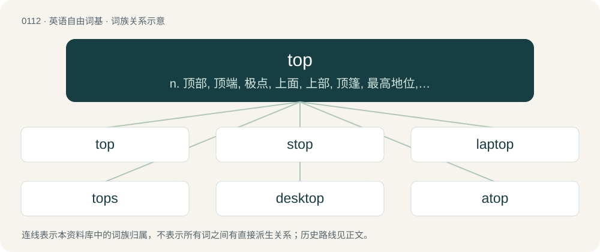

# 0116 · top — n. 顶部, 顶端, 极点, 上面, 上部, 顶篷, 最高地位, 首位, 陀螺；a. 最高的, 顶上的, 头等的；vt. 盖, 加以顶, 高达, 超越

[总目录](../00_总目录_按常用程度.md)

**类型**：英语自由词基　｜　**来源语言**：见词源记录

## 核心含义与来源

- 核心含义：n. 顶部, 顶端, 极点, 上面, 上部, 顶篷, 最高地位, 首位, 陀螺；a. 最高的, 顶上的, 头等的；vt. 盖, 加以顶, 高达, 超越
- 英文含义：The highest or uppermost part of something.
- 词形：top

**来源记录 1**（名词；The highest or uppermost part of something.）

From Middle English top, toppe, from Old English topp (“top, highest part; summit; crest; tassel, tuft; (spinning) top, ball; a tuft or ball at the highest point of anything”), from Proto-West Germanic \*topp, from Proto-Germanic \*tuppaz (“braid, pigtail, end”), of unknown ultimate origin. Compare typologically Latin apex (&lt;&lt; Proto-Indo-European \*h₂ep- (“to join, attach, fasten, fit”)). Cognate with Saterland Frisian Top (“top”), Cimbrian sòpf (“braid”), Dutch top (“top, summit, peak”), German Topp (“top of a mast”), Zopf (“braid, pigtail, plait, top”), Luxembourgish Zapp (“plait, tress”), Vilamovian cöp (“braid, plait”), Yiddish צאָפּ (tsop, “braid”), Danish top (“top”), Icelandic toppur (“top”), Norwegian Bokmål, Norwegian Nynorsk and Swedish topp (“top, peak, summit, tip”), Italian zuffa (“brawl”). The sense of a spinning toy is separated from this, obscurely related to Dutch top and dop in this sense, against Standard Dutch tol, and French toupie having this sense.

## 词族图

## 单词速览（常用到不常用）

| 单词 | 音标 | 释义 |
|---|---|---|
| [top](#w-1) | 英 /tɒp/；美 /tɑp/ | n. 顶部, 顶端, 极点, 上面, 上部, 顶篷, 最高地位, 首位, 陀螺；a. 最高的, 顶上的, 头等的；vt. 盖, 加以顶, 高达, 超越 |
| [stop](#w-2) | 英 /stɒp/；/stɑp/ | 【英文】The squark that is the superpartner of a top quark. |
| [laptop](#w-3) | 英 /ˈlæp.tɒp/；美 /ˈlæp.tɑp/ | \[计\] 膝上型的 |
| [tops](#w-4) | 英 /tɒps/；美 /tɑps/ | a. 第一流的, 最上等的 |
| [desktop](#w-5) | /ˈdɛsktɒp/ | n. 桌面；\[计\] 桌面 |
| [atop](#w-6) | /əˈtɒp/ | adv. 在顶上；prep. 在...的顶上 |
| [topping](#w-7) | 英 /ˈtɒpɪŋ/；美 /ˈtɑpɪŋ/ | a. 极好的, 主要的, 一流的；n. 除顶部, 修剪树稍, 剪落之小树枝 |
| [rooftop](#w-8) | 英 /ˈɹuːfˌtɒp/；美 /ˈɹufˌtɑp/ | n. 屋顶 |
| [topless](#w-9) | /ˈtɒplis/ | a. 无顶的, 袒胸的 |
| [topper](#w-10) | 英 /ˈtɒpə/；美 /ˈtɑpɚ/ | n. 第一流的人物, 高档的东西, 胜过以前同类物的东西, 大礼帽, 轻便大衣；\[经\] 高档货 |
| [tabletop](#w-11) | /ˈteibltɒp/ | n. 桌面 |
| [hilltop](#w-12) | 英 /ˈhɪltɒp/ | n. 小山顶 |
| [topple](#w-13) | 英 /ˈtɒpl̩/；美 /ˈtɑpl̩/ | vt. 推翻, 颠覆；vi. 倒塌, 摇摇欲坠 |
| [topshop](#w-14) |  | 【英文】A building found in parts of the English Midlands, having three storeys, the lower two serving as living accommodation and the upper floor as a workshop containing a weaver's loom. |
| [mountaintop](#w-15) | 美 /ˈmaʊnt(ɪ)nˌtɑp/ | n. 山顶 |
| [countertop](#w-16) | /ˈkajntətɔp/ | n. (厨房的)工作台面 |
| [topsoil](#w-17) | /ˈtɒpsɒil/ | n. 上层土, 表层土 |
| [topmost](#w-18) | 英 /tɒpˈməʊst/；美 /tɑpˈmoʊst/ | a. 最高的, 顶端的 |
| [topside](#w-19) | 美 /ˈtɑp.saɪd/ | n. 干舷部 |
| [hardtop](#w-20) | /ˈhɑːdtɔp/ | n. 有金属顶盖的汽车；室内电影院 |
| [blacktop](#w-21) | /ˈblæktɒp/ | n. 沥青, 柏油路 |
| [stovetop](#w-22) | /ˈstəʊvtɒp/ | n. 炉顶面, 炉面；a. 炉面的；适于在炉面烹制的 |
| [topsail](#w-23) | 英 /ˈtɒp.seɪl/；美 /ˈtɑp.seɪl/ | n. 上桅帆 |
| [treetop](#w-24) | 英 /ˈtɹiːˌtɒp/；美 /ˈtɹiˌtɑp/ | n. 树稍 |
| [topman](#w-25) | /ˈtɔpmən/ | n. 地面上做杂务的建筑工人 |
| [worktop](#w-26) |  | n. 桌面, 台面 |
| [topline](#w-27) | /ˈtɔplain/ | n. 背线(指动物身体上部从头至尾的外形线) |

## 逐词详解

### 1. top

**词性**：名词　｜　**音标**：英 /tɒp/；美 /tɑp/

**中文释义**：n. 顶部, 顶端, 极点, 上面, 上部, 顶篷, 最高地位, 首位, 陀螺；a. 最高的, 顶上的, 头等的；vt. 盖, 加以顶, 高达, 超越

**英文义项**：The highest or uppermost part of something. / The part of something that is usually highest or uppermost.

**词源与演化**：

From Middle English top, toppe, from Old English topp (“top, highest part; summit; crest; tassel, tuft; (spinning) top, ball; a tuft or ball at the highest point of anything”), from Proto-West Germanic \*topp, from Proto-Germanic \*tuppaz (“braid, pigtail, end”), of unknown ultimate origin. Compare typologically Latin apex (&lt;&lt; Proto-Indo-European \*h₂ep- (“to join, attach, fasten, fit”)). Cognate with Saterland Frisian Top (“top”), Cimbrian sòpf (“braid”), Dutch top (“top, summit, peak”), German Topp (“top of a mast”), Zopf (“braid, pigtail, plait, top”), Luxembourgish Zapp (“plait, tress”), Vilamovian cöp (“braid, plait”), Yiddish צאָפּ (tsop, “braid”), Danish top (“top”), Icelandic toppur (“top”), Norwegian Bokmål, Norwegian Nynorsk and Swedish topp (“top, peak, summit, tip”), Italian zuffa (“brawl”). The sense of a spinning toy is separated from this, obscurely related to Dutch top and dop in this sense, against Standard Dutch tol, and French toupie having this sense.

**例句**：

> Further weather information can be found at the top of your television screen.

该用例对应义项：The uppermost part of a page, picture, viewing screen, etc.

### 2. stop

**词性**：名词　｜　**音标**：英 /stɒp/；/stɑp/

**英文义项**：The squark that is the superpartner of a top quark.

**构词拆分**：From s- + top.

**词源与演化**：

From s- + top.

### 3. laptop

**词性**：名词　｜　**音标**：英 /ˈlæp.tɒp/；美 /ˈlæp.tɑp/

**中文释义**：\[计\] 膝上型的

**英文义项**：A laptop computer.

**构词拆分**：lap (“upper legs of a seated person”) + top

**词源与演化**：

From lap (“upper legs of a seated person”) + top, modeled after desktop.

**例句**：

> He was playing a video game on his laptop.

该用例对应义项：A laptop computer.

### 4. tops

**词性**：名词　｜　**音标**：英 /tɒps/；美 /tɑps/

**中文释义**：a. 第一流的, 最上等的

**英文义项**：The uppermost field of a dartboard; the double-20 field

**构词拆分**：top + -s (diminutive)

**词源与演化**：

Likely top + -s (diminutive).

**例句**：

> Scoring 38 more points leaves him with tops for the win.

该用例对应义项：The uppermost field of a dartboard; the double-20 field

### 5. desktop

**词性**：名词　｜　**音标**：/ˈdɛsktɒp/

**中文释义**：n. 桌面；\[计\] 桌面

**英文义项**：The top surface of a desk. / A desktop computer.

**构词拆分**：From desk + top.

**词源与演化**：

From desk + top.

**例句**：

> I installed a new application and it added its icon to my desktop.

该用例对应义项：The main graphical user interface of an operating system, usually displaying icons, windows and background wallpaper.

### 6. atop

**词性**：介词　｜　**音标**：/əˈtɒp/

**中文释义**：adv. 在顶上；prep. 在...的顶上

**英文义项**：On the top of. / On the top (with of).

**构词拆分**：From a- (“on”) + top.

**词源与演化**：

From a- (“on”) + top.

**例句**：

> He sat atop of the mountain, waiting for the end of the world.

该用例对应义项：On the top (with of).

### 7. topping

**词性**：名词　｜　**音标**：英 /ˈtɒpɪŋ/；美 /ˈtɑpɪŋ/

**中文释义**：a. 极好的, 主要的, 一流的；n. 除顶部, 修剪树稍, 剪落之小树枝

**英文义项**：Any food item added on top of another, such as sprinkles on ice cream or pepperoni on pizza. / The act of cutting off the top of something.

**构词拆分**：top + -ing

**词源与演化**：

From Middle English toppyng; equivalent to top + -ing.

**例句**：

> Pepperoni and mushrooms are common pizza toppings.

该用例对应义项：Any food item added on top of another, such as sprinkles on ice cream or pepperoni on pizza.

### 8. rooftop

**词性**：名词　｜　**音标**：英 /ˈɹuːfˌtɒp/；美 /ˈɹufˌtɑp/

**中文释义**：n. 屋顶

**英文义项**：The area atop a roof. / The top layer of a roof; the material covering or composing a roof.

**构词拆分**：From roof + top.

**词源与演化**：

From roof + top.

**例句**：

> The staircase leading to the rooftop is narrow, steep, and dark.

### 9. topless

**词性**：形容词　｜　**音标**：/ˈtɒplis/

**中文释义**：a. 无顶的, 袒胸的

**英文义项**：Lacking a top. / Very high; towering.

**构词拆分**：top + -less

**词源与演化**：

From top + -less.

**例句**：

> Only her closest friends knew that Jenny was working at a topless bar to help with college expenses.

该用例对应义项：Featuring women that are naked from the waist up, often strippers or dancers.

### 10. topper

**词性**：名词　｜　**音标**：英 /ˈtɒpə/；美 /ˈtɑpɚ/

**中文释义**：n. 第一流的人物, 高档的东西, 胜过以前同类物的东西, 大礼帽, 轻便大衣；\[经\] 高档货

**英文义项**：Something that is on top. / A top hat.

**构词拆分**：top + -er

**词源与演化**：

From Middle English toppor, equivalent to top + -er.

**例句**：

> In his latest standup set, his topper is a callback to the dog bowl story.

该用例对应义项：Something that exceeds those previous in a series, as a joke or prank.

### 11. tabletop

**词性**：名词　｜　**音标**：/ˈteibltɒp/

**中文释义**：n. 桌面

**英文义项**：The flat, horizontal upper surface of a table. / A fixed item resembling a table, used for performing skateboarding tricks.

**构词拆分**：table + top

**词源与演化**：

From table + top.

### 12. hilltop

**词性**：名词　｜　**音标**：英 /ˈhɪltɒp/

**中文释义**：n. 小山顶

**英文义项**：The peak or crest of a hill.

**构词拆分**：hill + top

**词源与演化**：

From hill + top.

**例句**：

> The caves are situated on a hilltop and provide an excellent vantage point.

### 13. topple

**词性**：动词　｜　**音标**：英 /ˈtɒpl̩/；美 /ˈtɑpl̩/

**中文释义**：vt. 推翻, 颠覆；vi. 倒塌, 摇摇欲坠

**英文义项**：To push or throw over. / To overturn.

**构词拆分**：From top + -le (frequentative verb suffix).

**词源与演化**：

From top + -le (frequentative verb suffix).

**例句**：

> The pile of pennies began to topple.

该用例对应义项：To totter and fall, or to lean as if about to do so.

### 14. topshop

**词性**：名词

**英文义项**：A building found in parts of the English Midlands, having three storeys, the lower two serving as living accommodation and the upper floor as a workshop containing a weaver's loom.

**构词拆分**：top + shop

**词源与演化**：

From top + shop.

### 15. mountaintop

**词性**：形容词　｜　**音标**：美 /ˈmaʊnt(ɪ)nˌtɑp/

**中文释义**：n. 山顶

**英文义项**：Situated or occurring on the summit of a mountain.

**构词拆分**：From mountain + top.

**词源与演化**：

From mountain + top.

**例句**：

> You can get a fine view of the sea from the mountaintop.

### 16. countertop

**词性**：名词　｜　**音标**：/ˈkajntətɔp/

**中文释义**：n. (厨房的)工作台面

**英文义项**：The top surface of a counter, for preparation of food, etc.

**构词拆分**：counter + top

**词源与演化**：

From counter + top.

**例句**：

> The sink was full, so I left the plate on the countertop.

### 17. topsoil

**词性**：名词　｜　**音标**：/ˈtɒpsɒil/

**中文释义**：n. 上层土, 表层土

**英文义项**：The upper layer of soil, typically most fertile and in which it is the easiest to start new plants.

**构词拆分**：top + soil

**词源与演化**：

From top + soil.

**例句**：

> Little grew on the farm, after the floods from the hurricane washed away the topsoil.

该用例对应义项：The upper layer of soil, typically most fertile and in which it is the easiest to start new plants.

### 18. topmost

**词性**：形容词　｜　**音标**：英 /tɒpˈməʊst/；美 /tɑpˈmoʊst/

**中文释义**：a. 最高的, 顶端的

**英文义项**：At or nearest to the top; uppermost; being the very highest. / Of greatest status, esteem, or prestige; best.

**构词拆分**：top + -most

**词源与演化**：

From top + -most.

**例句**：

> On the topmost step.

该用例对应义项：at or nearest to the top

### 19. topside

**词性**：名词　｜　**音标**：美 /ˈtɑp.saɪd/

**中文释义**：n. 干舷部

**英文义项**：The side or part of something that is at the top. / The surface of a ship’s hull that is above the water line.

**构词拆分**：top + side

**词源与演化**：

From top + side.

### 20. hardtop

**词性**：名词　｜　**音标**：/ˈhɑːdtɔp/

**中文释义**：n. 有金属顶盖的汽车；室内电影院

**英文义项**：The removable rigid roof of a convertible or sports car. / A car with such a roof.

**构词拆分**：hard + top

**词源与演化**：

From hard + top.

### 21. blacktop

**词性**：动词　｜　**音标**：/ˈblæktɒp/

**中文释义**：n. 沥青, 柏油路

**英文义项**：To pave with blacktop.

**构词拆分**：black + top

**词源与演化**：

From black + top.

**例句**：

> The blacktop road glistened in the heat of the afternoon sun.

### 22. stovetop

**词性**：名词　｜　**音标**：/ˈstəʊvtɒp/

**中文释义**：n. 炉顶面, 炉面；a. 炉面的；适于在炉面烹制的

**英文义项**：The top of a stove; usually specifically the burners.

**构词拆分**：stove + top

**词源与演化**：

From stove + top.

**例句**：

> You make this on the stovetop, not in the oven.

该用例对应义项：The top of a stove; usually specifically the burners.

### 23. topsail

**词性**：名词　｜　**音标**：英 /ˈtɒp.seɪl/；美 /ˈtɑp.seɪl/

**中文释义**：n. 上桅帆

**英文义项**：A sail or either of the two sails rigged just above the course sail and supported by the topmast on a square-rigged sailing ship. / In a fore-and-aft-rigged sailing boat, the sail that is set above the gaff at the top part of the mast.

**构词拆分**：top + sail

**词源与演化**：

From Middle English topsail, topsayl, topseyle, topsaill, equivalent to top + sail.

### 24. treetop

**词性**：名词　｜　**音标**：英 /ˈtɹiːˌtɒp/；美 /ˈtɹiˌtɑp/

**中文释义**：n. 树稍

**英文义项**：The crown or uppermost branches of a tree.

**构词拆分**：tree + top

**词源与演化**：

From tree + top.

**例句**：

> The crow cawed from the treetop.

### 25. topman

**词性**：名词　｜　**音标**：/ˈtɔpmən/

**中文释义**：n. 地面上做杂务的建筑工人

**英文义项**：The man stationed in the top on a sailing vessel, responsible for the setting of the sails / The uppermost sawyer in a sawpit; a topsman.

**构词拆分**：top + -man

**词源与演化**：

From top + -man.

### 26. worktop

**词性**：名词

**中文释义**：n. 桌面, 台面

**英文义项**：A surface, usually resting on cupboards or drawers that can be used to work on. Usually in a kitchen.

**构词拆分**：work + top

**词源与演化**：

From work + top.

**例句**：

> The cupboards were oak and the worktop was granite.

该用例对应义项：A surface, usually resting on cupboards or drawers that can be used to work on. Usually in a kitchen.

### 27. topline

**词性**：名词　｜　**音标**：/ˈtɔplain/

**中文释义**：n. 背线(指动物身体上部从头至尾的外形线)

**英文义项**：The upper curvature of a horse's or dog's withers, back, and loin. / Top billing.

**构词拆分**：top + line

**词源与演化**：

From top + line.

**用法示例／搭配（非完整句）**：

> topline takeaways

该用例对应义项：The first line, the topmost-ranking line; the most important thing.
