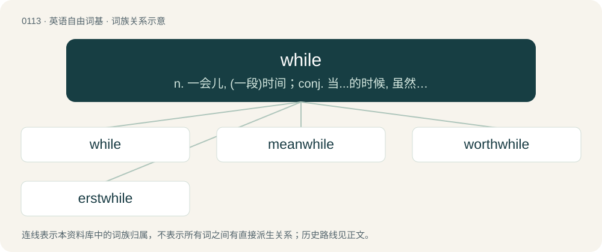

# 0117 · while — n. 一会儿, (一段)时间；conj. 当...的时候, 虽然；vt. 消磨

[总目录](../00_总目录_按常用程度.md)

**类型**：英语自由词基　｜　**来源语言**：见词源记录

## 核心含义与来源

- 核心含义：n. 一会儿, (一段)时间；conj. 当...的时候, 虽然；vt. 消磨
- 英文含义：An uncertain duration of time, a period of time.
- 词形：while

**来源记录 1**（名词；An uncertain duration of time, a period of time.）

From Middle English whyle, from Old English hwīl, from Proto-West Germanic \*hwīlu, from Proto-Germanic \*hwīlō (compare Dutch wijl, Low German Wiel, German Weile, Danish and Norwegian Bokmål hvile (“rest”), Norwegian Nynorsk kvila (“rest”), Swedish vila (“rest”), Faroese and Icelandic hvíla (“rest”)) from Proto-Indo-European \*kʷyeh₁- (“to rest”). Cognate with Albanian sillë (“breakfast”), Latin tranquillus, Sanskrit चिर (cirá), Persian شاد (šâd).

## 词族图

## 单词速览（常用到不常用）

| 单词 | 音标 | 释义 |
|---|---|---|
| [while](#w-1) | /ʍaɪl/ | n. 一会儿, (一段)时间；conj. 当...的时候, 虽然；vt. 消磨 |
| [meanwhile](#w-2) | /ˈmiːnwaɪl/ | n. 其时, 其间；adv. 同时, 于此时 |
| [worthwhile](#w-3) | 英 /ˌwɜː(ɹ)θˈʍaɪl/；/ˌwɜː(ɹ)θˈwaɪl/ | a. 值得花时间的, 值得做的, 有真实价值的 |
| [erstwhile](#w-4) | 英 /ˈɜː(ɹ)st.waɪl/；美 /ˈɝst.waɪl/ | adv. 以前, 往昔地；a. 以前的, 往昔的 |

## 逐词详解

### 1. while

**词性**：名词　｜　**音标**：/ʍaɪl/

**中文释义**：n. 一会儿, (一段)时间；conj. 当...的时候, 虽然；vt. 消磨

**英文义项**：An uncertain duration of time, a period of time. / An uncertain long period of time

**词源与演化**：

From Middle English whyle, from Old English hwīl, from Proto-West Germanic \*hwīlu, from Proto-Germanic \*hwīlō (compare Dutch wijl, Low German Wiel, German Weile, Danish and Norwegian Bokmål hvile (“rest”), Norwegian Nynorsk kvila (“rest”), Swedish vila (“rest”), Faroese and Icelandic hvíla (“rest”)) from Proto-Indo-European \*kʷyeh₁- (“to rest”). Cognate with Albanian sillë (“breakfast”), Latin tranquillus, Sanskrit चिर (cirá), Persian شاد (šâd).

**例句**：

> It’s a long while since anyone lived there, so it’s a ruin now.

该用例对应义项：An uncertain duration of time, a period of time.

### 2. meanwhile

**词性**：名词　｜　**音标**：/ˈmiːnwaɪl/

**中文释义**：n. 其时, 其间；adv. 同时, 于此时

**英文义项**：The time between two events.

**构词拆分**：mean (“intermediate”) + while

**词源与演化**：

From Middle English menewhile, equivalent to mean (“intermediate”) + while. Adverb is by ellipsis from in the mean while, noun being conventionally written as one word after the adjective.

**例句**：

> Meanwhile the socialists are running the government.

该用例对应义项：the time between one event, process, or period and another

### 3. worthwhile

**词性**：形容词　｜　**音标**：英 /ˌwɜː(ɹ)θˈʍaɪl/；/ˌwɜː(ɹ)θˈwaɪl/

**中文释义**：a. 值得花时间的, 值得做的, 有真实价值的

**英文义项**：Good and important enough to spend time, effort, or money on.

**构词拆分**：worth (adjective) + while (noun)

**词源与演化**：

From worth (adjective) + while (noun).

**例句**：

> Doing volunteer work to help others is truly worthwhile.

该用例对应义项：Good and important enough to spend time, effort, or money on.

### 4. erstwhile

**词性**：形容词　｜　**音标**：英 /ˈɜː(ɹ)st.waɪl/；美 /ˈɝst.waɪl/

**中文释义**：adv. 以前, 往昔地；a. 以前的, 往昔的

**英文义项**：Former, previous. / Respected, honourable.

**构词拆分**：From erst (“first, formerly”) + while.

**词源与演化**：

From erst (“first, formerly”) + while.

**例句**：

> My erstwhile colleague kept me up-to-date with the company gossip.
