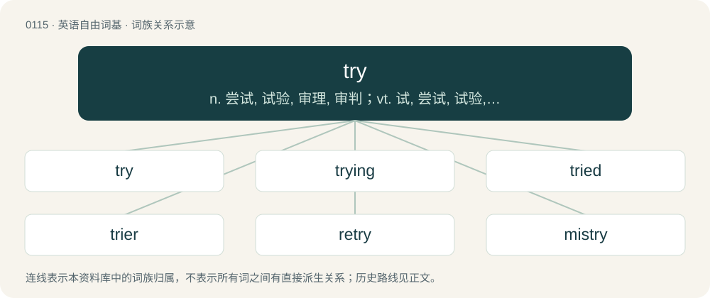

# 0119 · try — n. 尝试, 试验, 审理, 审判；vt. 试, 尝试, 试验, 考验, 审问, 提炼；vi. 尝试, 试图

[总目录](../00_总目录_按常用程度.md)

**类型**：英语自由词基　｜　**来源语言**：见词源记录

## 核心含义与来源

- 核心含义：n. 尝试, 试验, 审理, 审判；vt. 试, 尝试, 试验, 考验, 审问, 提炼；vi. 尝试, 试图
- 英文含义：To attempt; to endeavour. Followed by infinitive.
- 词形：try

**来源记录 1**（动词；To attempt; to endeavour. Followed by infinitive.）

From Middle English trien (“to separate out, sift, choose, select, evaluate, try a legal case”), from Anglo-Norman trier, triher, triere (“to divide, separate, choose, select, prove, determine, try a case”), Old French trier (“to choose, pick out or separate from others, sift, cull”), of uncertain origin. Cognate with Occitan triar (“to choose, sort, scrutinise, peel”), Catalan triar (“to pick, choose, decide”). Suggested to be derived from Late Latin \*trītāre (“to crush, grind, trample, wear out”), itself derived from Classical Latin trītus (“rubbed, worn down, pulverised”), the past participle of terō, terere (“to rub, wear down, trample”), though this derivation is incompatible with the Occitan form. Additionally, the shift in meaning from "rub, crush, trample" to "pick out, choose, cull" is difficult to explain. One suggestion is that the semantic shift might have originated from a Latin phrase \*granum terere ("to tread the corn (in threshing)"; compare Latin trītūra (“rubbing, chafing, friction" also "threshing”)), which has a parallel in the modern French trier le grain (“to sort the grain”). Alternatively, perhaps derived from Vulgar Latin \*trīāre, a metathetic alteration of \*tīrāre (“to tear off, pull, draw”), whence also Old French tirer (“to draw, pull, pluck, tug, peck at, extract”), Occitan tirar (“to take, draw, retrieve, remove, extract”). Replaced native Middle English cunnen (“to try”) (from Old English cunnian), Middle English fandien (“to try, prove”) (from Old English fandian), and Middle English costnien (“to try, tempt, test”) (from Old English costnian).

## 词族图

## 单词速览（常用到不常用）

| 单词 | 音标 | 释义 |
|---|---|---|
| [try](#w-1) | /tɹaɪ/ | n. 尝试, 试验, 审理, 审判；vt. 试, 尝试, 试验, 考验, 审问, 提炼；vi. 尝试, 试图 |
| [trying](#w-2) | /ˈtɹaɪ.ɪŋ/ | a. 难受的, 难堪的；\[法\] 裁决, 审判, 审理; 使人痛苦的, 难堪的, 难处的 |
| [tried](#w-3) | /tɹaɪd/ | a. 试验过的, 可靠的；\[法\] 已经审讯的, 已经查验的 |
| [trier](#w-4) | /ˈtɹaɪə(ɹ)/ | n. 试验者, 试验物, 审问者；\[化\] 取样器 |
| [retry](#w-5) | /riˈtɹaɪ/ | vt. 再试, 再审；\[计\] 重发; 重试 |
| [mistry](#w-6) | /mɪsˈtɹaɪ/ | \[人名\] 米斯特里 |

## 逐词详解

### 1. try

**词性**：动词　｜　**音标**：/tɹaɪ/

**中文释义**：n. 尝试, 试验, 审理, 审判；vt. 试, 尝试, 试验, 考验, 审问, 提炼；vi. 尝试, 试图

**英文义项**：To attempt; to endeavour. Followed by infinitive. / To make an experiment. Usually followed by a present participle.

**词源与演化**：

From Middle English trien (“to separate out, sift, choose, select, evaluate, try a legal case”), from Anglo-Norman trier, triher, triere (“to divide, separate, choose, select, prove, determine, try a case”), Old French trier (“to choose, pick out or separate from others, sift, cull”), of uncertain origin. Cognate with Occitan triar (“to choose, sort, scrutinise, peel”), Catalan triar (“to pick, choose, decide”). Suggested to be derived from Late Latin \*trītāre (“to crush, grind, trample, wear out”), itself derived from Classical Latin trītus (“rubbed, worn down, pulverised”), the past participle of terō, terere (“to rub, wear down, trample”), though this derivation is incompatible with the Occitan form. Additionally, the shift in meaning from "rub, crush, trample" to "pick out, choose, cull" is difficult to explain. One suggestion is that the semantic shift might have originated from a Latin phrase \*granum terere ("to tread the corn (in threshing)"; compare Latin trītūra (“rubbing, chafing, friction" also "threshing”)), which has a parallel in the modern French trier le grain (“to sort the grain”). Alternatively, perhaps derived from Vulgar Latin \*trīāre, a metathetic alteration of \*tīrāre (“to tear off, pull, draw”), whence also Old French tirer (“to draw, pull, pluck, tug, peck at, extract”), Occitan tirar (“to take, draw, retrieve, remove, extract”). Replaced native Middle English cunnen (“to try”) (from Old English cunnian), Middle English fandien (“to try, prove”) (from Old English fandian), and Middle English costnien (“to try, tempt, test”) (from Old English costnian).

**例句**：

> I am really not trying to hear you talk about my mama like that.

该用例对应义项：To want, to desire.

### 2. trying

**词性**：形容词　｜　**音标**：/ˈtɹaɪ.ɪŋ/

**中文释义**：a. 难受的, 难堪的；\[法\] 裁决, 审判, 审理; 使人痛苦的, 难堪的, 难处的

**英文义项**：Difficult to endure; arduous. / Irritating, stressful or bothersome.

**构词拆分**：From try + -ing.

**词源与演化**：

From try + -ing.

**例句**：

> A trying day at the office.

该用例对应义项：extremely irritating to the nerves

### 3. tried

**词性**：形容词　｜　**音标**：/tɹaɪd/

**中文释义**：a. 试验过的, 可靠的；\[法\] 已经审讯的, 已经查验的

**英文义项**：Tested, hence, proven to be firm or reliable. / Put on trial, taken before a lawcourt.

**构词拆分**：try + -ed

**词源与演化**：

From Middle English tried, tryed, equivalent to try + -ed.

**例句**：

> The excited woman tried to explain the accident all in one breath.

### 4. trier

**词性**：名词　｜　**音标**：/ˈtɹaɪə(ɹ)/

**中文释义**：n. 试验者, 试验物, 审问者；\[化\] 取样器

**英文义项**：One who tries; one who makes experiments or examines anything by a test or standard. / An instrument used for sampling something.

**构词拆分**：try + -er

**词源与演化**：

From Middle English triour, from Anglo-Norman triour and Middle English trien (equivalent to try + -er).

**例句**：

> Trier is a city in western Germany that's located in the Rhineland-Palatinate federal state.

### 5. retry

**词性**：动词　｜　**音标**：/riˈtɹaɪ/

**中文释义**：vt. 再试, 再审；\[计\] 重发; 重试

**英文义项**：To try or attempt again. / To try judicially a second time.

**构词拆分**：re- + try

**词源与演化**：

From re- + try.

**用法示例／搭配（非完整句）**：

> to retry connecting to the Internet after an error

该用例对应义项：To try or attempt again.

### 6. mistry

**词性**：动词　｜　**音标**：/mɪsˈtɹaɪ/

**中文释义**：\[人名\] 米斯特里

**英文义项**：To declare a mistrial in (a court case). / (of a court case) To end in a mistrial.

**构词拆分**：mis- + try

**词源与演化**：

From mis- + try, as a back-formation from mistrial.
