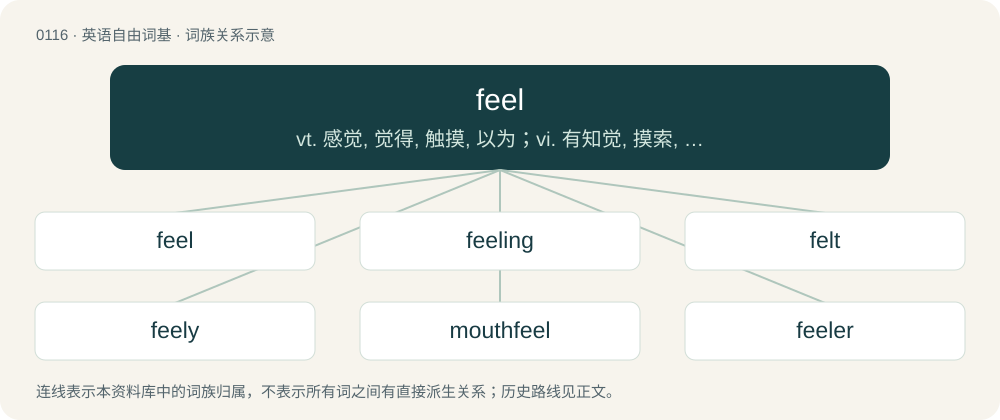

# 0120 · feel — vt. 感觉, 觉得, 触摸, 以为；vi. 有知觉, 摸索, 同情；n. 感觉, 觉得, 触摸

[总目录](../00_总目录_按常用程度.md)

**类型**：英语自由词基　｜　**来源语言**：见词源记录

## 核心含义与来源

- 核心含义：vt. 感觉, 觉得, 触摸, 以为；vi. 有知觉, 摸索, 同情；n. 感觉, 觉得, 触摸
- 英文含义：To become aware of through the skin; to use the sense of touch on.
- 词形：feel

**来源记录 1**（动词；To become aware of through the skin; to use the sense of touch on.）

From Middle English felen, from Old English fēlan, from Proto-West Germanic \*fōlijan. Cognate with Dutch voelen and German fühlen.

## 词族图

## 单词速览（常用到不常用）

| 单词 | 音标 | 释义 |
|---|---|---|
| [feel](#w-1) | /ˈfiːl/ | vt. 感觉, 觉得, 触摸, 以为；vi. 有知觉, 摸索, 同情；n. 感觉, 觉得, 触摸 |
| [feeling](#w-2) | 英 /ˈfiː.lɪŋ/；美 /ˈfi.lɪŋ/ | n. 摸, 触觉, 知觉, 感觉, 情绪, 同情；a. 有同情心的, 有感觉的, 仁慈的, 动人的 |
| [felt](#w-3) | /ˈfɛlt/ | 【英文】That has been experienced or perceived. |
| [feely](#w-4) | /ˈfiːli/ | 【英文】Tending to feel things by physically touching them. |
| [mouthfeel](#w-5) | 美 /ˈmaʊθˌfil/ | n. （进食者对食品的）口觉, 口感 |
| [feeler](#w-6) | 英 /ˈfiːlə/；美 /ˈfiːləɹ/ | n. 触角, 试探者, 试探手段 |

## 逐词详解

### 1. feel

**词性**：动词　｜　**音标**：/ˈfiːl/

**中文释义**：vt. 感觉, 觉得, 触摸, 以为；vi. 有知觉, 摸索, 同情；n. 感觉, 觉得, 触摸

**英文义项**：To become aware of through the skin; to use the sense of touch on. / To find one's way (literally or figuratively) by touching or using cautious movements.

**词源与演化**：

From Middle English felen, from Old English fēlan, from Proto-West Germanic \*fōlijan. Cognate with Dutch voelen and German fühlen.

**例句**：

> I did feel a complete fool after stumbling on the same rock again.

该用例对应义项：To become aware of through the skin; to use the sense of touch on.

### 2. feeling

**词性**：形容词　｜　**音标**：英 /ˈfiː.lɪŋ/；美 /ˈfi.lɪŋ/

**中文释义**：n. 摸, 触觉, 知觉, 感觉, 情绪, 同情；a. 有同情心的, 有感觉的, 仁慈的, 动人的

**英文义项**：Emotionally sensitive. / Expressive of great sensibility; attended by, or evincing, sensibility.

**构词拆分**：feel + -ing

**词源与演化**：

From Middle English felynge, equivalent to feel + -ing.

**例句**：

> Despite the rough voice, the coach is surprisingly feeling.

该用例对应义项：Emotionally sensitive.

### 3. felt

**词性**：形容词　｜　**音标**：/ˈfɛlt/

**英文义项**：That has been experienced or perceived.

**构词拆分**：feel + -ed

**词源与演化**：

From Old English fēled, corresponding to feel + -ed.

### 4. feely

**词性**：形容词　｜　**音标**：/ˈfiːli/

**英文义项**：Tending to feel things by physically touching them.

**构词拆分**：feel + -y

**词源与演化**：

From feel + -y.

### 5. mouthfeel

**词性**：名词　｜　**音标**：美 /ˈmaʊθˌfil/

**中文释义**：n. （进食者对食品的）口觉, 口感

**英文义项**：The texture of food, drink, etc. as perceived by the mouth. / The sensations of the tongue when it moves around in the mouth.

**构词拆分**：mouth + feel

**词源与演化**：

From mouth + feel.

**例句**：

> I have a much better mouthfeel since my broken tooth has been repaired.

该用例对应义项：The sensations of the tongue when it moves around in the mouth.

### 6. feeler

**词性**：名词　｜　**音标**：英 /ˈfiːlə/；美 /ˈfiːləɹ/

**中文释义**：n. 触角, 试探者, 试探手段

**英文义项**：Someone or something that feels. / An antenna or appendage used for feeling, especially on an insect.

**构词拆分**：feel + -er

**词源与演化**：

From Middle English feler, feeler, felar, equivalent to feel + -er. Animal organ definition from 1660s. Transferred sense of "proposal put forth to observe the reaction it gets" is from 1830.

**例句**：

> This survey is designed to get a feeler about how the citizens feel about the proposed new highway.

该用例对应义项：Something ventured to test another's feelings, opinion, or position.
