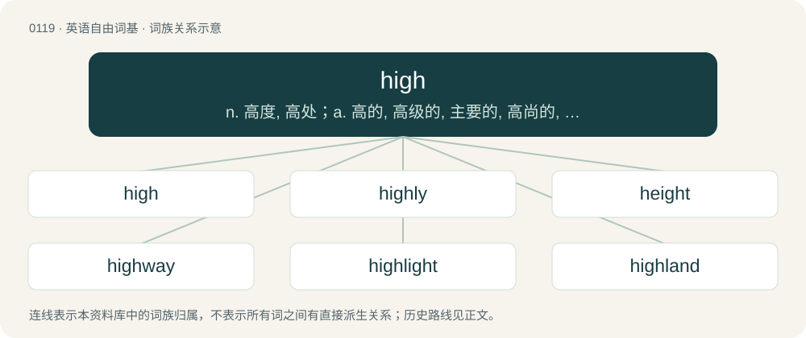

# 0123 · high — n. 高度, 高处；a. 高的, 高级的, 主要的, 高尚的, 高原的, 高音的, 昂贵的, 傲慢的；adv. 高度地, 奢侈地

[总目录](../00_总目录_按常用程度.md)

**类型**：英语自由词基　｜　**来源语言**：见词源记录

## 核心含义与来源

- 核心含义：n. 高度, 高处；a. 高的, 高级的, 主要的, 高尚的, 高原的, 高音的, 昂贵的, 傲慢的；adv. 高度地, 奢侈地
- 英文含义：Very elevated; extending or being far above a base; tall; lofty.
- 词形：high

**来源记录 1**（形容词；Very elevated; extending or being far above a base; tall; lofty.）

From Middle English high, heigh, heih, from Old English hēah (“high, tall, lofty, high-class, exalted, sublime, illustrious, important, proud, haughty, deep, right”), from Proto-West Germanic \*hauh (“high”), from Proto-Germanic \*hauhaz (“high”), from Proto-Indo-European \*kewk- (“to bend; crooked”). Cognates Cognate with Scots heich (“high”), Yola heegh, heigh, heighe, hia, hie (“high”), North Frisian hoog, huuch (“high”), Saterland Frisian hooch, hoog (“high”), West Frisian heech (“high”), Alemannic German hooch (“high”), Central Franconian huh (“high”), Cimbrian hoach, hòach (“high”), Dutch hoog (“high”), German hoch (“high”), German Low German hooch (“high”), Limburgish hoeg (“high”), Luxembourgish héich (“high”), Mòcheno heach (“high”), Vilamovian huch (“high”), Yiddish הויך (hoykh, “high”), Danish høj (“high”), Faroese háur, høgur (“high”), Gutnish haugar (“high”), Icelandic hár (“high”), Norwegian Bokmål høg, høy (“high”), Norwegian Nynorsk høg, håg, hå (“high”), Swedish hög (“high”), Gothic 𐌷𐌰𐌿𐌷𐍃 (hauhs, “high”), Vandalic \*oas (“high”), Old French haut (“high”) (from Old High German hoh (“high”)); also with Ancient Greek Καύκᾰσος (Kaúkăsos, “Caucasus”), Latvian koks (“tree”), Lithuanian kúoka (“stick with thick end, pounder, pestle”), Bulgarian ку́ка (kúka, “hook”), Albanian çukë (“peak, summit, top”).

## 词族图

## 单词速览（常用到不常用）

| 单词 | 音标 | 释义 |
|---|---|---|
| [high](#w-1) | /haɪ/ | n. 高度, 高处；a. 高的, 高级的, 主要的, 高尚的, 高原的, 高音的, 昂贵的, 傲慢的；adv. 高度地, 奢侈地 |
| [highly](#w-2) | /ˈhaɪli/ | adv. 非常, 非常赞许地；\[电\] 大大地 |
| [height](#w-3) | /haɪt/ | n. 高度, 海拔, 高地, 顶点；\[化\] 高度 |
| [highway](#w-4) | /ˈhaɪweɪ/ | n. 公路, 大道, 捷径；\[法\] 公路, 大路 |
| [highlight](#w-5) | 英 /ˈhaɪlaɪt/；美 /ˈhaɪˌlaɪt/ | n. 加亮区, 精彩场面；vt. 加亮, 使显著, 以强光照射, 突出；\[计\] 突出 |
| [highland](#w-6) | /ˈhaɪ.lənd/ | n. 高地, 苏格兰高地 |
| [highlands](#w-7) | /ˈhaɪləndz/ | n. 高原地区; 苏格兰高地 |
| [highness](#w-8) | /ˈhaɪnəs/ | n. 高, 高尚, 殿下 |
| [highgate](#w-9) |  | 【英文】A highway. |
| [highbrow](#w-10) | /ˈhaibrau/ | n. (自以为)文化修养高的人, 卖弄知识的人；a. 自炫博学的, 知识分子的, 不切实际的 |
| [highline](#w-11) | 美 /ˈhaɪˌlaɪn/ | 高缆索 |
| [highball](#w-12) | 美 /ˈhaɪˌbɑl/ | n. 掺了姜汁啤酒的威士忌, 掺了苏打水的威士忌 |
| [highlife](#w-13) |  | 强节奏爵士舞, 强节奏爵士乐（尤指盛行于20世纪50年代和60年代, 受摇滚乐、爵士乐影响的源于西非的舞蹈和音乐风格） |

## 逐词详解

### 1. high

**词性**：形容词　｜　**音标**：/haɪ/

**中文释义**：n. 高度, 高处；a. 高的, 高级的, 主要的, 高尚的, 高原的, 高音的, 昂贵的, 傲慢的；adv. 高度地, 奢侈地

**英文义项**：Very elevated; extending or being far above a base; tall; lofty. / Relatively elevated; rising or raised above the average or normal level from which elevation is measured.

**词源与演化**：

From Middle English high, heigh, heih, from Old English hēah (“high, tall, lofty, high-class, exalted, sublime, illustrious, important, proud, haughty, deep, right”), from Proto-West Germanic \*hauh (“high”), from Proto-Germanic \*hauhaz (“high”), from Proto-Indo-European \*kewk- (“to bend; crooked”). Cognates Cognate with Scots heich (“high”), Yola heegh, heigh, heighe, hia, hie (“high”), North Frisian hoog, huuch (“high”), Saterland Frisian hooch, hoog (“high”), West Frisian heech (“high”), Alemannic German hooch (“high”), Central Franconian huh (“high”), Cimbrian hoach, hòach (“high”), Dutch hoog (“high”), German hoch (“high”), German Low German hooch (“high”), Limburgish hoeg (“high”), Luxembourgish héich (“high”), Mòcheno heach (“high”), Vilamovian huch (“high”), Yiddish הויך (hoykh, “high”), Danish høj (“high”), Faroese háur, høgur (“high”), Gutnish haugar (“high”), Icelandic hár (“high”), Norwegian Bokmål høg, høy (“high”), Norwegian Nynorsk høg, håg, hå (“high”), Swedish hög (“high”), Gothic 𐌷𐌰𐌿𐌷𐍃 (hauhs, “high”), Vandalic \*oas (“high”), Old French haut (“high”) (from Old High German hoh (“high”)); also with Ancient Greek Καύκᾰσος (Kaúkăsos, “Caucasus”), Latvian koks (“tree”), Lithuanian kúoka (“stick with thick end, pounder, pestle”), Bulgarian ку́ка (kúka, “hook”), Albanian çukë (“peak, summit, top”).

**例句**：

> The oldest of the elves' royal family still conversed in High Elvish.

该用例对应义项：Elevated in status, esteem, or prestige, or in importance or development; exalted in rank, station, or character.

### 2. highly

**词性**：副词　｜　**音标**：/ˈhaɪli/

**中文释义**：adv. 非常, 非常赞许地；\[电\] 大大地

**英文义项**：In a high or esteemed manner. / Extremely; greatly; very much.

**构词拆分**：high + -ly

**词源与演化**：

From Middle English hiȝly, heȝly, heyȝliche, from Old English hēalīce (“highly”), equivalent to high + -ly. Cognate with Dutch hoogelijk (“highly”), German höchlich (“highly”), Danish højlig (“highly”), Swedish högligen (“highly”).

**例句**：

> The book was highly controversial yet sold unbelievably well.

该用例对应义项：Extremely; greatly; very much.

### 3. height

**词性**：名词　｜　**音标**：/haɪt/

**中文释义**：n. 高度, 海拔, 高地, 顶点；\[化\] 高度

**英文义项**：The distance from the base to the top of something. / The vertical distance from the ground to the highest part of a standing person or animal (withers in the case of a horse).

**构词拆分**：high + -t (abstract nominal suffix)

**词源与演化**：

From Middle English heighte, heiȝþe, from Old English hēahþu, hēhþo, hīehþu (“height”), Proto-West Germanic \*hauhiþu, from Proto-Germanic \*hauhiþō (compare \*hauhaz). Equivalent to high + -t (abstract nominal suffix). The regular pronunciation is now obsolete /heɪt/ (as with other words in -eight); the modern form developed early on, at first as a variant, by analogy with the underlying adjective. Cognates See also Saterland Frisian Höchte, Hööchte (“height”), West Frisian hichte (“height”), Dutch hoogte (“height”), Middle High German hœhede, hœhte (“height”), Old Norse hæð (“height”) (compare Swedish höjd, Norwegian høyde), Gothic 𐌷𐌰𐌿𐌷𐌹𐌸𐌰 (hauhiþa, “height”).

**例句**：

> The area of a triangle is "a half base times height".

该用例对应义项：The minimum distance from a vertex of a triangle to (the extension of) the edge opposite, namely along a line perpendicular to the edge.

### 4. highway

**词性**：名词　｜　**音标**：/ˈhaɪweɪ/

**中文释义**：n. 公路, 大道, 捷径；\[法\] 公路, 大路

**英文义项**：A main public road, especially a multi-lane, high-speed thoroughfare. / Any public road.

**构词拆分**：high + way

**词源与演化**：

From Middle English heiȝwai, heiȝwei, from Old English hēahweġ (“main road, highway”), corresponding to high + way. Compare highgate, high street, high road. Cognate with Scots heaway, heway, hieway, hichway, heichway (“highway”).

**例句**：

> You're on a highway to greatness.

该用例对应义项：A way; a path that leads to a certain destiny.

### 5. highlight

**词性**：名词　｜　**音标**：英 /ˈhaɪlaɪt/；美 /ˈhaɪˌlaɪt/

**中文释义**：n. 加亮区, 精彩场面；vt. 加亮, 使显著, 以强光照射, 突出；\[计\] 突出

**英文义项**：An area or a spot in a drawing, painting, or photograph that is strongly illuminated. / An especially significant or interesting detail or event or period of time.

**构词拆分**：high + light

**词源与演化**：

From high + light.

**例句**：

> Meeting my future wife was the highlight of my trip to Spain.

该用例对应义项：An especially significant or interesting detail or event or period of time.

### 6. highland

**词性**：名词　｜　**音标**：/ˈhaɪ.lənd/

**中文释义**：n. 高地, 苏格兰高地

**英文义项**：A high area; land that is higher than surrounding areas.

**构词拆分**：high + land

**词源与演化**：

From Middle English hy laund, holond (“highland, upland”), from Old English hēahland (“highland”), from Proto-West Germanic \*hauhaland, \*hauhalandī; equivalent to high + land. Cognate with Scots hieland (“highland”), Dutch hoogland (“highland”), German Hochland (“highland”), Danish højland (“highland”), Swedish högland (“highland”).

**例句**：

> The highlands of the Swiss Alps are home to many unique flowers.

该用例对应义项：A high area; land that is higher than surrounding areas.

### 7. highlands

**词性**：名词　｜　**音标**：/ˈhaɪləndz/

**中文释义**：n. 高原地区; 苏格兰高地

**英文义项**：A high area of land, lands higher than surrounding areas.

**构词拆分**：high + lands

**词源与演化**：

From high + lands.

**例句**：

> The potato is native to the highlands of Central and South America.

### 8. highness

**词性**：名词　｜　**音标**：/ˈhaɪnəs/

**中文释义**：n. 高, 高尚, 殿下

**英文义项**：The state of being high. / A title of respect when referring to a prince or princess.

**构词拆分**：high + -ness

**词源与演化**：

From Middle English hyghnesse; equivalent to high + -ness.

**例句**：

> Responsible for the highness of the rates.

该用例对应义项：a high degree (of amount or force etc.)

### 9. highgate

**词性**：名词

**英文义项**：A highway.

**构词拆分**：high + gate (“a way, a road, a path”)

**词源与演化**：

From Middle English hiȝe gate, heiȝe gate, heie gate, equivalent to high + gate (“a way, a road, a path”).

### 10. highbrow

**词性**：形容词　｜　**音标**：/ˈhaibrau/

**中文释义**：n. (自以为)文化修养高的人, 卖弄知识的人；a. 自炫博学的, 知识分子的, 不切实际的

**英文义项**：Intellectually stimulating, highly cultured, sophisticated.

**构词拆分**：high + brow

**词源与演化**：

A compound of the words high + brow, first recorded usage in 1875. Referring to the (by that time discredited) science of phrenology, which suggested that a person of intelligence and sophistication would possess a higher brow-line than someone of lesser intelligence and sophistication.

**用法示例／搭配（非完整句）**：

> highbrow entertainment

该用例对应义项：Intellectually stimulating, highly cultured, sophisticated.

### 11. highline

**词性**：名词　｜　**音标**：美 /ˈhaɪˌlaɪn/

**中文释义**：高缆索

**英文义项**：An elevated slackline; a slackline which is mounted across a deep drop; a slackline that is strung up high.

**构词拆分**：high + line

**词源与演化**：

From high + line.

### 12. highball

**词性**：动词　｜　**音标**：美 /ˈhaɪˌbɑl/

**中文释义**：n. 掺了姜汁啤酒的威士忌, 掺了苏打水的威士忌

**英文义项**：To make an estimate which tends toward exaggeration. / To move quickly; to hightail.

**构词拆分**：high + ball

**词源与演化**：

From high + ball, of the same railroad origins as lowball.

**例句**：

> If we highball the price, it comes out to $240. If we lowball it, it's closer to $200.

该用例对应义项：To make an estimate which tends toward exaggeration.

### 13. highlife

**词性**：名词

**中文释义**：强节奏爵士舞, 强节奏爵士乐（尤指盛行于20世纪50年代和60年代, 受摇滚乐、爵士乐影响的源于西非的舞蹈和音乐风格）

**英文义项**：A genre of music that originated in Ghana in the early 20th century, blending elements of traditional Akan music with Western instruments and ideas. / A work or performance in this style.

**构词拆分**：high + life

**词源与演化**：

From high + life.
