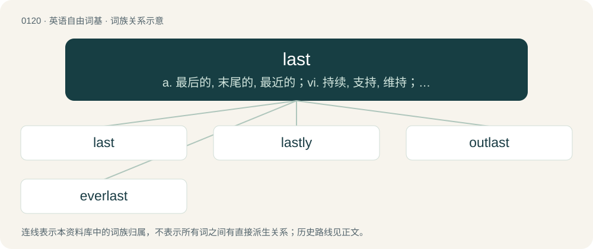

# 0124 · last — a. 最后的, 末尾的, 最近的；vi. 持续, 支持, 维持；vt. 使维持, 够...用

[总目录](../00_总目录_按常用程度.md)

**类型**：英语自由词基　｜　**来源语言**：见词源记录

## 核心含义与来源

- 核心含义：a. 最后的, 末尾的, 最近的；vi. 持续, 支持, 维持；vt. 使维持, 够...用
- 英文含义：Final, ultimate, coming after all others of its kind.
- 词形：last

**多个词源／构词路径**：同一拼写可能有不同来源；以下按词性和含义分别列出。

**来源记录 1**（形容词；Final, ultimate, coming after all others of its kind.）

From Middle English laste, latst, syncopated variant of latest, both ultimately from Old English latost. Doublet of latest.

**来源记录 2**（动词；To endure, continue over time.）

From Middle English lasten, from Old English lǣstan, from Proto-West Germanic \*laistijan, from Proto-Germanic \*laistijaną. Cognate with German leisten (“yield”).

**来源记录 3**（名词；A tool in the form of a foot on which an item of footwear (such as a boot or shoe) is placed for shaping while it is being manufactured or repaired.）

The noun is derived from Middle English lest, leste (“shoemaker’s model shaped like a foot, last”), from Old English lǣste (“shoemaker‘s last”), from Proto-Germanic \*laistiz, from \*laisǭ (“track, trail”), from Proto-Indo-European \*leys-eh₂-, from \*leys- (“to trace; to track”). Doublet of learn and lore. The verb is derived from the noun. cognates \* Dutch leest \* German Leisten \* Proto-Germanic \*laistaz (“footprint”) \* Swedish läst

**来源记录 4**（名词；A load of some commodity with reference to its weight and commercial value.）

From Middle English last, from Old English hlæst (“burden, load, freight”), from Proto-Germanic \*hlastuz (“burden, load, freight”), from Proto-Indo-European \*kleh₂- (“to put, lay out”). Cognate with West Frisian lêst, Dutch last, German Last, Swedish last, Icelandic lest.

## 词族图

## 单词速览（常用到不常用）

| 单词 | 音标 | 释义 |
|---|---|---|
| [last](#w-1) | 英 /lɑːst/；美 /læst/ | a. 最后的, 末尾的, 最近的；vi. 持续, 支持, 维持；vt. 使维持, 够...用 |
| [lastly](#w-2) | 英 /ˈlɑːstli/；美 /ˈlæstli/ | adv. 最后, 终于 |
| [outlast](#w-3) | 英 /ˌaʊtˈlɑːst/；美 /ˌaʊtˈlæst/ | vt. 比...长久, 从...中逃生 |
| [everlast](#w-4) |  | n. 永恒 |

## 逐词详解

### 1. last

**词性**：形容词　｜　**音标**：英 /lɑːst/；美 /læst/

**中文释义**：a. 最后的, 末尾的, 最近的；vi. 持续, 支持, 维持；vt. 使维持, 够...用

**英文义项**：Final, ultimate, coming after all others of its kind. / Most recent, latest, last so far.

**词源与演化**：

From Middle English laste, latst, syncopated variant of latest, both ultimately from Old English latost. Doublet of latest.

**例句**：

> Will try to fix it by myself for now: as a last resort, we can always take it to a grease monkey.

该用例对应义项：Final, ultimate, coming after all others of its kind.

### 2. lastly

**词性**：副词　｜　**音标**：英 /ˈlɑːstli/；美 /ˈlæstli/

**中文释义**：adv. 最后, 终于

**英文义项**：Used to mark the beginning of the last in a list of items or propositions. / Used to signal that the speaker is about to yield control of the conversation.

**构词拆分**：last + -ly

**词源与演化**：

From last + -ly.

**例句**：

> Firstly, that's illegal; secondly, it has serious disadvantages; thirdly, it's not necessary; and lastly, did I mention that it's illegal?

该用例对应义项：Used to mark the beginning of the last in a list of items or propositions.

### 3. outlast

**词性**：动词　｜　**音标**：英 /ˌaʊtˈlɑːst/；美 /ˌaʊtˈlæst/

**中文释义**：vt. 比...长久, 从...中逃生

**英文义项**：To live, last or remain longer than.

**构词拆分**：out- + last

**词源与演化**：

From out- + last.

**例句**：

> Some think that classical music would outlast pop.

该用例对应义项：To live, last or remain longer than.

### 4. everlast

**词性**：动词

**中文释义**：n. 永恒

**英文义项**：To last always or forever; to continue, endure, or remain.

**构词拆分**：ever + last

**词源与演化**：

Back-formation from everlasting, equivalent to ever + last.
