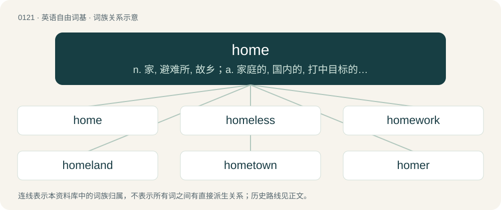

# 0125 · home — n. 家, 避难所, 故乡；a. 家庭的, 国内的, 打中目标的；adv. 在家, 在本国, 打中目标地

[总目录](../00_总目录_按常用程度.md)

**类型**：英语自由词基　｜　**来源语言**：见词源记录

## 核心含义与来源

- 核心含义：n. 家, 避难所, 故乡；a. 家庭的, 国内的, 打中目标的；adv. 在家, 在本国, 打中目标地
- 英文含义：One’s own dwelling place; the house or structure in which one lives; especially the house in which one lives with one's family; the habitual abode of one’s family.
- 词形：home

**来源记录 1**（名词；One’s own dwelling place; the house or structure in which one lives; especially the house in which one lives with one's family; the habitual abode of one’s family.）

From Middle English hōm, from Old English hām, from Proto-West Germanic \*haim, from Proto-Germanic \*haimaz (“home, village”), from Proto-Indo-European \*ḱóymos (“village, home”), from the root \*tḱey-. Doublet of heyem. Cognates Cognate with Scots hame (“home”), Yola haime, hime, hyme (“home”), Saterland Frisian Heem (“home”), Alemannic German haim, hei, heim, hemmu (“home”), Bavarian hama, hame (“home”), Cimbrian hòam, huam (“home”), Dutch heem, heim (“home”), German Heim (“home”), Limburgish heim, Héïm (“home”), Luxembourgish Heem (“home”), Mòcheno hoa'm (“home”), Vilamovian ham, hām, haom (“home”), Yiddish היים (heym, “home”), Danish hjem (“home”), Faroese, Icelandic heim (“home”), heimur (“world”), Norwegian Bokmål heim, hjem (“home”), Norwegian Nynorsk heim (“home”), Swedish hem (“home”), Gothic 𐌷𐌰𐌹𐌼𐍃 (haims, “village”), Irish caoimh (“dear”), Lithuanian kaimas (“village”), šeima (“family”), Albanian komb (“nation, people”), Ancient Greek κώμη (kṓmē, “village”), from Proto-Indo-European \*ḱey- (“to lie”) (compare Hittite \[script needed\] (kittari, “it lies”), Ancient Greek κεῖμαι (keîmai, “to lie down”), Latin civis (“citizen”), Avestan 𐬯𐬀𐬉𐬙𐬈 (saēte, “he lies, rests”), Sanskrit शये (śáye, “he lies”)).

## 词族图

## 单词速览（常用到不常用）

| 单词 | 音标 | 释义 |
|---|---|---|
| [home](#w-1) | 英 /həʊm/；美 /hoʊm/ | n. 家, 避难所, 故乡；a. 家庭的, 国内的, 打中目标的；adv. 在家, 在本国, 打中目标地 |
| [homeless](#w-2) | 美 /ˈhoʊmlɪs/ | a. 无家的, 无养主的 |
| [homework](#w-3) | 英 /ˈhəʊmˌwɜːk/；美 /ˈhoʊmˌwɝk/ | n. 家庭作业, 家里做的工作；\[经\] 家庭作业 |
| [homeland](#w-4) | 英 /ˈhəʊmˌlænd/；美 /ˈhoʊmˌlænd/ | n. 本国, 故国 |
| [hometown](#w-5) | 美 /ˈhoʊmˌtaʊn/ | n. 故乡, 家乡 |
| [homer](#w-6) | 英 /ˈhəʊmə/；美 /ˈhoʊmɚ/ | n. 本垒打, 传信鸽 |
| [homemade](#w-7) | 英 /ˌ(h)əʊmˈmeɪ̯d/；美 /ˌhoʊmˈmeɪ̯d/ | a. 自制的, 国产的 |
| [homecoming](#w-8) | 美 /ˈhoʊmˌkʌmɪŋ/ | n. 归国, 省亲回家, 同学会 |
| [homie](#w-9) | 英 /ˈhəʊ.mi/；美 /ˈhoʊ.mi/ | a. 家庭似的, 舒适的, 自在的 |
| [homeowner](#w-10) | /ˈhəum.əunə/ | n. 私房屋主；自己拥有住房者 |
| [homegrown](#w-11) | /həumˈgrəun/ | a. 自家种植的, 国产的 |
| [homesick](#w-12) | 英 /ˈhəʊ̯m.sɪk/；美 /ˈhoʊ̯m.sɪk/ | a. 思家的, 思乡病的 |
| [homely](#w-13) | 英 /ˈhəʊmli/；美 /ˈhoʊmli/ | a. 家常的, 平凡的, 朴实无华的 |
| [homemaker](#w-14) | /ˈhəummeikə/ | n. 主妇 |
| [homey](#w-15) | 美 /ˈhoʊmi/ | a. 家庭似的, 自在的, 舒适的 |
| [homeownership](#w-16) |  | n. 私房屋主；自己拥有住房者 (homeowner的变形) |
| [homeward](#w-17) | 英 /ˈhəʊmwəd/；美 /ˈhoʊmwɚd/ | a. 在归途上的, 向家的；adv. 在归途上, 向家地 |
| [homebrew](#w-18) | 美 /ˈhoʊmˌbɹu/ | n. 自酿（啤）酒; 公司自产自用 |
| [homeroom](#w-19) | 美 /ˈhoʊmˌɹum/ | n. 学生接受指导的教室 |
| [homespun](#w-20) | 美 /ˈhoʊmˌspʌn/ | a. 家里纺的, 家里做的, 简朴的, 不做作的, 平凡的, 朴素的, 朴实的, 粗陋的；n. 土布 |
| [homesickness](#w-21) |  | n. 乡愁 |
| [homecare](#w-22) |  | 【英文】The care and maintenance of one's home. |
| [homebound](#w-23) | 美 /ˈhoʊmbaʊnd/ | a. 回家(乡)的, 回本国的 |
| [homescreen](#w-24) |  | 【英文】The main or first interface shown in a graphical user interface. |
| [homestand](#w-25) |  | 【英文】A series of games played at a team's home field |
| [homebuyer](#w-26) | /ˈhəʊmbaɪə(r)/ | n. 购房者 |
| [homeware](#w-27) |  | 【英文】Furnishings for the home, such as furniture and cushions. |
| [homebody](#w-28) | /ˈhəumbɒdi/ | n. 重视家庭生活的人, 喜欢在家消遣的男人 |
| [homebuilding](#w-29) | /ˈhəjm,bildiŋ/ | n. 住宅建筑(或设计) |
| [homemaking](#w-30) | /ˈhəummeikiŋ/ | n. 家政 |
| [homegirl](#w-31) | 美 /ˈhoʊmˌɡɝl/ | n. 闺蜜 |
| [rehome](#w-32) | /ɹiːˈhəʊm/ | v. 为（狗、猫等宠物）找新家；\[网络\] 家园重建；帅气忠哥；新的家 |

## 逐词详解

### 1. home

**词性**：名词　｜　**音标**：英 /həʊm/；美 /hoʊm/

**中文释义**：n. 家, 避难所, 故乡；a. 家庭的, 国内的, 打中目标的；adv. 在家, 在本国, 打中目标地

**英文义项**：One’s own dwelling place; the house or structure in which one lives; especially the house in which one lives with one's family; the habitual abode of one’s family. / The place (residence, settlement, country, etc.), where a person was born or raised; a childhood or parental home; the home of one’s parents or guardian.

**词源与演化**：

From Middle English hōm, from Old English hām, from Proto-West Germanic \*haim, from Proto-Germanic \*haimaz (“home, village”), from Proto-Indo-European \*ḱóymos (“village, home”), from the root \*tḱey-. Doublet of heyem. Cognates Cognate with Scots hame (“home”), Yola haime, hime, hyme (“home”), Saterland Frisian Heem (“home”), Alemannic German haim, hei, heim, hemmu (“home”), Bavarian hama, hame (“home”), Cimbrian hòam, huam (“home”), Dutch heem, heim (“home”), German Heim (“home”), Limburgish heim, Héïm (“home”), Luxembourgish Heem (“home”), Mòcheno hoa'm (“home”), Vilamovian ham, hām, haom (“home”), Yiddish היים (heym, “home”), Danish hjem (“home”), Faroese, Icelandic heim (“home”), heimur (“world”), Norwegian Bokmål heim, hjem (“home”), Norwegian Nynorsk heim (“home”), Swedish hem (“home”), Gothic 𐌷𐌰𐌹𐌼𐍃 (haims, “village”), Irish caoimh (“dear”), Lithuanian kaimas (“village”), šeima (“family”), Albanian komb (“nation, people”), Ancient Greek κώμη (kṓmē, “village”), from Proto-Indo-European \*ḱey- (“to lie”) (compare Hittite \[script needed\] (kittari, “it lies”), Ancient Greek κεῖμαι (keîmai, “to lie down”), Latin civis (“citizen”), Avestan 𐬯𐬀𐬉𐬙𐬈 (saēte, “he lies, rests”), Sanskrit शये (śáye, “he lies”)).

**例句**：

> The object of Sorry! is to get all four of your pawns to your home.

该用例对应义项：The ultimate point aimed at in a progress; the goal.

### 2. homeless

**词性**：形容词　｜　**音标**：美 /ˈhoʊmlɪs/

**中文释义**：a. 无家的, 无养主的

**英文义项**：Lacking a permanent place of residence. / Containing no place that might be called home.

**构词拆分**：home + -less

**词源与演化**：

From Middle English \*homles, \*hamles, from Old English hāmlēas (“homeless”), equivalent to home + -less. Cognate with Dutch heemloos, Danish hjemløs (“homeless”), Swedish hemlös (“homeless”). Compare also German heimatlos (“homeless”), Icelandic heimilislaus (“homeless”), West Frisian dakleas (“homeless”, literally “having no roof, roofless”).

**例句**：

> Whenever I pass the park, I see the homeless people sleeping on the benches.

该用例对应义项：Lacking a permanent place of residence.

### 3. homework

**词性**：名词　｜　**音标**：英 /ˈhəʊmˌwɜːk/；美 /ˈhoʊmˌwɝk/

**中文释义**：n. 家庭作业, 家里做的工作；\[经\] 家庭作业

**英文义项**：Exercises assigned by a teacher to a student which review concepts studied in class. / Something which one is encouraged to learn or study on one's own.

**构词拆分**：home + work

**词源与演化**：

From home + work.

**例句**：

> The speaker had certainly done his homework before delivering the lecture.

该用例对应义项：Something which one is encouraged to learn or study on one's own.

### 4. homeland

**词性**：名词　｜　**音标**：英 /ˈhəʊmˌlænd/；美 /ˈhoʊmˌlænd/

**中文释义**：n. 本国, 故国

**英文义项**：The country that one regards as home. / One's country of residence.

**构词拆分**：home + land

**词源与演化**：

From home + land.

**例句**：

> After years abroad, she finally returned to her homeland.

该用例对应义项：The country that one regards as home.

### 5. hometown

**词性**：名词　｜　**音标**：美 /ˈhoʊmˌtaʊn/

**中文释义**：n. 故乡, 家乡

**英文义项**：An individual’s place of birth, childhood home, or place of main residence. / Designating a decision or judgement that is biased, or perceived to be biased, in favour of local preference.

**构词拆分**：home + town

**词源与演化**：

From home + town.

**用法示例／搭配（非完整句）**：

> hometown decision, hometown verdict

该用例对应义项：Designating a decision or judgement that is biased, or perceived to be biased, in favour of local preference.

### 6. homer

**词性**：名词　｜　**音标**：英 /ˈhəʊmə/；美 /ˈhoʊmɚ/

**中文释义**：n. 本垒打, 传信鸽

**英文义项**：A home run. / Synonym of home run (“sexual intercourse”).

**构词拆分**：home + -er

**词源与演化**：

From home + -er.

**例句**：

> Joe is such a homer that he would never boo the Hometown Hobos, even if they are in last place in the league.

该用例对应义项：A person who is extremely devoted to a favorite team.

### 7. homemade

**词性**：形容词　｜　**音标**：英 /ˌ(h)əʊmˈmeɪ̯d/；美 /ˌhoʊmˈmeɪ̯d/

**中文释义**：a. 自制的, 国产的

**英文义项**：Made at home. / Made by oneself.

**构词拆分**：home + made

**词源与演化**：

From home + made.

**用法示例／搭配（非完整句）**：

> a homemade chicken casserole

该用例对应义项：Made at home.

### 8. homecoming

**词性**：名词　｜　**音标**：美 /ˈhoʊmˌkʌmɪŋ/

**中文释义**：n. 归国, 省亲回家, 同学会

**英文义项**：The act or event of returning home. / In high schools and colleges, a tradition centered around a football game, a parade and the coronation of a Homecoming Queen.

**构词拆分**：home + coming

**词源与演化**：

From Middle English hom-comyng, home komyng, home-cumyng, home-commynge, equivalent to home + coming. Probably an alteration of earlier Middle English hom-come, homkome, hame-come, ham-cume, from Old English hāmcyme (“homecoming; return”).

**例句**：

> His homecoming was saddened by the news of his mother's death the day before.

该用例对应义项：The act or event of returning home.

### 9. homie

**词性**：名词　｜　**音标**：英 /ˈhəʊ.mi/；美 /ˈhoʊ.mi/

**中文释义**：a. 家庭似的, 舒适的, 自在的

**英文义项**：Someone, particularly a friend or male acquaintance, from one's hometown. / A close friend or fellow member of a youth gang.

**构词拆分**：home + -ie

**词源与演化**：

Earliest known reference is in the tune The House of Blue Lights (1946) by Ella Mae Morse and Freddie Slack, when Morse improvises a spoken-word intro. Equivalent to home + -ie.

**例句**：

> Hey there, Francis, my homie!

该用例对应义项：A close friend or fellow member of a youth gang.

### 10. homeowner

**词性**：名词　｜　**音标**：/ˈhəum.əunə/

**中文释义**：n. 私房屋主；自己拥有住房者

**英文义项**：Someone who owns a house. / Someone who does not have the title to a house, but has possession and is paying for it in installments.

**构词拆分**：home + owner

**词源与演化**：

From home + owner.

**例句**：

> Ziri saw who he assumed to be the homeowner.

### 11. homegrown

**词性**：形容词　｜　**音标**：/həumˈgrəun/

**中文释义**：a. 自家种植的, 国产的

**英文义项**：Raised or cultivated at home, on one's own land, or in one's own country; domestic; indigenous. / Produced or coming from one's own country or a particular place; local; native; self-produced.

**构词拆分**：home + grown

**词源与演化**：

From home + grown.

**例句**：

> Each spring they planted a garden and each summer they enjoyed homegrown vegetables.

该用例对应义项：Raised or cultivated at home, on one's own land, or in one's own country; domestic; indigenous.

### 12. homesick

**词性**：形容词　｜　**音标**：英 /ˈhəʊ̯m.sɪk/；美 /ˈhoʊ̯m.sɪk/

**中文释义**：a. 思家的, 思乡病的

**英文义项**：Missing one's home and family very much when away; nostalgic.

**构词拆分**：home + sick

**词源与演化**：

Back-formation from homesickness, equivalent to home + sick.

**例句**：

> The camp counselors tried to comfort the homesick children.

该用例对应义项：Missing one's home and family very much when away; nostalgic.

### 13. homely

**词性**：形容词　｜　**音标**：英 /ˈhəʊmli/；美 /ˈhoʊmli/

**中文释义**：a. 家常的, 平凡的, 朴实无华的

**英文义项**：Characteristic of, belonging to, or befitting a home; domestic, cosy. / Lacking in beauty or elegance, plain in appearance, physically unattractive.

**构词拆分**：home + -ly

**词源与演化**：

From Middle English homly, hoomly, hamely (“domestic, familiar, plain, unattractive”), from Old English \*hāmlīċ (“of the home, domestic”), from Proto-West Germanic \*haimalīk (“of or characteristic of home”), equivalent to home + -ly. Cognate with Scots hamely (“familiar, personal, private”), West Frisian heimelik, Dutch heimelijk (“secret, secretive, clandestine”), German heimlich (“secret, secretive, clandestine, undercover”), Danish hemmelig (“secret”), Swedish hemlig (“secret, concealed, privy, covert”), Faroese heimligur (“homelike, homey”), Icelandic heimlegur (“homely; worldly”).

**例句**：

> I am seeking a beautiful homely girl for marriage.

该用例对应义项：Conservative and family-oriented.

### 14. homemaker

**词性**：名词　｜　**音标**：/ˈhəummeikə/

**中文释义**：n. 主妇

**英文义项**：A person who maintains the administration and upkeep of his or her residence, especially one who is not employed outside the home; one who runs the household.

**构词拆分**：home + maker

**词源与演化**：

From home + maker.

### 15. homey

**词性**：形容词　｜　**音标**：美 /ˈhoʊmi/

**中文释义**：a. 家庭似的, 自在的, 舒适的

**英文义项**：Befitting a home; cozy, intimate.

**构词拆分**：home + -y

**词源与演化**：

From home + -y.

**例句**：

> Susan added some homey touches to her office.

该用例对应义项：Befitting a home; cozy, intimate.

### 16. homeownership

**词性**：名词

**中文释义**：n. 私房屋主；自己拥有住房者 (homeowner的变形)

**英文义项**：The state of being a homeowner.

**构词拆分**：homeowner + -ship；home + ownership

**词源与演化**：

From homeowner + -ship or home + ownership.

**例句**：

> Today, the homeownership rate in the United States stands at around 65%.

### 17. homeward

**词性**：副词　｜　**音标**：英 /ˈhəʊmwəd/；美 /ˈhoʊmwɚd/

**中文释义**：a. 在归途上的, 向家的；adv. 在归途上, 向家地

**英文义项**：Towards home.

**构词拆分**：home + -ward

**词源与演化**：

From Middle English homward, from Old English hāmweard, from Proto-Germanic \*haimawarda, equivalent to home + -ward. Cognate with Dutch heimwaarts, German heimwärts (“homeward”).

**例句**：

> I am homeward bound.

该用例对应义项：Towards home.

### 18. homebrew

**词性**：名词　｜　**音标**：美 /ˈhoʊmˌbɹu/

**中文释义**：n. 自酿（啤）酒; 公司自产自用

**英文义项**：A beer brewed by enthusiasts rather than commercially. / A game or amateur radio equipment made or modified by an amateur.

**构词拆分**：home + brew

**词源与演化**：

From home + brew.

**例句**：

> I'm too cheap to play anything but homebrew PC games.

### 19. homeroom

**词性**：名词　｜　**音标**：美 /ˈhoʊmˌɹum/

**中文释义**：n. 学生接受指导的教室

**英文义项**：A classroom where school pupils of the same age gather for registration, or for other purposes that are unrelated to class content. / The collection of pupils who gather in such a room.

**构词拆分**：home + room

**词源与演化**：

From home + room.

**例句**：

> Homeroom teachers should make every effort to keep in touch with their students.

### 20. homespun

**词性**：形容词　｜　**音标**：美 /ˈhoʊmˌspʌn/

**中文释义**：a. 家里纺的, 家里做的, 简朴的, 不做作的, 平凡的, 朴素的, 朴实的, 粗陋的；n. 土布

**英文义项**：Spun in the home. / Woven in the home.

**构词拆分**：home + spun

**词源与演化**：

From home + spun.

**用法示例／搭配（非完整句）**：

> homespun wisdom

该用例对应义项：Plain and homely; unsophisticated and unpretentious.

### 21. homesickness

**词性**：名词

**中文释义**：n. 乡愁

**英文义项**：The characteristic of being homesick; a strong, sad feeling of missing one's home (and often left-behind loved ones, such as family and friends) when physically away.

**构词拆分**：home + sickness

**词源与演化**：

Calque of German Heimweh (“homesickness”, literally “home-woe”), equivalent to home + sickness.

**例句**：

> Homesickness is a longing to go back to where you are from.

### 22. homecare

**词性**：名词

**英文义项**：The care and maintenance of one's home. / Treatment of a patient at his or her own home.

**构词拆分**：home + care

**词源与演化**：

From home + care.

### 23. homebound

**词性**：形容词　｜　**音标**：美 /ˈhoʊmbaʊnd/

**中文释义**：a. 回家(乡)的, 回本国的

**英文义项**：Being on one's way home: being homeward bound. / Confined to one's home, unable to leave it for some reason.

**构词拆分**：home + bound；home + -bound

**词源与演化**：

From home + bound or home + -bound.

**例句**：

> During the holiday season, the center's volunteers serve up meals-on-wheels, feeding homebound seniors and the homeless.

### 24. homescreen

**词性**：名词

**英文义项**：The main or first interface shown in a graphical user interface.

**构词拆分**：home + screen

**词源与演化**：

From home + screen.

### 25. homestand

**词性**：名词

**英文义项**：A series of games played at a team's home field

**构词拆分**：home + stand

**词源与演化**：

From home + stand.

### 26. homebuyer

**词性**：名词　｜　**音标**：/ˈhəʊmbaɪə(r)/

**中文释义**：n. 购房者

**英文义项**：A person who buys or plans to buy a house.

**构词拆分**：home + buyer

**词源与演化**：

From home + buyer.

### 27. homeware

**词性**：名词

**英文义项**：Furnishings for the home, such as furniture and cushions.

**构词拆分**：home + -ware

**词源与演化**：

From home + -ware.

### 28. homebody

**词性**：名词　｜　**音标**：/ˈhəumbɒdi/

**中文释义**：n. 重视家庭生活的人, 喜欢在家消遣的男人

**英文义项**：A person who prefers to remain at home, rather than participate in social events elsewhere.

**构词拆分**：home + body

**词源与演化**：

From home + body.

**例句**：

> Although my uncle likes to travel, my aunt is a homebody, so he usually comes with us while she stays home with her cats.

该用例对应义项：A person who prefers to remain at home, rather than participate in social events elsewhere.

### 29. homebuilding

**词性**：名词　｜　**音标**：/ˈhəjm,bildiŋ/

**中文释义**：n. 住宅建筑(或设计)

**英文义项**：The part of the construction industry concerned with building individual homes.

**构词拆分**：home + building

**词源与演化**：

From home + building.

### 30. homemaking

**词性**：名词　｜　**音标**：/ˈhəummeikiŋ/

**中文释义**：n. 家政

**英文义项**：The management of a household considered as an occupation.

**构词拆分**：home + making

**词源与演化**：

From home + making.

### 31. homegirl

**词性**：名词　｜　**音标**：美 /ˈhoʊmˌɡɝl/

**中文释义**：n. 闺蜜

**英文义项**：A female friend. / A female co-member of a gang.

**构词拆分**：home + girl

**词源与演化**：

From home + girl; compare homeboy.

### 32. rehome

**词性**：动词　｜　**音标**：/ɹiːˈhəʊm/

**中文释义**：v. 为（狗、猫等宠物）找新家；\[网络\] 家园重建；帅气忠哥；新的家

**英文义项**：To find a new home for (especially a pet). / To find a new family for (one or more adopted children) without using official adoption agencies.

**构词拆分**：re- + home

**词源与演化**：

From re- + home.
