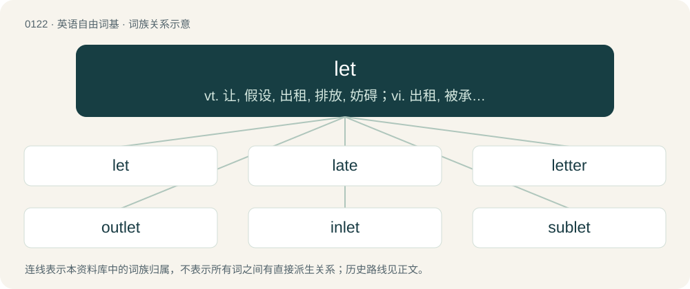

# 0126 · let — vt. 让, 假设, 出租, 排放, 妨碍；vi. 出租, 被承包；n. 出租屋, 障碍

[总目录](../00_总目录_按常用程度.md)

**类型**：英语自由词基　｜　**来源语言**：见词源记录

## 核心含义与来源

- 核心含义：vt. 让, 假设, 出租, 排放, 妨碍；vi. 出租, 被承包；n. 出租屋, 障碍
- 英文含义：To allow to, not to prevent (+ infinitive, but usually without to).
- 词形：let

**多个词源／构词路径**：同一拼写可能有不同来源；以下按词性和含义分别列出。

**来源记录 1**（动词；To allow to, not to prevent (+ infinitive, but usually without to).）

Derived from Middle English leten, læten, from Old English lǣtan (“to allow, let go, bequeath, leave, rent”), from Proto-West Germanic \*lātan, from Proto-Germanic \*lētaną (“to leave behind, allow”), from Proto-Indo-European \*leh₁d- (“to be tired, leave”). Cognates Cognate with Scots lat, lete (“to let, leave”), Yola leth (“let”), North Frisian leet, let, lätje (“to let”), Bavarian låssn (“to let”), Dutch, Low German laten (“to let, leave”), German lassen, laßen (“to let, leave, allow”), Luxembourgish loossen (“to let, leave”), Yiddish לאָזן (lozn, “to let”), Danish lade (“to let, allow, leave”), Faroese, Icelandic láta (“to let”), Norwegian Bokmål la (“to let, leave”), Norwegian Nynorsk la, lata, late (“let, allow”), Swedish låta (“to let, allow, leave”), Gothic 𐌻𐌴𐍄𐌰𐌽 (lētan, “to let”), Albanian lë (“to allow, let, leave”) and partially related to French laisser (“to let”).

**来源记录 2**（名词；The hindrance caused by the net during serve, only if the ball falls legally.）

Derived from Middle English letten (“to hinder, delay”), from Old English lettan (“to hinder, delay”; literally, “to make late”), from Proto-West Germanic \*lattjan, from Proto-Germanic \*latjaną. Akin to Old English latian (“to delay”), Dutch letten, Old English læt (“late”). More at late, delay.

## 词族图

## 单词速览（常用到不常用）

| 单词 | 音标 | 释义 |
|---|---|---|
| [let](#w-1) | /lɛt/ | vt. 让, 假设, 出租, 排放, 妨碍；vi. 出租, 被承包；n. 出租屋, 障碍 |
| [late](#w-2) | 英 /leɪt/ | a. 迟的, 晚的, 已故的；adv. 很晚, 很迟, 晚 |
| [letter](#w-3) | 英 /ˈlɛtə/；美 /ˈlɛtɚ/ | 【英文】One who lets, or lets out. |
| [outlet](#w-4) | /ˈaʊtlɛt/ | n. 出口, 发泄方法, 市场；\[医\] 出口 |
| [inlet](#w-5) | /ˈɪnlət/ | n. 进口, 插入物；\[化\] 入口; 进口; 投料口; 供料口 |
| [sublet](#w-6) | /ˌsʌbˈlɛt/ | v. 转租；n. 转租的房屋 |

## 逐词详解

### 1. let

**词性**：动词　｜　**音标**：/lɛt/

**中文释义**：vt. 让, 假设, 出租, 排放, 妨碍；vi. 出租, 被承包；n. 出租屋, 障碍

**英文义项**：To allow to, not to prevent (+ infinitive, but usually without to). / To allow to be or do without interference; to not disturb or meddle with; to leave alone.

**词源与演化**：

Derived from Middle English leten, læten, from Old English lǣtan (“to allow, let go, bequeath, leave, rent”), from Proto-West Germanic \*lātan, from Proto-Germanic \*lētaną (“to leave behind, allow”), from Proto-Indo-European \*leh₁d- (“to be tired, leave”). Cognates Cognate with Scots lat, lete (“to let, leave”), Yola leth (“let”), North Frisian leet, let, lätje (“to let”), Bavarian låssn (“to let”), Dutch, Low German laten (“to let, leave”), German lassen, laßen (“to let, leave, allow”), Luxembourgish loossen (“to let, leave”), Yiddish לאָזן (lozn, “to let”), Danish lade (“to let, allow, leave”), Faroese, Icelandic láta (“to let”), Norwegian Bokmål la (“to let, leave”), Norwegian Nynorsk la, lata, late (“let, allow”), Swedish låta (“to let, allow, leave”), Gothic 𐌻𐌴𐍄𐌰𐌽 (lētan, “to let”), Albanian lë (“to allow, let, leave”) and partially related to French laisser (“to let”).

**例句**：

> "Let there be no doubt: I saw your boyfriend with another girl" "Let him, see if I care!".

该用例对应义项：Used to introduce a first or third person imperative verb construction.

### 2. late

**词性**：形容词　｜　**音标**：英 /leɪt/

**中文释义**：a. 迟的, 晚的, 已故的；adv. 很晚, 很迟, 晚

**英文义项**：Near the end of a period of time. / Specifically, near the end of the day.

**词源与演化**：

From Middle English late, lat, from Old English læt (“slow; slack, lax, negligent; late”), from Proto-West Germanic \*lat, from Proto-Germanic \*lataz (“slow, lazy”). By surface analysis, deverbal from let. Cognates Cognate with Yola laate (“late”), North Frisian leed, leet, lääs (“late”), Saterland Frisian leet (“late”), Dutch, German Low German laat (“late, tardy”), German lass (“lazy, sluggish”), Danish lad (“languid, lazy, indolent”), Faroese, Icelandic latur (“lazy”), Norwegian Bokmål, Norwegian Nynorsk and Swedish lat (“lazy”), Gothic 𐌻𐌰𐍄𐍃 (lats, “lazy, slothful”).

**例句**：

> The seedlings appeared to be coming along nicely until a late frost killed them.

该用例对应义项：Near the end of a period of time.

### 3. letter

**词性**：名词　｜　**音标**：英 /ˈlɛtə/；美 /ˈlɛtɚ/

**英文义项**：One who lets, or lets out.

**构词拆分**：let + -er

**词源与演化**：

From Middle English letere, equivalent to let + -er.

**用法示例／搭配（非完整句）**：

> the letter of a room

该用例对应义项：One who lets, or lets out.

### 4. outlet

**词性**：名词　｜　**音标**：/ˈaʊtlɛt/

**中文释义**：n. 出口, 发泄方法, 市场；\[医\] 出口

**英文义项**：A vent or similar passage to allow the escape of something. / Something which allows for the release of one's desires.

**构词拆分**：out- + let

**词源与演化**：

From Middle English outlete, outeleate, ut-lete, derived from Middle English outleten (“to allow, let out, emit”), equivalent to out- + let. Compare West Frisian útlit (“outlet”), Dutch uitlaat (“outlet”), German Auslass (“outlet”).

**例句**：

> Jamie found doing martial arts was a great outlet for her stress.

该用例对应义项：Something which allows for the release of one's desires.

### 5. inlet

**词性**：名词　｜　**音标**：/ˈɪnlət/

**中文释义**：n. 进口, 插入物；\[化\] 入口; 进口; 投料口; 供料口

**英文义项**：A body of water let into a coast, such as a bay, cove, fjord or estuary. / A passage that leads into a cavity.

**构词拆分**：in- + let

**词源与演化**：

From Middle English inlāte (“inlet, entrance”), from inleten (“to let in”), equivalent to in- + let. Compare Low German inlat (“inlet”), German Einlass (“inlet, entrance”).

**例句**：

> We hit a bad chop at the inlet.

该用例对应义项：A body of water let into a coast, such as a bay, cove, fjord or estuary.

### 6. sublet

**词性**：动词　｜　**音标**：/ˌsʌbˈlɛt/

**中文释义**：v. 转租；n. 转租的房屋

**英文义项**：To grant a sublease out of property held under a lease.

**构词拆分**：sub- + let

**词源与演化**：

From sub- + let.

**例句**：

> We sublet our apartment over the summer.

该用例对应义项：lease or rent all or part of (a leased or rented property) to another person
