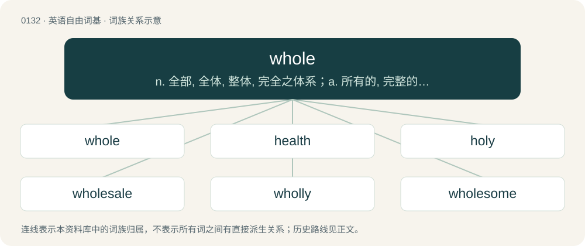

# 0138 · whole — n. 全部, 全体, 整体, 完全之体系；a. 所有的, 完整的, 完全的, 纯粹的

[总目录](../00_总目录_按常用程度.md)

**类型**：英语自由词基　｜　**来源语言**：见词源记录

## 核心含义与来源

- 核心含义：n. 全部, 全体, 整体, 完全之体系；a. 所有的, 完整的, 完全的, 纯粹的
- 英文含义：Entire, undivided.
- 词形：whole

**来源记录 1**（形容词；Entire, undivided.）

From Middle English whol, hol, hole (“healthy, unhurt, whole”), from Old English hāl (“healthy, safe”), from Proto-West Germanic \*hail, from Proto-Germanic \*hailaz (“whole, safe, sound”), from Proto-Indo-European \*kéh₂ilos (“healthy, whole”). The spelling with wh-, attested since ca. 1400, represents an excrescent /w/, which developed in words with initial /(h)ɔː/, /(h)oː/ in southwestern dialects of Middle English. While this pronunciation did not establish itself in the standard language (except in one), the spelling survived in whole and whore, in the former case likely reinforced by a desire to disambiguate from hole. Cognates Compare West Frisian hiel, Low German heel/heil, Dutch heel, German heil, Danish and Norwegian Bokmål hel, Norwegian Nynorsk heil; also Welsh coel (“omen”), Breton kel (“omen, mention”), Old Prussian kails (“healthy”), Old Church Slavonic цѣлъ (cělŭ, “healthy, unhurt”). Related to hale, health, hail, hallow, heal, and holy. False cognate of Ancient Greek ὅλος (hólos).

## 词族图

## 单词速览（常用到不常用）

| 单词 | 音标 | 释义 |
|---|---|---|
| [whole](#w-1) | 英 /həʊl/；美 /hoʊl/ | n. 全部, 全体, 整体, 完全之体系；a. 所有的, 完整的, 完全的, 纯粹的 |
| [health](#w-2) | 英 /ˈhɛlθ/ | n. 健康, 卫生, 蓬勃, 健康状态；\[医\] 健康 |
| [holy](#w-3) | 英 /ˈhəʊli/；美 /ˈhoʊli/ | a. 神圣的, 圣洁的, 至善的；n. 神圣的东西 |
| [wholesale](#w-4) | /ˈhoʊlseɪl/ | n. 批发；a. 批发的, 大规模的；adv. 大规模, 照批发方式 |
| [wholly](#w-5) | 英 /ˈhəʊ.li/；美 /ˈhoʊ.li/ | adv. 完全地, 整个, 统统, 全部；\[法\] 完全地, 统统地 |
| [wholesome](#w-6) | 英 /ˈhəʊl.səm/；美 /ˈhoʊl.səm/ | a. 有益健康的, 合乎卫生的, 健全的, 有益的, 有生气的, 审慎的 |
| [wholeness](#w-7) | /ˈhəulnis/ | n. 全体, 一切, 完全 |
| [wholehearted](#w-8) | 英 /ˌhəʊlˈhɑː(ɹ)t.əd/ | a. 一心一意的, 诚恳的 |
| [wholemeal](#w-9) | /ˈhoʊlmiːl/ | n. 全麦面粉 |

## 逐词详解

### 1. whole

**词性**：形容词　｜　**音标**：英 /həʊl/；美 /hoʊl/

**中文释义**：n. 全部, 全体, 整体, 完全之体系；a. 所有的, 完整的, 完全的, 纯粹的

**英文义项**：Entire, undivided. / Used as an intensifier.

**词源与演化**：

From Middle English whol, hol, hole (“healthy, unhurt, whole”), from Old English hāl (“healthy, safe”), from Proto-West Germanic \*hail, from Proto-Germanic \*hailaz (“whole, safe, sound”), from Proto-Indo-European \*kéh₂ilos (“healthy, whole”). The spelling with wh-, attested since ca. 1400, represents an excrescent /w/, which developed in words with initial /(h)ɔː/, /(h)oː/ in southwestern dialects of Middle English. While this pronunciation did not establish itself in the standard language (except in one), the spelling survived in whole and whore, in the former case likely reinforced by a desire to disambiguate from hole. Cognates Compare West Frisian hiel, Low German heel/heil, Dutch heel, German heil, Danish and Norwegian Bokmål hel, Norwegian Nynorsk heil; also Welsh coel (“omen”), Breton kel (“omen, mention”), Old Prussian kails (“healthy”), Old Church Slavonic цѣлъ (cělŭ, “healthy, unhurt”). Related to hale, health, hail, hallow, heal, and holy. False cognate of Ancient Greek ὅλος (hólos).

**例句**：

> I brought a whole lot of balloons for the party. She ate a whole bunch of french fries.

该用例对应义项：Used as an intensifier.

### 2. health

**词性**：名词　｜　**音标**：英 /ˈhɛlθ/

**中文释义**：n. 健康, 卫生, 蓬勃, 健康状态；\[医\] 健康

**英文义项**：The state of being free from physical or psychological disease, illness, or malfunction; wellness. / A state of well-being or balance, often physical but sometimes also mental and social; the overall level of function of an organism from the cellular (micro) level to the social (macro) level.

**构词拆分**：heal + -th (abstract nominal suffix)

**词源与演化**：

Inherited from Middle English helthe, from Old English hǣlþ, from Proto-West Germanic \*hailiþu, from Proto-Germanic \*hailiþō, from \*hailaz + \*-iþō. Cognate with Old High German heilida. Analyzable as whole, hale, or heal + -th (abstract nominal suffix). More at heal. Doublet of wholth.

**例句**：

> The directors are concerned about the financial health of the project.

该用例对应义项：A state of well-being or balance, often physical but sometimes also mental and social; the overall level of function of an organism from the cellular (micro) level to the social (macro) level.

### 3. holy

**词性**：形容词　｜　**音标**：英 /ˈhəʊli/；美 /ˈhoʊli/

**中文释义**：a. 神圣的, 圣洁的, 至善的；n. 神圣的东西

**英文义项**：Dedicated to a religious purpose or a god. / Revered in a religion.

**构词拆分**：whole + -y

**词源与演化**：

From Middle English ali, aly, hale, halege, hali, halȝe, hayly, holi, holia, holie, holiȝ, holy, hooly, oli, oly, wholy, woly, from Old English hāleġ, hāliġ (“holy, sacred; healthy, sound”), from Proto-West Germanic \*hailag, from Proto-Germanic \*hailagaz (“holy, sacred”), from Proto-Germanic \*hailaz (“healthy; whole”), from Proto-Indo-European \*kéh₂ilos (“intact, whole; complete; hale, healthy, sound”), equivalent to whole + -y and a doublet of later wholly. Cognates Cognate with Scots halie, haly (“holy”), Yola holly, holy (“holy”), Saterland Frisian helig (“holy”), Alemannic German, Dutch, and German heilig (“holy, sacred”), Cimbrian hòolig (“holy”), Luxembourgish helleg (“holy”), Vilamovian haeliḱ, haliky, hȧlikjy, hǡliḱ (“holy”), Yiddish הייליק (heylik, “holy”), Danish and Norwegian Bokmål hellig (“holy”), Faroese heilagur (“holy”), Icelandic heilagur, helgur (“holy”), Norwegian Nynorsk heilag, heilag’u (“holy”), Swedish helig (“holy”), Gothic 𐌷𐌰𐌹𐌻𐌰𐌲𐍃 (hailags, “holy”); also Latin cael, caelus, caelum, coelus, coelum (“heaven; sky; climate, weather”), Belarusian цэ́лы (cély, “entire, whole”), Bulgarian цял (cjal, “entire, full, intact, whole; real, regular, veritable”), Czech and Slovak celý (“whole”), Macedonian цел (cel, “entire, whole”), Polish cały (“entire, whole”), Russian це́лый (célyj, “entire, whole”), Serbo-Croatian це̏о, ци̏јел, ци̏о, cȅo, cȉjel, cȉo (“entire, whole”), Slovene cel (“whole”), Ukrainian ці́лий (cílyj, “entire, whole”). More at whole.

**例句**：

> I'm planning to visit the holy city of Jerusalem this Christmas.

该用例对应义项：Dedicated to a religious purpose or a god.

### 4. wholesale

**词性**：形容词　｜　**音标**：/ˈhoʊlseɪl/

**中文释义**：n. 批发；a. 批发的, 大规模的；adv. 大规模, 照批发方式

**英文义项**：Of or relating to sale in large quantities, for resale. / Extensive, indiscriminate, all-encompassing; blanket.

**构词拆分**：whole + sale

**词源与演化**：

From whole + sale.

**例句**：

> The bombing resulted in wholesale destruction.

该用例对应义项：Extensive, indiscriminate, all-encompassing; blanket.

### 5. wholly

**词性**：副词　｜　**音标**：英 /ˈhəʊ.li/；美 /ˈhoʊ.li/

**中文释义**：adv. 完全地, 整个, 统统, 全部；\[法\] 完全地, 统统地

**英文义项**：Completely and entirely; to the fullest extent. / Very; to a great extent.

**构词拆分**：By surface analysis, whol(e) + -ly

**词源与演化**：

From Middle English holly, holeliche, holliche (also as halely, hallich, etc.). Doublet of earlier holy. By surface analysis, whol(e) + -ly.

**例句**：

> A creature wholly given to brawls and wine.

该用例对应义项：Exclusively and solely.

### 6. wholesome

**词性**：形容词　｜　**音标**：英 /ˈhəʊl.səm/；美 /ˈhoʊl.səm/

**中文释义**：a. 有益健康的, 合乎卫生的, 健全的, 有益的, 有生气的, 审慎的

**英文义项**：Promoting good physical health and well-being. / Promoting moral and mental well-being.

**构词拆分**：whole + -some；hale (“healthy”) + -some

**词源与演化**：

From earlier holesome, from Middle English holsom, holsum, helsum, halsum, from Old English \*hālsum, \*hǣlsum, from Proto-West Germanic \*hailasam, from Proto-Germanic \*hailasamaz, equivalent to whole + -some or hale (“healthy”) + -some. Cognate with Saterland Frisian heelsoam, Dutch heilzaam, German Low German heelsaam, German heilsam, Icelandic heilsamur, Norwegian Nynorsk helsesam, Swedish hälsosam (“wholesome”).

**例句**：

> Baking apple pie fills the house with a wholesome aroma.

### 7. wholeness

**词性**：名词　｜　**音标**：/ˈhəulnis/

**中文释义**：n. 全体, 一切, 完全

**英文义项**：The quality of being whole. / The entirety, the whole thing as opposed to part.

**构词拆分**：whole + -ness

**词源与演化**：

From Middle English holnesse, holnes, from Old English hālnes (“wholeness”), equivalent to whole + -ness.

**例句**：

> Wholeness is the opposite of duality.

### 8. wholehearted

**词性**：形容词　｜　**音标**：英 /ˌhəʊlˈhɑː(ɹ)t.əd/

**中文释义**：a. 一心一意的, 诚恳的

**英文义项**：Showing enthusiastic and unconditional commitment; having no reservations.

**构词拆分**：whole + hearted

**词源与演化**：

From whole + hearted. First appears before 1628 in the publications of John Preston, a clergyman in the Church of England.

**例句**：

> Gave wholehearted support to her candidacy.

该用例对应义项：with unconditional and enthusiastic devotion

### 9. wholemeal

**词性**：形容词　｜　**音标**：/ˈhoʊlmiːl/

**中文释义**：n. 全麦面粉

**英文义项**：Containing or made from the whole grain, including the bran. / Whole-wheat.

**构词拆分**：whole + meal

**词源与演化**：

From whole + meal.

**例句**：

> Modern healthy eating experts put emphasis on eating wholemeal bread and eating more vegetables.
