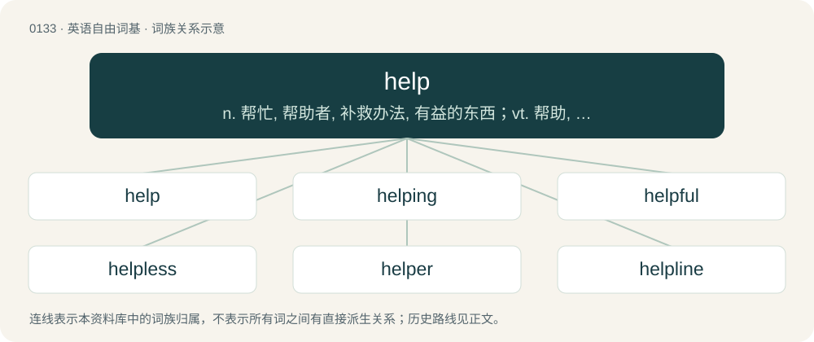

# 0139 · help — n. 帮忙, 帮助者, 补救办法, 有益的东西；vt. 帮助, 帮忙, 接济, 治疗, 款待；vi. 有用, 救命, 招待

[总目录](../00_总目录_按常用程度.md)

**类型**：英语自由词基　｜　**来源语言**：见词源记录

## 核心含义与来源

- 核心含义：n. 帮忙, 帮助者, 补救办法, 有益的东西；vt. 帮助, 帮忙, 接济, 治疗, 款待；vi. 有用, 救命, 招待
- 英文含义：Action given to provide assistance; aid.
- 词形：help

**多个词源／构词路径**：同一拼写可能有不同来源；以下按词性和含义分别列出。

**来源记录 1**（名词；Action given to provide assistance; aid.）

From Middle English help, from Old English help (“help, aid, assistance, relief”), from Proto-Germanic \*helpō (“help”), \*hilpiz, \*hulpiz, from Proto-Indo-European \*ḱelb-, \*ḱelp- (“to help”). Cognate with Saterland Frisian Hälpe (“help”), West Frisian help (“help”), Cimbrian hölfe (“help”), Dutch hulp (“help”), German Hilfe (“help, aid, assistance”), Luxembourgish Hëllef (“help”), Mòcheno hilf (“help”), Vilamovian hyłf (“help”), Yiddish הילף (hilf, “help”), Danish hjælp (“help”), Faroese and Icelandic hjálp (“help”), Norwegian Bokmål hjelp (“help”), Norwegian Nynorsk hjelp, hjølp (“help”), Swedish hjälp (“help”).

**来源记录 2**（动词；To provide assistance to (someone or something).）

From Middle English helpen, from Old English helpan (“to help, aid, assist, benefit, relieve, cure”), from Proto-West Germanic \*helpan, Proto-Germanic \*helpaną (“to help”), from Proto-Indo-European \*ḱelb-, \*ḱelp- (“to help”). Cognate with North Frisian halep, heelpe, help (“to help”), Saterland Frisian hälpe (“to help”), West Frisian helpe (“to help”), Cimbrian hölfan (“to help”), Dutch helpen (“to help”), German helfen (“to help”), Low German helpen, hölpen, hülpen (“to help”), Luxembourgish hëllefen (“to help”), Yiddish העלפֿן (helfn, “to help”), Danish hjælpe (“to help”), Faroese and Icelandic hjálpa (“to help”), Norwegian Bokmål hjelpe (“to help”), Norwegian Nynorsk hjelpa, hjelpe (“to help”), Swedish hjälpa (“to help”), Gothic 𐌷𐌹𐌻𐍀𐌰𐌽 (hilpan, “to help”), Lithuanian šelpti (“to help, support”).

## 词族图

## 单词速览（常用到不常用）

| 单词 | 音标 | 释义 |
|---|---|---|
| [help](#w-1) | 英 /hɛlp/；/hɛp/ | n. 帮忙, 帮助者, 补救办法, 有益的东西；vt. 帮助, 帮忙, 接济, 治疗, 款待；vi. 有用, 救命, 招待 |
| [helping](#w-2) | /ˈhɛlpɪŋ/ | n. 帮助, 协助, 一份 |
| [helpful](#w-3) | /ˈhɛlp.fl̩/ | a. 有帮助的, 有益的, 有用的 |
| [helpless](#w-4) | /ˈhɛlplɪs/ | a. 无助的, 无能为力的, 无依无靠的 |
| [helper](#w-5) | 美 /ˈhɛlpɚ/ | n. 帮忙者, 有益的东西；\[机\] 助手 |
| [helpline](#w-6) | 美 /ˈhɛlpˌlaɪn/ | n. 热线服务电话 |

## 逐词详解

### 1. help

**词性**：名词　｜　**音标**：英 /hɛlp/；/hɛp/

**中文释义**：n. 帮忙, 帮助者, 补救办法, 有益的东西；vt. 帮助, 帮忙, 接济, 治疗, 款待；vi. 有用, 救命, 招待

**英文义项**：Action given to provide assistance; aid. / Something or someone which provides assistance with a task.

**词源与演化**：

From Middle English help, from Old English help (“help, aid, assistance, relief”), from Proto-Germanic \*helpō (“help”), \*hilpiz, \*hulpiz, from Proto-Indo-European \*ḱelb-, \*ḱelp- (“to help”). Cognate with Saterland Frisian Hälpe (“help”), West Frisian help (“help”), Cimbrian hölfe (“help”), Dutch hulp (“help”), German Hilfe (“help, aid, assistance”), Luxembourgish Hëllef (“help”), Mòcheno hilf (“help”), Vilamovian hyłf (“help”), Yiddish הילף (hilf, “help”), Danish hjælp (“help”), Faroese and Icelandic hjálp (“help”), Norwegian Bokmål hjelp (“help”), Norwegian Nynorsk hjelp, hjølp (“help”), Swedish hjälp (“help”).

**例句**：

> “He’s a real road-rager.” / “Yup, he really needs help, maybe anger management.”

该用例对应义项：Correction of deficits, as by psychological counseling or medication or social support or remedial training.

### 2. helping

**词性**：名词　｜　**音标**：/ˈhɛlpɪŋ/

**中文释义**：n. 帮助, 协助, 一份

**英文义项**：The act of giving aid or assistance (to). / A portion or serving, especially of food that one takes for oneself, or to which one helps oneself.

**构词拆分**：help + -ing

**词源与演化**：

From Middle English helping, helpinge, helpynge, equivalent to help + -ing.

**例句**：

> She eagerly took a second helping of ice cream.

该用例对应义项：A portion or serving, especially of food that one takes for oneself, or to which one helps oneself.

### 3. helpful

**词性**：形容词　｜　**音标**：/ˈhɛlp.fl̩/

**中文释义**：a. 有帮助的, 有益的, 有用的

**英文义项**：Furnishing help; gives aid; useful.

**构词拆分**：help + -ful

**词源与演化**：

From Middle English helpful; equivalent to help + -ful.

**用法示例／搭配（非完整句）**：

> a helpful person

该用例对应义项：Furnishing help; gives aid; useful.

### 4. helpless

**词性**：形容词　｜　**音标**：/ˈhɛlplɪs/

**中文释义**：a. 无助的, 无能为力的, 无依无靠的

**英文义项**：Unable to defend oneself. / Lacking help; powerless.

**构词拆分**：help + -less

**词源与演化**：

From Middle English helples, from Old English \*helplēas (“helpless”) from Proto-Germanic \*helpōlausaz, equivalent to help + -less. Compare Dutch hulpeloos (“helpless”), German hilflos (“helpless”), Danish hjælpeløs (“helpless”) and Swedish hjälplös (“helpless”).

**例句**：

> As helpless as a baby.

该用例对应义项：unable to manage independently

### 5. helper

**词性**：名词　｜　**音标**：美 /ˈhɛlpɚ/

**中文释义**：n. 帮忙者, 有益的东西；\[机\] 助手

**英文义项**：One who helps; an aide; assistant; auxiliary. / That which helps; anything serving to assist.

**构词拆分**：help + -er

**词源与演化**：

From Middle English helpere, from Old English \*helpere, from Proto-West Germanic \*helpārī (“helper”), equivalent to help + -er. Cognate with Saterland Frisian Hälper (“helper”), West Frisian helper (“helper”), Dutch helper (“helper”), German Low German Helper (“helper”), German Helfer (“helper”), Danish hjælper (“helper”), Swedish hjälpare (“helper”), Icelandic hjálpar (“helper”).

**例句**：

> When they go away to work, they take a helper with them.

### 6. helpline

**词性**：名词　｜　**音标**：美 /ˈhɛlpˌlaɪn/

**中文释义**：n. 热线服务电话

**英文义项**：A telephone service (or (by extension) one using email, SMS, or the Web) which offers help to those who call, as either a public emergency service or customer service.

**构词拆分**：help + line

**词源与演化**：

From help + line.

**例句**：

> Contact the appropriate customer service helpline if the device does not operate properly.
