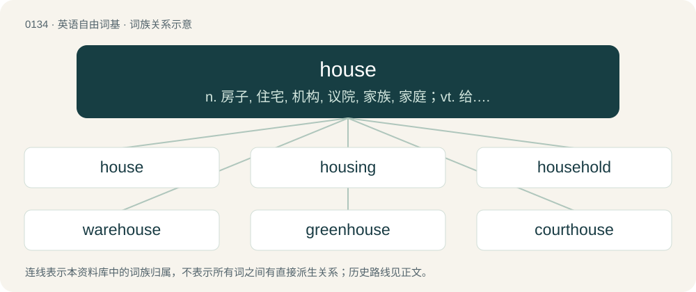

# 0140 · house — n. 房子, 住宅, 机构, 议院, 家族, 家庭；vt. 给...房子住, 收藏；vi. 住, 躲藏

[总目录](../00_总目录_按常用程度.md)

**类型**：英语自由词基　｜　**来源语言**：见词源记录

## 核心含义与来源

- 核心含义：n. 房子, 住宅, 机构, 议院, 家族, 家庭；vt. 给...房子住, 收藏；vi. 住, 躲藏
- 英文含义：A structure built or serving as an abode of human beings.
- 词形：house

**多个词源／构词路径**：同一拼写可能有不同来源；以下按词性和含义分别列出。

**来源记录 1**（名词；A structure built or serving as an abode of human beings.）

From Middle English hous, hus, from Old English hūs (“dwelling, shelter, house”), from Proto-West Germanic \*hūs, from Proto-Germanic \*hūsą (“house”), possibly from Proto-Indo-European \*(s)kews-, from \*(s)kewH- (“to cover, hide”). More at hose. Eclipsed non-native Middle English mees, meson, measoun (“house”), borrowed from Anglo-Norman mes, mies, meis, maisun (“house”). The uncommon plural form housen is from Middle English husen, housen. (The Old English nominative plural was simply hūs.) Cognates Cognate with Scots hoose, oos (“house”), Yola heouse, houze, howze (“house”), North Frisian hüs (“house”), Saterland Frisian Huus, Húus (“house”), West Frisian hûs (“house”), Alemannic German hous, hus, husch, hüs, hüüsch (“house”), Bavarian, Cimbrian, Mòcheno haus (“house”), Central Franconian Haus, Hous, Huus (“home”), Dutch huis (“house”), Dutch Low Saxon hoes, huus (“house”), German Haus, Hauß (“house”), German Low German Huus (“house”), Limburgish hoes, Huus (“house”), Luxembourgish Haus (“house”), Vilamovian haojs, haus, hoüz (“house”), Yiddish הויז (hoyz, “house”), Danish, Norwegian Bokmål, Norwegian Nynorsk, and Swedish hus (“house”), Elfdalian aus (“house”), Faroese and Icelandic hús (“house”), Crimean Gothic hus (“house”); also Cornish kudha (“to conceal, hide”), Welsh cuddio (“to hide”), Latin cutis (“human skin; hide, leather”), Ancient Greek κεύθω (keúthō, “to cover, hide”), Tocharian A kāc (“hide, skin”), Sanskrit स्कुनाति (skunāti, “to cover”).

**来源记录 2**（动词；To keep within a structure or container.）

From Middle English housen, from Old English hūsian, from Proto-Germanic \*hūsōną (“to house, live, dwell”), from the noun (see above). Compare Dutch huizen (“to live, dwell, reside”), German Low German husen (“to live, dwell, reside”), German hausen (“to live, dwell, reside”), Norwegian Nynorsk husa (“to house”), Faroese húsa (“to house”), Icelandic húsa (“to shelter, house”).

**来源记录 3**（名词；House music.）

Probably from The Warehouse, a nightclub in Chicago, Illinois, USA, where the music became popular around 1985.

## 词族图

## 单词速览（常用到不常用）

| 单词 | 音标 | 释义 |
|---|---|---|
| [house](#w-1) | 英 /haʊ̯s/；/hæʊ̯s/ | n. 房子, 住宅, 机构, 议院, 家族, 家庭；vt. 给...房子住, 收藏；vi. 住, 躲藏 |
| [housing](#w-2) | /ˈhaʊzɪŋ/ | n. 遮盖, 住房供给, 居留(处), 房屋, 装饰；\[化\] 外壳 |
| [household](#w-3) | 英 /ˈhaʊshəʊld/；美 /ˈhaʊshoʊld/ | n. 一家人, 家庭, 家族, 王室；a. 家庭的, 家常的, 王室的 |
| [warehouse](#w-4) | /ˈwɛə(ɹ)haʊs/ | n. 仓库, 货栈, 大商店；vt. 储入仓库 |
| [greenhouse](#w-5) | 英 /ˈɡɹiːnhaʊs/；美 /ˈɡɹːnˌ(h)aʊs/ | n. 温室 |
| [courthouse](#w-6) | 美 /ˈkɔɹt.haʊs/ | n. 法院, 郡政府所在地 |
| [lighthouse](#w-7) | /ˈlaɪthaʊs/ | n. 灯塔 |
| [powerhouse](#w-8) | /ˈpauəhaus/ | n. 发电所, 动力室, 精力旺盛的人, 办事效率高的机构 |
| [farmhouse](#w-9) | 英 /ˈfɑːmhaus/ | n. 农舍 |
| [clubhouse](#w-10) | 美 /ˈklʌbˌhaʊs/ | n. 俱乐部会所 |
| [housewife](#w-11) | /ˈhaʊs.waɪf/ | n. 主妇, 家庭妇女 |
| [housekeeper](#w-12) | 英 /ˈhaʊskiːpə/；美 /ˈhaʊskipɚ/ | n. 主妇, 女管家 |
| [housekeeping](#w-13) | /ˈhauskiːpiŋ/ | n. 家事, 家政, 持家；\[计\] 内务处理 |
| [housework](#w-14) | 美 /ˈhaʊsˌwɝk/ | n. 家事, 家务 |
| [townhouse](#w-15) | 美 /ˈtaʊnˌhaʊs/ | n. 连栋房屋; 城市住房 |
| [waterhouse](#w-16) |  | 【英文】A house on floats. |
| [housemate](#w-17) | 美 /ˈhaʊsˌmeɪt/ | n. 住在同一所房子里的人 |
| [slaughterhouse](#w-18) | 英 /ˈsloː.tə(ɹ).haʊs/ | n. 屠杀场 |
| [schoolhouse](#w-19) | 美 /ˈskulˌhaʊs/ | n. 校舍 |
| [treehouse](#w-20) | /ˈtɹiːˌhaʊs/ | n. 树屋 |
| [woodhouse](#w-21) | /ˈwʊd.haʊs/ | 【英文】A house or shed for storing (chopped) wood |
| [steakhouse](#w-22) | 美 /ˈsteɪk.haʊs/ | n. 牛排餐厅 |
| [firehouse](#w-23) | /ˈfaiəhaus/ | n. 消防站 |
| [guesthouse](#w-24) | /ˈɡɛsthaʊs/ | n. 宾馆, 高级寄宿舍, 招待所 |
| [workhouse](#w-25) | /ˈw\\\\ːkhajs/ | n. (英)贫民习艺所, 济贫院, (美)感化院, 教养所 |
| [roundhouse](#w-26) | 美 /ˈɹaʊndˌhaʊs/ | n. 圆形机车库, 拘留所, 大抡拳 |
| [winehouse](#w-27) | /ˈwainhajs/ | n. 酒馆,酒店 |
| [boathouse](#w-28) | 美 /ˈboʊtˌhaʊs/ | n. 船库, 艇库 |
| [madhouse](#w-29) | 美 /ˈmædˌhaʊs/ | n. 精神病院, 极为吵闹的场所 |
| [roadhouse](#w-30) | 英 /ˈɹəʊdˌhaʊs/；美 /ˈɹoʊdˌhaʊs/ | n. 郊外小旅馆, 客栈 |
| [storehouse](#w-31) | /ˈstɔː(ɹ)haʊs/ | n. 仓库, 储藏所, 宝库；\[机\] 库房, 贮藏库, 仓库 |
| [houseboat](#w-32) | 美 /ˈhaʊsˌboʊt/ | n. 居住船, 游艇 |
| [bathhouse](#w-33) | 美 /ˈbæθˌhaʊs/ | n. 公共浴室, 澡堂, 更衣室 |
| [wheelhouse](#w-34) | 英 /ˈwiːlˌhaʊs/；美 /ˈwilˌhaʊs/ | n. 舵手室, 驾驶室 |
| [outhouse](#w-35) | 美 /ˈaʊthaʊs/ | n. 外屋, 户外厕所 |
| [jailhouse](#w-36) | 美 /ˈd͡ʒeɪlˌhaʊs/ | n. 监狱 |
| [gatehouse](#w-37) | /ˈgeithaus/ | n. 警卫室, 门房 |
| [coffeehouse](#w-38) |  | n. 咖啡馆 |
| [housemaid](#w-39) | 美 /ˈhaʊsˌmeɪd/ | n. 女佣 |
| [glasshouse](#w-40) | 英 /ˈɡlɑːshaʊs/；美 /ˈɡlæshaʊs/ | n. 温室, 玻璃工场, 禁闭房 |
| [smokehouse](#w-41) | 美 /ˈsmoʊkˌhaʊs/ | n. 熏制室 |
| [housewarming](#w-42) | /ˈhauswɒːmiŋ/ | n. 乔迁庆宴 |
| [hothouse](#w-43) | /ˈhɒthaus/ | n. 温室, 温床, 浴室 |
| [houseguest](#w-44) | 美 /ˈhaʊsˌɡɛst/ | n. 在家过夜或暂住的来客 |
| [houser](#w-45) | /ˈhaʊsər/ | 筹划或管理造房规化的人; 建房者 |
| [teahouse](#w-46) | /ˈtiˌhaʊs/ | n. 茶室 |
| [birdhouse](#w-47) | /ˈbɝdhaʊs/ | n. 鸟笼, 鸟舍 |
| [charterhouse](#w-48) |  | 【英文】A Carthusian monastery. |
| [bunkhouse](#w-49) | /ˈbʌŋkˌhaʊs/ | n. 临时住房, 陋屋 |
| [funhouse](#w-50) | 美 /ˈfʌnˌhaʊs/ | 恐布欢乐屋 |
| [limehouse](#w-51) |  | 【英文】An oast house that uses a limekiln. |
| [houseman](#w-52) | 英 /ˈhaʊsmən/ | n. 实习医生；\[化\] 石油炼厂控制室操作者 |
| [shithouse](#w-53) | 美 /ˈʃɪtˌhaʊs/ | 厕所；卫生间 |
| [whorehouse](#w-54) | /ˈhɒːhaus/ | n. 妓院 |
| [safehouse](#w-55) | 美 /ˈseɪfˌhaʊs/ | 【英文】A secure location, known to only a few trusted people, suitable for hiding witnesses, agents or other persons perceived as being in danger. |
| [brewhouse](#w-56) | /ˈbruːhajs/ | n. 酿酒厂,啤酒厂 |
| [hussy](#w-57) | /ˈhʌzi/ | n. 粗野女子, 轻佻女子 |
| [poorhouse](#w-58) | /ˈpuəhaus/ | n. 救济院 |
| [housecleaning](#w-59) | /ˈhauskliːniŋ/ | n. 清扫房屋, 肃清, 革除 |
| [summerhouse](#w-60) | /ˈsʌməhaus/ | n. 凉亭, 亭子 |
| [longhouse](#w-61) |  | （英国旧式人畜共居的）长屋 |
| [guardhouse](#w-62) | 美 /ˈɡɑɹdˌhaʊs/ | n. 警卫队队部, 禁闭室 |
| [blockhouse](#w-63) | /ˈblɒkhaus/ | n. 碉堡 |
| [houseplant](#w-64) | 美 /ˈhaʊsˌplænt/ | 室内植物 |
| [drafthouse](#w-65) |  | 【英文】A business establishment where alcoholic beverages such as beer, wine, ale, etc, are served, but not hard liquor. |
| [housebound](#w-66) | /ˈhajsbajnd/ | a. 闭门不出的 |
| [malthouse](#w-67) | /ˈmɒːlthaus/ | n. 麦芽作坊 |
| [almshouse](#w-68) | /ˈɑːmzhaus/ | n. 救济院, 贫民所 |
| [porterhouse](#w-69) | /ˈpɔːtəhajs/ | n. 小饭馆 |
| [henhouse](#w-70) | /ˈhenhaus/ | n. 鸡舍 |
| [grindhouse](#w-71) |  | \[电影\]刑房 |
| [backhouse](#w-72) | /ˈbækhɑjs/ | n. 后面的小屋, (尤指)厕所 |
| [housebreaking](#w-73) | /ˈhausbreikiŋ/ | n. 侵入家宅, 盗取, 拆屋 |
| [houseful](#w-74) | /ˈhausful/ | n. 满屋 |
| [icehouse](#w-75) | 美 /ˈaɪsˌhaʊs/ | n. 冰库, 制冰厂 |

## 逐词详解

### 1. house

**词性**：名词　｜　**音标**：英 /haʊ̯s/；/hæʊ̯s/

**中文释义**：n. 房子, 住宅, 机构, 议院, 家族, 家庭；vt. 给...房子住, 收藏；vi. 住, 躲藏

**英文义项**：A structure built or serving as an abode of human beings. / An apartment building within a public housing estate.

**词源与演化**：

From Middle English hous, hus, from Old English hūs (“dwelling, shelter, house”), from Proto-West Germanic \*hūs, from Proto-Germanic \*hūsą (“house”), possibly from Proto-Indo-European \*(s)kews-, from \*(s)kewH- (“to cover, hide”). More at hose. Eclipsed non-native Middle English mees, meson, measoun (“house”), borrowed from Anglo-Norman mes, mies, meis, maisun (“house”). The uncommon plural form housen is from Middle English husen, housen. (The Old English nominative plural was simply hūs.) Cognates Cognate with Scots hoose, oos (“house”), Yola heouse, houze, howze (“house”), North Frisian hüs (“house”), Saterland Frisian Huus, Húus (“house”), West Frisian hûs (“house”), Alemannic German hous, hus, husch, hüs, hüüsch (“house”), Bavarian, Cimbrian, Mòcheno haus (“house”), Central Franconian Haus, Hous, Huus (“home”), Dutch huis (“house”), Dutch Low Saxon hoes, huus (“house”), German Haus, Hauß (“house”), German Low German Huus (“house”), Limburgish hoes, Huus (“house”), Luxembourgish Haus (“house”), Vilamovian haojs, haus, hoüz (“house”), Yiddish הויז (hoyz, “house”), Danish, Norwegian Bokmål, Norwegian Nynorsk, and Swedish hus (“house”), Elfdalian aus (“house”), Faroese and Icelandic hús (“house”), Crimean Gothic hus (“house”); also Cornish kudha (“to conceal, hide”), Welsh cuddio (“to hide”), Latin cutis (“human skin; hide, leather”), Ancient Greek κεύθω (keúthō, “to cover, hide”), Tocharian A kāc (“hide, skin”), Sanskrit स्कुनाति (skunāti, “to cover”).

**例句**：

> As the babysitter, Emma always acted as the mother whenever the kids demanded to play house.

该用例对应义项：A children's game in which the players pretend to be members of a household.

### 2. housing

**词性**：名词　｜　**音标**：/ˈhaʊzɪŋ/

**中文释义**：n. 遮盖, 住房供给, 居留(处), 房屋, 装饰；\[化\] 外壳

**英文义项**：The activity of enclosing something or providing a residence for someone. / Residences, collectively.

**构词拆分**：house + -ing

**词源与演化**：

From Middle English housynge, housinge, from housen (“to house, shelter; receive into one's house”), equivalent to house + -ing. Cognate with Scots housing (“housing”), Old Frisian hūsinge (whence Saterland Frisian Huzenge); compare also Dutch huizing, behuizing (“housing”), Low German husing, hüsing (“housing”), German Behausung (“housing”), Swedish inhysing (“housing”).

**例句**：

> The gears were grinding against their housing.

该用例对应义项：A mechanical component's container or covering.

### 3. household

**词性**：形容词　｜　**音标**：英 /ˈhaʊshəʊld/；美 /ˈhaʊshoʊld/

**中文释义**：n. 一家人, 家庭, 家族, 王室；a. 家庭的, 家常的, 王室的

**英文义项**：Belonging to the same house and family. / Found in or having its origin in a home.

**构词拆分**：By surface analysis, house + hold

**词源与演化**：

From Middle English houshold. By surface analysis, house + hold. Cognate with Scots houshald, housald, housell, howsell (“household”), Dutch huishouden (“household”) (earlier huishoud), German Low German Huushollen (“household”) (Middle Low German hūsholt), German Haushalt (“household”), Swedish hushåll (“household, family”), Norwegian husholdning (“household”).

**用法示例／搭配（非完整句）**：

> a household word; a household name

该用例对应义项：Widely known to the public; familiar.

### 4. warehouse

**词性**：动词　｜　**音标**：/ˈwɛə(ɹ)haʊs/

**中文释义**：n. 仓库, 货栈, 大商店；vt. 储入仓库

**英文义项**：To store in a warehouse or similar. / To confine (a person) to an institution for a long period.

**构词拆分**：ware + house

**词源与演化**：

From ware + house.

**例句**：

> Who was it that forgot to lock the door of the warehouse?

### 5. greenhouse

**词性**：名词　｜　**音标**：英 /ˈɡɹiːnhaʊs/；美 /ˈɡɹːnˌ(h)aʊs/

**中文释义**：n. 温室

**英文义项**：A building used to grow plants, particularly one with large glass windows or plastic sheeting to trap heat from sunlight even in intemperate seasons or climates. / The glass of a plane's cockpit.

**构词拆分**：green + house

**词源与演化**：

From green + house ("house for growing greens"), in reference to the produce grown within.

**例句**：

> The industrial production of livestock is the leading contributor to greenhouse gases.

### 6. courthouse

**词性**：名词　｜　**音标**：美 /ˈkɔɹt.haʊs/

**中文释义**：n. 法院, 郡政府所在地

**英文义项**：A public building housing courts of law. / The public building where most American counties have their county offices.

**构词拆分**：court + house

**词源与演化**：

From court + house.

**例句**：

> There was an angry crowd gathered outside the courthouse causing a riot.

### 7. lighthouse

**词性**：名词　｜　**音标**：/ˈlaɪthaʊs/

**中文释义**：n. 灯塔

**英文义项**：A tower or other structure exhibiting a light or lights to warn or guide sailors.

**构词拆分**：light + house

**词源与演化**：

From light + house.

**例句**：

> In the history of lighthouses, English civil engineer John Smeaton made a significant contribution to the design of them.

该用例对应义项：A tower or other structure exhibiting a light or lights to warn or guide sailors.

### 8. powerhouse

**词性**：名词　｜　**音标**：/ˈpauəhaus/

**中文释义**：n. 发电所, 动力室, 精力旺盛的人, 办事效率高的机构

**英文义项**：A power station; the building housing the core parts of a power station, such as the dynamo. / Any source of power, energy or strength; a source of influence or inspiration.

**构词拆分**：power + house

**词源与演化**：

From power + house.

**例句**：

> The company has been a powerhouse in its industry for many years.

该用例对应义项：Any source of power, energy or strength; a source of influence or inspiration.

### 9. farmhouse

**词性**：名词　｜　**音标**：英 /ˈfɑːmhaus/

**中文释义**：n. 农舍

**英文义项**：A farmer's residence. / A house that was once a farmer's residence albeit today lived in by residents whose occupation is not farming.

**构词拆分**：farm + house

**词源与演化**：

From farm + house.

**例句**：

> They walked with him to an old wooden building near the farmhouse.

### 10. clubhouse

**词性**：名词　｜　**音标**：美 /ˈklʌbˌhaʊs/

**中文释义**：n. 俱乐部会所

**英文义项**：Any building used by a club for meetings or social activities. / A locker room and possibly associated rooms used by an athletic team.

**构词拆分**：club + house

**词源与演化**：

From club + house.

**例句**：

> The clubhouse needed a new roof.

该用例对应义项：a building that is occupied by a social club

### 11. housewife

**词性**：名词　｜　**音标**：/ˈhaʊs.waɪf/

**中文释义**：n. 主妇, 家庭妇女

**英文义项**：A woman whose main employment is homemaking, maintaining the upkeep of her home and tending to household affairs; often, such a woman whose sole \[unpaid\] employment is homemaking. / The wife of a householder; the mistress of a family; the female head of a household.

**构词拆分**：house + wife

**词源与演化**：

From Middle English houswyf, housewif, huswijf, equivalent to house + wife; a doublet of hussy, which it was long distinguished from and displaced due to gradual negative connotation (see Online Etymology Dictionary entry). Cognate with West Frisian húswiif, Dutch huiswijf, German Low German Huuswief, German Hausweib.

**例句**：

> The worried housewife heard the telephone ring and quickly picked up the receiver.

### 12. housekeeper

**词性**：名词　｜　**音标**：英 /ˈhaʊskiːpə/；美 /ˈhaʊskipɚ/

**中文释义**：n. 主妇, 女管家

**英文义项**：Someone (traditionally a woman) employed to look after the home, typically by managing domestic servants or superintending household management; also someone with equivalent duties in a hotel, institution etc. / Someone who manages the running of a home, traditionally the female head of the household.

**构词拆分**：house + keeper

**词源与演化**：

From house + keeper.

**例句**：

> She was their third housekeeper, but after a month or so she also gave up.

该用例对应义项：Someone (traditionally a woman) employed to look after the home, typically by managing domestic servants or superintending household management; also someone with equivalent duties in a hotel, institution etc.

### 13. housekeeping

**词性**：名词　｜　**音标**：/ˈhauskiːpiŋ/

**中文释义**：n. 家事, 家政, 持家；\[计\] 内务处理

**英文义项**：The chores of maintaining a house as a residence, especially cleaning. / Those workers of an establishment who maintain a house through cleaning, etc.

**构词拆分**：house + keeping

**词源与演化**：

From house + keeping.

**例句**：

> Thank you all for coming! Just some quick housekeeping before we get underway, the emergency exits are to your left...

该用例对应义项：Announcements that must be made before a show or event can begin.

### 14. housework

**词性**：名词　｜　**音标**：美 /ˈhaʊsˌwɝk/

**中文释义**：n. 家事, 家务

**英文义项**：domestic household chores such as cleaning and cooking / homework

**构词拆分**：house + work

**词源与演化**：

From house + work. Cognate with Dutch huiswerk (“homework”).

**例句**：

> It's easier for me to have a job than to do housework.

### 15. townhouse

**词性**：名词　｜　**音标**：美 /ˈtaʊnˌhaʊs/

**中文释义**：n. 连栋房屋; 城市住房

**英文义项**：A row house or terraced house. / A house in an urban setting.

**构词拆分**：town + house

**词源与演化**：

From town + house. Compare Dutch tuinhuis (“summer house, cabana”), tuinhuisje (“bower”).

### 16. waterhouse

**词性**：名词

**英文义项**：A house on floats.

**构词拆分**：water + house

**词源与演化**：

From water + house.

### 17. housemate

**词性**：名词　｜　**音标**：美 /ˈhaʊsˌmeɪt/

**中文释义**：n. 住在同一所房子里的人

**英文义项**：Someone living in the same house.

**构词拆分**：house + -mate

**词源与演化**：

From house + -mate.

**例句**：

> I probably have COVID, as my housemate has it.

### 18. slaughterhouse

**词性**：名词　｜　**音标**：英 /ˈsloː.tə(ɹ).haʊs/

**中文释义**：n. 屠杀场

**英文义项**：A place where animals are slaughtered. / The scene of a massacre.

**构词拆分**：slaughter + house

**词源与演化**：

From slaughter + house.

**例句**：

> Tom's mobile slaughterhouse was quickly shut down by the local authorities.

### 19. schoolhouse

**词性**：名词　｜　**音标**：美 /ˈskulˌhaʊs/

**中文释义**：n. 校舍

**英文义项**：A building housing a school, especially a small or single-room one.

**构词拆分**：school + house

**词源与演化**：

From Middle English scolehous, scole-hous, equivalent to school + house. Compare West Frisian skoallehûs, skoalhûs (“schoolhouse”), Dutch schoolhuis (“schoolhouse”), German Schulhaus (“schoolhouse”).

**例句**：

> The teachers could not decide where to build the new schoolhouse.

### 20. treehouse

**词性**：名词　｜　**音标**：/ˈtɹiːˌhaʊs/

**中文释义**：n. 树屋

**英文义项**：A house, or similar structure within a tree, or several trees, built with light materials. / A tropical residence built in a tree, or on stilts.

**构词拆分**：tree + house

**词源与演化**：

From tree + house. First use appears c. 1867. See cite below.

**例句**：

> Tom used to hang out with his friends in his treehouse.

### 21. woodhouse

**词性**：名词　｜　**音标**：/ˈwʊd.haʊs/

**英文义项**：A house or shed for storing (chopped) wood

**构词拆分**：wood + house

**词源与演化**：

From wood + house.

### 22. steakhouse

**词性**：名词　｜　**音标**：美 /ˈsteɪk.haʊs/

**中文释义**：n. 牛排餐厅

**英文义项**：A restaurant that specializes in good cuts of meat, particularly steak.

**构词拆分**：steak + house

**词源与演化**：

From steak + house.

**例句**：

> Layla and Sami went to a Brazilian steakhouse.

### 23. firehouse

**词性**：名词　｜　**音标**：/ˈfaiəhaus/

**中文释义**：n. 消防站

**英文义项**：A house containing a fire to heat it; a dwelling-house, as opposed to a barn, a stable, or other outhouse.

**构词拆分**：fire + house

**词源与演化**：

From Middle English firhous, fyrehous, from Old English fȳrhūs (“a fire-house, a room with a fire; furnace”), equivalent to fire + house. Compare Icelandic eldhús (“kitchen”).

### 24. guesthouse

**词性**：名词　｜　**音标**：/ˈɡɛsthaʊs/

**中文释义**：n. 宾馆, 高级寄宿舍, 招待所

**英文义项**：A small house near a main house, for lodging visitors. / A private house offering accommodation to paying guests; a boarding house; a bed and breakfast.

**构词拆分**：guest + house

**词源与演化**：

From Middle English gest hous, gistenehus, gystehuse, gesthus, partly from Old English gæsthūs, ġesthūs (“guesthouse, hostel; guest-chamber”), from Proto-West Germanic \*gastihūs; and partly from Old Norse gesthús (“guesthouse; guest-chamber”); both from Proto-Germanic \*gastihūsą, corresponding to guest + house.

**例句**：

> I too am staying at the guesthouse.

### 25. workhouse

**词性**：名词　｜　**音标**：/ˈw\\\\ːkhajs/

**中文释义**：n. (英)贫民习艺所, 济贫院, (美)感化院, 教养所

**英文义项**：A prison in which the sentence includes manual labour.

**构词拆分**：work + house

**词源与演化**：

From Middle English werkhous, from Old English weorchūs (“workshop, place of manufacture”), from Proto-Germanic \*werkahūsą, equivalent to work + house.

### 26. roundhouse

**词性**：名词　｜　**音标**：美 /ˈɹaʊndˌhaʊs/

**中文释义**：n. 圆形机车库, 拘留所, 大抡拳

**英文义项**：A circular prison, especially a small local lockup or station house. / A traditional circular dwelling elevated on stilts with a conical roof found in part of Southeast Asia.

**构词拆分**：round + house

**词源与演化**：

From round + house, a calque of Dutch rondhuis (“guardhouse”). First attested in the Mid-15th c.

### 27. winehouse

**词性**：名词　｜　**音标**：/ˈwainhajs/

**中文释义**：n. 酒馆,酒店

**英文义项**：The building on a vineyard in which the winepress is located. / A tavern or restaurant at which the primary drink served is wine.

**构词拆分**：wine + house

**词源与演化**：

From wine + house. Does not continue Old English wīnhūs. First attested in 1607.

**例句**：

> Does Amy Winehouse live further as Lady Gaga?

### 28. boathouse

**词性**：名词　｜　**音标**：美 /ˈboʊtˌhaʊs/

**中文释义**：n. 船库, 艇库

**英文义项**：A building at the edge of a river, lake or other body of water in which boats are kept.

**构词拆分**：boat + house

**词源与演化**：

From boat + house.

**例句**：

> Martino was standing by the boathouse.

### 29. madhouse

**词性**：名词　｜　**音标**：美 /ˈmædˌhaʊs/

**中文释义**：n. 精神病院, 极为吵闹的场所

**英文义项**：A chaotic, uproarious, noisy place.

**构词拆分**：mad + house

**词源与演化**：

From mad + house.

**例句**：

> It's not a madhouse. It's a clinic for the mentally unstable.

### 30. roadhouse

**词性**：名词　｜　**音标**：英 /ˈɹəʊdˌhaʊs/；美 /ˈɹoʊdˌhaʊs/

**中文释义**：n. 郊外小旅馆, 客栈

**英文义项**：An inn or similar establishment situated beside a road beyond the jurisdiction of a town or city. In the centuries before motor vehicles, such inns were places for travellers to stop at night during multi-day journeys, besides being public houses for their local countryfolk. / A receiving house.

**构词拆分**：road + house

**词源与演化**：

From road + house.

### 31. storehouse

**词性**：名词　｜　**音标**：/ˈstɔː(ɹ)haʊs/

**中文释义**：n. 仓库, 储藏所, 宝库；\[机\] 库房, 贮藏库, 仓库

**英文义项**：A building for keeping goods of any kind, especially provisions. / A single location or resource where a large quantity of something can be found.

**构词拆分**：store + house

**词源与演化**：

From store + house.

**例句**：

> This old book is a genuine storehouse of useful cooking tips.

该用例对应义项：A single location or resource where a large quantity of something can be found.

### 32. houseboat

**词性**：名词　｜　**音标**：美 /ˈhaʊsˌboʊt/

**中文释义**：n. 居住船, 游艇

**英文义项**：A vessel, such as a barge, used as a dwelling.

**构词拆分**：house + boat

**词源与演化**：

From house + boat.

**例句**：

> Tom and Mary spent a relaxing week on a houseboat.

### 33. bathhouse

**词性**：名词　｜　**音标**：美 /ˈbæθˌhaʊs/

**中文释义**：n. 公共浴室, 澡堂, 更衣室

**英文义项**：A building with baths for communal use. / A building where swimmers can change clothes.

**构词拆分**：bath + house

**词源与演化**：

Inherited from Middle English bathhous, bathous, from Old English bæþhūs (“bathhouse”), equivalent to bath + house. Cognate with Dutch badhuis (“bathhouse”), German Badehaus (“bathhouse”), German Low German Baadhuus, Boodhuus (“bathhouse”), Danish badehus (“bathhouse”), Norwegian Bokmål badehus (“bathhouse”), Norwegian Nynorsk badehus (“bathhouse”), Swedish badhus (“bathhouse”).

**例句**：

> Luckily for Neo, there is a bubble tea vendor near the bathhouse.

### 34. wheelhouse

**词性**：名词　｜　**音标**：英 /ˈwiːlˌhaʊs/；美 /ˈwilˌhaʊs/

**中文释义**：n. 舵手室, 驾驶室

**英文义项**：A building or other structure containing a (large) wheel, such as the water wheel of a mill. / The partially enclosed structure above and around a wheel of an automobile, typically partly formed by a portion of a fender panel that has been extended outward beyond the plane of the rest of the panel.

**构词拆分**：wheel + house

**词源与演化**：

From wheel + house. Sense 3 (“(baseball) a pitch location which is favourable to the hitter”) references the fact that a vessel is controlled from its wheelhouse (sense 1.2), and sense 4 (“a person’s area of authority or expertise”) is a figurative use of sense 3.

**例句**：

> Ever since I started taking antipsychotics, managing my mental health has been a whole different wheelhouse.

该用例对应义项：A set of skills necessitated by a situation.

### 35. outhouse

**词性**：名词　｜　**音标**：美 /ˈaʊthaʊs/

**中文释义**：n. 外屋, 户外厕所

**英文义项**：An outbuilding, typically permanent, containing a toilet or seat over a cesspit. / Any outbuilding: any small structure located apart from a main building.

**构词拆分**：out- + house

**词源与演化**：

From Middle English outhous, equivalent to out- + house. Compare Old Norse úthús (“outhouse”).

**例句**：

> Ziri lived in a house so old it had a wooden outhouse.

### 36. jailhouse

**词性**：名词　｜　**音标**：美 /ˈd͡ʒeɪlˌhaʊs/

**中文释义**：n. 监狱

**英文义项**：A building containing a prison.

**构词拆分**：jail + house

**词源与演化**：

From jail + house.

**例句**：

> The quadruplets are only distinguishable by little jailhouse tattoos behind their ears.

### 37. gatehouse

**词性**：名词　｜　**音标**：/ˈgeithaus/

**中文释义**：n. 警卫室, 门房

**英文义项**：A lodge besides the entrance to an estate; often the residence of a gatekeeper; also a dwelling formerly used as such a residence. / A shelter for a gatekeeper.

**构词拆分**：gate + house

**词源与演化**：

From gate + house.

### 38. coffeehouse

**词性**：名词

**中文释义**：n. 咖啡馆

**英文义项**：An establishment where coffee is served to clients; a café.

**构词拆分**：coffee + house

**词源与演化**：

From coffee + house.

**例句**：

> The coffeehouse closest to the school is closed at noon.

### 39. housemaid

**词性**：名词　｜　**音标**：美 /ˈhaʊsˌmeɪd/

**中文释义**：n. 女佣

**英文义项**：A female domestic worker responsible for cleaning a house. / A housewife.

**构词拆分**：house + maid

**词源与演化**：

From house + maid.

**例句**：

> That's what I call a self-evident proposition, as the dog's-meat man said, when the housemaid told him he warn't a gentleman.

### 40. glasshouse

**词性**：名词　｜　**音标**：英 /ˈɡlɑːshaʊs/；美 /ˈɡlæshaʊs/

**中文释义**：n. 温室, 玻璃工场, 禁闭房

**英文义项**：A greenhouse, especially one for commercial use. / A building where glass or glassware is manufactured.

**构词拆分**：glass + house

**词源与演化**：

From Middle English glasehows, glashous, glashows; equivalent to glass + house.

### 41. smokehouse

**词性**：名词　｜　**音标**：美 /ˈsmoʊkˌhaʊs/

**中文释义**：n. 熏制室

**英文义项**：A structure used to smoke food to preserve it and to add flavor. / A structure in which freshly harvested tobacco is cured or preserved by smoking.

**构词拆分**：smoke + house

**词源与演化**：

From smoke + house.

**例句**：

> Now and then, he would bring a kipper or two home from the smokehouse.

### 42. housewarming

**词性**：名词　｜　**音标**：/ˈhauswɒːmiŋ/

**中文释义**：n. 乔迁庆宴

**英文义项**：A party to celebrate moving into a new home. / The act of welcoming a person/family to their newly purchased or newly rented home.

**构词拆分**：house + warming

**词源与演化**：

From house + warming.

**例句**：

> We bought our new neighbors a clock as a housewarming gift.

### 43. hothouse

**词性**：名词　｜　**音标**：/ˈhɒthaus/

**中文释义**：n. 温室, 温床, 浴室

**英文义项**：A heated greenhouse. / An environment in which growth or development is encouraged naturally or artificially; a hotbed.

**构词拆分**：hot + house

**词源与演化**：

From Middle English hothous, equivalent to hot + house.

**例句**：

> Hothouse conditions helped the exotic plants thrive.

### 44. houseguest

**词性**：名词　｜　**音标**：美 /ˈhaʊsˌɡɛst/

**中文释义**：n. 在家过夜或暂住的来客

**英文义项**：A person who visits and stays at someone else's house, usually for one or more nights.

**构词拆分**：house + guest

**词源与演化**：

From house + guest.

**例句**：

> We had houseguests for weeks after the wedding.

该用例对应义项：A person who visits and stays at someone else's house, usually for one or more nights.

### 45. houser

**词性**：名词　｜　**音标**：/ˈhaʊsər/

**中文释义**：筹划或管理造房规化的人; 建房者

**英文义项**：One who, or that which, houses. / A house music track.

**构词拆分**：house + -er

**词源与演化**：

From Middle English housere, equivalent to house + -er.

### 46. teahouse

**词性**：名词　｜　**音标**：/ˈtiˌhaʊs/

**中文释义**：n. 茶室

**英文义项**：A cafe or restaurant that serves tea, usually with light food. / A public lavatory.

**构词拆分**：tea + house

**词源与演化**：

From tea + house.

**例句**：

> I am drinking a cup of blueberry tea in the teahouse.

### 47. birdhouse

**词性**：名词　｜　**音标**：/ˈbɝdhaʊs/

**中文释义**：n. 鸟笼, 鸟舍

**英文义项**：A small house or nest box for birds. / An aviary.

**构词拆分**：bird + house

**词源与演化**：

From bird + house.

**例句**：

> Matthew loves birdwatching and has built a beautiful birdhouse in his backyard.

### 48. charterhouse

**词性**：名词

**英文义项**：A Carthusian monastery.

**构词拆分**：charter + house

**词源与演化**：

From French chartreuse, reanalysed as a compound of charter + house. Doublet of chartreuse.

### 49. bunkhouse

**词性**：名词　｜　**音标**：/ˈbʌŋkˌhaʊs/

**中文释义**：n. 临时住房, 陋屋

**英文义项**：A building providing sleeping quarters for workers or guests, especially in a rural setting.

**构词拆分**：bunk + house

**词源与演化**：

From bunk + house.

**例句**：

> Ziri went to the abandoned bunkhouse.

### 50. funhouse

**词性**：名词　｜　**音标**：美 /ˈfʌnˌhaʊs/

**中文释义**：恐布欢乐屋

**英文义项**：A structure, usually at a circus or amusement park, enclosing several interactive attractions such as distorting mirrors, ramps, slides, stairs, rotating barrel slides, etc., that usually do not involve performers.

**构词拆分**：fun + house

**词源与演化**：

From fun + house.

### 51. limehouse

**词性**：名词

**英文义项**：An oast house that uses a limekiln.

**构词拆分**：lime + house

**词源与演化**：

From lime + house.

### 52. houseman

**词性**：名词　｜　**音标**：英 /ˈhaʊsmən/

**中文释义**：n. 实习医生；\[化\] 石油炼厂控制室操作者

**英文义项**：A male follower or retainer; a male domestic worker or servant. / A medical graduate gaining practical experience in a hospital; a house officer.

**构词拆分**：house + -man

**词源与演化**：

From house + -man.

### 53. shithouse

**词性**：名词　｜　**音标**：美 /ˈʃɪtˌhaʊs/

**中文释义**：厕所；卫生间

**英文义项**：An outhouse, an outbuilding used as a lavatory. / A coward; one who is overly fearful or timid.

**构词拆分**：shit + house

**词源与演化**：

From shit + house. Compare Middle Low German schîthûs, German Scheißhaus, Swedish skithus, Icelandic skíthús.

### 54. whorehouse

**词性**：名词　｜　**音标**：/ˈhɒːhaus/

**中文释义**：n. 妓院

**英文义项**：Brothel.

**构词拆分**：whore + house

**词源与演化**：

From Middle English horehous, equivalent to whore + house. Cognate with Dutch hoerenhuis (“whorehouse”), German Hurenhaus (“whorehouse”), Danish horehus (“whorehouse”), Swedish horhus (“whorehouse”), Icelandic hóruhús (“whorehouse; brothel”).

**例句**：

> A country with no whorehouse is not a country.

### 55. safehouse

**词性**：名词　｜　**音标**：美 /ˈseɪfˌhaʊs/

**英文义项**：A secure location, known to only a few trusted people, suitable for hiding witnesses, agents or other persons perceived as being in danger.

**构词拆分**：safe + house

**词源与演化**：

From safe + house.

### 56. brewhouse

**词性**：名词　｜　**音标**：/ˈbruːhajs/

**中文释义**：n. 酿酒厂,啤酒厂

**英文义项**：The part of a brewery where the wort is made, as contrasted with the cellars and warehouses; a brewery (sometimes synonymous in cases involving a single building).

**构词拆分**：brew + house

**词源与演化**：

From Middle English brewhous, brouhous, brewehous, equivalent to brew + house. Compare Dutch brouwhuis (“brewhouse”).

### 57. hussy

**词性**：名词　｜　**音标**：/ˈhʌzi/

**中文释义**：n. 粗野女子, 轻佻女子

**英文义项**：A sexually immoral woman. / A cheeky or disrespectful girl; a woman showing inappropriate or improper behavior.

**构词拆分**：house + wife

**词源与演化**：

From earlier hussive, hussif, the regular evolution of Middle English houswyf (“housewife”), equivalent to house + wife. Modern housewife is a restoration of the compound (and thus is a doublet), after its component parts had become unrecognisable through regular phonetic change, as well as gradual negative senses and historical factors. The traditional pronunciation of the word is /ˈhʌzi/; the pronunciation with /s/ is a spelling pronunciation.

### 58. poorhouse

**词性**：名词　｜　**音标**：/ˈpuəhaus/

**中文释义**：n. 救济院

**英文义项**：A charitable institution where poor or homeless people are lodged. / A workhouse.

**构词拆分**：poor + house

**词源与演化**：

From poor + house.

### 59. housecleaning

**词性**：名词　｜　**音标**：/ˈhauskliːniŋ/

**中文释义**：n. 清扫房屋, 肃清, 革除

**英文义项**：Collectively, the tasks involved with cleaning a house; the practice of cleaning a house.

**构词拆分**：house + cleaning

**词源与演化**：

From house + cleaning.

**例句**：

> If you do not keep up with the housecleaning, you will soon have a huge mess.

该用例对应义项：Collectively, the tasks involved with cleaning a house; the practice of cleaning a house.

### 60. summerhouse

**词性**：名词　｜　**音标**：/ˈsʌməhaus/

**中文释义**：n. 凉亭, 亭子

**英文义项**：A house owned not as a primary residence and used as vacation home during warm weather months of the year. / An outbuilding in a garden where the owners can relax in warm weather.

**构词拆分**：summer + house

**词源与演化**：

From Middle English somer-hous, from Old English sumerhūs, sumorhūs, equivalent to summer + house. Compare Dutch zomerhuis, German Sommerhaus, Danish sommerhus, Swedish sommarhus.

### 61. longhouse

**词性**：名词

**中文释义**：（英国旧式人畜共居的）长屋

**英文义项**：A long communal housing of the Iroquois and some other American Indians, the Malaysians, the Indonesians, the Vikings, and many other peoples. / The modern society, perceived as increasingly matriarchal and overly egalitarian, and therefore stifling nonconformity and masculine values.

**构词拆分**：long + house

**词源与演化**：

From long + house. The sense of outhouse possibly derives from Whittington's Longhouse, a public toilet in medieval London, but first attested in a translation of a similar French expression.

### 62. guardhouse

**词性**：名词　｜　**音标**：美 /ˈɡɑɹdˌhaʊs/

**中文释义**：n. 警卫队队部, 禁闭室

**英文义项**：A station for guards, especially at the entrance of a town, castle, etc. / Synonym of military prison.

**构词拆分**：guard + house

**词源与演化**：

From guard + house.

### 63. blockhouse

**词性**：名词　｜　**音标**：/ˈblɒkhaus/

**中文释义**：n. 碉堡

**英文义项**：A sturdy military fortification, often of concrete, with gunports. / A reinforced building from which to control hazardous operations, such as an explosion or a rocket launch.

**构词拆分**：block + house

**词源与演化**：

From block + house. Calque of German Blockhaus.

### 64. houseplant

**词性**：名词　｜　**音标**：美 /ˈhaʊsˌplænt/

**中文释义**：室内植物

**英文义项**：A plant that is grown indoors in places such as a house or office for decorative purposes. / A variety of plant that is especially suited to such cultivation, or that is frequently grown in such settings.

**构词拆分**：house + plant

**词源与演化**：

From house + plant.

**例句**：

> "I always thought a begonia was a houseplant!" exclaimed Sue, staring at the towering tropical specimen.

该用例对应义项：A variety of plant that is especially suited to such cultivation, or that is frequently grown in such settings.

### 65. drafthouse

**词性**：名词

**英文义项**：A business establishment where alcoholic beverages such as beer, wine, ale, etc, are served, but not hard liquor.

**构词拆分**：draft + house

**词源与演化**：

From draft + house.

### 66. housebound

**词性**：形容词　｜　**音标**：/ˈhajsbajnd/

**中文释义**：a. 闭门不出的

**英文义项**：Restricted to one's home, as by physical infirmity.

**构词拆分**：house + bound

**词源与演化**：

From house + bound.

**例句**：

> Mary delivers groceries to housebound people.

### 67. malthouse

**词性**：名词　｜　**音标**：/ˈmɒːlthaus/

**中文释义**：n. 麦芽作坊

**英文义项**：A plant where malt is produced.

**构词拆分**：malt + house

**词源与演化**：

From Old English mealthūs, equivalent to malt + house.

### 68. almshouse

**词性**：名词　｜　**音标**：/ˈɑːmzhaus/

**中文释义**：n. 救济院, 贫民所

**英文义项**：A building of residence for the poor, sick or elderly of a parish. Originally founded by the Church, and usually funded by charitable donations.

**构词拆分**：alms + house

**词源与演化**：

From Middle English almeshous, almassehous, equivalent to alms + house.

### 69. porterhouse

**词性**：名词　｜　**音标**：/ˈpɔːtəhajs/

**中文释义**：n. 小饭馆

**英文义项**：A cut of beef taken from the thick end of the short loin; it has a T-shaped bone and a large piece of tenderloin; a porterhouse steak.

**构词拆分**：porter + house

**词源与演化**：

From porter + house.

### 70. henhouse

**词性**：名词　｜　**音标**：/ˈhenhaus/

**中文释义**：n. 鸡舍

**英文义项**：Synonym of hencoop.

**构词拆分**：hen + house

**词源与演化**：

From hen + house.

**例句**：

> There are about seventy hens in the henhouse, but only one rooster.

### 71. grindhouse

**词性**：名词

**中文释义**：\[电影\]刑房

**英文义项**：A low-budget film theater that shows primarily exploitation films

**构词拆分**：grind + house

**词源与演化**：

From grind + house. \* Perhaps from the grinding or cranking motion employed by early projectionists. \* Perhaps from bump and grind (dubious). The term may originally have been used for burlesque houses in the 1940s.

### 72. backhouse

**词性**：名词　｜　**音标**：/ˈbækhɑjs/

**中文释义**：n. 后面的小屋, (尤指)厕所

**英文义项**：An outbuilding behind the main building, or an annex attached to the rear of it; especially, a scullery or washhouse. / An outhouse: an outbuilding used as a lavatory.

**构词拆分**：back + house

**词源与演化**：

From back + house.

### 73. housebreaking

**词性**：名词　｜　**音标**：/ˈhausbreikiŋ/

**中文释义**：n. 侵入家宅, 盗取, 拆屋

**英文义项**：The act of breaking into another person's house with unlawful intent.

**构词拆分**：house + breaking

**词源与演化**：

From house + breaking.

**例句**：

> The accused was charged with housebreaking and theft.

该用例对应义项：The act of breaking into another person's house with unlawful intent.

### 74. houseful

**词性**：名词　｜　**音标**：/ˈhausful/

**中文释义**：n. 满屋

**英文义项**：as many as a house will hold

**构词拆分**：house + -ful

**词源与演化**：

From Middle English housful, equivalent to house + -ful.

**例句**：

> They entertained a houseful of guests.

该用例对应义项：as many as a house will accommodate

### 75. icehouse

**词性**：名词　｜　**音标**：美 /ˈaɪsˌhaʊs/

**中文释义**：n. 冰库, 制冰厂

**英文义项**：An outbuilding or cellar for the storage of ice for personal use and sometimes also for the storage of food at a low temperature. / An ice hockey rink.

**构词拆分**：ice + house

**词源与演化**：

From ice + house.
