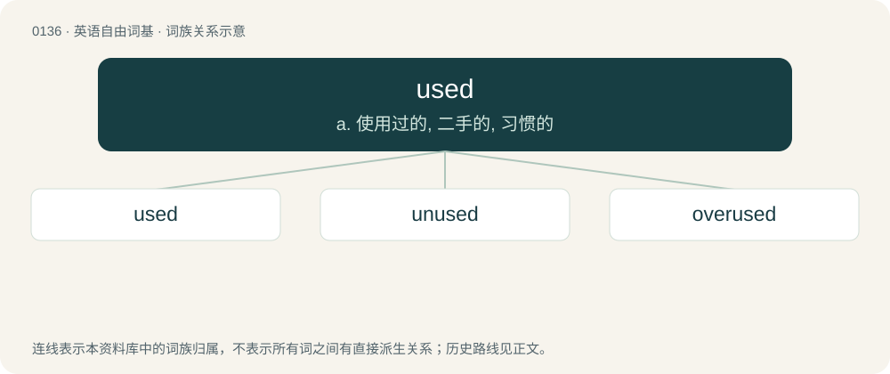

# 0142 · used — a. 使用过的, 二手的, 习惯的

[总目录](../00_总目录_按常用程度.md)

**类型**：英语自由词基　｜　**来源语言**：见词源记录

## 核心含义与来源

- 核心含义：a. 使用过的, 二手的, 习惯的
- 英文含义：In used to.
- 词形：used

**来源记录 1**（动词；In used to.）

From Middle English used, equivalent to use + -ed.

## 词族图

## 单词速览（常用到不常用）

| 单词 | 音标 | 释义 |
|---|---|---|
| [used](#w-1) | 英 /juːzd/；美 /juzd/ | a. 使用过的, 二手的, 习惯的 |
| [unused](#w-2) | 英 /ʌnˈjuːzd/；美 /ʌnˈjuzd/ | a. 不用的, 不在使用的, 从未用过的 |
| [overused](#w-3) | /ˌəʊvəˈjuːzd/ | v. 使用过度( overuse的过去式和过去分词 ) |

## 逐词详解

### 1. used

**词性**：形容词　｜　**音标**：英 /juːzd/；美 /juzd/

**中文释义**：a. 使用过的, 二手的, 习惯的

**英文义项**：That is or has or have been used. / That has or have previously been owned by someone else.

**构词拆分**：use + -ed

**词源与演化**：

From Middle English used, equivalent to use + -ed.

**例句**：

> The ground was littered with used syringes left behind by drug abusers.

该用例对应义项：That is or has or have been used.

### 2. unused

**词性**：形容词　｜　**音标**：英 /ʌnˈjuːzd/；美 /ʌnˈjuzd/

**中文释义**：a. 不用的, 不在使用的, 从未用过的

**英文义项**：Not used. / Not accustomed (to), unfamiliar with.

**构词拆分**：un- + used

**词源与演化**：

From un- + used.

**例句**：

> I am unused to the dark nights of the countryside.

该用例对应义项：Not accustomed (to), unfamiliar with.

### 3. overused

**词性**：形容词　｜　**音标**：/ˌəʊvəˈjuːzd/

**中文释义**：v. 使用过度( overuse的过去式和过去分词 )

**英文义项**：Used too much, or too often. / Hackneyed or clichéd.

**构词拆分**：over- + used

**词源与演化**：

From over- + used.

**例句**：

> These words are often overused in academic writing.
