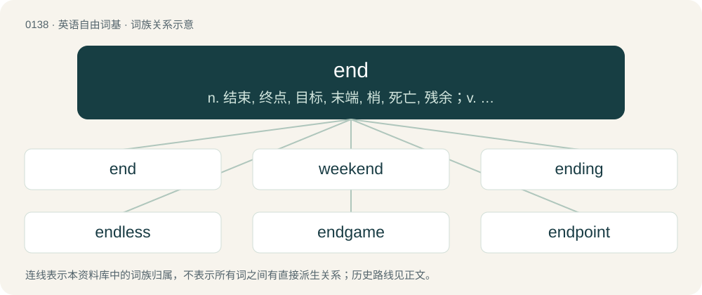

# 0144 · end — n. 结束, 终点, 目标, 末端, 梢, 死亡, 残余；v. 结束, 终结, 终止；\[计\] 端; 结束

[总目录](../00_总目录_按常用程度.md)

**类型**：英语自由词基　｜　**来源语言**：见词源记录

## 核心含义与来源

- 核心含义：n. 结束, 终点, 目标, 末端, 梢, 死亡, 残余；v. 结束, 终结, 终止；\[计\] 端; 结束
- 英文含义：The terminal point of something in space or time.
- 词形：end

**来源记录 1**（名词；The terminal point of something in space or time.）

From Middle English ende, from Old English ende, from Proto-West Germanic \*andī, from Proto-Germanic \*andijaz (“end”), from Proto-Indo-European \*h₂entíos (“forehead; front”), from \*h₂ent- (“face; forehead; front”), from \*h₂en- (“on, onto”). Cognates Cognate with Yola een, eene (“end”), Saterland Frisian Eend, Eende (“end”), West Frisian ein (“end”), Alemannic German End, Endi (“end”), Central Franconian Eng, Enk (“end”), Cimbrian énte (“end”), Dutch eind, einde, end (“end”), German Ende (“end”), Luxembourgish Enn (“end”), Vilamovian end, ent (“end”), Danish, Norwegian Bokmål, and Norwegian Nynorsk ende (“end”), Faroese endi (“end”), Icelandic endi, endir (“end”), Swedish ända, ände (“end”), Gothic 𐌰𐌽𐌳𐌴𐌹𐍃 (andeis, “end”); also Irish éadan (“end; front”), Manx eddin (“face; front”), Scottish Gaelic aodann (“face; hillside”), Latin antiae (“forelock”), Ancient Greek ἀντίος (antíos, “opposite”), Albanian anë (“brink; edge; facet; side”), Latvian no (“for; from”), Lithuanian nuo (“for; from”), Belarusian, Bulgarian, Macedonian, Russian, and Ukrainian на (na, “on”), Czech, Kashubian, Lower Sorbian, Polish, Slovak, and Slovene na (“on”), Serbo-Croatian на, na (“on”), Old Armenian ընդ (ənd, “in the place, instead of”), Old Persian 𐎠𐎲𐎡𐎹 (abiy, “against; towards; upon”), Tocharian A ānt (“in front”), Tocharian B ānte (“in front of”), Sanskrit अन्त (anta, “boundary; border, edge; end, termination”). More at and and anti-. The verb is from Middle English enden, endien, from Old English endian (“to end, to make an end of, complete, finish, abolish, destroy, come to an end, die”), from Proto-Germanic \*andijōną (“to finish, end”), denominative from \*andijaz.

## 词族图

## 单词速览（常用到不常用）

| 单词 | 音标 | 释义 |
|---|---|---|
| [end](#w-1) | /ɛnd/ | n. 结束, 终点, 目标, 末端, 梢, 死亡, 残余；v. 结束, 终结, 终止；\[计\] 端; 结束 |
| [weekend](#w-2) | 英 /wiːˈkɛnd/；美 /ˈwiˌkɛnd/ | n. 周末, 周末休假 |
| [ending](#w-3) | /ˈɛndɪŋ/ | n. 终止, 终了, 收场；\[医\] 末梢 |
| [endless](#w-4) | /ˈɛndlɪs/ | a. 不停的, 无穷尽的, 无尽的；\[机\] 无端的, 环状的 |
| [endgame](#w-5) | /ˈɛnd.ɡeɪm/ | n. 最后阶段；尾声 |
| [endpoint](#w-6) | /ˈend.pɔint/ | n. 端点；末端, 终结点 |
| [endo](#w-7) | /ˈɛndəʊ/ | abbr. 日本株式会社远藤公司 |
| [ender](#w-8) | 美 /ˈɛndə(ɹ)/ | n. 安德（游戏中的人物名）；恩德（男子名） |
| [upend](#w-9) | /ʌpˈɛnd/ | v. 颠倒, 倒放 |
| [bookend](#w-10) | 英 /ˈbʊkɛnd/ | n. 书挡, 压书具 |

## 逐词详解

### 1. end

**词性**：名词　｜　**音标**：/ɛnd/

**中文释义**：n. 结束, 终点, 目标, 末端, 梢, 死亡, 残余；v. 结束, 终结, 终止；\[计\] 端; 结束

**英文义项**：The terminal point of something in space or time. / Share of joint responsibility.

**词源与演化**：

From Middle English ende, from Old English ende, from Proto-West Germanic \*andī, from Proto-Germanic \*andijaz (“end”), from Proto-Indo-European \*h₂entíos (“forehead; front”), from \*h₂ent- (“face; forehead; front”), from \*h₂en- (“on, onto”). Cognates Cognate with Yola een, eene (“end”), Saterland Frisian Eend, Eende (“end”), West Frisian ein (“end”), Alemannic German End, Endi (“end”), Central Franconian Eng, Enk (“end”), Cimbrian énte (“end”), Dutch eind, einde, end (“end”), German Ende (“end”), Luxembourgish Enn (“end”), Vilamovian end, ent (“end”), Danish, Norwegian Bokmål, and Norwegian Nynorsk ende (“end”), Faroese endi (“end”), Icelandic endi, endir (“end”), Swedish ända, ände (“end”), Gothic 𐌰𐌽𐌳𐌴𐌹𐍃 (andeis, “end”); also Irish éadan (“end; front”), Manx eddin (“face; front”), Scottish Gaelic aodann (“face; hillside”), Latin antiae (“forelock”), Ancient Greek ἀντίος (antíos, “opposite”), Albanian anë (“brink; edge; facet; side”), Latvian no (“for; from”), Lithuanian nuo (“for; from”), Belarusian, Bulgarian, Macedonian, Russian, and Ukrainian на (na, “on”), Czech, Kashubian, Lower Sorbian, Polish, Slovak, and Slovene na (“on”), Serbo-Croatian на, na (“on”), Old Armenian ընդ (ənd, “in the place, instead of”), Old Persian 𐎠𐎲𐎡𐎹 (abiy, “against; towards; upon”), Tocharian A ānt (“in front”), Tocharian B ānte (“in front of”), Sanskrit अन्त (anta, “boundary; border, edge; end, termination”). More at and and anti-. The verb is from Middle English enden, endien, from Old English endian (“to end, to make an end of, complete, finish, abolish, destroy, come to an end, die”), from Proto-Germanic \*andijōną (“to finish, end”), denominative from \*andijaz.

**例句**：

> My father always sat at the end of the table nearest the kitchen.

该用例对应义项：The most extreme point of an object, especially one that is longer than it is wide.

### 2. weekend

**词性**：动词　｜　**音标**：英 /wiːˈkɛnd/；美 /ˈwiˌkɛnd/

**中文释义**：n. 周末, 周末休假

**英文义项**：To spend the weekend.

**构词拆分**：week + end

**词源与演化**：

From week + end. Originally a Northern England regionalism (see 1903 quotation), in more general use from late 19th century. Compare Saterland Frisian Wiekeneende (“weekend”), West Frisian wykein (“weekend”), Dutch weekeinde (“weekend”), German Low German Wekenenn (“weekend”), German Wochenende (“weekend”).

**例句**：

> We'll weekend at the beach.

该用例对应义项：To spend the weekend.

### 3. ending

**词性**：名词　｜　**音标**：/ˈɛndɪŋ/

**中文释义**：n. 终止, 终了, 收场；\[医\] 末梢

**英文义项**：A termination or conclusion. / The last part of something.

**构词拆分**：end + -ing

**词源与演化**：

From Middle English endynge, endyng, endinge, from Old English endung, ġeendung (“ending”), equivalent to end + -ing. Cognate with Dutch ending (“ending”), German Endung (“ending”).

**例句**：

> Spanish verb forms have different endings depending on the tense, mood and person.

该用例对应义项：The last morpheme of a word, added to some base to make an inflected form (such as -s in "dogs").

### 4. endless

**词性**：形容词　｜　**音标**：/ˈɛndlɪs/

**中文释义**：a. 不停的, 无穷尽的, 无尽的；\[机\] 无端的, 环状的

**英文义项**：Having no end. / Extending indefinitely.

**构词拆分**：end + -less

**词源与演化**：

From Middle English endeles, from Old English endelēas (“endless”), from Proto-Germanic \*andijalausaz (“endless”), equivalent to end + -less.

**用法示例／搭配（非完整句）**：

> endless time; endless praise

该用例对应义项：Having no end.

### 5. endgame

**词性**：名词　｜　**音标**：/ˈɛnd.ɡeɪm/

**中文释义**：n. 最后阶段；尾声

**英文义项**：The final stage of a game of chess, when there are few pieces left. / The final stage of a game of bridge, when there are few cards left.

**构词拆分**：end + game

**词源与演化**：

From end + game.

**例句**：

> Being stuck with two V tiles can make for an awkward Scrabble endgame.

该用例对应义项：The final stage of any game.

### 6. endpoint

**词性**：名词　｜　**音标**：/ˈend.pɔint/

**中文释义**：n. 端点；末端, 终结点

**英文义项**：Either of the two points at the ends of a line segment. / The point in speech at which an utterance ends.

**构词拆分**：end + point

**词源与演化**：

From end + point.

**例句**：

> The river flows into the Bay of Fundy near St. Martins, New Brunswick, and serves as the endpoint of the Fundy Trail.

### 7. endo

**词性**：名词　｜　**音标**：/ˈɛndəʊ/

**中文释义**：abbr. 日本株式会社远藤公司

**英文义项**：Marijuana.

**构词拆分**：end + -o

**词源与演化**：

Originally used to refer to the bottom tips of the marijuana plant which accumulate the most resin and crystals after being hung to dry, probably from end + -o.

### 8. ender

**词性**：名词　｜　**音标**：美 /ˈɛndə(ɹ)/

**中文释义**：n. 安德（游戏中的人物名）；恩德（男子名）

**英文义项**：Something which ends another thing.

**构词拆分**：end (verb) + -er (agent noun suffix)

**词源与演化**：

From Middle English endere, ender; equivalent to end (verb) + -er (agent noun suffix).

**例句**：

> Tom hasn't defeated the Ender Dragon before.

### 9. upend

**词性**：动词　｜　**音标**：/ʌpˈɛnd/

**中文释义**：v. 颠倒, 倒放

**英文义项**：To end up; to set on end. / To tip or turn over.

**构词拆分**：up- + end

**词源与演化**：

From up- + end.

**例句**：

> By the middle of March 2020, the COVID-19 pandemic upended normal life for virtually all Americans.

该用例对应义项：To affect or upset drastically.

### 10. bookend

**词性**：名词　｜　**音标**：英 /ˈbʊkɛnd/

**中文释义**：n. 书挡, 压书具

**英文义项**：A heavy object or moveable support placed at one or both ends of a row of books for the purpose of keeping them upright. / Something that comes before, after, or at both sides of something else.

**构词拆分**：book + end

**词源与演化**：

From book + end.
