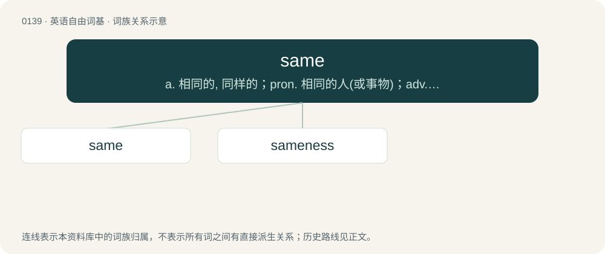

# 0145 · same — a. 相同的, 同样的；pron. 相同的人(或事物)；adv. 同样地

[总目录](../00_总目录_按常用程度.md)

**类型**：英语自由词基　｜　**来源语言**：见词源记录

## 核心含义与来源

- 核心含义：a. 相同的, 同样的；pron. 相同的人(或事物)；adv. 同样地
- 英文含义：Not different or other; not another or others; not different as regards self; selfsame; identical.
- 词形：same

**来源记录 1**（形容词；Not different or other; not another or others; not different as regards self; selfsame; identical.）

From Middle English same, from Old Norse samr (“same”) and/or Old English same, sama (“same”) in the phrase swā same (swā) (“in like manner, in the same way (as)”), both from Proto-Germanic \*samaz (“same”), from Proto-Indo-European \*somHós (“same”). Doublet of some and -some. Cognates Cognate with Scots samin (“same, like, together”), Dutch samen (“together”), Danish samme (“same”), Swedish samma (“same”), Norwegian Bokmål samme (“same”), Norwegian Nynorsk same (“same”), Gothic 𐍃𐌰𐌼𐌰 (sama), a weak adjectival form, Ancient Greek ὁμός (homós, “same”), Old Irish som, Russian са́мый (sámyj), Sanskrit सम (samá), Persian هم (ham, “also, same”), Finnish sama (“same”), Estonian sama (“same”). Unlikely to be related to Malay and Indonesian sama (“same, equal, together, exactly like”) and other similar words in Austronesian languages, based on cognates found in Oceanic languages such as Lauan dama (“mate, fellow, corresponding part; exactly like, the same”), 'Are'are tama (“in line, in pairs”); and Malagasy samy (“both, each, everyone; same”), which rarely to never had any direct contact with Indo-European speakers in precolonialism (except Malay and most regional languages of Indonesia, e.g. Javanese and Sundanese). All of which originated from Proto-Austronesian \*sama (“both, each, everyone, fellow, together, corresponding part; exactly like, in pairs, in line; same”).

## 词族图

## 单词速览（常用到不常用）

| 单词 | 音标 | 释义 |
|---|---|---|
| [same](#w-1) | 英 /seɪm/ | a. 相同的, 同样的；pron. 相同的人(或事物)；adv. 同样地 |
| [sameness](#w-2) | 英 /ˈseɪmnəs/ | n. 相同, 同样, 千篇一律 |

## 逐词详解

### 1. same

**词性**：形容词　｜　**音标**：英 /seɪm/

**中文释义**：a. 相同的, 同样的；pron. 相同的人(或事物)；adv. 同样地

**英文义项**：Not different or other; not another or others; not different as regards self; selfsame; identical. / Lacking variety from; indistinguishable.

**词源与演化**：

From Middle English same, from Old Norse samr (“same”) and/or Old English same, sama (“same”) in the phrase swā same (swā) (“in like manner, in the same way (as)”), both from Proto-Germanic \*samaz (“same”), from Proto-Indo-European \*somHós (“same”). Doublet of some and -some. Cognates Cognate with Scots samin (“same, like, together”), Dutch samen (“together”), Danish samme (“same”), Swedish samma (“same”), Norwegian Bokmål samme (“same”), Norwegian Nynorsk same (“same”), Gothic 𐍃𐌰𐌼𐌰 (sama), a weak adjectival form, Ancient Greek ὁμός (homós, “same”), Old Irish som, Russian са́мый (sámyj), Sanskrit सम (samá), Persian هم (ham, “also, same”), Finnish sama (“same”), Estonian sama (“same”). Unlikely to be related to Malay and Indonesian sama (“same, equal, together, exactly like”) and other similar words in Austronesian languages, based on cognates found in Oceanic languages such as Lauan dama (“mate, fellow, corresponding part; exactly like, the same”), 'Are'are tama (“in line, in pairs”); and Malagasy samy (“both, each, everyone; same”), which rarely to never had any direct contact with Indo-European speakers in precolonialism (except Malay and most regional languages of Indonesia, e.g. Javanese and Sundanese). All of which originated from Proto-Austronesian \*sama (“both, each, everyone, fellow, together, corresponding part; exactly like, in pairs, in line; same”).

**例句**：

> I realised I was the same age as my grandfather had been when he joined the air force.

该用例对应义项：Not different or other; not another or others; not different as regards self; selfsame; identical.

### 2. sameness

**词性**：名词　｜　**音标**：英 /ˈseɪmnəs/

**中文释义**：n. 相同, 同样, 千篇一律

**英文义项**：The quality of being the same; identity. / The state of being equivalent; equality.

**构词拆分**：same + -ness

**词源与演化**：

From same + -ness.

**例句**：

> He hated the sameness of the food the college served.

该用例对应义项：the quality of wearisome constancy, routine, and lack of variety
