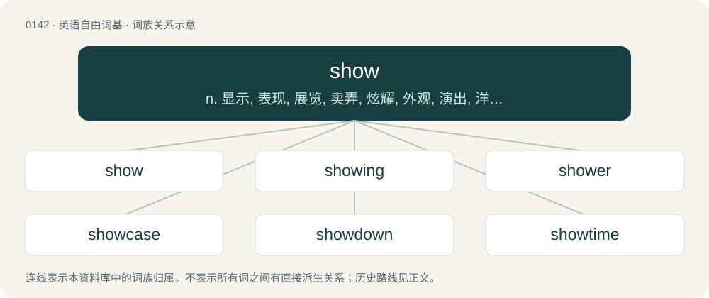

# 0149 · show — n. 显示, 表现, 展览, 卖弄, 炫耀, 外观, 演出, 洋相；vt. 表示, 显示, 展现, 陈列, 演出, 表明, 指出, 带领；vi. 露面, 显现, 演出

[总目录](../00_总目录_按常用程度.md)

**类型**：英语自由词基　｜　**来源语言**：见词源记录

## 核心含义与来源

- 核心含义：n. 显示, 表现, 展览, 卖弄, 炫耀, 外观, 演出, 洋相；vt. 表示, 显示, 展现, 陈列, 演出, 表明, 指出, 带领；vi. 露面, 显现, 演出
- 英文含义：To display, convey or exhibit; to have something available for others to see; to direct attention to something.
- 词形：show

**多个词源／构词路径**：同一拼写可能有不同来源；以下按词性和含义分别列出。

**来源记录 1**（动词；To display, convey or exhibit; to have something available for others to see; to direct attention to something.）

From Middle English schewen, from Old English scēawian (“to look, look at, exhibit, display”), from Proto-West Germanic \*skauwōn, from Proto-Germanic \*skawwōną (“to look, see”), from Proto-Indo-European \*(s)kewh₁- (“to heed, look, feel, take note of”); see haw, gaum, caveat, caution. Cognate with Scots shaw (“to show”), Dutch schouwen (“to inspect, view”), German schauen (“to see, behold”), Danish skue (“to behold”). Related to sheen. Wider cognates include Ancient Greek κῦδος (kûdos), Latin caveō whence English caution and caveat, Sanskrit कवि (kaví, “seer, prophet, bard”), Proto-Slavic \*čuti (whence Russian чу́ять (čújatʹ) and many more).

**来源记录 2**（名词；A play, dance, or other entertainment.）

From Middle English schewe, from the verb (schewen).

**来源记录 3**（名词；Synonym of shive (“wood fragment of the husk of flax or hemp”).）

Variant of shove, itself a variant of shive.

## 词族图

## 单词速览（常用到不常用）

| 单词 | 音标 | 释义 |
|---|---|---|
| [show](#w-1) | 英 /ʃəʊ/；美 /ʃoʊ/ | n. 显示, 表现, 展览, 卖弄, 炫耀, 外观, 演出, 洋相；vt. 表示, 显示, 展现, 陈列, 演出, 表明, 指出, 带领；vi. 露面, 显现, 演出 |
| [showing](#w-2) | 英 /ˈʃəʊɪŋ/；美 /ˈʃoʊɪŋ/ | n. 显示, 陈列, 展览, 成绩, 表现, 表演, 夸耀, 陈述, 叙述, 外表, 迹象 |
| [shower](#w-3) | 英 /ˈʃəʊ.ə(ɹ)/；美 /ˈʃoʊ.ɚ/ | 【英文】One who shows. |
| [showcase](#w-4) | 英 /ˈʃəʊˌkeɪs/；美 /ˈʃoʊˌkeɪs/ | n. 陈列橱；\[经\] 商品陈列所, 货物陈列架 |
| [showdown](#w-5) | 美 /ˈʃoʊˌdaʊn/ | n. 摊牌, 暴露, 紧要关头 |
| [showtime](#w-6) | 美 /ˈʃoʊˌtaɪm/ | n. 好戏上演；（电视等的）节目播放时间 |
| [showroom](#w-7) | 美 /ˈʃoʊˌɹum/ | n. 陈列室；\[经\] 样品间, 陈列室 |
| [roadshow](#w-8) | /ˈrəʊdʃəʊ/ | n. （由广播电台、杂志或公司组织的）路演, 巡回演出; 巡回演出; 巡回宣传（或竞选）团队 |
| [sideshow](#w-9) | 美 /ˈsaɪdˌʃoʊ/ | n. 杂耍, 附属活动, 枝节问题 |
| [slideshow](#w-10) | 美 /ˈslaɪdˌʃoʊ/ | n. 幻灯片, 幻灯片放映, 播放幻灯片方式 |
| [showy](#w-11) | 英 /ˈʃəʊ.i/；美 /ˈʃoʊ.i/ | a. 艳丽的, 炫耀的 |
| [showman](#w-12) | /ˈʃəʊ.mən/ | n. 演出主持人, 玩杂耍的人 |
| [showrunner](#w-13) | 美 /ˈʃoʊˌɹʌnɚ/ | \[网络\] 剧集运作人；执行制片人；剧集总监 |
| [showgirl](#w-14) | /ˈʃəj^\\\\ːl/ | n. 广告女郎；歌舞女郎 |
| [showpiece](#w-15) | /ˈʃəupiːs/ | n. 展出品, 样品 |
| [showstopper](#w-16) | /ˈʃəu.stɒpə/ | n. 被热烈掌声打断的表演 |
| [showboat](#w-17) | 美 /ˈʃoʊˌboʊt/ | n. 演戏船 |
| [showground](#w-18) | /ˈʃəj^rajnd/ | n. 展览场地 |

## 逐词详解

### 1. show

**词性**：动词　｜　**音标**：英 /ʃəʊ/；美 /ʃoʊ/

**中文释义**：n. 显示, 表现, 展览, 卖弄, 炫耀, 外观, 演出, 洋相；vt. 表示, 显示, 展现, 陈列, 演出, 表明, 指出, 带领；vi. 露面, 显现, 演出

**英文义项**：To display, convey or exhibit; to have something available for others to see; to direct attention to something. / To indicate; to convey facts that lead to a conclusion.

**词源与演化**：

From Middle English schewen, from Old English scēawian (“to look, look at, exhibit, display”), from Proto-West Germanic \*skauwōn, from Proto-Germanic \*skawwōną (“to look, see”), from Proto-Indo-European \*(s)kewh₁- (“to heed, look, feel, take note of”); see haw, gaum, caveat, caution. Cognate with Scots shaw (“to show”), Dutch schouwen (“to inspect, view”), German schauen (“to see, behold”), Danish skue (“to behold”). Related to sheen. Wider cognates include Ancient Greek κῦδος (kûdos), Latin caveō whence English caution and caveat, Sanskrit कवि (kaví, “seer, prophet, bard”), Proto-Slavic \*čuti (whence Russian чу́ять (čújatʹ) and many more).

**例句**：

> All he had to show for four years of attendance at college was a framed piece of paper.

该用例对应义项：To display, convey or exhibit; to have something available for others to see; to direct attention to something.

### 2. showing

**词性**：名词　｜　**音标**：英 /ˈʃəʊɪŋ/；美 /ˈʃoʊɪŋ/

**中文释义**：n. 显示, 陈列, 展览, 成绩, 表现, 表演, 夸耀, 陈述, 叙述, 外表, 迹象

**英文义项**：An occasion when something is shown. / A result, a judgement.

**构词拆分**：show + -ing

**词源与演化**：

From Middle English schewyng, schewinge, from Old English sċēawung (“a looking at, contemplation, consideration; respect, regard; survey, examination; a show, appearance, pretense”), from Proto-West Germanic \*skauwungu, from Proto-Germanic \*skawwungō, equivalent to show + -ing. Cognate with Dutch schouwing (“inspection, survey”), German Schauung (“vision”).

**例句**：

> We went to the midnight showing of the new horror movie.

该用例对应义项：An occasion when something is shown.

### 3. shower

**词性**：名词　｜　**音标**：英 /ˈʃəʊ.ə(ɹ)/；美 /ˈʃoʊ.ɚ/

**英文义项**：One who shows. / An object or activity that is shown in a contest.

**构词拆分**：show + -er

**词源与演化**：

Inherited from Middle English schewere, schewer, shewere (“one who exhibits something, actor; watchman; sign; mirror; index finger”), from Old English sċēawere (“an observer, one who examines into a matter; a spy; mirror; actor, buffoon”), equivalent to show + -er. Cognate with Dutch schouwer (“observer, visionary, clairvoyant”), German Schauer (“an inspector”).

**例句**：

> That calf is going to be a great shower at the fair this year.

该用例对应义项：An object or activity that is shown in a contest.

### 4. showcase

**词性**：动词　｜　**音标**：英 /ˈʃəʊˌkeɪs/；美 /ˈʃoʊˌkeɪs/

**中文释义**：n. 陈列橱；\[经\] 商品陈列所, 货物陈列架

**英文义项**：To display, demonstrate, show, or present.

**构词拆分**：show + case

**词源与演化**：

From show + case.

**例句**：

> I think the demonstration really showcases the strengths of the software.

该用例对应义项：To display, demonstrate, show, or present.

### 5. showdown

**词性**：名词　｜　**音标**：美 /ˈʃoʊˌdaʊn/

**中文释义**：n. 摊牌, 暴露, 紧要关头

**英文义项**：The final battle between two opponents, in which there can be only one victor. / The final round in a poker match, where all of the remaining players' cards have to be put down on the table and shown.

**构词拆分**：show + down

**词源与演化**：

From show + down.

**例句**：

> This could be the showdown of the century.

### 6. showtime

**词性**：名词　｜　**音标**：美 /ˈʃoʊˌtaɪm/

**中文释义**：n. 好戏上演；（电视等的）节目播放时间

**英文义项**：The time at which an entertainment event is set to begin. / The time for action.

**构词拆分**：show + time

**词源与演化**：

From show + time.

### 7. showroom

**词性**：动词　｜　**音标**：美 /ˈʃoʊˌɹum/

**中文释义**：n. 陈列室；\[经\] 样品间, 陈列室

**英文义项**：To inspect merchandise in a physical store, then purchase the identical product from an online merchant; to use a physical store as a showroom for an online merchant.

**构词拆分**：show + room

**词源与演化**：

From show + room. Verb sense circa 2011.

**例句**：

> This new phone looks good, but I want to go to the mall and showroom it before buying.

该用例对应义项：To inspect merchandise in a physical store, then purchase the identical product from an online merchant; to use a physical store as a showroom for an online merchant.

### 8. roadshow

**词性**：名词　｜　**音标**：/ˈrəʊdʃəʊ/

**中文释义**：n. （由广播电台、杂志或公司组织的）路演, 巡回演出; 巡回演出; 巡回宣传（或竞选）团队

**英文义项**：A show that travels from place to place. / The showing of a film in selected cinemas prior to its general release.

**构词拆分**：road + show

**词源与演化**：

From road + show.

### 9. sideshow

**词性**：名词　｜　**音标**：美 /ˈsaɪdˌʃoʊ/

**中文释义**：n. 杂耍, 附属活动, 枝节问题

**英文义项**：A minor attraction at a larger event such as a circus, fair or music festival. / An incidental spectacle that diverts attention from a larger concern.

**构词拆分**：side + show

**词源与演化**：

From side + show.

**例句**：

> Instruction is not an educational sideshow.

该用例对应义项：a subordinate incident of little importance relative to the main event

### 10. slideshow

**词性**：名词　｜　**音标**：美 /ˈslaɪdˌʃoʊ/

**中文释义**：n. 幻灯片, 幻灯片放映, 播放幻灯片方式

**英文义项**：A presentation of a series of photographic slides, usually with a spoken or recorded explanation. / Any sequence of images, shown one after the other (not simultaneously).

**构词拆分**：slide + show

**词源与演化**：

From slide + show.

**例句**：

> When there are too many enemies, the whole thing just turns into a slideshow.

该用例对应义项：The situation where a game has a low frame rate due to insufficient computing power.

### 11. showy

**词性**：形容词　｜　**音标**：英 /ˈʃəʊ.i/；美 /ˈʃoʊ.i/

**中文释义**：a. 艳丽的, 炫耀的

**英文义项**：Calling attention; flashy; standing out to the eye. / Making a striking or aesthetically pleasing display.

**构词拆分**：show (noun) + -y

**词源与演化**：

From show (noun) + -y.

**用法示例／搭配（非完整句）**：

> showy flowers

该用例对应义项：Making a striking or aesthetically pleasing display.

### 12. showman

**词性**：名词　｜　**音标**：/ˈʃəʊ.mən/

**中文释义**：n. 演出主持人, 玩杂耍的人

**英文义项**：A person (usually a man) involved in putting on shows (of various types); especially, one who plays a central role in doing so. / One who produces or presents shows as a profession, especially the proprietor, manager, or MC of a circus or variety show.

**构词拆分**：show + -man

**词源与演化**：

From show + -man.

**例句**：

> David is a showman above all else. His showroom is more than merely a sales floor: it is a spectacle.

该用例对应义项：A person (usually a man) involved in putting on shows (of various types); especially, one who plays a central role in doing so.

### 13. showrunner

**词性**：名词　｜　**音标**：美 /ˈʃoʊˌɹʌnɚ/

**中文释义**：\[网络\] 剧集运作人；执行制片人；剧集总监

**英文义项**：The person in overall charge of the production of a television series.

**构词拆分**：show + runner

**词源与演化**：

From show + runner.

### 14. showgirl

**词性**：名词　｜　**音标**：/ˈʃəj^\\\\ːl/

**中文释义**：n. 广告女郎；歌舞女郎

**英文义项**：A female performer in any of various (usually live) entertainment roles, usually including dancing and singing, often exotically or provocatively costumed.

**构词拆分**：show + girl

**词源与演化**：

From show + girl.

**例句**：

> She was a Las Vegas showgirl when she was younger.

该用例对应义项：A female performer in any of various (usually live) entertainment roles, usually including dancing and singing, often exotically or provocatively costumed.

### 15. showpiece

**词性**：名词　｜　**音标**：/ˈʃəupiːs/

**中文释义**：n. 展出品, 样品

**英文义项**：Something that exhibits exceptional quality, something worth being shown. / Something made specifically to be displayed.

**构词拆分**：show + piece

**词源与演化**：

From show + piece.

### 16. showstopper

**词性**：名词　｜　**音标**：/ˈʃəu.stɒpə/

**中文释义**：n. 被热烈掌声打断的表演

**英文义项**：A performance or segment of a theatrical production that induces a positive audience reaction strong enough to pause the production. / Any impediment that prevents all further progress.

**构词拆分**：show + stopper

**词源与演化**：

From show + stopper.

### 17. showboat

**词性**：名词　｜　**音标**：美 /ˈʃoʊˌboʊt/

**中文释义**：n. 演戏船

**英文义项**：A river steamboat having a resident theatre. / A person, often an athlete or performer, who behaves in an ostentatious, flashy manner to attract attention or admiration; a showoff.

**构词拆分**：show + boat

**词源与演化**：

From show + boat.

### 18. showground

**词性**：名词　｜　**音标**：/ˈʃəj^rajnd/

**中文释义**：n. 展览场地

**英文义项**：An outdoor arena or area where entertainment events and shows are held.

**构词拆分**：show + ground

**词源与演化**：

From show + ground.

**例句**：

> The fair takes place on the showground outside the city.
