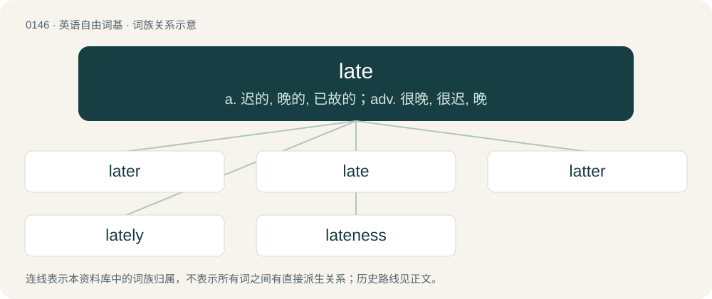

# 0154 · late — a. 迟的, 晚的, 已故的；adv. 很晚, 很迟, 晚

[总目录](../00_总目录_按常用程度.md)

**类型**：英语自由词基　｜　**来源语言**：见词源记录

## 核心含义与来源

- 核心含义：a. 迟的, 晚的, 已故的；adv. 很晚, 很迟, 晚
- 英文含义：Near the end of a period of time.
- 词形：late

**来源记录 1**（形容词；Near the end of a period of time.）

From Middle English late, lat, from Old English læt (“slow; slack, lax, negligent; late”), from Proto-West Germanic \*lat, from Proto-Germanic \*lataz (“slow, lazy”). By surface analysis, deverbal from let. Cognates Cognate with Yola laate (“late”), North Frisian leed, leet, lääs (“late”), Saterland Frisian leet (“late”), Dutch, German Low German laat (“late, tardy”), German lass (“lazy, sluggish”), Danish lad (“languid, lazy, indolent”), Faroese, Icelandic latur (“lazy”), Norwegian Bokmål, Norwegian Nynorsk and Swedish lat (“lazy”), Gothic 𐌻𐌰𐍄𐍃 (lats, “lazy, slothful”).

## 词族图

## 单词速览（常用到不常用）

| 单词 | 音标 | 释义 |
|---|---|---|
| [later](#w-1) | 英 /ˈleɪ.tə/；美 /ˈleɪ.tɚ/ | adv. 以后, 随后 |
| [late](#w-2) | 英 /leɪt/ | a. 迟的, 晚的, 已故的；adv. 很晚, 很迟, 晚 |
| [latter](#w-3) | 美 /ˈlæt.ɚ/；/ˈlæt.ə(ɹ)/ | a. 后者的, 较后的, 近来的 |
| [lately](#w-4) | /ˈleɪt.li/ | adv. 近来, 最近 |
| [lateness](#w-5) | 英 /ˈleɪt.nɪs/ | n. 迟, 晚 |

## 逐词详解

### 1. later

**词性**：形容词　｜　**音标**：英 /ˈleɪ.tə/；美 /ˈleɪ.tɚ/

**中文释义**：adv. 以后, 随后

**英文义项**：Coming afterward in time (used with than when comparing with another time). / Coming afterward in distance (following an antecedent distance as embedded within an adverbial phrase)

**构词拆分**：late + -er

**词源与演化**：

\* Adverb: From Middle English later, latere, from Old English lator, equivalent to late + -er. \* Adjective: From Middle English later, latere, from Old English lætra, equivalent to late + -er. Cognate with Saterland Frisian leeter (“later”), West Frisian letter (“later”), Dutch later (“later”), German Low German later (“later”).

**例句**：

> I felt some leg pain during the first mile of my run and I strained my calf two miles later.

该用例对应义项：Coming afterward in distance (following an antecedent distance as embedded within an adverbial phrase)

### 2. late

**词性**：形容词　｜　**音标**：英 /leɪt/

**中文释义**：a. 迟的, 晚的, 已故的；adv. 很晚, 很迟, 晚

**英文义项**：Near the end of a period of time. / Specifically, near the end of the day.

**词源与演化**：

From Middle English late, lat, from Old English læt (“slow; slack, lax, negligent; late”), from Proto-West Germanic \*lat, from Proto-Germanic \*lataz (“slow, lazy”). By surface analysis, deverbal from let. Cognates Cognate with Yola laate (“late”), North Frisian leed, leet, lääs (“late”), Saterland Frisian leet (“late”), Dutch, German Low German laat (“late, tardy”), German lass (“lazy, sluggish”), Danish lad (“languid, lazy, indolent”), Faroese, Icelandic latur (“lazy”), Norwegian Bokmål, Norwegian Nynorsk and Swedish lat (“lazy”), Gothic 𐌻𐌰𐍄𐍃 (lats, “lazy, slothful”).

**例句**：

> The seedlings appeared to be coming along nicely until a late frost killed them.

该用例对应义项：Near the end of a period of time.

### 3. latter

**词性**：形容词　｜　**音标**：美 /ˈlæt.ɚ/；/ˈlæt.ə(ɹ)/

**中文释义**：a. 后者的, 较后的, 近来的

**英文义项**：Near (or nearer) to the end. / In the past, but close (or closer) to the present time.

**构词拆分**：late + -er

**词源与演化**：

From Middle English latter, lattere, lattre, from Old English lætra, comparative form of læt (“late”). Equivalent to late + -er, thus a doublet of later; also, related to last, whose doublet is latest.

**例句**：

> In his latter years my dad became very absent-minded.

该用例对应义项：In the past, but close (or closer) to the present time.

### 4. lately

**词性**：副词　｜　**音标**：/ˈleɪt.li/

**中文释义**：adv. 近来, 最近

**英文义项**：Recently; not long ago; of late; not long since. / In a late manner; after-the-fact.

**构词拆分**：late + -ly

**词源与演化**：

From Middle English lately, latly, equivalent to late + -ly. Compare Old English lætlīċe (“slowly, tardily”), Middle Low German lātlîk (“careless, slack, sloppy”).

**例句**：

> Don't try to come lately and change your answer now after you've heard everyone else's response.

该用例对应义项：In a late manner; after-the-fact.

### 5. lateness

**词性**：名词　｜　**音标**：英 /ˈleɪt.nɪs/

**中文释义**：n. 迟, 晚

**英文义项**：The state of being late.

**构词拆分**：late + -ness

**词源与演化**：

From late + -ness.

**例句**：

> His chronic lateness will cost him a promotion if not his job.

该用例对应义项：The state of being late.
