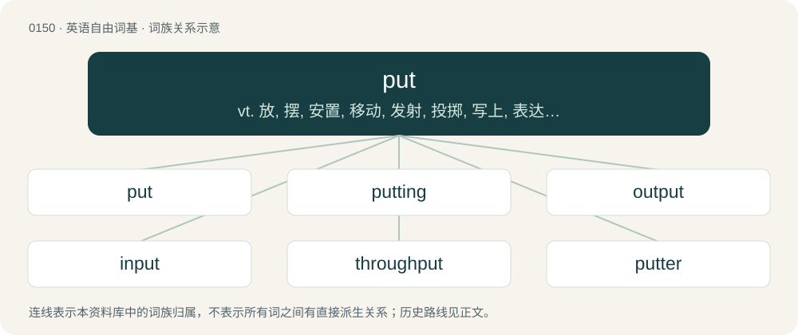

# 0158 · put — vt. 放, 摆, 安置, 移动, 发射, 投掷, 写上, 表达, 使从事, 使受到, 驱使, 赋予；vi. 出发, 航行, 发芽；n. 掷, 股票出售权, 笨蛋

[总目录](../00_总目录_按常用程度.md)

**类型**：英语自由词基　｜　**来源语言**：见词源记录

## 核心含义与来源

- 核心含义：vt. 放, 摆, 安置, 移动, 发射, 投掷, 写上, 表达, 使从事, 使受到, 驱使, 赋予；vi. 出发, 航行, 发芽；n. 掷, 股票出售权, 笨蛋
- 英文含义：To physically place (sth or sb swh).
- 词形：put

**来源记录 1**（动词；To physically place (sth or sb swh).）

From Middle English putten, pitten, pytten, puten, poten, from Old English putian, \*pūtian ("to push, put out"; attested by derivative putung (“pushing, impulse, instigation, urging”)) and potian (“to push, thrust, strike, butt, goad”), both from Proto-West Germanic \*putōn, from Proto-Germanic \*putōną (“to stick, stab”), which is of uncertain origin. Possibly from Proto-Indo-European \*bud- (“to shoot, sprout”), which would make it cognate with Sanskrit बुन्द (bundá, “arrow”), Lithuanian budė, and budis (“mushroom, fungus”). Compare also related Old English pȳtan (“to push, poke, thrust, put out (the eyes)”). Cognate with Dutch poten (“to set, plant”), Low German paten (“to set, plant”), Danish putte (“to put”), Swedish putta, pötta, potta (“to strike, knock, push gently, shove, put away”), Norwegian putte (“to set, put”), Norwegian pota (“to poke”), Icelandic pota (“to poke”), Dutch peuteren (“to pick, poke around, dig, fiddle with”).

## 词族图

## 单词速览（常用到不常用）

| 单词 | 音标 | 释义 |
|---|---|---|
| [put](#w-1) | 英 /pʊt/ | vt. 放, 摆, 安置, 移动, 发射, 投掷, 写上, 表达, 使从事, 使受到, 驱使, 赋予；vi. 出发, 航行, 发芽；n. 掷, 股票出售权, 笨蛋 |
| [putting](#w-2) | /ˈpʊtɪŋ/ | n. 投掷；（高尔夫球）打球入洞 |
| [output](#w-3) | 英 /ˈaʊtpʊt/ | n. 输出, 产品, 产量；\[计\] 输出 |
| [input](#w-4) | 英 /ˈɪnpʊt/ | n. 输入, 输入电路；vt. 输入；\[计\] 输入 |
| [throughput](#w-5) | 英 /ˈθɹuː.pʊt/；美 /ˈθɹu.pʊt/ | n. 生产量, 通过量；\[化\] 通过量; 产量 |
| [putter](#w-6) | 英 /ˈpʊtə(ɹ)/；美 /ˈpʊtɚ/ | 【英文】One who puts or places. |

## 逐词详解

### 1. put

**词性**：动词　｜　**音标**：英 /pʊt/

**中文释义**：vt. 放, 摆, 安置, 移动, 发射, 投掷, 写上, 表达, 使从事, 使受到, 驱使, 赋予；vi. 出发, 航行, 发芽；n. 掷, 股票出售权, 笨蛋

**英文义项**：To physically place (sth or sb swh). / To place in abstract; to attach or attribute; to assign.

**词源与演化**：

From Middle English putten, pitten, pytten, puten, poten, from Old English putian, \*pūtian ("to push, put out"; attested by derivative putung (“pushing, impulse, instigation, urging”)) and potian (“to push, thrust, strike, butt, goad”), both from Proto-West Germanic \*putōn, from Proto-Germanic \*putōną (“to stick, stab”), which is of uncertain origin. Possibly from Proto-Indo-European \*bud- (“to shoot, sprout”), which would make it cognate with Sanskrit बुन्द (bundá, “arrow”), Lithuanian budė, and budis (“mushroom, fungus”). Compare also related Old English pȳtan (“to push, poke, thrust, put out (the eyes)”). Cognate with Dutch poten (“to set, plant”), Low German paten (“to set, plant”), Danish putte (“to put”), Swedish putta, pötta, potta (“to strike, knock, push gently, shove, put away”), Norwegian putte (“to set, put”), Norwegian pota (“to poke”), Icelandic pota (“to poke”), Dutch peuteren (“to pick, poke around, dig, fiddle with”).

**例句**：

> That seems like a bad idea put against the restrictions we're working under.

该用例对应义项：To place in abstract; to attach or attribute; to assign.

### 2. putting

**词性**：名词　｜　**音标**：/ˈpʊtɪŋ/

**中文释义**：n. 投掷；（高尔夫球）打球入洞

**英文义项**：The action or result of the verb put.

**构词拆分**：From put + -ing.

**词源与演化**：

From put + -ing.

**例句**：

> Planning the wedding before proposing is putting the cart before the horse.

### 3. output

**词性**：名词　｜　**音标**：英 /ˈaʊtpʊt/

**中文释义**：n. 输出, 产品, 产量；\[计\] 输出

**英文义项**：Production; quantity produced, created, or completed. / Data sent out of the computer, as to output device such as a monitor or printer, or data sent from one program on the computer to another.

**构词拆分**：out + (verb) put

**词源与演化**：

From out + (verb) put; nominalisation of put out.

**例句**：

> The factory increased its output this year.

该用例对应义项：Production; quantity produced, created, or completed.

### 4. input

**词性**：名词　｜　**音标**：英 /ˈɪnpʊt/

**中文释义**：n. 输入, 输入电路；vt. 输入；\[计\] 输入

**英文义项**：The act or process of putting in; infusion. / That which is put in, as in an amount.

**构词拆分**：in- + put

**词源与演化**：

From Middle English inputten, equivalent to in- + put.

**例句**：

> You can provide input via this form.

该用例对应义项：Contribution of work or information, as an opinion or advice.

### 5. throughput

**词性**：名词　｜　**音标**：英 /ˈθɹuː.pʊt/；美 /ˈθɹu.pʊt/

**中文释义**：n. 生产量, 通过量；\[化\] 通过量; 产量

**英文义项**：The rate at which data is transferred through a system. / The rate of production; the rate at which something can be processed.

**构词拆分**：through + put

**词源与演化**：

From through + put (after input and output).

**例句**：

> The factory managed a throughput of 120 units per hour.

该用例对应义项：The rate of production; the rate at which something can be processed.

### 6. putter

**词性**：名词　｜　**音标**：英 /ˈpʊtə(ɹ)/；美 /ˈpʊtɚ/

**英文义项**：One who puts or places. / A shot-putter.

**构词拆分**：From put + -er.

**词源与演化**：

From put + -er.
