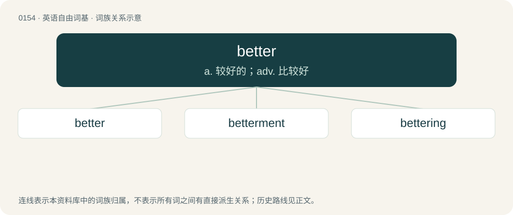

# 0163 · better — a. 较好的；adv. 比较好

[总目录](../00_总目录_按常用程度.md)

**类型**：英语自由词基　｜　**来源语言**：见词源记录

## 核心含义与来源

- 核心含义：a. 较好的；adv. 比较好
- 英文含义：Greater in amount or quantity
- 词形：better

**多个词源／构词路径**：同一拼写可能有不同来源；以下按词性和含义分别列出。

**来源记录 1**（形容词；Greater in amount or quantity）

From Middle English better, bettre, betre, from Old English betera (“better”), from Proto-West Germanic \*batiʀō, from Proto-Germanic \*batizô (“better”), from Proto-Indo-European \*bʰed-rós, from \*bʰed- (“good”). Cognate with Dutch beter, German besser, Danish and Norwegian Bokmål bedre, Norwegian Nynorsk betre, Swedish bättre, Faroese and Icelandic betri. Also Sanskrit भ॒द्र (bhadrá, “blessed; fortunate; happy; good”) (from \*bʰn̥d-ró-s). Related to best and battle (“getting better; improving; fruitful; fertile”). Compare also Icelandic batna (“to improve”), bót (“improvement”), German besser. More at batten, boot. False cognate of Persian بهتر (behtar).

**来源记录 2**（动词；Had better.）

Shortening of had better ('d better).

**来源记录 3**（动词；To improve.）

From Middle English beteren, from Old English beterian, betrian, from Proto-Germanic \*batizōną. Cognate with West Frisian betterje (“to better”), Dutch beteren (“to better”), German bessern (“to better”), Danish bedre (“to better”), Swedish bättra (“to better”).

## 词族图

## 单词速览（常用到不常用）

| 单词 | 音标 | 释义 |
|---|---|---|
| [better](#w-1) | /ˈbɛt.ə/ | a. 较好的；adv. 比较好 |
| [betterment](#w-2) | 英 /ˈbɛtəmənt/；美 /ˈbɛtɚmənt/ | n. 改进, 改善, (不动产)增值；\[法\] 改良, 改善, 地产增值 |
| [bettering](#w-3) | /ˈbetərɪŋ/ | v. 改善, 提高( better的现在分词 ) |

## 逐词详解

### 1. better

**词性**：形容词　｜　**音标**：/ˈbɛt.ə/

**中文释义**：a. 较好的；adv. 比较好

**英文义项**：Greater in amount or quantity / Greater or lesser (whichever is seen as more advantageous), in reference to value, distance, time, etc.

**词源与演化**：

From Middle English better, bettre, betre, from Old English betera (“better”), from Proto-West Germanic \*batiʀō, from Proto-Germanic \*batizô (“better”), from Proto-Indo-European \*bʰed-rós, from \*bʰed- (“good”). Cognate with Dutch beter, German besser, Danish and Norwegian Bokmål bedre, Norwegian Nynorsk betre, Swedish bättre, Faroese and Icelandic betri. Also Sanskrit भ॒द्र (bhadrá, “blessed; fortunate; happy; good”) (from \*bʰn̥d-ró-s). Related to best and battle (“getting better; improving; fruitful; fertile”). Compare also Icelandic batna (“to improve”), bót (“improvement”), German besser. More at batten, boot. False cognate of Persian بهتر (behtar).

**例句**：

> We can't go to the zoo today because you're sick; let's go when you're all better.

该用例对应义项：Healed or recovered from an injury or illness.

### 2. betterment

**词性**：名词　｜　**音标**：英 /ˈbɛtəmənt/；美 /ˈbɛtɚmənt/

**中文释义**：n. 改进, 改善, (不动产)增值；\[法\] 改良, 改善, 地产增值

**英文义项**：An improvement or amelioration. / An improvement to a property that adds to its value.

**构词拆分**：better + -ment

**词源与演化**：

From better + -ment.

**例句**：

> We can contribute to the betterment of society.

### 3. bettering

**词性**：名词　｜　**音标**：/ˈbetərɪŋ/

**中文释义**：v. 改善, 提高( better的现在分词 )

**英文义项**：improvement

**构词拆分**：better + -ing

**词源与演化**：

From Middle English beterynge; equivalent to better + -ing.
