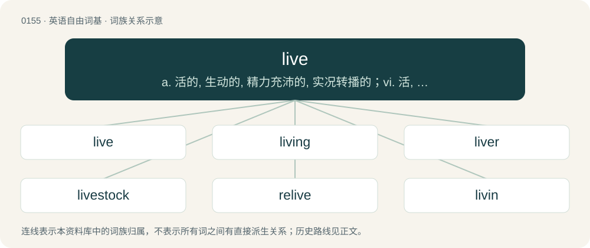

# 0164 · live — a. 活的, 生动的, 精力充沛的, 实况转播的；vi. 活, 生存, 居住；vt. 过着, 度过, 经历

[总目录](../00_总目录_按常用程度.md)

**类型**：英语自由词基　｜　**来源语言**：见词源记录

## 核心含义与来源

- 核心含义：a. 活的, 生动的, 精力充沛的, 实况转播的；vi. 活, 生存, 居住；vt. 过着, 度过, 经历
- 英文含义：To be alive; to have life.
- 词形：live

**多个词源／构词路径**：同一拼写可能有不同来源；以下按词性和含义分别列出。

**来源记录 1**（动词；To be alive; to have life.）

From Middle English lefe, lifen, libbe, libben, live, luvien, lyven, from Old English libban, lifian (“to live; be alive”), from Proto-West Germanic \*libbjan, from Proto-Germanic \*libjaną (“to live”), from Proto-Indo-European \*leyp- (“to stick”). Cognates Cognate with Yola live (“to live”), North Frisian laawe, lawe, lewe, lewi, lewwe, lääwe (“to live”), Saterland Frisian lieuwje, líeuwje (“to live”), West Frisian libje (“to live”), Alemannic German läbe (“to live”), Cimbrian and Mòcheno lem (“to live”), Dutch leeven, leven (“to live”), German leben (“to live”), German Low German lęven (“to live”), Limburgish leve, léëve (“to live”), Luxembourgish liewen (“to live”), Vilamovian łaowa (“to live”), Yiddish לעבן (lebn, “to live”), Danish and Norwegian Bokmål leve (“to live”), Faroese liva (“to live”), Icelandic lifa (“to live”), Norwegian Nynorsk leva, leve, liva (“to live”), Swedish leva (“to live”), Gothic 𐌻𐌹𐌱𐌰𐌽 (liban, “to live”); also Latin lippus (“half-sighted, myopic”), Greek λίπος (lípos, “fat, tallow”), Lithuanian lipti (“to stick”), Bulgarian лепя́ (lepjá, “to glue, paste, stick; to plaster, smear”), Czech lepit (“to glue, stick”), Macedonian лепи (lepi, “to glue, stick”), Polish lepić (“to mold; to glue, paste; to stick”), Russian лепи́ть (lepítʹ, “to fashion, sculpt, shape”), Serbo-Croatian лепити, лије́пити, lépiti, lijépiti (“to glue, paste; to stick”), Slovak lepiť (“to stick”), Slovene lepiti (“to stick”), Ukrainian ліпити (lipyty, “to mould, shape”), Sanskrit लिप् (lip, “to anoint, smear; to defile, soil, taint”), रिप् (rip, “deceit, fraud; injury; enemy, traitor”).

**来源记录 2**（形容词；Having life; that is alive.）

An apheretic form of alive.

## 词族图

## 单词速览（常用到不常用）

| 单词 | 音标 | 释义 |
|---|---|---|
| [live](#w-1) | /ˈlɪv/ | a. 活的, 生动的, 精力充沛的, 实况转播的；vi. 活, 生存, 居住；vt. 过着, 度过, 经历 |
| [living](#w-2) | /ˈlɪvɪŋ/ | n. 生活, 生计, 生存；a. 活的, 逼真的, 现存的 |
| [liver](#w-3) | /ˈlɪvə(ɹ)/ | 【英文】Someone who lives (usually in a specified way). |
| [livestock](#w-4) | 英 /ˈlaɪvstɒk/；美 /ˈlaɪvstɑk/ | n. 家畜；\[经\] 牲畜, 家畜 |
| [relive](#w-5) | /ɹiːˈlɪv/ | vi. 再生, 复活；vt. 再体验 |
| [livin](#w-6) |  | \[医\]（尚无中文译名）新发现的凋亡抑制蛋白，存在于胚胎组织、胎盘和一些恶性肿瘤组织中。 |
| [livestream](#w-7) |  | 【英文】To broadcast as a live stream. |
| [livable](#w-8) | /ˈlivəbl/ | a. 生活过得有价值的, (生活)过得去的, 值得过的, 适于居住的 |
| [outlive](#w-9) | 英 /aʊtˈlɪv/ | vt. 比...经久, 比...活得长, 度过(风暴)而健在 |
| [liven](#w-10) | /ˈlaɪvən/ | vt. 使高兴, 使快活；vi. 快活起来 |
| [livability](#w-11) | /,livəˈbiliti/ | n. (牲畜)存活率 |

## 逐词详解

### 1. live

**词性**：动词　｜　**音标**：/ˈlɪv/

**中文释义**：a. 活的, 生动的, 精力充沛的, 实况转播的；vi. 活, 生存, 居住；vt. 过着, 度过, 经历

**英文义项**：To be alive; to have life. / To have permanent residence somewhere, to inhabit, to reside.

**词源与演化**：

From Middle English lefe, lifen, libbe, libben, live, luvien, lyven, from Old English libban, lifian (“to live; be alive”), from Proto-West Germanic \*libbjan, from Proto-Germanic \*libjaną (“to live”), from Proto-Indo-European \*leyp- (“to stick”). Cognates Cognate with Yola live (“to live”), North Frisian laawe, lawe, lewe, lewi, lewwe, lääwe (“to live”), Saterland Frisian lieuwje, líeuwje (“to live”), West Frisian libje (“to live”), Alemannic German läbe (“to live”), Cimbrian and Mòcheno lem (“to live”), Dutch leeven, leven (“to live”), German leben (“to live”), German Low German lęven (“to live”), Limburgish leve, léëve (“to live”), Luxembourgish liewen (“to live”), Vilamovian łaowa (“to live”), Yiddish לעבן (lebn, “to live”), Danish and Norwegian Bokmål leve (“to live”), Faroese liva (“to live”), Icelandic lifa (“to live”), Norwegian Nynorsk leva, leve, liva (“to live”), Swedish leva (“to live”), Gothic 𐌻𐌹𐌱𐌰𐌽 (liban, “to live”); also Latin lippus (“half-sighted, myopic”), Greek λίπος (lípos, “fat, tallow”), Lithuanian lipti (“to stick”), Bulgarian лепя́ (lepjá, “to glue, paste, stick; to plaster, smear”), Czech lepit (“to glue, stick”), Macedonian лепи (lepi, “to glue, stick”), Polish lepić (“to mold; to glue, paste; to stick”), Russian лепи́ть (lepítʹ, “to fashion, sculpt, shape”), Serbo-Croatian лепити, лије́пити, lépiti, lijépiti (“to glue, paste; to stick”), Slovak lepiť (“to stick”), Slovene lepiti (“to stick”), Ukrainian ліпити (lipyty, “to mould, shape”), Sanskrit लिप् (lip, “to anoint, smear; to defile, soil, taint”), रिप् (rip, “deceit, fraud; injury; enemy, traitor”).

**例句**：

> I live at 2a Acacia Avenue. At that time I'd been living in a camper for about six months.

该用例对应义项：To have permanent residence somewhere, to inhabit, to reside.

### 2. living

**词性**：形容词　｜　**音标**：/ˈlɪvɪŋ/

**中文释义**：n. 生活, 生计, 生存；a. 活的, 逼真的, 现存的

**英文义项**：Having life; alive. / In use or existing.

**构词拆分**：live + -ing

**词源与演化**：

From Middle English livynge, libbyng, livinde, livand, livende, libbinde, libbende, from Old English lifiġende, lifiende, libbende, from Proto-West Germanic \*libbjandī, from Proto-Germanic \*libjandz (“living”), present participle of Proto-Germanic \*libjaną (“to live”), equivalent to live + -ing. Cognate with West Frisian libbend (“living”), Dutch levend (“living”), German lebend (“living”), Swedish levande (“living”), Icelandic lifandi (“living”).

**例句**：

> Respect for the dead does not preclude respect for the living.

该用例对应义项：Having life; alive.

### 3. liver

**词性**：名词　｜　**音标**：/ˈlɪvə(ɹ)/

**英文义项**：Someone who lives (usually in a specified way). / Someone who is alive: one of the living.

**构词拆分**：live + -er

**词源与演化**：

From Middle English lyvere, livere, equivalent to live + -er.

### 4. livestock

**词性**：名词　｜　**音标**：英 /ˈlaɪvstɒk/；美 /ˈlaɪvstɑk/

**中文释义**：n. 家畜；\[经\] 牲畜, 家畜

**英文义项**：Farm animals; animals domesticated for cultivation.

**构词拆分**：live + stock

**词源与演化**：

From live + stock.

**例句**：

> In the West there are local areas with too many livestock.

该用例对应义项：Farm animals; animals domesticated for cultivation.

### 5. relive

**词性**：动词　｜　**音标**：/ɹiːˈlɪv/

**中文释义**：vi. 再生, 复活；vt. 再体验

**英文义项**：To experience (something) again; to live over again. / To come back to life.

**构词拆分**：re- + live

**词源与演化**：

From re- + live.

**例句**：

> Replays in video games allow you to relive your greatest moments.

该用例对应义项：To experience (something) again; to live over again.

### 6. livin

**词性**：名词

**中文释义**：\[医\]（尚无中文译名）新发现的凋亡抑制蛋白，存在于胚胎组织、胎盘和一些恶性肿瘤组织中。

**英文义项**：A particular protein that inhibits apoptosis

**构词拆分**：live + -in

**词源与演化**：

From live + -in.

### 7. livestream

**词性**：动词

**英文义项**：To broadcast as a live stream. / To receive and watch as a live stream.

**构词拆分**：live + stream

**词源与演化**：

From live + stream.

**例句**：

> I'm planning to livestream the football game this weekend.

该用例对应义项：To receive and watch as a live stream.

### 8. livable

**词性**：形容词　｜　**音标**：/ˈlivəbl/

**中文释义**：a. 生活过得有价值的, (生活)过得去的, 值得过的, 适于居住的

**英文义项**：Endurable, survivable, suitable for living in, inhabitable.

**构词拆分**：live + -able

**词源与演化**：

From live + -able.

**例句**：

> Istanbul has ceased to be a livable city.

### 9. outlive

**词性**：动词　｜　**音标**：英 /aʊtˈlɪv/

**中文释义**：vt. 比...经久, 比...活得长, 度过(风暴)而健在

**英文义项**：To live longer than; continue to live after the death of; overlive; survive. / To live through or past (a given time).

**构词拆分**：out- + live

**词源与演化**：

From Middle English outliven, equivalent to out- + live.

**例句**：

> It's not natural for a mother to outlive her child.

### 10. liven

**词性**：动词　｜　**音标**：/ˈlaɪvən/

**中文释义**：vt. 使高兴, 使快活；vi. 快活起来

**英文义项**：To cause to be more lively, or to become more lively.

**构词拆分**：life + -en；live (adjective) + -en

**词源与演化**：

Partly from life + -en; partly from live (adjective) + -en; and partly a shortening of enliven. Cognate with Norwegian Nynorsk livna (“to quicken, come alive”), Faroese livna (“to come to life, come alive”), Icelandic lifna (“to come to life”).

**例句**：

> Let's liven up this party!

该用例对应义项：To cause to be more lively, or to become more lively.

### 11. livability

**词性**：名词　｜　**音标**：/,livəˈbiliti/

**中文释义**：n. (牲畜)存活率

**英文义项**：The property of being livable.

**构词拆分**：live + -ability

**词源与演化**：

From live + -ability.

**例句**：

> The livability of the shack was questioned, but the old man had lived there for 50 years.

该用例对应义项：The property of being livable.
