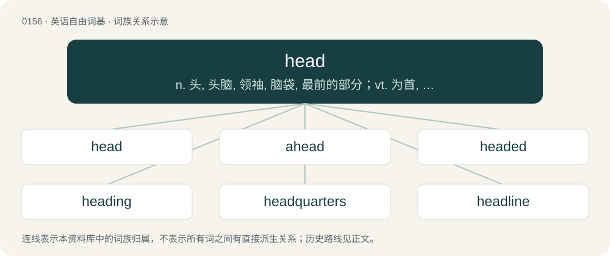

# 0166 · head — n. 头, 头脑, 领袖, 脑袋, 最前的部分；vt. 为首, 朝向, 前进, 用头顶；vi. 朝特定方向行进, (作物)结穗

[总目录](../00_总目录_按常用程度.md)

**类型**：英语自由词基　｜　**来源语言**：见词源记录

## 核心含义与来源

- 核心含义：n. 头, 头脑, 领袖, 脑袋, 最前的部分；vt. 为首, 朝向, 前进, 用头顶；vi. 朝特定方向行进, (作物)结穗
- 英文含义：The part of the body of an animal or human which contains the brain, mouth, and main sense organs.
- 词形：head

**多个词源／构词路径**：同一拼写可能有不同来源；以下按词性和含义分别列出。

**来源记录 1**（名词；The part of the body of an animal or human which contains the brain, mouth, and main sense organs.）

From Middle English efd, had, hafd, heafd, hed, heed, hefet, heid, het, hevd, heved, hevid, hiede, hæfd, hæfedd, from Old English hēafod (“head; top; leader; origin”), from Proto-West Germanic \*haubud, from Proto-Germanic \*haubudą (“head”), from Proto-Indo-European \*káput (“head”), from \*kap- (“head; bowl, cup”). The modern word comes from Old English oblique stem hēafd-; the expected Modern English outcome for hēafod would be \*heaved (similar to the Middle English word). Doublet of cape, capo, caput, chef, chief, and Howth. Cognates Cognate with Scots heid (“head”), Yola haade, hade, heade (“head”), North Frisian Haur, hood (“head”), Saterland Frisian Haud, Hööft (“head”), West Frisian haad (“head”), Alemannic German Haupt (“head”), Dutch hoofd (“head”), German Haupt, Häupt (“head”), Vilamovian hiöet, hiöt, huöt, huø̄t (“head”), Yiddish הויפּט (hoypt, “head”), Danish hode, hoved (“head”), Elfdalian ovuð (“head”), Faroese høvd, høvur (“head”), Icelandic höfuð (“head”), Jamtish huvu (“head”), Norwegian Bokmål hode, hue (“head”), Norwegian Nynorsk haud, hauv, hove, hovu, hovud, hue, huggu, hugu, hugud, huvu, huvud (“head”), Scanian huweð (“head”), Swedish hufvud, hufwud, huve, huvud, hövve (“head”), Crimean Gothic hoef (“head”), Gothic 𐌷𐌰𐌿𐌱𐌹𐌳 (haubid), 𐌷𐌰𐌿𐌱𐌹𐌸 (haubiþ, “head”); also Irish and Scottish Gaelic cuach (“bowl; dome (of head)”), Welsh cawg (“basin, bowl, vessel”), Latin capud, capus, caput (“head”), Greek κεφάλι (kefáli), κεφαλή (kefalí, “head”), Central Kurdish کاپۆڵ (kapoll, “skull”), Sanskrit कपाल (kapāla, “skull; bowl”).

**来源记录 2**（形容词；Foremost in rank or importance.）

From Middle English heed, from Old English hēafod- (“main”), from Proto-West Germanic \*haubida-, derived from the noun \*haubid (“head”). Cognate with Saterland Frisian hööft-, West Frisian haad-, Dutch hoofd-, German Low German höövd-, German haupt-.

## 词族图

## 单词速览（常用到不常用）

| 单词 | 音标 | 释义 |
|---|---|---|
| [head](#w-1) | 英 /hɛd/；/hiːd/ | n. 头, 头脑, 领袖, 脑袋, 最前的部分；vt. 为首, 朝向, 前进, 用头顶；vi. 朝特定方向行进, (作物)结穗 |
| [ahead](#w-2) | /əˈhɛd/ | a. 领先的, 预先的, 向前的；adv. 领先, 预先, 向前, 胜于, 在前面, 在将来 |
| [headed](#w-3) | /ˈhɛdɪd/ | a. 列有标题的, 具有某种类型的头(脑)或头发的 |
| [heading](#w-4) | /ˈhɛdɪŋ/ | n. 标题, 起始字, 方向；\[计\] 上标题 |
| [headquarters](#w-5) | 英 /ˌhɛdˈk(w)ɔː.təz/；美 /ˈhɛdˌk(w)ɔɹ.tɚz/ | n. 总部, 司令部, 总部人员；\[经\] 本部, 总部, 总署 |
| [headline](#w-6) | 英 /ˈhɛd.laɪn/ | n. 大标题, 新闻摘要；vt. 为...做标题, 写标题 |
| [overhead](#w-7) | /ˈəʊvəˌhɛd/ | n. 经常开支, 普通用费, 天花板；a. 在头上的, 高架的；adv. 在头顶上, 在空中, 在高处, 从头到脚全部没入地 |
| [header](#w-8) | 英 /ˈhɛdə/；美 /ˈhɛdɚ/ | n. 收割台；n. 顶梁, 域名；\[计\] 页眉, 域名, 数据头, 电子邮件头 |
| [headphones](#w-9) | 英 /ˈhɛdfəʊnz/；美 /ˈhɛdfoʊnz/ | n. 听筒；耳机；头戴式受话器（headphone的复数形式） |
| [forehead](#w-10) | 英 /ˈfɔːhɛd/；美 /ˈfɔɹ.hɛd/ | n. 额, 前额, 前部；\[医\] 额 |
| [headset](#w-11) | /ˈhɛdsɛt/ | n. (一副)耳机；\[电\] 头载机组 |
| [headphone](#w-12) | 英 /ˈhɛdfəʊn/；美 /ˈhɛdfoʊn/ | n. 戴在头上的收话器, 耳机；\[电\] 头载数话器 |
| [dickhead](#w-13) | /ˈdɪkˌ(h)ɛd/ | n. 白痴 |
| [headmaster](#w-14) | 英 /ˈhɛdˌmɑːstə/；美 /ˈhɛdˌmæstɚ/ | n. (中小学)校长, 监工 |
| [redhead](#w-15) | /ˈɹɛdˌhɛd/ | n. 红发的人 |
| [whitehead](#w-16) |  | 【英文】A type of comedo, manifesting as a small whitish bump of the skin due to retention of sebum and dead skin cells in a skin pore blocked by a thin layer of epithelium. |
| [headway](#w-17) | /ˈhɛdweɪ/ | n. 前进, 航行速度, 进展；\[经\] 进尺, 钻井 |
| [warhead](#w-18) | /ˈwɒːhed/ | n. 弹头 |
| [headless](#w-19) | /ˈhɛdləs/ | a. 无头的, 无领导者的, 无知的 |
| [headband](#w-20) | /ˈhɛdˌbænd/ | n. 头巾, 头饰带；\[医\] 额镜带 |
| [headlight](#w-21) | 美 /ˈhɛdˌlaɪt/ | n. 前灯, 桅灯；\[电\] 车前灯 |
| [headliner](#w-22) | 美 /ˈhɛdˌlaɪnɚ/ | 【英文】The interior fabric covering the ceiling-like area inside of a vehicle. |
| [heady](#w-23) | /ˈhɛdi/ | a. 顽固的, 任性的, 性急的, 猛烈的 |
| [headshot](#w-24) | /hedˈʃɒt/ | 拍摄头部 |
| [arrowhead](#w-25) | 英 /ˈæɹəʊhɛd/；/ˈæɹoʊhɛd/ | n. 箭头, 镞, 慈菇；\[计\] 箭头尖 |
| [headgear](#w-26) | 英 /ˈhɛdɡɪə(ɹ)/；美 /ˈhɛdɡɪɹ/ | n. 头饰, 马首挽具, 井架；\[医\] 头网, 连轮装置 |
| [shithead](#w-27) | /ˈʃɪt.hɛd/ | n. 笨蛋 |
| [spearhead](#w-28) | 英 /ˈspɪə.hɛd/；美 /ˈspɪɹ.hɛd/ | n. 矛尖, 先锋队, 先头部队；vt. 做先锋, 带头 |
| [figurehead](#w-29) | /ˈfɪɡjəɹˌhɛd/ | n. 装饰船头的人像, 傀儡领袖 |
| [headstone](#w-30) | 美 /ˈhɛdstoʊn/ | n. 墓石, 基石 |
| [bulkhead](#w-31) | /ˈbʌlk.hɛd/ | n. 隔壁, 防水壁 |
| [behead](#w-32) | /bɪˈhɛd/ | vt. 斩首, 砍头 |
| [flathead](#w-33) | 美 /ˈflætˌhɛd/ | n. 扁头印第安人 |
| [headland](#w-34) | /ˈhɛdlənd/ | n. 陆岬, 未耕地 |
| [headstrong](#w-35) | /ˈhedstrɒŋ/ | a. 顽固的, 刚愎的, 任性的 |
| [hammerhead](#w-36) | /ˈhæməhed/ | n. 锤头, 笨人 |
| [headteacher](#w-37) | /hedˈtiːtʃər/ | n. 中小学的校长 |
| [skinhead](#w-38) | /ˈskɪn.hɛd/ | n. 理光头的男人 |
| [headwaters](#w-39) | Canada /ˈhɛdˌwɑtɝz/ | n. 源头, 上游 |
| [headdress](#w-40) | 美 /ˈhɛdˌdɹɛs/ | a. 饰头巾, 头式 |
| [headscarf](#w-41) | 美 /ˈhɛdˌskɑɹf/ | n. 女人的头巾 |
| [steelhead](#w-42) | /ˈstiːlˈhed/ | 虹鳟 |
| [headroom](#w-43) | /ˈhedruːm/ | n. 净空, 车身内部高度 |
| [trailhead](#w-44) | /ˈtreilhed/ | n. 小道的起点 |
| [headbutt](#w-45) | /ˈhɛdbʌt/ | 故意用头撞（人） |
| [letterhead](#w-46) | /ˈlɛtə(ɹ)ˌhɛd/ | n. 信笺上方的印刷文字, 印有抬头的信笺 |
| [headspace](#w-47) | /ˈhɛdspeɪs/ | \[机\] 顶部空间 |
| [headfirst](#w-48) |  | adv. 头在前 |
| [headlamp](#w-49) | 美 /ˈhɛdˌlæmp/ | n. (汽车的)前灯, (矿工头上的)照明灯, 桅灯 |
| [headboard](#w-50) | /ˈhedbɒːd/ | n. 床头板 |
| [jughead](#w-51) | /ˈdʒʌ^hed/ | n. 笨蛋, 傻瓜；\[计\] 标题列表程序 |
| [headhunter](#w-52) | 美 /ˈhɛdˌhʌntɚ/ | n. (原始社会中)猎取人头者, 物色人才的人 |
| [headlock](#w-53) | /ˈhedlɒk/ | n. (摔跤中的)夹头 |
| [headpiece](#w-54) | 美 /ˈhɛdˌpis/ | n. 头巾, 耳机, 盔, 帽子, (书的)扉页, 头脑, 才智 |
| [masthead](#w-55) | /ˈmɑːsthed/ | n. 桅顶, 刊头, 报刊名称；vt. 升于桅顶, 爬到桅顶 |
| [headcount](#w-56) | /ˈhɛdˌkaʊnt/ | n. 点人头数总人数, 职员总数 |
| [beachhead](#w-57) | /ˈbiːt͡ʃhɛd/ | n. 滩头堡 |
| [headwear](#w-58) | /ˈhɛdˌweə(ɹ)/ | n. 头饰, 吊索 |
| [bobblehead](#w-59) |  | 摇头娃娃 |
| [butthead](#w-60) | /ˈbʌtˌhɛd/ | 【英文】An annoying person or someone who is difficult to get along with. |
| [headrest](#w-61) | /ˈhɛdˌɹɛst/ | n. 头靠, 弹性头垫；\[医\] 头靠 |
| [pinhead](#w-62) | /ˈpɪn.hɛd/ | n. 针头, 小东西, 微不足道的东西 |
| [headstock](#w-63) | /ˈhedstɒk/ | n. 头座, 机头座；\[机\] 车头, 主轴台 |
| [airhead](#w-64) | 英 /ˈɛə̯hɛd/；美 /ˈɛɹˌ(h)ɛd/ | n. 空降物 |
| [meathead](#w-65) | 美 /ˈmitˌhɛd/ | n. 笨蛋 |
| [headwind](#w-66) | /ˈhɛdˌwɪnd/ | n. 逆风, 顶风 |
| [fuckhead](#w-67) | /ˈfʌkˌhɛd/ | \[网络\] 指愚笨或不是好人 |
| [bonehead](#w-68) | 英 /ˈbəʊnˌhɛd/；美 /ˈboʊnˌhɛd/ | n. 笨蛋 |
| [copperhead](#w-69) | /ˈkɒpəhed/ | n. 铜头(蝮)蛇, 南北战争时同情南方的北方人；\[医\] 铜头蛇(蝮属) |
| [fathead](#w-70) | /ˈfæt.hɛd/ | n. 笨蛋, 呆子 |
| [fountainhead](#w-71) | /ˈfauntinhed/ | n. 水源, 源, 本源 |
| [leatherhead](#w-72) | /ˈleðəhed/ | n. 呆头, 更夫 |
| [riverhead](#w-73) | /ˈrivəhed/ | n. 河源, 水源 |
| [bridgehead](#w-74) | /ˈbɹɪd͡ʒhɛd/ | n. 桥头堡 |
| [headship](#w-75) | /ˈhedʃip/ | n. 领导人地位, 能力, 校长职务 |
| [egghead](#w-76) | 美 /ˈɛɡˌhɛd/ | n. 有知识的人, 受过高等教育的人, 自以为有大学问的人 |
| [hothead](#w-77) | /ˈhɒthed/ | n. 性急人 |
| [knucklehead](#w-78) | /ˈnʌkl̩ˌhɛd/ | n. &lt;美&gt; 蠢人, 傻瓜 |
| [loggerhead](#w-79) | 英 /ˈlɒɡəhɛd/；美 /ˈlɔɡɚˌhɛd/ | n. 傻瓜, 笨蛋 |
| [bullhead](#w-80) | 英 /ˈbʌlˌhɛd/ | n. 大头鱼, 顽固的人 |
| [headcanon](#w-81) |  | 【英文】Elements and interpretations of a fictional universe accepted by an individual or small group of fans, but not necessarily found within or supported by the official canon. |
| [wellhead](#w-82) | 英 /ˈwɛlhɛd/ | n. 水源, 泉源 |
| [deadhead](#w-83) | /ˈdɛdhɛd/ | n. 免费乘客, 免费入场者 |
| [blackhead](#w-84) | /ˈblæk.hɛd/ | n. 粉刺；\[医\] 黑头粉刺, 盲肠肝炎 |
| [headbanging](#w-85) |  | 重金属乐迷有节奏的疯狂摆头 |
| [sheepshead](#w-86) | /ˈʃiːpshed/ | n. 羊头, 蠢人 |
| [showerhead](#w-87) | /ˈʃaʊəhed/ | n. 淋喷头, 莲蓬头 |
| [headwater](#w-88) | /ˈhed,wɔːtə(r)/ | n. \[常作～s\](河流)上游源头 |
| [broadhead](#w-89) |  | \[人名\] \[英格兰人姓氏\] 布罗德黑德绰号, 宽额或大头者, 来源于中世纪英语, 含义是“宽阔的+头”(broad+head) |

## 逐词详解

### 1. head

**词性**：名词　｜　**音标**：英 /hɛd/；/hiːd/

**中文释义**：n. 头, 头脑, 领袖, 脑袋, 最前的部分；vt. 为首, 朝向, 前进, 用头顶；vi. 朝特定方向行进, (作物)结穗

**英文义项**：The part of the body of an animal or human which contains the brain, mouth, and main sense organs. / Mental or emotional aptitude or skill.

**词源与演化**：

From Middle English efd, had, hafd, heafd, hed, heed, hefet, heid, het, hevd, heved, hevid, hiede, hæfd, hæfedd, from Old English hēafod (“head; top; leader; origin”), from Proto-West Germanic \*haubud, from Proto-Germanic \*haubudą (“head”), from Proto-Indo-European \*káput (“head”), from \*kap- (“head; bowl, cup”). The modern word comes from Old English oblique stem hēafd-; the expected Modern English outcome for hēafod would be \*heaved (similar to the Middle English word). Doublet of cape, capo, caput, chef, chief, and Howth. Cognates Cognate with Scots heid (“head”), Yola haade, hade, heade (“head”), North Frisian Haur, hood (“head”), Saterland Frisian Haud, Hööft (“head”), West Frisian haad (“head”), Alemannic German Haupt (“head”), Dutch hoofd (“head”), German Haupt, Häupt (“head”), Vilamovian hiöet, hiöt, huöt, huø̄t (“head”), Yiddish הויפּט (hoypt, “head”), Danish hode, hoved (“head”), Elfdalian ovuð (“head”), Faroese høvd, høvur (“head”), Icelandic höfuð (“head”), Jamtish huvu (“head”), Norwegian Bokmål hode, hue (“head”), Norwegian Nynorsk haud, hauv, hove, hovu, hovud, hue, huggu, hugu, hugud, huvu, huvud (“head”), Scanian huweð (“head”), Swedish hufvud, hufwud, huve, huvud, hövve (“head”), Crimean Gothic hoef (“head”), Gothic 𐌷𐌰𐌿𐌱𐌹𐌳 (haubid), 𐌷𐌰𐌿𐌱𐌹𐌸 (haubiþ, “head”); also Irish and Scottish Gaelic cuach (“bowl; dome (of head)”), Welsh cawg (“basin, bowl, vessel”), Latin capud, capus, caput (“head”), Greek κεφάλι (kefáli), κεφαλή (kefalí, “head”), Central Kurdish کاپۆڵ (kapoll, “skull”), Sanskrit कपाल (kapāla, “skull; bowl”).

**例句**：

> He never learned how to pour a glass of beer so it didn't have too much head.

该用例对应义项：The foam that forms on top of beer or other carbonated beverages.

### 2. ahead

**词性**：副词　｜　**音标**：/əˈhɛd/

**中文释义**：a. 领先的, 预先的, 向前的；adv. 领先, 预先, 向前, 胜于, 在前面, 在将来

**英文义项**：At or towards the front; in the direction one is facing or moving. / So as to be further advanced, either spatially or in an abstract sense; to be superior.

**构词拆分**：a- + head

**词源与演化**：

From a- + head. Perhaps originally a nautical term, beyond the head (of a ship), then drifting into more general English usage where it is used to describe something as being in front of.

**例句**：

> Push the deadline ahead a day, from the 20th to the 21st.

该用例对应义项：To a later time.

### 3. headed

**词性**：形容词　｜　**音标**：/ˈhɛdɪd/

**中文释义**：a. 列有标题的, 具有某种类型的头(脑)或头发的

**英文义项**：Of a sheet of paper: having the sender's name, address, etc. preprinted at the top. / Having a head or brain with specified characteristics.

**构词拆分**：head + -ed

**词源与演化**：

From head (“noun”) + -ed.

**用法示例／搭配（非完整句）**：

> a large-headed caricature of a politician

该用例对应义项：Having a head or brain with specified characteristics.

### 4. heading

**词性**：名词　｜　**音标**：/ˈhɛdɪŋ/

**中文释义**：n. 标题, 起始字, 方向；\[计\] 上标题

**英文义项**：The title or topic of a document, article, chapter, or of a section thereof. / The direction into which a seagoing or airborne vessel's bow is pointing (apparent heading) and/or the direction into which it is actually moving relative to the ground (true heading)

**构词拆分**：head + -ing

**词源与演化**：

From head + -ing.

**用法示例／搭配（非完整句）**：

> put the information under the "Advantages" heading

该用例对应义项：The title or topic of a document, article, chapter, or of a section thereof.

### 5. headquarters

**词性**：名词　｜　**音标**：英 /ˌhɛdˈk(w)ɔː.təz/；美 /ˈhɛdˌk(w)ɔɹ.tɚz/

**中文释义**：n. 总部, 司令部, 总部人员；\[经\] 本部, 总部, 总署

**英文义项**：The military installation from which troops are commanded and orders are issued; the military unit consisting of a commander and his support staff. / The center of an organization's operations or administration.

**构词拆分**：head + quarter

**词源与演化**：

From head + quarters.

**例句**：

> The general's headquarters were a couple of large tents.

该用例对应义项：the military installation from which a commander performs the functions of command

### 6. headline

**词性**：名词　｜　**音标**：英 /ˈhɛd.laɪn/

**中文释义**：n. 大标题, 新闻摘要；vt. 为...做标题, 写标题

**英文义项**：A rope or chain used to attach the bow of a vessel to the shore or to another vessel. / A rope tied to the head of an animal.

**构词拆分**：head + line

**词源与演化**：

From head + line.

**例句**：

> The headline on today's newspaper reads "John Doe Wins Wood-Splitting Competition."

该用例对应义项：A heading or title at the top of a page or section of text; especially, a brief line in large letters summarising or drawing attention to the following article or similar in a magazine or newspaper.

### 7. overhead

**词性**：形容词　｜　**音标**：/ˈəʊvəˌhɛd/

**中文释义**：n. 经常开支, 普通用费, 天花板；a. 在头上的, 高架的；adv. 在头顶上, 在空中, 在高处, 从头到脚全部没入地

**英文义项**：Located above, especially over the head. / Kicked over one's own head.

**构词拆分**：over- + head

**词源与演化**：

From Middle English owerheved, over-hed, over hede (adverb), from Old English oferhēafod (adverb), equivalent to over- + head. Compare German Low German overhoopt, överhoopt, German überhaupt. Piecewise doublet of overchief.

**例句**：

> Place your luggage in the overhead lockers.

该用例对应义项：Located above, especially over the head.

### 8. header

**词性**：名词　｜　**音标**：英 /ˈhɛdə/；美 /ˈhɛdɚ/

**中文释义**：n. 收割台；n. 顶梁, 域名；\[计\] 页眉, 域名, 数据头, 电子邮件头

**英文义项**：The upper portion of a page (or other) layout. / Text, or other visual information, used to mark off a quantity of text, often titling or summarizing it.

**构词拆分**：head + -er

**词源与演化**：

From head + -er.

**例句**：

> The encapsulation layer adds an eight-byte header and a two-byte trailer to each packet.

该用例对应义项：the first part of a packet or stream, often containing its address and descriptors.

### 9. headphones

**词性**：名词　｜　**音标**：英 /ˈhɛdfəʊnz/；美 /ˈhɛdfoʊnz/

**中文释义**：n. 听筒；耳机；头戴式受话器（headphone的复数形式）

**英文义项**：A pair of cushioned speakers worn over or in the ears so only the wearer can hear the sound. / A pair of cushioned speakers worn over or on the ears.

**构词拆分**：head + phones

**词源与演化**：

From head + phones.

**例句**：

> Circumaural headphones enclose the ear, supra-aural headphones rest on the ear's surface, and earbuds are placed inside the ear.

该用例对应义项：A pair of cushioned speakers worn over or in the ears so only the wearer can hear the sound.

### 10. forehead

**词性**：名词　｜　**音标**：英 /ˈfɔːhɛd/；美 /ˈfɔɹ.hɛd/

**中文释义**：n. 额, 前额, 前部；\[医\] 额

**英文义项**：The part of the face above the eyebrows and below the hairline. / confidence; audacity; impudence.

**构词拆分**：fore- + head

**词源与演化**：

From Middle English forhed, forheed, from Old English forehēafod, from Proto-West Germanic \*forēhaubid, corresponding to fore- + head. Cognate with Scots foreheid (“forehead”), Dutch voorhoofd (“forehead”), German Vorhaupt (“forehead”), Danish forhoved (“brow; forehead; face”). Compare also West Frisian foarholle (“forehead”), German Low German Vörkopp (“forehead”).

**例句**：

> The man put the gun against his forehead and squeezed the trigger.

### 11. headset

**词性**：名词　｜　**音标**：/ˈhɛdsɛt/

**中文释义**：n. (一副)耳机；\[电\] 头载机组

**英文义项**：A pair of headphones or earphones, or a singular headphone or earphone, typically with an attached microphone. / Any electronic device worn on the head.

**构词拆分**：head + set

**词源与演化**：

From head + set.

**例句**：

> My virtual reality headset is broken because it fell on the ground.

### 12. headphone

**词性**：名词　｜　**音标**：英 /ˈhɛdfəʊn/；美 /ˈhɛdfoʊn/

**中文释义**：n. 戴在头上的收话器, 耳机；\[电\] 头载数话器

**英文义项**：Used with headphones.

**构词拆分**：head + phone

**词源与演化**：

From head + phone.

**用法示例／搭配（非完整句）**：

> headphone socket

该用例对应义项：Used with headphones.

### 13. dickhead

**词性**：名词　｜　**音标**：/ˈdɪkˌ(h)ɛd/

**中文释义**：n. 白痴

**英文义项**：The glans penis. / A jerk; a mean or rude person.

**构词拆分**：dick + head

**词源与演化**：

From dick + head. Attested since the 1960s, with the jerk sense appearing earliest. Compare cockhead, knobhead.

### 14. headmaster

**词性**：名词　｜　**音标**：英 /ˈhɛdˌmɑːstə/；美 /ˈhɛdˌmæstɚ/

**中文释义**：n. (中小学)校长, 监工

**英文义项**：A male headteacher.

**构词拆分**：head + master

**词源与演化**：

From head + master.

**例句**：

> Tom named his schoolmates who had scratched the Chevrolet of the headmaster.

### 15. redhead

**词性**：名词　｜　**音标**：/ˈɹɛdˌhɛd/

**中文释义**：n. 红发的人

**英文义项**：A person with red hair. / A North American duck (Aythya americana) highly esteemed as a game bird.

**构词拆分**：red + head

**词源与演化**：

Bahuvrihi compound of red + head.

**例句**：

> I'm a natural redhead, so I most definitely freckle.

### 16. whitehead

**词性**：名词

**英文义项**：A type of comedo, manifesting as a small whitish bump of the skin due to retention of sebum and dead skin cells in a skin pore blocked by a thin layer of epithelium. / A species of passerine bird, endemic to New Zealand (Mohoua albicilla).

**构词拆分**：white + head

**词源与演化**：

From white + head.

**例句**：

> Ruth knew that the whiteheads of her teenage acne were a temporary state of affairs, but that did nothing to quell her distress when an eruption hit just before prom.

该用例对应义项：A type of comedo, manifesting as a small whitish bump of the skin due to retention of sebum and dead skin cells in a skin pore blocked by a thin layer of epithelium.

### 17. headway

**词性**：名词　｜　**音标**：/ˈhɛdweɪ/

**中文释义**：n. 前进, 航行速度, 进展；\[经\] 进尺, 钻井

**英文义项**：A movement ahead or forward. / Forward motion, or its rate.

**构词拆分**：By surface analysis, head + way

**词源与演化**：

Partly from Middle English hauedwei, from Old English hēafodweġ (“head-road, main-road”); partly as a shortening of ahead-way, the source of the nautical sense. By surface analysis, head + way.

**例句**：

> The ship made little headway against the gale.

该用例对应义项：forward movement

### 18. warhead

**词性**：名词　｜　**音标**：/ˈwɒːhed/

**中文释义**：n. 弹头

**英文义项**：The part of a missile, projectile, torpedo, rocket, or other munition which contains either the nuclear or thermonuclear system, high explosive system, chemical or biological agents, or inert materials intended to inflict damage. / The glans penis.

**构词拆分**：war + head

**词源与演化**：

From war + head, originally to distinguish a live war head of a torpedo from an inert exercise head. Piecewise doublet of war chief.

**例句**：

> The scientist participated in developing high-voltage switches, a key component crucial for setting off explosions needed to trigger nuclear warhead.

### 19. headless

**词性**：形容词　｜　**音标**：/ˈhɛdləs/

**中文释义**：a. 无头的, 无领导者的, 无知的

**英文义项**：Synonym of decapitated. / Naturally having and needing no head.

**构词拆分**：head + -less

**词源与演化**：

From Middle English heedles, hevedles, from Old English hēafodlēas (“headless”), equivalent to head + -less. Cognate with Dutch hoofdloos (“headless”), Danish hovedløs (“headless”), Swedish huvudlös (“headless”), Icelandic höfuðlaus (“headless”). Piecewise doublet of chefless and chiefless.

**例句**：

> The headless army blundered along after the death of their general, accomplishing nothing.

该用例对应义项：Without leadership.

### 20. headband

**词性**：名词　｜　**音标**：/ˈhɛdˌbænd/

**中文释义**：n. 头巾, 头饰带；\[医\] 额镜带

**英文义项**：A strip of fabric worn around the head. / A hair accessory, made of a flexible material and curved like a horseshoe, for holding one's hair back.

**构词拆分**：head + band

**词源与演化**：

From Middle English \*hedband, from Old English hēafodbænd, hēafodbend (“headband”), equivalent to head + band. Cognate with Old High German houbitbant (“headband”), Dutch hoofdband (“headband”).

**例句**：

> The earphones were held in place by a headband.

该用例对应义项：a band worn around or over the head

### 21. headlight

**词性**：名词　｜　**音标**：美 /ˈhɛdˌlaɪt/

**中文释义**：n. 前灯, 桅灯；\[电\] 车前灯

**英文义项**：A bright light, with a lens and reflector, on the front of a motor vehicle (or originally a ship or train), designed to illuminate the road when driving at night; normally one of a pair. / A woman's breast.

**构词拆分**：head + light

**词源与演化**：

From head + light.

**例句**：

> Yanni's car has only one headlight working.

### 22. headliner

**词性**：名词　｜　**音标**：美 /ˈhɛdˌlaɪnɚ/

**英文义项**：The interior fabric covering the ceiling-like area inside of a vehicle.

**构词拆分**：head + liner

**词源与演化**：

From head + liner.

### 23. heady

**词性**：形容词　｜　**音标**：/ˈhɛdi/

**中文释义**：a. 顽固的, 任性的, 性急的, 猛烈的

**英文义项**：Intoxicating or stupefying. / Tending to upset the mind or senses.

**构词拆分**：head + -y

**词源与演化**：

From Middle English hedi, hevedi, equivalent to head + -y.

**例句**：

> Home sales remained steady, although running slightly below the previous month's heady pace.

该用例对应义项：rapid, substantial, or breakneck in growth.

### 24. headshot

**词性**：名词　｜　**音标**：/hedˈʃɒt/

**中文释义**：拍摄头部

**英文义项**：A portrait for branding or social media. / A gunshot to the head.

**构词拆分**：head + shot

**词源与演化**：

From head + shot.

**例句**：

> In many games, a headshot is an instant kill.

### 25. arrowhead

**词性**：名词　｜　**音标**：英 /ˈæɹəʊhɛd/；/ˈæɹoʊhɛd/

**中文释义**：n. 箭头, 镞, 慈菇；\[计\] 箭头尖

**英文义项**：The pointed part of an arrow (the weapon). / The pointed part of an arrow (the symbol).

**构词拆分**：By surface analysis, arrow + head

**词源与演化**：

From Middle English arewehede, arowhede, arowheved. By surface analysis, arrow + head.

**例句**：

> If you're practicing target archery, you'll be using a narrow, pointed arrowhead rather than a broadhead.

### 26. headgear

**词性**：名词　｜　**音标**：英 /ˈhɛdɡɪə(ɹ)/；美 /ˈhɛdɡɪɹ/

**中文释义**：n. 头饰, 马首挽具, 井架；\[医\] 头网, 连轮装置

**英文义项**：Anything worn on the head, such as a hat, hood, helmet, etc. / The harness that fits on a horse's head.

**构词拆分**：head + gear

**词源与演化**：

From head + gear.

**例句**：

> Tom was late for wrestling practice because he left his headgear at home.

### 27. shithead

**词性**：名词　｜　**音标**：/ˈʃɪt.hɛd/

**中文释义**：n. 笨蛋

**英文义项**：A stupid or contemptible person. / A card game, the aim of which is to lose one's cards.

**构词拆分**：shit + head

**词源与演化**：

From shit + head. Dysphemistically modelled after dickhead.

**例句**：

> Unfortunately Todd is a dummy, but what's worse is that Harvey is a shithead.

该用例对应义项：A stupid or contemptible person.

### 28. spearhead

**词性**：动词　｜　**音标**：英 /ˈspɪə.hɛd/；美 /ˈspɪɹ.hɛd/

**中文释义**：n. 矛尖, 先锋队, 先头部队；vt. 做先锋, 带头

**英文义项**：To drive or campaign ardently for (an effort, project, etc.); to direct.

**构词拆分**：spear + head

**词源与演化**：

From Middle English spere-hed; equivalent to spear + head.

**例句**：

> He spearheaded the entire project from day one.

该用例对应义项：To drive or campaign ardently for (an effort, project, etc.); to direct.

### 29. figurehead

**词性**：名词　｜　**音标**：/ˈfɪɡjəɹˌhɛd/

**中文释义**：n. 装饰船头的人像, 傀儡领袖

**英文义项**：A carved figure on the prow of a sailing ship. / Someone in a nominal position of leadership who has little to no actual power.

**构词拆分**：figure + head

**词源与演化**：

From figure + head.

**例句**：

> President Jackson is just a figurehead for the international conspiracy of Esperantists.

### 30. headstone

**词性**：名词　｜　**音标**：美 /ˈhɛdstoʊn/

**中文释义**：n. 墓石, 基石

**英文义项**：A gravestone, a grave marker: a monument traditionally made of stone placed at the head of a grave. / The cornerstone or principal stone of a building.

**构词拆分**：head + stone

**词源与演化**：

From head + stone.

**例句**：

> The epitaph engraved on the headstone was a meaningful, succinct poem.

### 31. bulkhead

**词性**：名词　｜　**音标**：/ˈbʌlk.hɛd/

**中文释义**：n. 隔壁, 防水壁

**英文义项**：A vertical partition dividing the hull into separate compartments; often made watertight to prevent excessive flooding if the ship's hull is breached. / A similar partition in an aircraft or spacecraft, or some rail vehicles.

**构词拆分**：bulk + head

**词源与演化**：

From Old Norse bálkr (“partition”) + head, anglicised as bulk + head.

**例句**：

> He leaned against the metal bulkhead as the ferry rocked in the waves.

### 32. behead

**词性**：动词　｜　**音标**：/bɪˈhɛd/

**中文释义**：vt. 斩首, 砍头

**英文义项**：To deliberately remove the head of; to cut off (someone's) head.

**构词拆分**：be- (“off, away”) + head

**词源与演化**：

From Middle English beheden, bihefden, biheveden, from Old English behēafdian (“to behead”), from Proto-West Germanic \*bihaubudōn, \*bihaubidōn (“to behead”), equivalent to be- (“off, away”) + head. Cognate with Middle High German behoubeten (“to behead”).

**例句**：

> She discussed plans to behead a victim and to "go after" police officers.

### 33. flathead

**词性**：名词　｜　**音标**：美 /ˈflætˌhɛd/

**中文释义**：n. 扁头印第安人

**英文义项**：Any fish in the family Platycephalidae. / A type of screw or bolt designed to fit in a countersink so that it sits flush with a surface.

**构词拆分**：flat + head

**词源与演化**：

From flat + head.

### 34. headland

**词性**：名词　｜　**音标**：/ˈhɛdlənd/

**中文释义**：n. 陆岬, 未耕地

**英文义项**：Coastal land that juts into the sea. / The unplowed boundary of a field.

**构词拆分**：head + land

**词源与演化**：

From Middle English hedelond, hedelonde, from Old English hēafodland, hafudland (“boundary, headland”), equivalent to head + land. Eclipsed non-native Middle English chevicir (“headland”), borrowed from Old French chevecier (“head piece”).

**例句**：

> The inexorable force of the waves crashing against the shore over millennia caused a huge section of the headland to fall into the sea.

### 35. headstrong

**词性**：形容词　｜　**音标**：/ˈhedstrɒŋ/

**中文释义**：a. 顽固的, 刚愎的, 任性的

**英文义项**：Determined to do as one pleases, and not as others want.

**构词拆分**：head + strong

**词源与演化**：

From Middle English heedstrong, equivalent to head + strong.

**例句**：

> He was in that headstrong teenage phase when he felt like he knew everything.

该用例对应义项：Determined to do as one pleases, and not as others want.

### 36. hammerhead

**词性**：名词　｜　**音标**：/ˈhæməhed/

**中文释义**：n. 锤头, 笨人

**英文义项**：The portion of a hammer containing the metal striking face (also including the claw or peen if so equipped). / Any shark of the family Sphyrnidae, which only includes the genera Sphyrna and Zygaena, with eyes set on projections from the sides of the head.

**构词拆分**：hammer + head

**词源与演化**：

From hammer + head.

**例句**：

> The great hammerhead is a type of shark.

### 37. headteacher

**词性**：名词　｜　**音标**：/hedˈtiːtʃər/

**中文释义**：n. 中小学的校长

**英文义项**：The most senior teacher in a school who is responsible for its management and administration.

**构词拆分**：head + teacher

**词源与演化**：

From head + teacher.

**例句**：

> I had to go and see the headteacher about my attitude.

该用例对应义项：The most senior teacher in a school who is responsible for its management and administration.

### 38. skinhead

**词性**：名词　｜　**音标**：/ˈskɪn.hɛd/

**中文释义**：n. 理光头的男人

**英文义项**：Someone with a shaved head. / A member of a subculture that arose among working-class youth in late 1960s England or its diaspora, defined by close-cropped or shaven heads and working-class clothing, and often associated with violence and white-supremacist or anti-immigrant principles.

**构词拆分**：skin + head

**词源与演化**：

From skin + head.

**例句**：

> Layla received threats from a skinhead movement.

### 39. headwaters

**词性**：名词　｜　**音标**：Canada /ˈhɛdˌwɑtɝz/

**中文释义**：n. 源头, 上游

**英文义项**：The source of a river, the set of streams that feed into the river's beginning.

**构词拆分**：head + waters

**词源与演化**：

From head + waters.

**例句**：

> The headwaters of the River Thames are found in Gloucestershire, and its mouth is on the North Sea.

### 40. headdress

**词性**：名词　｜　**音标**：美 /ˈhɛdˌdɹɛs/

**中文释义**：a. 饰头巾, 头式

**英文义项**：A decorative covering or ornament worn on the head. / A hairdo.

**构词拆分**：head + dress

**词源与演化**：

From head + dress.

**例句**：

> The week before emancipation day the women love to wear a headdress.

### 41. headscarf

**词性**：名词　｜　**音标**：美 /ˈhɛdˌskɑɹf/

**中文释义**：n. 女人的头巾

**英文义项**：A more or less square piece of material worn over the head, typically by women, often to protect the hair, or for religious reasons.

**构词拆分**：head + scarf

**词源与演化**：

From head + scarf.

**例句**：

> As far as only the Quran itself is concerned, wearing a headscarf is neither required nor prohibited.

该用例对应义项：A more or less square piece of material worn over the head, typically by women, often to protect the hair, or for religious reasons.

### 42. steelhead

**词性**：名词　｜　**音标**：/ˈstiːlˈhed/

**中文释义**：虹鳟

**英文义项**：The anadromous form of the rainbow trout, Oncorhynchus mykiss. / The ruddy duck.

**构词拆分**：steel + head

**词源与演化**：

From steel + head.

**例句**：

> This remarkable life cycle is what makes salmon and steelhead truly unique.

### 43. headroom

**词性**：名词　｜　**音标**：/ˈhedruːm/

**中文释义**：n. 净空, 车身内部高度

**英文义项**：The vertical clearance above someone's head, as in a tunnel, doorway etc; room (space) for one's head. / The vertical measurement, top to bottom, for example for clearance under a bridge.

**构词拆分**：head + room

**词源与演化**：

From head + room.

**例句**：

> This tent doesn't have a lot of headroom.

### 44. trailhead

**词性**：名词　｜　**音标**：/ˈtreilhed/

**中文释义**：n. 小道的起点

**英文义项**：The beginning of a trail, often specifically a hiking trail. / The initial clue that leads to an alternate reality game.

**构词拆分**：trail + head

**词源与演化**：

From trail + head.

**例句**：

> The western state of Wyoming was once a trailhead for cattle about to be shipped east.

### 45. headbutt

**词性**：名词　｜　**音标**：/ˈhɛdbʌt/

**中文释义**：故意用头撞（人）

**英文义项**：A sharp blow delivered by driving the head into an opponent or object, generally by lowering the head and charging forward or by rapidly tilting the head backward and then forward.

**构词拆分**：head + butt

**词源与演化**：

From head + butt.

**例句**：

> Benedito laughed as his billy goat tried to headbutt a ram.

### 46. letterhead

**词性**：名词　｜　**音标**：/ˈlɛtə(ɹ)ˌhɛd/

**中文释义**：n. 信笺上方的印刷文字, 印有抬头的信笺

**英文义项**：A portion of text at the top of a letter, identifying the sender and often giving their address etc., used for formal correspondence. / Paper marked with a letterhead.

**构词拆分**：letter + head

**词源与演化**：

From letter + head.

**例句**：

> Internal memos do not need to be printed on letterhead.

该用例对应义项：Paper marked with a letterhead.

### 47. headspace

**词性**：名词　｜　**音标**：/ˈhɛdspeɪs/

**中文释义**：\[机\] 顶部空间

**英文义项**：The space between the top of the contents of a container (such as a jar) and its seal (such as a lid). / One's capacity for mental activity modeled as a physical space with limits.

**构词拆分**：head + space

**词源与演化**：

From head + space.

**例句**：

> I don't know if I'm in the headspace for that.

### 48. headfirst

**词性**：形容词

**中文释义**：adv. 头在前

**英文义项**：With the head in front; headlong.

**构词拆分**：head + first

**词源与演化**：

From head + first.

**例句**：

> A headfirst plunge down the stairs.

该用例对应义项：with the head foremost

### 49. headlamp

**词性**：名词　｜　**音标**：美 /ˈhɛdˌlæmp/

**中文释义**：n. (汽车的)前灯, (矿工头上的)照明灯, 桅灯

**英文义项**：An individual headlight, particularly of a motor vehicle. / A flashlight worn on the head.

**构词拆分**：head + lamp

**词源与演化**：

From head + lamp.

**例句**：

> The 56-year-old man works by the light of a single headlamp.

### 50. headboard

**词性**：名词　｜　**音标**：/ˈhedbɒːd/

**中文释义**：n. 床头板

**英文义项**：A vertical panel, either plain or upholstered, attached to the head of a bed. / A panel, usually of metal, attached to the head of a fore-and-aft sail for additional strength.

**构词拆分**：head + board

**词源与演化**：

From head + board.

**例句**：

> One bug was found in the bathroom, another in the headboard of a bed.

### 51. jughead

**词性**：名词　｜　**音标**：/ˈdʒʌ^hed/

**中文释义**：n. 笨蛋, 傻瓜；\[计\] 标题列表程序

**英文义项**：A fool.

**构词拆分**：jug + head

**词源与演化**：

From jug + head.

### 52. headhunter

**词性**：名词　｜　**音标**：美 /ˈhɛdˌhʌntɚ/

**中文释义**：n. (原始社会中)猎取人头者, 物色人才的人

**英文义项**：A person who practises headhunting, the taking and preserving of a person's head after killing them. / One who recruits skilled personnel, especially executive-level ones, for a company.

**构词拆分**：head + hunter

**词源与演化**：

From head + hunter.

**例句**：

> A headhunter called me out of the blue with an offer I couldn't refuse.

该用例对应义项：One who recruits skilled personnel, especially executive-level ones, for a company.

### 53. headlock

**词性**：名词　｜　**音标**：/ˈhedlɒk/

**中文释义**：n. (摔跤中的)夹头

**英文义项**：A wrestling move where the attacker puts their arm tightly round their opponent's head, from which the opponent cannot easily escape.

**构词拆分**：head + lock

**词源与演化**：

From head + lock.

**例句**：

> Tom put Mary in a headlock.

### 54. headpiece

**词性**：名词　｜　**音标**：美 /ˈhɛdˌpis/

**中文释义**：n. 头巾, 耳机, 盔, 帽子, (书的)扉页, 头脑, 才智

**英文义项**：The head; the brain; the head as the seat of intellect. / A person with great intelligence.

**构词拆分**：head + piece

**词源与演化**：

From head + piece.

**例句**：

> The beret is an iconic French headpiece.

### 55. masthead

**词性**：名词　｜　**音标**：/ˈmɑːsthed/

**中文释义**：n. 桅顶, 刊头, 报刊名称；vt. 升于桅顶, 爬到桅顶

**英文义项**：The top of a mast. / The list of a newspaper's or another periodical's main staff, contributing writers, publisher, circulation, advertising rates etc.

**构词拆分**：mast + head

**词源与演化**：

From mast + head.

### 56. headcount

**词性**：名词　｜　**音标**：/ˈhɛdˌkaʊnt/

**中文释义**：n. 点人头数总人数, 职员总数

**英文义项**：The act of counting how many people are present in a group. / The number of people present in a group or employed by a company.

**构词拆分**：head + count

**词源与演化**：

From head + count.

**例句**：

> I've convinced management to give us one more headcount, to take some work off the rest of us.

该用例对应义项：One slot in a workgroup, filled or to be filled by one person.

### 57. beachhead

**词性**：名词　｜　**音标**：/ˈbiːt͡ʃhɛd/

**中文释义**：n. 滩头堡

**英文义项**：An area of hostile territory (especially on a beach) that, when captured, serves for the continuous landing (or movement into position) of further troops and material / A coastal landing place.

**构词拆分**：beach + head

**词源与演化**：

From beach + head.

**例句**：

> The town became a beachhead in the campaign to ban smoking outdoors.

该用例对应义项：an initial accomplishment that opens the way for further developments

### 58. headwear

**词性**：名词　｜　**音标**：/ˈhɛdˌweə(ɹ)/

**中文释义**：n. 头饰, 吊索

**英文义项**：Clothing or other items worn on the head.

**构词拆分**：head + -wear

**词源与演化**：

From head + -wear. Piecewise doublet of chefwear.

**例句**：

> A turban is a piece of cloth-based headwear worn by people in various cultures, often also serving as a religious observance.

### 59. bobblehead

**词性**：名词

**中文释义**：摇头娃娃

**英文义项**：A collectible doll with a bobbing head. / A thoughtless person.

**构词拆分**：bobble + head

**词源与演化**：

From bobble + head. Sense 3 derives from a common gesture found in South Asian cultures, most notably in India.

**例句**：

> Tom has a bobblehead on his dashboard.

### 60. butthead

**词性**：名词　｜　**音标**：/ˈbʌtˌhɛd/

**英文义项**：An annoying person or someone who is difficult to get along with.

**构词拆分**：butt (“buttocks, backside”) + head

**词源与演化**：

From butt (“buttocks, backside”) + head. Compare buttface.

**例句**：

> You're such a butthead. That hypnosis controller only works on smart people, and that's not me.

### 61. headrest

**词性**：名词　｜　**音标**：/ˈhɛdˌɹɛst/

**中文释义**：n. 头靠, 弹性头垫；\[医\] 头靠

**英文义项**：The part of a seat designed to support the sitter's head.

**构词拆分**：head + rest

**词源与演化**：

From head + rest.

### 62. pinhead

**词性**：名词　｜　**音标**：/ˈpɪn.hɛd/

**中文释义**：n. 针头, 小东西, 微不足道的东西

**英文义项**：The head of a pin. (Frequently used in size comparisons.) / A foolish or stupid person.

**构词拆分**：pin + head

**词源与演化**：

From pin + head.

**例句**：

> The Cenobites' most iconic member is Pinhead, also known as the Hell Priest, who serves as their leader and spokesperson.

### 63. headstock

**词性**：名词　｜　**音标**：/ˈhedstɒk/

**中文释义**：n. 头座, 机头座；\[机\] 车头, 主轴台

**英文义项**：A headframe. / A part of a machine (such as a lathe or drill) that contains the primary spindle.

**构词拆分**：head + stock

**词源与演化**：

From head + stock.

### 64. airhead

**词性**：名词　｜　**音标**：英 /ˈɛə̯hɛd/；美 /ˈɛɹˌ(h)ɛd/

**中文释义**：n. 空降物

**英文义项**：An area of hostile territory that has been seized for use as an airbase to ensure the further safe landing of troops and materiel. / A (usually temporary) landing area for aircraft for supplying a non-military operation.

**构词拆分**：air + head (“foremost, topmost, or leading part”)

**词源与演化**：

From air + head (“foremost, topmost, or leading part”), sense 1 (“area of hostile territory seized for use as an airbase”) by analogy with beachhead and bridgehead.

**例句**：

> I'm a bit of an airhead; I keep forgetting to do my homework.

### 65. meathead

**词性**：名词　｜　**音标**：美 /ˈmitˌhɛd/

**中文释义**：n. 笨蛋

**英文义项**：An ungainly, dull, or stupid person; someone who is lazy, disrespectful, and/or whose beliefs and philosophies clash with those of another. / A large, muscular, stupid man, especially an athlete.

**构词拆分**：meat + head

**词源与演化**：

From meat + head. The term meathead is often said to come from the popular sitcom All In The Family (first aired 1971), wherein main character Archie Bunker uses the nickname to address his son-in-law Michael Stivic, but there are numerous earlier attestations of the word, some as early as 1863.

**例句**：

> Gary was a hulking meathead who, when he wasn't playing football, was either hunting, fishing or getting drunk and rowdy in some topless bar.

该用例对应义项：A large, muscular, stupid man, especially an athlete.

### 66. headwind

**词性**：名词　｜　**音标**：/ˈhɛdˌwɪnd/

**中文释义**：n. 逆风, 顶风

**英文义项**：A wind that blows directly against the course of a vehicle, like an aircraft, train, or ship. / A strong force that impedes or reverses progress.

**构词拆分**：head + wind

**词源与演化**：

From Middle English \*hedwind, from Old English hēafodwind, equivalent to head + wind. Cognate with Old Norse höfuðvindr.

**例句**：

> Today, Tatoeba is slower than a tired snail facing headwind.

### 67. fuckhead

**词性**：名词　｜　**音标**：/ˈfʌkˌhɛd/

**中文释义**：\[网络\] 指愚笨或不是好人

**英文义项**：A stupid or otherwise undesirable person.

**构词拆分**：fuck + head

**词源与演化**：

From fuck + head. Dysphemistically modelled after dickhead.

### 68. bonehead

**词性**：名词　｜　**音标**：英 /ˈbəʊnˌhɛd/；美 /ˈboʊnˌhɛd/

**中文释义**：n. 笨蛋

**英文义项**：Someone who is thick-skulled, stupid, or stubborn. / A member of a neo-Nazi, white supremacist, and antisemitic offshoot of the skinhead subculture.

**构词拆分**：bone + head

**词源与演化**：

From bone + head.

**例句**：

> That person is a bonehead, right?

### 69. copperhead

**词性**：名词　｜　**音标**：/ˈkɒpəhed/

**中文释义**：n. 铜头(蝮)蛇, 南北战争时同情南方的北方人；\[医\] 铜头蛇(蝮属)

**英文义项**：A venomous pit viper of species Agkistrodon contortrix, found in parts of North America. / A water moccasin (Agkistrodon piscivorus)

**构词拆分**：copper + head

**词源与演化**：

From copper + head.

### 70. fathead

**词性**：名词　｜　**音标**：/ˈfæt.hɛd/

**中文释义**：n. 笨蛋, 呆子

**英文义项**：An idiot; a fool. / A cyprinid fish of the Mississippi valley, Pimephales promelas, the black-headed minnow.

**构词拆分**：fat + head

**词源与演化**：

From fat + head.

**例句**：

> You fathead! You forgot to put the milk in the fridge and now it's spoiled!

该用例对应义项：An idiot; a fool.

### 71. fountainhead

**词性**：名词　｜　**音标**：/ˈfauntinhed/

**中文释义**：n. 水源, 源, 本源

**英文义项**：A spring that is the source of a river. / An abundant source of knowledge, etc.

**构词拆分**：fountain + head

**词源与演化**：

From fountain + head.

**例句**：

> We came upon a fountainhead and filled up the water bottles.

### 72. leatherhead

**词性**：名词　｜　**音标**：/ˈleðəhed/

**中文释义**：n. 呆头, 更夫

**英文义项**：The friarbird. / A firefighter.

**构词拆分**：leather + head

**词源与演化**：

From leather + head.

### 73. riverhead

**词性**：名词　｜　**音标**：/ˈrivəhed/

**中文释义**：n. 河源, 水源

**英文义项**：The head or source of a river.

**构词拆分**：river + head

**词源与演化**：

From river + head.

### 74. bridgehead

**词性**：名词　｜　**音标**：/ˈbɹɪd͡ʒhɛd/

**中文释义**：n. 桥头堡

**英文义项**：An area around the end of a bridge. / A fortification around the end of a bridge.

**构词拆分**：bridge + head

**词源与演化**：

Calque of French tête de pont, equivalent to bridge + head.

**例句**：

> An attempt to secure a bridgehead behind enemy lines.

该用例对应义项：an area in hostile territory that has been captured and is held awaiting further troops and supplies

### 75. headship

**词性**：名词　｜　**音标**：/ˈhedʃip/

**中文释义**：n. 领导人地位, 能力, 校长职务

**英文义项**：The position of a head or chief. / The position of a headmaster or headmistress.

**构词拆分**：head + -ship

**词源与演化**：

From head + -ship. Piecewise doublet of chiefship.

### 76. egghead

**词性**：名词　｜　**音标**：美 /ˈɛɡˌhɛd/

**中文释义**：n. 有知识的人, 受过高等教育的人, 自以为有大学问的人

**英文义项**：A bald person, especially a man. / A bald head.

**构词拆分**：egg + head

**词源与演化**：

From egg + head.

**例句**：

> In spite of her love of reading she denied being an egghead.

该用例对应义项：an intellectual; a very studious and academic person

### 77. hothead

**词性**：名词　｜　**音标**：/ˈhɒthed/

**中文释义**：n. 性急人

**英文义项**：One who is prone to anger or who actively seeks out conflicts and confrontations. / One who reacts or responds rapidly without engaging in careful deliberation.

**构词拆分**：hot + head

**词源与演化**：

From hot + head. Compare English hotbrain (“a hothead”); Middle English hot-heorte, hat-heorte (“anger”), Old English hātheort (“furious, angry, irascible, passionate, ardent”, literally “hot-heart”).

**例句**：

> The club was full of eager young hotheads who never seemed to be able to agree on anything.

该用例对应义项：One who is prone to anger or who actively seeks out conflicts and confrontations.

### 78. knucklehead

**词性**：名词　｜　**音标**：/ˈnʌkl̩ˌhɛd/

**中文释义**：n. &lt;美&gt; 蠢人, 傻瓜

**英文义项**：An idiot; a stupid or inept person.

**构词拆分**：knuckle + head

**词源与演化**：

From knuckle + head.

**例句**：

> Don't stick that screwdriver into the live electrical outlet, you knucklehead!

该用例对应义项：An idiot; a stupid or inept person.

### 79. loggerhead

**词性**：名词　｜　**音标**：英 /ˈlɒɡəhɛd/；美 /ˈlɔɡɚˌhɛd/

**中文释义**：n. 傻瓜, 笨蛋

**英文义项**：A metal tool consisting of a long rod with a bulbous end that is made hot in a fire, then plunged into some material (such as pitch or a liquid) to melt or heat it. / A post on a whaling boat used to secure the harpoon rope.

**构词拆分**：logger (“(dialectal) heavy wooden block secured to a horse's leg to prevent it from straying”) + head

**词源与演化**：

From logger (“(dialectal) heavy wooden block secured to a horse's leg to prevent it from straying”) + head. Logger was apparently coined because its sound connotes a clumsy, heavy object; compare log (“trunk of a dead tree; bulky piece of wood”).

**例句**：

> Loggerhead turtles lay their eggs on the beach.

### 80. bullhead

**词性**：名词　｜　**音标**：英 /ˈbʌlˌhɛd/

**中文释义**：n. 大头鱼, 顽固的人

**英文义项**：The black bullhead, Ameiurus melas. / The brown bullhead, Ameiurus nebulosus.

**构词拆分**：bull + head

**词源与演化**：

From bull + head.

### 81. headcanon

**词性**：名词

**英文义项**：Elements and interpretations of a fictional universe accepted by an individual or small group of fans, but not necessarily found within or supported by the official canon.

**构词拆分**：head + canon

**词源与演化**：

From head + canon. First attested in c. 2007.

**例句**：

> In my own headcanon of Rocky IV, Ivan Drago is a Russian Mafia enforcer instead of a Red Army Captain.

该用例对应义项：Elements and interpretations of a fictional universe accepted by an individual or small group of fans, but not necessarily found within or supported by the official canon.

### 82. wellhead

**词性**：名词　｜　**音标**：英 /ˈwɛlhɛd/

**中文释义**：n. 水源, 泉源

**英文义项**：The place where a spring breaks out of the ground; the source of water for a stream or well. / The source of something; a fountainhead.

**构词拆分**：well + head

**词源与演化**：

From well + head.

### 83. deadhead

**词性**：动词　｜　**音标**：/ˈdɛdhɛd/

**中文释义**：n. 免费乘客, 免费入场者

**英文义项**：To admit to a performance without charge. / To travel as a deadhead, or non-paying passenger.

**构词拆分**：dead + head

**词源与演化**：

From dead + head. Some senses are derived from theater jargon (originally spelled dead head) for audience members admitted without paying, which probably arose in analogy to dead weight or deadwood in reference to their lack of contribution to revenue or in reference to their unenthusiastic (dead) response to performances. Perhaps even from Latin caput mortuum, alchemy term for distillation residue. As Paul Quinion writes: Similarly, the term was applied to a dull or lazy person, one who contributes nothing to an enterprise, only in the early years of the twentieth century, well after the theatrical and transport senses had become well established.

**例句**：

> If you deadhead your roses regularly, they will bloom all season.

该用例对应义项：(transitive) To remove spent or dead blossoms from a plant.

### 84. blackhead

**词性**：名词　｜　**音标**：/ˈblæk.hɛd/

**中文释义**：n. 粉刺；\[医\] 黑头粉刺, 盲肠肝炎

**英文义项**：A type of comedo, a skin blemish, a type of acne vulgaris, where a pore becomes clogged with a dark, hard, cheesy keratin-filled substance forming a hard black "head" on the skin's surface. / A form of histomoniasis in poultry, characterized by cyanotic discoloration on the bird's head.

**构词拆分**：black + head

**词源与演化**：

From black + head.

### 85. headbanging

**词性**：名词

**中文释义**：重金属乐迷有节奏的疯狂摆头

**英文义项**：A type of dance associated with hard rock or heavy metal music, in which the head is shaken violently in time with music. / The motion of striking one's head against a surface, a common stereotypy.

**构词拆分**：head + banging

**词源与演化**：

From head + banging.

### 86. sheepshead

**词性**：名词　｜　**音标**：/ˈʃiːpshed/

**中文释义**：n. 羊头, 蠢人

**英文义项**：A fish of the species Archosargus probatocephalus. / A trick-taking card game.

**构词拆分**：sheep + -s- + head

**词源与演化**：

From sheep + -s- + head.

### 87. showerhead

**词性**：名词　｜　**音标**：/ˈʃaʊəhed/

**中文释义**：n. 淋喷头, 莲蓬头

**英文义项**：A perforated nozzle that showers water on a bather, sometimes in adjustable patterns. / A part of a coffeemaker for dispersing water evenly over the grounds.

**构词拆分**：shower + head

**词源与演化**：

From shower + head.

**例句**：

> The water suddenly stopped spraying from the showerhead.

### 88. headwater

**词性**：名词　｜　**音标**：/ˈhed,wɔːtə(r)/

**中文释义**：n. \[常作～s\](河流)上游源头

**英文义项**：The source (and the initial part) of a stream.

**构词拆分**：head + water

**词源与演化**：

From head + water.

### 89. broadhead

**词性**：名词

**中文释义**：\[人名\] \[英格兰人姓氏\] 布罗德黑德绰号, 宽额或大头者, 来源于中世纪英语, 含义是“宽阔的+头”(broad+head)

**英文义项**：A flat arrowhead with razor-sharp sides, intended to kill prey by causing severe bleeding.

**构词拆分**：broad + head

**词源与演化**：

From broad + head.

**例句**：

> If you're practicing target archery, you'll be using a narrow, pointed arrowhead rather than a broadhead.
