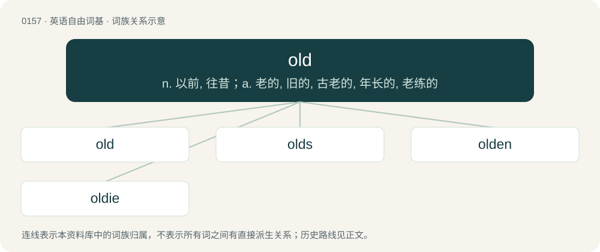

# 0167 · old — n. 以前, 往昔；a. 老的, 旧的, 古老的, 年长的, 老练的

[总目录](../00_总目录_按常用程度.md)

**类型**：英语自由词基　｜　**来源语言**：见词源记录

## 核心含义与来源

- 核心含义：n. 以前, 往昔；a. 老的, 旧的, 古老的, 年长的, 老练的
- 英文含义：Of an object, concept, relationship, etc., having existed for a relatively long period of time.
- 词形：old

**来源记录 1**（形容词；Of an object, concept, relationship, etc., having existed for a relatively long period of time.）

Inherited from Middle English old, oold, from Old English ald, eald (“old, aged, ancient, antique, primeval”), from Proto-West Germanic \*ald, from Proto-Germanic \*aldaz (“grown-up”), originally a participle form, from Proto-Indo-European \*h₂eltós (“grown, tall, big”). Cognates Cognate with Scots aald, auld (“old”), Yola yola, yolaw, yold, yole (“old”), North Frisian ool, ual, uuil, uul, üülj (“old”), Saterland Frisian oold (“old”), West Frisian âld (“old”), Alemannic German altu, oalt, oalts, olt, àltà (“old”), Bavarian oid (“old”), Central Franconian alt, aod, auw, oot (“old”), Cimbrian and German alt (“old”), Dutch oud (“old”), German Low German old, oolt (“old”), Luxembourgish al (“old”), Mòcheno òlt (“old”), Vilamovian aołd (“old”), Yiddish אַלט (alt, “old”), Danish ældre (“elderly”), Faroese eldri (“elder, older”), Icelandic aldinn (“old”), Norwegian Bokmål and Norwegian Nynorsk eldre (“elderly”), Swedish äldre (“elderly”), Crimean Gothic alt (“old”), Gothic 𐌰𐌻𐌸𐌴𐌹𐍃 (alþeis, “old”), Latin altus (“high, tall, grown big, lofty”). Related to eld.

## 词族图

## 单词速览（常用到不常用）

| 单词 | 音标 | 释义 |
|---|---|---|
| [old](#w-1) | 英 /əʊld/；美 /ˈoʊld/ | n. 以前, 往昔；a. 老的, 旧的, 古老的, 年长的, 老练的 |
| [olds](#w-2) |  | n. 老者（old的复数形式） |
| [olden](#w-3) | 英 /ˈəʊl.dn̩/；美 /ˈoʊldn̩/ | a. 古时的, 从前的；vt. 使衰老；vi. 变老 |
| [oldie](#w-4) | 英 /ˈəʊldi/；美 /ˈoʊldi/ | n. 老人, 陈旧之物 |

## 逐词详解

### 1. old

**词性**：形容词　｜　**音标**：英 /əʊld/；美 /ˈoʊld/

**中文释义**：n. 以前, 往昔；a. 老的, 旧的, 古老的, 年长的, 老练的

**英文义项**：Of an object, concept, relationship, etc., having existed for a relatively long period of time. / Of a living being, having lived for most of the expected years.

**词源与演化**：

Inherited from Middle English old, oold, from Old English ald, eald (“old, aged, ancient, antique, primeval”), from Proto-West Germanic \*ald, from Proto-Germanic \*aldaz (“grown-up”), originally a participle form, from Proto-Indo-European \*h₂eltós (“grown, tall, big”). Cognates Cognate with Scots aald, auld (“old”), Yola yola, yolaw, yold, yole (“old”), North Frisian ool, ual, uuil, uul, üülj (“old”), Saterland Frisian oold (“old”), West Frisian âld (“old”), Alemannic German altu, oalt, oalts, olt, àltà (“old”), Bavarian oid (“old”), Central Franconian alt, aod, auw, oot (“old”), Cimbrian and German alt (“old”), Dutch oud (“old”), German Low German old, oolt (“old”), Luxembourgish al (“old”), Mòcheno òlt (“old”), Vilamovian aołd (“old”), Yiddish אַלט (alt, “old”), Danish ældre (“elderly”), Faroese eldri (“elder, older”), Icelandic aldinn (“old”), Norwegian Bokmål and Norwegian Nynorsk eldre (“elderly”), Swedish äldre (“elderly”), Crimean Gothic alt (“old”), Gothic 𐌰𐌻𐌸𐌴𐌹𐍃 (alþeis, “old”), Latin altus (“high, tall, grown big, lofty”). Related to eld.

**例句**：

> How old are they? She’s five years old and he's seven. We also have a young teen and a two-year-old child.

该用例对应义项：Having existed or lived for the specified time.

### 2. olds

**词性**：名词

**中文释义**：n. 老者（old的复数形式）

**英文义项**：One's parents. / Anyone portrayed in the context as not young; for example, anyone older than the speaker's audience of coevals; often, middle-aged adults or older adults.

**构词拆分**：old + -s

**词源与演化**：

From old + -s; compare old folks, old man.

**例句**：

> Her friends at school snicker at how the olds are clueless about TikTok trends. But they can't shame us olds about it very effectively, because we're old enough to know that today's trends too shall pass.

该用例对应义项：Anyone portrayed in the context as not young; for example, anyone older than the speaker's audience of coevals; often, middle-aged adults or older adults.

### 3. olden

**词性**：形容词　｜　**音标**：英 /ˈəʊl.dn̩/；美 /ˈoʊldn̩/

**中文释义**：a. 古时的, 从前的；vt. 使衰老；vi. 变老

**英文义项**：From or relating to a previous era.

**构词拆分**：old + -en (“made of”)

**词源与演化**：

From Middle English olden, probably originally an inflected plural form of old (compare Old English ealdum, dative plural of eald (“old”)), but later reanalysed as equivalent to old + -en (“made of”). Otherwise derived from Old Norse aldinn (“ancient, old”).

**例句**：

> In the olden days, people wore garters to keep their stockings from falling down.

### 4. oldie

**词性**：名词　｜　**音标**：英 /ˈəʊldi/；美 /ˈoʊldi/

**中文释义**：n. 老人, 陈旧之物

**英文义项**：Something or someone old. / A song or record from a previous era.

**构词拆分**：From old + -ie.

**词源与演化**：

From old + -ie.

**用法示例／搭配（非完整句）**：

> an oldies radio station

该用例对应义项：The genre of music composed of popular music from previous eras.
