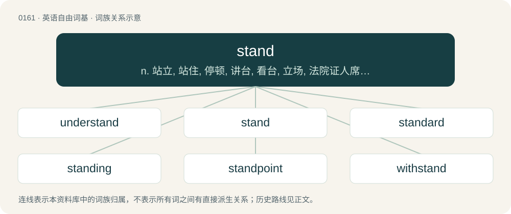

# 0174 · stand — n. 站立, 站住, 停顿, 讲台, 看台, 立场, 法院证人席；vi. 站, 立, 坐落, 停滞, 位于, 坚持, 维持原状；vt. 忍受, 使站立, 抵挡

[总目录](../00_总目录_按常用程度.md)

**类型**：英语自由词基　｜　**来源语言**：见词源记录

## 核心含义与来源

- 核心含义：n. 站立, 站住, 停顿, 讲台, 看台, 立场, 法院证人席；vi. 站, 立, 坐落, 停滞, 位于, 坚持, 维持原状；vt. 忍受, 使站立, 抵挡
- 英文含义：To support oneself on the feet in an erect position.
- 词形：stand

**多个词源／构词路径**：同一拼写可能有不同来源；以下按词性和含义分别列出。

**来源记录 1**（动词；To support oneself on the feet in an erect position.）

From Middle English stonden, standen (verb) and stand, stond (noun, from the verb), from Old English standan (“to stand, occupy a place”), from Proto-West Germanic \*standan, from Proto-Germanic \*standaną (“to stand”), from Pre-Germanic \*sth₂-n-t-´, an innovative extended n-infixed form of Proto-Indo-European \*steh₂-. Cognates Cognate with Scots staund (“to stand”), Yola sthoan, sthoane, sthone, stoane (“to stand”), North Frisian staan, stoune, stuine, stun, stönje, stööne (“to stand”), Saterland Frisian stounde (“to stand”), Danish stande (“to stand”), Faroese and Icelandic standa (“to stand”), Norwegian Nynorsk standa, stå (“to stand”), Swedish stånda (“to stand”), Gothic 𐍃𐍄𐌰𐌽𐌳𐌰𐌽 (standan, “to stand”). From the related Proto-Germanic \*stāną (“to stand”): West Frisian stean (“to stand”), Alemannic German staa (“to stand”), Central Franconian stiehn, stohn, stonn (“to stand”), Cimbrian stean (“to stand”), Dutch staan (“to stand”), German stehen (“to stand”), Low German stahn, staon (“to stand”), Luxembourgish stoen (“to stand”), Vilamovian śtejn (“to stand”), Yiddish שטיין (shteyn, “to stand”), Danish, Norwegian Bokmål, Norwegian Nynorsk, and Swedish stå (“to stand”), Faroese stá (“to stand”). Also from \*steh₂-: Breton and Cornish sevel (“to stand”), Welsh sefyll (“to stand”), Latin stō (“to stand”), Greek σταυρός (stavrós, “cross”), Albanian shtyllë (“pillar; column”), Latvian stāvēt (“to stand”), Lithuanian stóti, stovėti (“to stand”), Belarusian стая́ць (stajácʹ, “to stand”), Bulgarian стоя́ (stojá, “to stand, stay”), Czech stát (“to stand”), Macedonian стои (stoi, “to stand”), Polish stać, stojeć (“to stand”), Russian стоя́ть (stojátʹ, “to stand”), Serbo-Croatian ста̏јати, stȁjati (“to stand”), Slovak stáť (“to stand”), Slovene státi (“to stand”), Ukrainian стоя́ти (stojáty, “to stand”), Armenian ստվար (stvar, “large, thick; dense”), Ossetian стын (styn, “to stand up”), Northern Kurdish rawestîn (“to stand”), Persian ایستادن (istâdan), وایسادن (vâysâdan), وایستادن (vâystâdan, “to stand up”), Tocharian A ṣtäm- (“to stand”), Tocharian B stäm- (“to stand”), Sanskrit स्था (sthā, “to stand”).

**来源记录 2**（名词；A container which stands upright, such as a barrel or cask.）

From Middle English stand, stande, stond, stonde, stoonde, probably from Middle Dutch stande, from Old Dutch \*standan (“to stand”), from Frankish \*standan. Forms with -o- may show influence of stonden (“stand”, verb).

## 词族图

## 单词速览（常用到不常用）

| 单词 | 音标 | 释义 |
|---|---|---|
| [understand](#w-1) | 英 /ˌʌndəˈstænd/；美 /ˌʌndɚˈstænd/ | vt. 理解, 了解, 领会, 听说, 懂；vi. 懂得, 认为 |
| [stand](#w-2) | 英 /ˈstænd/；美 /ˈstænd/ | n. 站立, 站住, 停顿, 讲台, 看台, 立场, 法院证人席；vi. 站, 立, 坐落, 停滞, 位于, 坚持, 维持原状；vt. 忍受, 使站立, 抵挡 |
| [standard](#w-3) | 英 /ˈstændəd/；美 /ˈstændɚd/ | n. 标准, 规格, 旗, 军旗, 本位；a. 标准的, 合规格的；\[计\] 标准 |
| [standing](#w-4) | /ˈstændɪŋ/ | n. 起立, 持续, 身分；a. 立着的, 不动的, 经常的, 持续的 |
| [standpoint](#w-5) | /ˈstændpɔɪnt/ | n. 立场, 观点 |
| [withstand](#w-6) | /wɪðˈstænd/ | vt. 抵住, 顶住, 经得起 |
| [standstill](#w-7) | 英 /ˈstændˌstɪl/ | n. 停止, 停顿；\[医\] 停顿 |
| [grandstand](#w-8) | /ˈɡɹæn(d)stænd/ | n. 正面看台, 观众 |
| [nightstand](#w-9) | /ˈnaitstænd/ | n. &lt;美&gt;床头几 |
| [newsstand](#w-10) | /ˈnjuːzstænd/ | n. 报摊, 报刊出售处 |
| [bandstand](#w-11) | 英 /ˈbænd.stænd/ | n. 音乐台, 乐池 |
| [handstand](#w-12) | /ˈhændˌstænd/ | n. 手倒立 |
| [kickstand](#w-13) | 美 /ˈkɪkˌstænd/ | n. 撑脚架 |
| [stander](#w-14) | 英 /ˈstændə/；美 /ˈstændɚ/ | 采伐残留木 |
| [homestand](#w-15) |  | 【英文】A series of games played at a team's home field |

## 逐词详解

### 1. understand

**词性**：动词　｜　**音标**：英 /ˌʌndəˈstænd/；美 /ˌʌndɚˈstænd/

**中文释义**：vt. 理解, 了解, 领会, 听说, 懂；vi. 懂得, 认为

**英文义项**：To know the meaning of; to parse or have parsed correctly; to comprehend. / To know the meaning of.

**构词拆分**：under- + stand

**词源与演化**：

From Middle English understanden, from Old English understandan (“to understand”), from Proto-West Germanic \*understandan (“to stand between, understand”), from Proto-Germanic \*understandaną (“to stand between, understand”), equivalent to Old English under- (“between, inter-”) + standan (“to stand”) (Modern English under- + stand). Cognate with Old Frisian understonda (“to understand, experience, learn”), Old High German understantan (“to understand”), Middle Danish understande (“to understand”). Compare also Saterland Frisian understunda, unnerstounde (“to dare, survey, measure”), Dutch onderstaan (“to undertake, presume”), German unterstehen (“to be subordinate”).

**例句**：

> I understand that company policy says I can't get a refund, but can you make an exception?

该用例对应义项：To comprehend a fact or principle; to regard or come to regard a belief as such.

### 2. stand

**词性**：动词　｜　**音标**：英 /ˈstænd/；美 /ˈstænd/

**中文释义**：n. 站立, 站住, 停顿, 讲台, 看台, 立场, 法院证人席；vi. 站, 立, 坐落, 停滞, 位于, 坚持, 维持原状；vt. 忍受, 使站立, 抵挡

**英文义项**：To support oneself on the feet in an erect position. / To rise to one’s feet; to stand up.

**词源与演化**：

From Middle English stonden, standen (verb) and stand, stond (noun, from the verb), from Old English standan (“to stand, occupy a place”), from Proto-West Germanic \*standan, from Proto-Germanic \*standaną (“to stand”), from Pre-Germanic \*sth₂-n-t-´, an innovative extended n-infixed form of Proto-Indo-European \*steh₂-. Cognates Cognate with Scots staund (“to stand”), Yola sthoan, sthoane, sthone, stoane (“to stand”), North Frisian staan, stoune, stuine, stun, stönje, stööne (“to stand”), Saterland Frisian stounde (“to stand”), Danish stande (“to stand”), Faroese and Icelandic standa (“to stand”), Norwegian Nynorsk standa, stå (“to stand”), Swedish stånda (“to stand”), Gothic 𐍃𐍄𐌰𐌽𐌳𐌰𐌽 (standan, “to stand”). From the related Proto-Germanic \*stāną (“to stand”): West Frisian stean (“to stand”), Alemannic German staa (“to stand”), Central Franconian stiehn, stohn, stonn (“to stand”), Cimbrian stean (“to stand”), Dutch staan (“to stand”), German stehen (“to stand”), Low German stahn, staon (“to stand”), Luxembourgish stoen (“to stand”), Vilamovian śtejn (“to stand”), Yiddish שטיין (shteyn, “to stand”), Danish, Norwegian Bokmål, Norwegian Nynorsk, and Swedish stå (“to stand”), Faroese stá (“to stand”). Also from \*steh₂-: Breton and Cornish sevel (“to stand”), Welsh sefyll (“to stand”), Latin stō (“to stand”), Greek σταυρός (stavrós, “cross”), Albanian shtyllë (“pillar; column”), Latvian stāvēt (“to stand”), Lithuanian stóti, stovėti (“to stand”), Belarusian стая́ць (stajácʹ, “to stand”), Bulgarian стоя́ (stojá, “to stand, stay”), Czech stát (“to stand”), Macedonian стои (stoi, “to stand”), Polish stać, stojeć (“to stand”), Russian стоя́ть (stojátʹ, “to stand”), Serbo-Croatian ста̏јати, stȁjati (“to stand”), Slovak stáť (“to stand”), Slovene státi (“to stand”), Ukrainian стоя́ти (stojáty, “to stand”), Armenian ստվար (stvar, “large, thick; dense”), Ossetian стын (styn, “to stand up”), Northern Kurdish rawestîn (“to stand”), Persian ایستادن (istâdan), وایسادن (vâysâdan), وایستادن (vâystâdan, “to stand up”), Tocharian A ṣtäm- (“to stand”), Tocharian B stäm- (“to stand”), Sanskrit स्था (sthā, “to stand”).

**例句**：

> Christian charity, or love, stands first in the rank of gifts.

该用例对应义项：To have or maintain a position, order, or rank; to be in a particular relation.

### 3. standard

**词性**：形容词　｜　**音标**：英 /ˈstændəd/；美 /ˈstændɚd/

**中文释义**：n. 标准, 规格, 旗, 军旗, 本位；a. 标准的, 合规格的；\[计\] 标准

**英文义项**：Falling within an accepted range of size, amount, power, quality, etc. / Growing alone as a free-standing plant; not trained on a post etc.

**构词拆分**：stand + -ard；stand + -er

**词源与演化**：

From Middle English standard, from Old French estandart (“gathering place, battle flag”), from Frankish \*standahard (literally “stand firm, stand hard”), equivalent to stand + -ard. An alternative etymology derives the second element from Frankish \*oʀd (“point, spot, place”) (compare Old French ordé (“pointed”), Old English ord (“point, source, vanguard”), German Standort (“location, place, site, position, base”, literally “standing-point”)). Merged with Middle English standar, stander, standere (“flag, banner”, literally “stander”), equivalent to stand + -er. More at stand, hard, ord. As a hill-naming term possibly a calque from Cumbric; equivalent to Welsh lluman (“standard”), arising with confusion with the hill-naming element llumon (“chimney”).

**例句**：

> This is the standard model, but we offer a variety of customization options.

该用例对应义项：As normally supplied (not optional or modified by any extra requests).

### 4. standing

**词性**：形容词　｜　**音标**：/ˈstændɪŋ/

**中文释义**：n. 起立, 持续, 身分；a. 立着的, 不动的, 经常的, 持续的

**英文义项**：Erect, not cut down. / Performed from an erect position.

**构词拆分**：stand + -ing

**词源与演化**：

From Middle English standynge, stondynge, standende, stondinde, standande, stondande, from Old English standende, stondende, from Proto-Germanic \*standandz (“standing”), present participle of Proto-Germanic \*standaną (“to stand”), equivalent to stand + -ing.

**用法示例／搭配（非完整句）**：

> a standing bed, distinguished from a trundle-bed

该用例对应义项：Not movable; fixed.

### 5. standpoint

**词性**：名词　｜　**音标**：/ˈstændpɔɪnt/

**中文释义**：n. 立场, 观点

**英文义项**：A point of view; a perspective.

**构词拆分**：stand + point

**词源与演化**：

From stand + point, a calque of German Standpunkt. Similar constructions used in other languages, such as Japanese 立場 (tachiba, literally “standing place”).

**例句**：

> Bathing once a month may save time, but from a cleanliness standpoint, it's not effective.

该用例对应义项：A point of view; a perspective.

### 6. withstand

**词性**：动词　｜　**音标**：/wɪðˈstænd/

**中文释义**：vt. 抵住, 顶住, 经得起

**英文义项**：To resist or endure (something) successfully. / To oppose (something) forcefully.

**构词拆分**：with- (“against”) + stand

**词源与演化**：

From Middle English withstanden, from Old English wiþstandan, from Proto-West Germanic \*wiþistandan (“to withstand, resist”), equivalent to with- (“against”) + stand. Cognate with Old Frisian withstanda (“to resist”). Compare also Dutch weerstaan (“to withstand, repel”), German widerstehen (“to withstand, resist, defy”), Russian противостоять (protivostojatʹ, “to withstand”).

**例句**：

> Morality is mostly a matter of how much temptation you can withstand.

### 7. standstill

**词性**：名词　｜　**音标**：英 /ˈstændˌstɪl/

**中文释义**：n. 停止, 停顿；\[医\] 停顿

**英文义项**：A complete immobility; a halt.

**构词拆分**：stand + still

**词源与演化**：

From stand + still, a deverbal from stand still. Compare Dutch stilstand (“a standstill”), German Stillstand (“a standstill”), Danish stilstand (“a standstill”).

**例句**：

> The wreck brought traffic to a standstill for hours.

该用例对应义项：A complete immobility; a halt.

### 8. grandstand

**词性**：动词　｜　**音标**：/ˈɡɹæn(d)stænd/

**中文释义**：n. 正面看台, 观众

**英文义项**：To behave dramatically or showily to impress an audience or observers; to pander to a crowd.

**构词拆分**：grand + stand

**词源与演化**：

From grand + stand.

**例句**：

> Many politicians prefer to grandstand on hot-button issues rather than enact tough policy changes.

该用例对应义项：To behave dramatically or showily to impress an audience or observers; to pander to a crowd.

### 9. nightstand

**词性**：名词　｜　**音标**：/ˈnaitstænd/

**中文释义**：n. &lt;美&gt;床头几

**英文义项**：A small table or cabinet, often with one or more drawers or shelves, placed beside the head of a bed.

**构词拆分**：night (“the conventional time for a person to be in bed”) + stand (“an object which supports things”)

**词源与演化**：

From night (“the conventional time for a person to be in bed”) + stand (“an object which supports things”).

**例句**：

> He always kept a full glass of water on the nightstand.

该用例对应义项：A small table or cabinet, often with one or more drawers or shelves, placed beside the head of a bed.

### 10. newsstand

**词性**：名词　｜　**音标**：/ˈnjuːzstænd/

**中文释义**：n. 报摊, 报刊出售处

**英文义项**：An open stall, often on a street, where newspapers and magazines are on sale to the public.

**构词拆分**：news + stand

**词源与演化**：

From news + stand.

**例句**：

> I have to go out to the newsstand to get a newspaper.

### 11. bandstand

**词性**：名词　｜　**音标**：英 /ˈbænd.stænd/

**中文释义**：n. 音乐台, 乐池

**英文义项**：A small, open-air platform or enclosure for bands to play on, usually roofed. / A small, informal stage, usually located in nightclubs, where local and amateur musicians perform.

**构词拆分**：band + stand

**词源与演化**：

From band + stand.

**例句**：

> Only a few of the deck chairs ranged around the bandstand were occupied.

### 12. handstand

**词性**：名词　｜　**音标**：/ˈhændˌstænd/

**中文释义**：n. 手倒立

**英文义项**：The act of standing on one's hands, most often in an inverted way. / The position of standing on one's hands.

**构词拆分**：hand + stand

**词源与演化**：

From hand + stand.

**例句**：

> Tom did a handstand and his shirt fell over his face.

### 13. kickstand

**词性**：名词　｜　**音标**：美 /ˈkɪkˌstænd/

**中文释义**：n. 撑脚架

**英文义项**：A levered bar that can be folded down from the frame of a bicycle or motorcycle to prop it upright when not being ridden. / A folding bar to prop up a mobile phone, tablet or similar device when it is being used on a surface.

**构词拆分**：kick + stand

**词源与演化**：

From kick + stand (the bar is typically kicked into place with the foot, and enables the vehicle to stand).

### 14. stander

**词性**：名词　｜　**音标**：英 /ˈstændə/；美 /ˈstændɚ/

**中文释义**：采伐残留木

**英文义项**：One who stands.

**构词拆分**：stand + -er

**词源与演化**：

From stand + -er.

### 15. homestand

**词性**：名词

**英文义项**：A series of games played at a team's home field

**构词拆分**：home + stand

**词源与演化**：

From home + stand.
