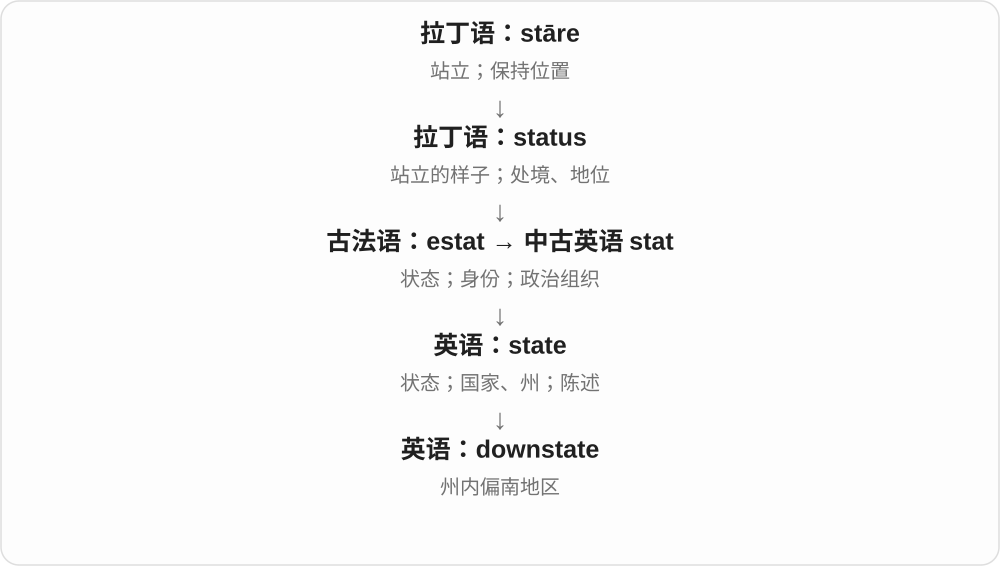

# 0175 · down — 向下；降低；绒羽〔另源〕

[逐词精讲目录](../00_逐词精讲目录.md) · [总目录](../00_总目录_按常用程度.md)

## 核心词根与来源

down 的方向义来自古英语较长的下山表达逐渐缩短；羽绒义来自古诺尔斯语 dúnn。countdown、meltdown 等说明向下如何用于数值与结构，downy 则属于绒毛一支。

**DOWN：向低处的方向，与柔软绒羽分开**

从山上下来是方向主线；轻软绒羽另有来历，不靠“掉下来”凑同源。

- **方向及减少**：down · downward · downwards
- **城市及时间**：downtown · downstate · sundown · downtime
- **关键过程与影响**：countdown · meltdown · showdown · knockdown
- **评价和情绪**：downside · downer · lowdown · downbeat
- **绒羽来源**：down · downy
- **绒羽 down 的同族借词 duvet 及复数**：down · duvet · duvets

## 词形与演化规律

动词短语常分写，名词可连写：count down／countdown、melt down／meltdown。downtown 的 down 不保证地势低；touchdown 在航空与运动中具体要求不同。

这里比较绒羽名，不接方向 down；duvet 经法语的绒羽小称材料借入，英语 down 不是它的直接母词。

## 单词速览（按词族由简到繁）

同一基础词的相关扩展放在一起，先读基础形式，再读扩展；各组之间优先读常用的。具体词源关系见各词讲解。

| 单词 | 音标 | 核心意思 |
|---|---|---|
| [down](#w-1) | /daʊn/ | 向下；下来；减少；低落；绒羽〔另源〕 |
| [downtown](#w-2) | /ˌdaʊnˈtaʊn/〔方位常见〕；/ˈdaʊntaʊn/〔修饰语常见〕 | 市中心；在市中心；市中心的 |
| [downward](#w-4) | 英 /ˈdaʊnwəd/；美 /ˈdaʊnwərd/ | 向下的；向下地 |
| [downside](#w-7) | /ˈdaʊnsaɪd/ | 不利方面；缺点；下行风险 |
| [downtime](#w-10) | /ˈdaʊntaɪm/ | 停机时间；停工时间；休息放松的时间 |
| [downwards](#w-11) | 英 /ˈdaʊnwədz/；美 /ˈdaʊnwərdz/ | 向下；往较低处 |
| [downer](#w-12) | 英 /ˈdaʊnə/；美 /ˈdaʊnər/ | 令人扫兴的事；情绪低落期〔口语〕 |
| [downy](#w-16) | /ˈdaʊni/ | 绒毛般的；覆有柔软绒毛的 |
| [downbeat](#w-17) | /ˈdaʊnbiːt/ | 低调消沉的；悲观的；强拍〔音乐〕 |
| [downstate](#w-19) | /ˈdaʊnsteɪt/ | 州南部的；州内偏南地区 |
| [touchdown](#w-3) | /ˈtʌtʃdaʊn/ | 着陆；达阵〔美式橄榄球〕 |
| [countdown](#w-5) | /ˈkaʊntdaʊn/ | 倒计时 |
| [meltdown](#w-6) | /ˈmeltdaʊn/ | 熔毁；崩溃；情绪失控 |
| [showdown](#w-8) | /ˈʃəʊdaʊn/〔英〕；/ˈʃoʊdaʊn/〔美〕 | 摊牌；决战；决定性对抗 |
| [sundown](#w-13) | /ˈsʌndaʊn/ | 日落；黄昏时分 |
| [knockdown](#w-14) | 英 /ˈnɒkdaʊn/；美 /ˈnɑːkdaʊn/ | 击倒；大幅压低的〔价格〕；可拆装的 |
| [lowdown](#w-15) | /ˈləʊdaʊn/〔英〕；/ˈloʊdaʊn/〔美〕 | 内情；实情；卑劣的 |
| [duvet](#w-20) | 英 /ˈduːveɪ/；美 /duːˈveɪ/，也有首音节重读和 /dj/ 读法 | 羽绒被、填充被；部分用法也指被套 |
| [duvets](#w-21) | 英 /ˈduːveɪz/；美 /duːˈveɪz/，重音也有变体 | 填充被、羽绒被〔复数〕 |

## 逐词讲解

### 1. down — 向下；下来；减少；低落；绒羽〔另源〕

**音标**：/daʊn/

**先抓住这个画面**

从高处到低处是主线；钱少了、精神低落、系统停了，也可借这个方向。另有柔软绒羽，须分源记。

**怎么拆**

方向词接古英语 of dūne“离开山丘”等表达，逐渐缩短。绒羽名词另经中古英语借自古诺尔斯语 dúnn，不能说羽毛往下落所以叫 down。

**怎么变成今天的意思**

**并行来源：古英语 of dūne 等；古诺尔斯语 dúnn**  
向下的表达；柔软绒羽

↓

**现代 down**  
向下、降低等；另一支为羽绒

sit down 是坐下，prices are down 是价格下降，feel down 是情绪低落，the server is down 是服务器无法正常提供服务。a down jacket 是羽绒服。

**常见搭配与例句**

go down；write down；feel down；be down；a down pillow。

> Please write down the address.

请把地址记下来。

> The website was down for an hour.

网站停用了一小时。

> The jacket is filled with down.

夹克里填充着羽绒。

**别混淆**

down 在短语中不总表示位置：write down 是记下；down the road 还可说沿路或将来某时。绒羽义与方向义不要硬合。

### 2. downtown — 市中心；在市中心；市中心的

**音标**：/ˌdaʊnˈtaʊn/〔方位常见〕；/ˈdaʊntaʊn/〔修饰语常见〕

**先抓住这个画面**

去城市里商店、办公和交通更集中的那一片区域。

**怎么拆**

down + town，形成美式城市中心区名称；发展与城市相对方位的用法有关，不表示所有市中心地势都较低。

**怎么变成今天的意思**

**英语 down；town**  
并列组合的材料

↓

**down + town → downtown**  
城市中心商业等区域

go downtown 通常不加 to，a downtown hotel 是市中心酒店。也可作名词 the downtown area 等，具体中心边界由城市语境给出。

**常见搭配与例句**

go downtown；a downtown office；downtown traffic。

> We took the bus downtown.

我们坐公交去市中心。

> Her office is in a downtown building.

她的办公室在市中心一栋楼里。

**别混淆**

downtown 是城市内部的中心区，downstate 是某州的南部等相对区域，不能按词形把两者当同一尺度。

### 3. downward — 向下的；向下地

**音标**：英 /ˈdaʊnwəd/；美 /ˈdaʊnwərd/

**先抓住这个画面**

沿高度或数值轴，朝较低位置移动。

**怎么拆**

down + -ward，-ward 表方向；可作形容词和副词，方向副词也常用 downwards。

**怎么变成今天的意思**

**古英语 of dūne／adūne → dūne**  
离开山丘、向下

↓

**中古英语 doun → 英语 down**  
向下、低处；状态降低等

↓

**down + -ward → downward**  
朝下的方向、变化趋势

a downward trend 是下降趋势，a downward glance 是向下一瞥，a downward spiral 可比喻越变越坏的循环。下降是否坏事取决于对象。

**常见搭配与例句**

a downward trend；downward pressure；a downward spiral。

> The figures show a downward trend in costs.

数字显示成本在下降。

> He gave the floor a quick downward glance.

他迅速朝地面瞥了一眼。

**别混淆**

downward 说方向，downside 说不利方面；成本下降可以是好事，并不自动是 downside。

### 4. downside — 不利方面；缺点；下行风险

**音标**：/ˈdaʊnsaɪd/

**先抓住这个画面**

把一个选择翻到不好的一面，看它可能带来什么不便或损失。

**怎么拆**

down（向下）+ side（面），从下侧的组合用于有利、不利的比喻对照。

**怎么变成今天的意思**

**英语 down；side**  
并列组合的两个材料

↓

**down + side → downside**  
不利的一面；下行可能

the downside of living here 是住这儿的缺点；on the downside 是往坏处说。财经 downside risk 说不利变化风险，具体含义由分析给定。

**常见搭配与例句**

the downside of；on the downside；downside risk。

> The only downside is the long commute.

唯一缺点是通勤路长。

> On the downside, the room gets little natural light.

不好的一面是，房间自然光很少。

**别混淆**

downside 是某选择的不利一面，downstairs 是楼下。反面常用 upside，但两方面并不要求同样大小。

### 5. downtime — 停机时间；停工时间；休息放松的时间

**音标**：/ˈdaʊntaɪm/

**先抓住这个画面**

机器没有提供服务的那段时间叫 downtime；人不工作、可以喘口气的时间，也借用这个词。

**怎么拆**

down“停止运行、不可用”加 time。先抓状态意义的 down，不是钟表掉到地上；机器停用的概念又扩展到人的非工作时段。

**怎么变成今天的意思**

**英语 down；time**  
停止运作、不可用；时间

↓

**英语 downtime**  
设备或服务不能工作的时段；也指人的休息间歇

planned downtime 是预先安排的维护停机，unexpected downtime 是意外中断。说 enjoy some downtime 时，语气却常是积极的休息，并不表示人出了故障。

**常见搭配与例句**

reduce downtime；scheduled downtime；some much-needed downtime。

> The upgrade required ten minutes of downtime.

升级需要停机十分钟。

> After the trip, we enjoyed some quiet downtime at home.

旅行后，我们在家享受了一段安静的休息时间。

**别混淆**

downtime 与 uptime 在系统语境中互相对照；个人 downtime 可以是主动休息，不一定是浪费时间。

### 6. downwards — 向下；往较低处

**音标**：英 /ˈdaʊnwədz/；美 /ˈdaʊnwərdz/

**先抓住这个画面**

从当前位置把视线、手势或运动送往下面。

**怎么拆**

down + -wards，结尾是方向副词材料，并非 down 的普通复数。

**怎么变成今天的意思**

**古英语 of dūne／adūne → dūne**  
离开山丘、向下

↓

**中古英语 doun → 英语 down**  
向下、低处；状态降低等

↓

**down + -wards → downwards**  
朝下方、往较低处

point downwards 是向下指，look downwards 是朝下看。形容词通常用 downward，如 a downward movement。

**常见搭配与例句**

point downwards；move downwards；face downwards。

> The arrow points downwards.

箭头向下指。

> The path slopes gently downwards.

小路缓缓向下倾斜。

**别混淆**

downwards 通常作副词；不把所有形容词位置都套成 downwards。与 downward 的副词用法很多时候近义。

### 7. downer — 令人扫兴的事；情绪低落期〔口语〕

**音标**：英 /ˈdaʊnə/；美 /ˈdaʊnər/

**先抓住这个画面**

本来气氛在往上走，一件事却把情绪拉了下来。

**怎么拆**

down 的低落、降低一侧 + -er，形成使人情绪下沉的事物称呼；另有药物俚语，不能据词形推出具体成分或作用。

**怎么变成今天的意思**

**古英语 of dūne／adūne → dūne**  
离开山丘、向下

↓

**中古英语 doun → 英语 down**  
向下、低处；状态降低等

↓

**down + -er → downer**  
让情绪变低的事物等口语用法

That’s a downer 是真扫兴；be on a downer 可说心情低落。通常不用于正式地诊断精神状态。

**常见搭配与例句**

a real downer；be on a downer；end on a downer。

> The cancellation was a real downer.

活动取消真让人扫兴。

> I did not want the evening to end on a downer.

我不想让这个晚上以扫兴收场。

**别混淆**

downer 是扫兴的事、低落的状态等口语；downward 是方向形容词，不能写 a downward 表示一件扫兴事。

### 8. downy — 绒毛般的；覆有柔软绒毛的

**音标**：/ˈdaʊni/

**先抓住这个画面**

摸上去轻软细密，像幼鸟身上的那层绒羽。

**怎么拆**

down（绒羽）+ -y，接绒羽名词这条古诺尔斯语借入来源，不是方向 down 的“比较向下”。

**怎么变成今天的意思**

**古诺尔斯语 dúnn → 英语 down**  
柔软绒羽

↓

**down + -y → downy**  
覆盖绒毛、轻软如绒的

downy feathers 是绒羽，a downy surface 是柔软带绒毛的表面。可描述植物细毛，不表示材料一定来自禽鸟。

**常见搭配与例句**

downy feathers；a downy chick；a downy surface。

> The chick was covered in soft, downy feathers.

小鸟覆盖着柔软绒羽。

> The leaves have a pale, downy underside.

叶背颜色浅，带着柔软细毛。

**别混淆**

downy 说绒毛性质，downcast 常说低头、沮丧；共享 down 拼写不代表同一来源义。

### 9. downbeat — 低调消沉的；悲观的；强拍〔音乐〕

**音标**：/ˈdaʊnbiːt/

**先抓住这个画面**

语气像往低处落，不兴奋；音乐中另有指挥手势向下对应的拍点。

**怎么拆**

down + beat（拍、击），音乐里关联小节中首拍等节拍定位；形容词又有情绪低落、压低期待的用法，不靠同一事件串所有义项。

**怎么变成今天的意思**

**英语 down；beat**  
并列组合的材料

↓

**down + beat → downbeat**  
音乐首拍、下拍；情绪低沉的

a downbeat assessment 是偏悲观的评估；on the downbeat 是在强拍或下拍位置，具体节奏背景看音乐说明。

**常见搭配与例句**

a downbeat mood；a downbeat forecast；on the downbeat。

> The report gave a downbeat assessment of the market.

报告对市场作出偏悲观评估。

> The dancers began on the downbeat.

舞者在下拍开始动作。

**别混淆**

downbeat 的音乐义不等于小声，beat 说节拍而非音量；情绪义通常与 upbeat 乐观对照。

### 10. downstate — 州南部的；州内偏南地区

**音标**：/ˈdaʊnsteɪt/

**先抓住这个画面**

downstate 就像在州地图上往下看，常指相对于北部或内陆地区的南部地带。

**怎么拆**

down（向南、向较低纬度）+ state（州）。

**怎么变成今天的意思**

与 upstate 相对，但两者的实际边界随州和说话习惯而变。纽约语境可涉及纽约市及附近地区，不能机械按地图中线划分。

**常见搭配与例句**

downstate residents；a downstate office；travel downstate。

> The organization opened a downstate office.

该组织在州南部开设了办事处。

> Several downstate schools joined the project.

州南部的几所学校加入了这个项目。

**别混淆**

它描述地区，不表示地区衰落或“低等”。down 在这里主要提供地理方向。

### 11. touchdown — 着陆；达阵〔美式橄榄球〕

**音标**：/ˈtʌtʃdaʊn/

**先抓住这个画面**

航空里是飞行器终于触到地面；运动里则是特定计分动作的固定名称。

**怎么拆**

touch（触碰）+ down（下到地面），另有橄榄球计分历史用法。现代美式橄榄球术语不要求按“必须把球触地”逐字推判。

**怎么变成今天的意思**

**英语 touch；down**  
并列组合的材料

↓

**touch + down → touchdown**  
着地、着陆；特定运动中的达阵

plane touchdown 是飞机着陆接地；score a touchdown 是美式橄榄球达阵得分。两种场景共享名字，不共享所有动作要求。

**常见搭配与例句**

after touchdown；score a touchdown；a touchdown pass。

> The passengers applauded after touchdown.

飞机着陆后，乘客鼓起掌来。

> The team scored a touchdown in the final minute.

球队在最后一分钟达阵得分。

**别混淆**

touchdown 的运动含义应按项目规则，不能把航空触地条件硬套上去；日常先识别是在机场还是球赛。

### 12. countdown — 倒计时

**音标**：/ˈkaʊntdaʊn/

**先抓住这个画面**

不是一、二、三往上数，而是五、四、三逐渐逼近零点或一个约定时刻。

**怎么拆**

count（数）+ down（向较小数值），与 count down 的短语相连，名词指倒数过程。

**怎么变成今天的意思**

**英语 count；down**  
并列组合的材料

↓

**count + down → countdown**  
按递减顺序数到某个时点

a countdown to launch 是发射倒计时，the countdown to a holiday 可比喻节日前的期待。结束点可以是零或某事件开始，不必是危险警报。

**常见搭配与例句**

a countdown to；start the countdown；a ten-second countdown。

> The countdown began ten seconds before launch.

发射前十秒开始倒计时。

> We have started the countdown to our holiday.

我们开始倒数期待假期了。

**别混淆**

countdown 是时间或序列递减，deadline 是必须完成的时间点；做倒计时不自动说明有截止义务。

### 13. meltdown — 熔毁；崩溃；情绪失控

**音标**：/ˈmeltdaʊn/

**先抓住这个画面**

本来能维持形状或秩序，后来撑不住，像材料熔塌一样失去结构。

**怎么拆**

melt（熔化）+ down，来自动词短语 melt down 的名词化；有核反应堆堆芯熔毁等专门义，也有系统、情绪崩溃比喻。

**怎么变成今天的意思**

**英语 melt；down**  
并列组合的材料

↓

**melt + down → meltdown**  
熔塌；失去正常结构、控制的崩溃

a financial meltdown 是金融体系急剧失稳，have a meltdown 可说情绪崩溃。口语使用不等于对某种心理疾病作判断。

**常见搭配与例句**

a financial meltdown；a reactor meltdown；have a meltdown。

> The report examines the causes of the financial meltdown.

报告分析了金融崩溃的原因。

> After hours of frustration, he nearly had a meltdown.

受挫几小时后，他几乎情绪失控。

**别混淆**

meltdown 比 ordinary problem 通常强烈得多，不能把每次小错误都当作系统完全崩溃。

### 14. showdown — 摊牌；决战；决定性对抗

**音标**：/ˈʃəʊdaʊn/〔英〕；/ˈʃoʊdaʊn/〔美〕

**先抓住这个画面**

双方僵持很久，终于不能再藏着，必须当面见真章。

**怎么拆**

show + down，与纸牌摊牌等历史用法相关，再扩展为关键对决；不按“向下展示”逐字解释实际语气。

**怎么变成今天的意思**

**英语 show；down**  
并列组合的材料

↓

**show + down → showdown**  
亮明牌面、力量 → 决定性对抗

a showdown between two teams 是关键对决，a showdown over policy 是就政策摊牌。可指谈判、争执，不必有身体冲突。

**常见搭配与例句**

a showdown between；a showdown over；head for a showdown。

> The teams are preparing for a final showdown.

两队正在准备最后对决。

> The budget dispute led to a showdown at the meeting.

预算争执导致会上摊牌。

**别混淆**

showdown 强调决定性的对抗，showcase 强调展示；办展示会不必与谁决战。

### 15. sundown — 日落；黄昏时分

**音标**：/ˈsʌndaʊn/

**先抓住这个画面**

太阳在地平线方向落下，一天的自然光渐渐收尾。

**怎么拆**

sun（太阳）+ down（落下、低处），按日落景象组合成时间名称。

**怎么变成今天的意思**

**英语 sun；down**  
并列组合的材料

↓

**sun + down → sundown**  
太阳落下的时刻、日落

before sundown 是日落前，at sundown 是日落时。与 sunset 很近，文体与地区使用偏好会不同。

**常见搭配与例句**

at sundown；before sundown；from dawn to sundown。

> We returned to the village before sundown.

我们在日落前回到村庄。

> The sky turned orange at sundown.

日落时天空变成橙色。

**别混淆**

sundown 是太阳落下，sunrise 是升起；down 在这个词里不是太阳情绪低落。

### 16. knockdown — 击倒；大幅压低的〔价格〕；可拆装的

**音标**：英 /ˈnɒkdaʊn/；美 /ˈnɑːkdaʊn/

**先抓住这个画面**

一面是把对象打倒，一面是价格被大幅往下压；都要看完整搭配。

**怎么拆**

knock（敲击）+ down（倒下、降低），与 knock down 短语相连形成名词或修饰语。拆装义也有将成件分解的相关用法。

**怎么变成今天的意思**

**英语 knock；down**  
并列组合的材料

↓

**knock + down → knockdown**  
击倒；压价；可分解装配等用法

a knockdown 在拳击报道里说击倒；a knockdown price 是大甩卖价；knockdown furniture 是可拆装家具。场景不同，不统一译为打架。

**常见搭配与例句**

a knockdown price；a knockdown in the ring；knockdown furniture。

> The shop sold the remaining stock at knockdown prices.

商店把剩余存货以甩卖价出售。

> The boxer recovered after the knockdown.

拳击手被击倒后恢复了状态。

**别混淆**

knockdown 与 knockout 在运动报道里有区别，击倒不必等于比赛已结束。词汇识别不替代具体比赛规则。

### 17. lowdown — 内情；实情；卑劣的

**音标**：/ˈləʊdaʊn/〔英〕；/ˈloʊdaʊn/〔美〕

**先抓住这个画面**

别人只看到表面，有人却把底下真正怎么回事讲给你听。

**怎么拆**

low + down，先有低下、卑微等形容词用法，后来口语 the lowdown 表内情。不要把“内幕在地下”当作已证明的唯一历史动机。

**怎么变成今天的意思**

**英语 low；down**  
并列组合的材料

↓

**low + down → lowdown**  
低下、卑劣；口语里的内部实情

give someone the lowdown on… 是告诉某事内情，常带轻松口语。a lowdown trick 是卑劣伎俩，较有旧式口语色彩。

**常见搭配与例句**

the lowdown on；get the lowdown；a lowdown trick。

> She gave me the lowdown on how the team works.

她给我讲了团队运作的实情。

> We asked a local resident for the lowdown on the neighbourhood.

我们向当地居民打听街区内情。

**别混淆**

lowdown 名词不等于 download 下载；两者音近、词形不同。the lowdown 可以是口头说明，不必是文件。

### 18. duvet — 羽绒被、填充被；部分用法也指被套

**音标**：英 /ˈduːveɪ/；美 /duːˈveɪ/，也有首音节重读和 /dj/ 读法

**先抓住这个画面**

一层布袋里装入轻软填充物，盖在身上保暖，是 duvet 的常用画面。名称的历史入口是轻软绒羽。

**怎么拆**

借法语 duvet 绒羽，较早 dumet、dum 的小称材料，再接古诺尔斯语 dúnn 绒羽；与英语名词 down 有历史联系，不接向下的方向词。

**怎么变成今天的意思**

**古诺尔斯语绒羽名 → 法语 dum、dumet、duvet**  
绒羽材料及小称形式

↓

**法语 duvet → 英语 duvet**  
用绒羽填充的被；现代填充材料扩大

a warm duvet 保暖填充被；a duvet cover 被套。

**常见搭配与例句**

pull up the duvet 拉起被子；a light duvet 轻薄填充被。

> She pulled the duvet over her shoulders.

她把被子拉到肩上。

> The duvet had a clean cotton cover.

填充被外面套着干净棉被套。

**别混淆**

现代 duvet 可以用合成纤维等填充，不必全是羽绒。duvet cover 明说被套；部分美式语境也会把 duvet 用作被套的简称，要看实物。

### 19. duvets — 填充被、羽绒被〔复数〕

**音标**：英 /ˈduːveɪz/；美 /duːˈveɪz/，重音也有变体

**先抓住这个画面**

多床轻软填充被，是 duvets。名称留着绒羽来源，现代则可涵盖不同填充材料。

**怎么拆**

duvet 经法语绒羽名称借入，现代加英语复数 -s；原词末 t 在常用英语读音里不发音，元音 /eɪ/ 后 s 读 /z/。

**怎么变成今天的意思**

**法语绒羽名称 → 英语 duvet**  
填充被名称

↓

**duvet + -s → duvets**  
多床被；发音不把末尾 t 补出来

light duvets 轻薄被；warm duvets 保暖被。

**常见搭配与例句**

duvets in different sizes 不同尺寸的被；covers for duvets 被套。

> The cupboard held spare duvets.

柜子里放着备用填充被。

> The shop sells duvets in different sizes.

店里卖不同尺寸的被子。

**别混淆**

法语借词保留的拼写不要求每个字母按英语常规发音。duvets 常用尾音是 /veɪz/，不是 /vets/。

## 这一组要分清什么

downside：缺点；downward：向下的。downtown：市中心；downstate：某州的相对南部等地区。downy：绒毛的，不是垂下的。

## 串起来练习

At sundown, we went downtown and got the lowdown on the next day’s event.

日落时我们去了市中心，打听到了第二天活动的内情。
