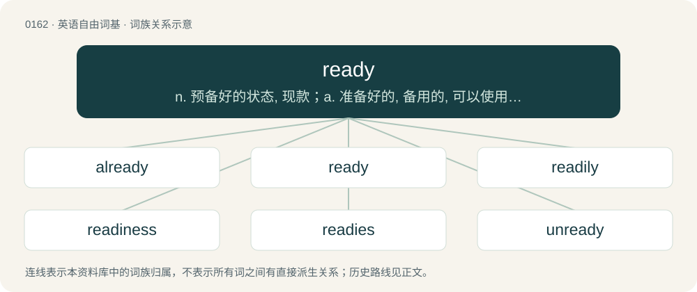

# 0175 · ready — n. 预备好的状态, 现款；a. 准备好的, 备用的, 可以使用的；adv. 预先, 迅速

[总目录](../00_总目录_按常用程度.md)

**类型**：英语自由词基　｜　**来源语言**：见词源记录

## 核心含义与来源

- 核心含义：n. 预备好的状态, 现款；a. 准备好的, 备用的, 可以使用的；adv. 预先, 迅速
- 英文含义：Prepared for immediate action or use.
- 词形：ready

**来源记录 1**（形容词；Prepared for immediate action or use.）

From Middle English redy, redi, rædiȝ, iredi, ȝerǣdi, alteration ( + -y) of earlier irēd, irede, ȝerād (“ready, prepared”), from Old English rǣde, ġerǣde (also ġerȳde) ("prepared, prompt, ready, ready for riding (horse), mounted (on a horse), skilled, simple, easy"), from Proto-Germanic \*garaidijaz, \*raidijaz, from base \*raidaz (“ready”), from Proto-Indo-European \*h₂reh₁dʰ-, \*h₂reh₁- (“to count, put in order, arrange, make comfortable”) and also probably conflated with Proto-Indo-European \*reydʰ- (“to ride”) in the sense of "set to ride, able or fit to go, ready". Cognate with Scots readie, reddy (“ready, prepared”), West Frisian ree (“ready”), Dutch gereed (“ready”), German bereit (“ready”), Danish rede (“ready”), Swedish redo (“ready, fit, prepared”), Norwegian reiug (“ready, prepared”), Icelandic greiður (“easy, light”), Gothic 𐌲𐌰𐍂𐌰𐌹𐌸𐍃 (garaiþs, “arranged, ordered”).

## 词族图

## 单词速览（常用到不常用）

| 单词 | 音标 | 释义 |
|---|---|---|
| [already](#w-1) | 英 /ɔːlˈɹɛdi/；/ɔlˈɹɛdi/ | adv. 已经, 早已 |
| [ready](#w-2) | 英 /ˈɹɛd.i/ | n. 预备好的状态, 现款；a. 准备好的, 备用的, 可以使用的；adv. 预先, 迅速 |
| [readily](#w-3) | /ˈɹɛdɪli/ | adv. 迅速地, 轻易地, 乐意地 |
| [readiness](#w-4) | /ˈɹɛdinəs/ | n. 预备, 准备, 敏捷 |
| [readies](#w-5) | /ˈrediz/ | n. 现钱( ready的名词复数 )；v. 做好…的准备, （为…）做好准备( ready的第三人称单数 ) |
| [unready](#w-6) | /.ʌnˈredi/ | a. 没预备的, 没准备的, 不敏捷的 |

## 逐词详解

### 1. already

**词性**：副词　｜　**音标**：英 /ɔːlˈɹɛdi/；/ɔlˈɹɛdi/

**中文释义**：adv. 已经, 早已

**英文义项**：Prior to some specified time, either past, present, or future; by this time; previously. / So soon.

**构词拆分**：al- (“all, completely”) + ready

**词源与演化**：

From Middle English alredy (“fully; already”), equivalent to al- (“all, completely”) + ready. Cognate with West Frisian alreeds (“already”), Dutch alreeds (“already”), Afrikaans alreeds (“already”), Middle Low German alreide, alreids ("already"; whence modern German Low German alreeds (“already”)), Danish allerede (“already”), Swedish allaredan (“already”), Norwegian Nynorsk allereie (“already”). More at all, ready. The use as an intensifier in American English is a semantic loan from Yiddish שוין (shoyn), attested from 1903. In Singapore English, the use of already as a marker of action completion and change of state is analogous to Hokkien 了 (liáu), Teochew 了 (liao²) and Mandarin 了 (le). Compare Malay (su)dah and Cantonese 咗 (zo²), 喇 (laa³).

**例句**：

> I still haven't seen that movie. I hope you haven't already seen it either.

该用例对应义项：Prior to some specified time, either past, present, or future; by this time; previously.

### 2. ready

**词性**：形容词　｜　**音标**：英 /ˈɹɛd.i/

**中文释义**：n. 预备好的状态, 现款；a. 准备好的, 备用的, 可以使用的；adv. 预先, 迅速

**英文义项**：Prepared for immediate action or use. / first only used predicatively, freely used from the end of the 17th century

**词源与演化**：

From Middle English redy, redi, rædiȝ, iredi, ȝerǣdi, alteration ( + -y) of earlier irēd, irede, ȝerād (“ready, prepared”), from Old English rǣde, ġerǣde (also ġerȳde) ("prepared, prompt, ready, ready for riding (horse), mounted (on a horse), skilled, simple, easy"), from Proto-Germanic \*garaidijaz, \*raidijaz, from base \*raidaz (“ready”), from Proto-Indo-European \*h₂reh₁dʰ-, \*h₂reh₁- (“to count, put in order, arrange, make comfortable”) and also probably conflated with Proto-Indo-European \*reydʰ- (“to ride”) in the sense of "set to ride, able or fit to go, ready". Cognate with Scots readie, reddy (“ready, prepared”), West Frisian ree (“ready”), Dutch gereed (“ready”), German bereit (“ready”), Danish rede (“ready”), Swedish redo (“ready, fit, prepared”), Norwegian reiug (“ready, prepared”), Icelandic greiður (“easy, light”), Gothic 𐌲𐌰𐍂𐌰𐌹𐌸𐍃 (garaiþs, “arranged, ordered”).

**例句**：

> The cave was like a ready-made home for us.

该用例对应义项：first only used predicatively, freely used from the end of the 17th century

### 3. readily

**词性**：副词　｜　**音标**：/ˈɹɛdɪli/

**中文释义**：adv. 迅速地, 轻易地, 乐意地

**英文义项**：Without unwillingness or hesitation; showing readiness. / Without impediment, easily.

**构词拆分**：By surface analysis, read(i) + -ly

**词源与演化**：

From Middle English redily, rediliche. By surface analysis, read(i) + -ly.

**例句**：

> The suspect readily answered all questions the police officers asked him.

该用例对应义项：Without unwillingness or hesitation; showing readiness.

### 4. readiness

**词性**：名词　｜　**音标**：/ˈɹɛdinəs/

**中文释义**：n. 预备, 准备, 敏捷

**英文义项**：The state or degree of being ready; preparedness. / Willingness.

**构词拆分**：ready + -ness

**词源与演化**：

From ready + -ness.

**用法示例／搭配（非完整句）**：

> readiness for civil emergencies

该用例对应义项：The state or degree of being ready; preparedness.

### 5. readies

**词性**：名词　｜　**音标**：/ˈrediz/

**中文释义**：n. 现钱( ready的名词复数 )；v. 做好…的准备, （为…）做好准备( ready的第三人称单数 )

**英文义项**：Cash, especially bank notes.

**构词拆分**：ready + -s

**词源与演化**：

From ready + -s, from ready money.

**例句**：

> Voice clips are entered into a submission queue that readies them for listening.

### 6. unready

**词性**：形容词　｜　**音标**：/.ʌnˈredi/

**中文释义**：a. 没预备的, 没准备的, 不敏捷的

**英文义项**：Not yet mature; not yet ripe. / Not yet prepared.

**构词拆分**：un- + ready

**词源与演化**：

From Middle English unredy, equivalent to un- + ready. Compare Dutch ongereed and onbereid, German unbereit, Swedish oberedd.

**例句**：

> The junior varsity team is unready for a serious competition; a lot of training remains to be done.

该用例对应义项：Not yet prepared.
