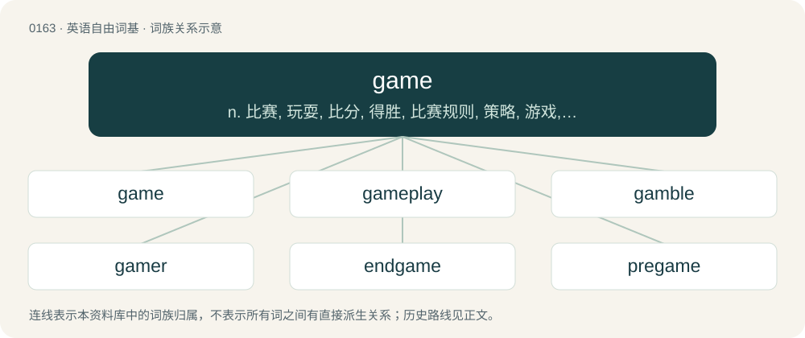

# 0176 · game — n. 比赛, 玩耍, 比分, 得胜, 比赛规则, 策略, 游戏, 野味；vi. 赌博；a. 勇敢的, 有胆量的, 关于野味的, 跛的

[总目录](../00_总目录_按常用程度.md)

**类型**：英语自由词基　｜　**来源语言**：见词源记录

## 核心含义与来源

- 核心含义：n. 比赛, 玩耍, 比分, 得胜, 比赛规则, 策略, 游戏, 野味；vi. 赌博；a. 勇敢的, 有胆量的, 关于野味的, 跛的
- 英文含义：A playful activity that may be unstructured; an amusement or pastime.
- 词形：game

**来源记录 1**（名词；A playful activity that may be unstructured; an amusement or pastime.）

From Middle English game, gamen, gammen, from Old English gamen (“sport, joy, mirth, pastime, game, amusement, pleasure”), from Proto-West Germanic \*gaman, from Proto-Germanic \*gamaną (“amusement, pleasure, game", literally "participation, communion, people together”), from \*ga- (collective prefix) + \*mann- (“man”); or alternatively from \*ga- + a root from Proto-Indo-European \*men- (“to think, have in mind”). Cognate with Yola gaame, gaaume, gaume (“game”), Old Frisian game, gome (“joy, amusement, entertainment”), Dutch gemelijk (“cantankerous, crabbed”), Middle High German gamen (“joy, amusement, fun, pleasure”), Danish gammen (“merriment”), Icelandic, Norwegian Nynorsk gaman (“joy, fun”), Swedish gamman (“mirth, rejoicing, merriment”). Related to gammon, gamble.

## 词族图

## 单词速览（常用到不常用）

| 单词 | 音标 | 释义 |
|---|---|---|
| [game](#w-1) | /ɡeɪm/ | n. 比赛, 玩耍, 比分, 得胜, 比赛规则, 策略, 游戏, 野味；vi. 赌博；a. 勇敢的, 有胆量的, 关于野味的, 跛的 |
| [gameplay](#w-2) | /ˈɡeɪmˌpleɪ/ | n. （电脑游戏的）游戏情节设计, 玩法 |
| [gamble](#w-3) | 英 /ˈɡæm.bəl/ | n. 赌博, 冒险；v. 赌博, 孤注一掷 |
| [gamer](#w-4) | 英 /ˈɡeɪ̯mə/；美 /ˈɡeɪ̯mɚ/ | n. 玩家, 博弈者 |
| [endgame](#w-5) | /ˈɛnd.ɡeɪm/ | n. 最后阶段；尾声 |
| [pregame](#w-6) | /ˈpriːˈ^eim/ | a. 比赛前的 |
| [postgame](#w-7) | 美 /ˈpoʊstˌɡeɪm/ | 赛后 |
| [gameday](#w-8) |  | 【英文】The day on which a sports team plays a game. |
| [gamification](#w-9) |  | 【英文】The use of gameplay mechanics for non-game applications (as for example making work less onerous; incentivization; or pedagogy). |
| [gamepad](#w-10) | /ˈɡeɪm.pæd/ | n. 游戏手柄; \[计\]\[WIN\]游戏键盘 |
| [minigame](#w-11) | 美 /ˈmɪniˌɡeɪm/ | 【英文】A small and simple game, especially an incidental game within a larger video game. |
| [gamekeeper](#w-12) | /ˈgeimkiːpə/ | n. 猎场看守人 |
| [ingame](#w-13) |  | 【英文】Used as a protective measure to avoid legal liability for making a statement that could be interpreted as a threat. |
| [gamesmanship](#w-14) | /ˈgeimzmənʃip/ | n. 搅乱战术 |
| [gamey](#w-15) | /ˈɡeɪmi/ | a. 多猎物的, 味道强的, 勇敢的 |
| [gamely](#w-16) | /ˈgeimli/ | adv. 不屈地, 勇敢地 |

## 逐词详解

### 1. game

**词性**：名词　｜　**音标**：/ɡeɪm/

**中文释义**：n. 比赛, 玩耍, 比分, 得胜, 比赛规则, 策略, 游戏, 野味；vi. 赌博；a. 勇敢的, 有胆量的, 关于野味的, 跛的

**英文义项**：A playful activity that may be unstructured; an amusement or pastime. / An activity described by a set of rules, especially for the purpose of entertainment, often competitive or having an explicit goal.

**词源与演化**：

From Middle English game, gamen, gammen, from Old English gamen (“sport, joy, mirth, pastime, game, amusement, pleasure”), from Proto-West Germanic \*gaman, from Proto-Germanic \*gamaną (“amusement, pleasure, game", literally "participation, communion, people together”), from \*ga- (collective prefix) + \*mann- (“man”); or alternatively from \*ga- + a root from Proto-Indo-European \*men- (“to think, have in mind”). Cognate with Yola gaame, gaaume, gaume (“game”), Old Frisian game, gome (“joy, amusement, entertainment”), Dutch gemelijk (“cantankerous, crabbed”), Middle High German gamen (“joy, amusement, fun, pleasure”), Danish gammen (“merriment”), Icelandic, Norwegian Nynorsk gaman (“joy, fun”), Swedish gamman (“mirth, rejoicing, merriment”). Related to gammon, gamble.

**例句**：

> In the game of life, you may find yourself playing the waiting game far too often.

该用例对应义项：Something that resembles a game with rules, despite not being designed.

### 2. gameplay

**词性**：名词　｜　**音标**：/ˈɡeɪmˌpleɪ/

**中文释义**：n. （电脑游戏的）游戏情节设计, 玩法

**英文义项**：The totality of player experiences during a game, such as the gaming environment and the competitive interaction with other players; often with reference to a video game or a board game.

**构词拆分**：game + play

**词源与演化**：

From game + play.

**例句**：

> Critics praised the game's graphics and storyline, but criticised its gameplay mechanics.

### 3. gamble

**词性**：名词　｜　**音标**：英 /ˈɡæm.bəl/

**中文释义**：n. 赌博, 冒险；v. 赌博, 孤注一掷

**英文义项**：A bet or wager. / A significant risk, undertaken with a potential gain.

**构词拆分**：game + -le

**词源与演化**：

From earlier gamel, from Middle English \*gamlen, \*gamelen, variant of Middle English gamenen, from Old English gæmnian, gamnian, gamenian (“to joke; play”), related to Old English gamen (“joy; mirth; pleasure; entertainment; pastime; sport; game”), equivalent to game + -le. Compare Old Danish gammel, Middle High German gamel (“pleasure; fun”). More at game.

**例句**：

> The sailors had taken many gambles with the sea and always won.

该用例对应义项：A risky venture.

### 4. gamer

**词性**：名词　｜　**音标**：英 /ˈɡeɪ̯mə/；美 /ˈɡeɪ̯mɚ/

**中文释义**：n. 玩家, 博弈者

**英文义项**：A person who plays any kind of game. / A person whose hobby is video games.

**构词拆分**：game (noun) + -er (occupational suffix)

**词源与演化**：

From Middle English gamer, attested since before 1450 as a common noun and possibly since 1248 in the name of one Johannes le Gamer. Equivalent to game (noun) + -er (occupational suffix).

**例句**：

> At home, Tom juggles two roles: dad by day, gamer by night.

### 5. endgame

**词性**：名词　｜　**音标**：/ˈɛnd.ɡeɪm/

**中文释义**：n. 最后阶段；尾声

**英文义项**：The final stage of a game of chess, when there are few pieces left. / The final stage of a game of bridge, when there are few cards left.

**构词拆分**：end + game

**词源与演化**：

From end + game.

**例句**：

> Being stuck with two V tiles can make for an awkward Scrabble endgame.

该用例对应义项：The final stage of any game.

### 6. pregame

**词性**：名词　｜　**音标**：/ˈpriːˈ^eim/

**中文释义**：a. 比赛前的

**英文义项**：A social gathering of friends who get together to drink before going out to a party or a sports game, in order to generate a slight feeling of intoxication before going out for the night. / A television show preceding a sports game wherein commentators discuss that game.

**构词拆分**：pre- + game

**词源与演化**：

From pre- + game.

### 7. postgame

**词性**：形容词　｜　**音标**：美 /ˈpoʊstˌɡeɪm/

**中文释义**：赛后

**英文义项**：Following a game, usually specifically a sporting match. / Occurring after the main storyline of the game.

**构词拆分**：post- + game

**词源与演化**：

From post- + game.

**例句**：

> Stay tuned for the postgame show.

该用例对应义项：Following a game, usually specifically a sporting match.

### 8. gameday

**词性**：名词

**英文义项**：The day on which a sports team plays a game.

**构词拆分**：game + day

**词源与演化**：

From game + day.

### 9. gamification

**词性**：名词

**英文义项**：The use of gameplay mechanics for non-game applications (as for example making work less onerous; incentivization; or pedagogy).

**构词拆分**：gam(e) + -ification

**词源与演化**：

From gam(e) + -ification.

### 10. gamepad

**词性**：名词　｜　**音标**：/ˈɡeɪm.pæd/

**中文释义**：n. 游戏手柄; \[计\]\[WIN\]游戏键盘

**英文义项**：A type of game controller held in both hands and controlled with the thumbs.

**构词拆分**：game + pad

**例句**：

> This game is basically designed for use with keyboard and gamepad but configuration can only be done by mouse.

### 11. minigame

**词性**：名词　｜　**音标**：美 /ˈmɪniˌɡeɪm/

**英文义项**：A small and simple game, especially an incidental game within a larger video game.

**构词拆分**：mini- + game

**词源与演化**：

From mini- + game.

**例句**：

> If you collect 100 coins, you get to play a balloon-popping minigame.

该用例对应义项：A small and simple game, especially an incidental game within a larger video game.

### 12. gamekeeper

**词性**：名词　｜　**音标**：/ˈgeimkiːpə/

**中文释义**：n. 猎场看守人

**英文义项**：A person employed to maintain the game for hunting and all associated materials and effects.

**构词拆分**：game + keeper

**词源与演化**：

From game + keeper.

**例句**：

> It was the gamekeeper who found the body.

### 13. ingame

**词性**：prep_phrase

**英文义项**：Used as a protective measure to avoid legal liability for making a statement that could be interpreted as a threat.

**构词拆分**：in- + game

**词源与演化**：

From in- + game.

### 14. gamesmanship

**词性**：名词　｜　**音标**：/ˈgeimzmənʃip/

**中文释义**：n. 搅乱战术

**英文义项**：The use of legal but unsporting tactics to gain an advantage over one’s opponent.

**构词拆分**：game + -s- + -manship；gamesman + -ship

**词源与演化**：

From game + -s- + -manship or gamesman + -ship.

**例句**：

> They kept the other team waiting on the field until the last possible moment – that was a clear case of gamesmanship.

该用例对应义项：The use of legal but unsporting tactics to gain an advantage over one’s opponent.

### 15. gamey

**词性**：形容词　｜　**音标**：/ˈɡeɪmi/

**中文释义**：a. 多猎物的, 味道强的, 勇敢的

**英文义项**：Having the smell, taste and texture of game meat. / Plucky, spirited or gritty.

**构词拆分**：game + -y

**词源与演化**：

From game + -y.

**例句**：

> Have you ever eaten javelina? It's quite good, albeit somewhat gamey.

### 16. gamely

**词性**：形容词　｜　**音标**：/ˈgeimli/

**中文释义**：adv. 不屈地, 勇敢地

**英文义项**：Sportive; lively; joyful. / Of or pertaining to game.

**构词拆分**：game + -ly

**词源与演化**：

From game + -ly; compare Old English gamenlīċ (“belonging to games, sportive, theatrical, ridiculous”) and Middle High German gāmelich, gemelich (“joyful”).

**例句**：

> His gamely gesture was much appreciated.
