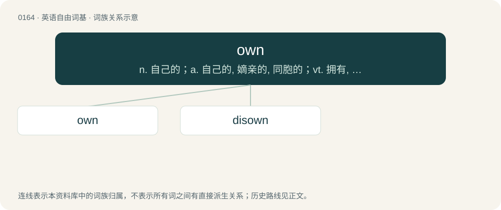

# 0177 · own — n. 自己的；a. 自己的, 嫡亲的, 同胞的；vt. 拥有, 支配, 自认, 承认, 顺从于

[总目录](../00_总目录_按常用程度.md)

**类型**：英语自由词基　｜　**来源语言**：见词源记录

## 核心含义与来源

- 核心含义：n. 自己的；a. 自己的, 嫡亲的, 同胞的；vt. 拥有, 支配, 自认, 承认, 顺从于
- 英文含义：Belonging to; possessed; acquired and designated by; proper to; property of; titled to; held in one's name; under/using the name of. Often marks a possessive determiner as reflexive, referring back to the subject of the clause or sentence.
- 词形：own

**多个词源／构词路径**：同一拼写可能有不同来源；以下按词性和含义分别列出。

**来源记录 1**（形容词；Belonging to; possessed; acquired and designated by; proper to; property of; titled to; held in one's name; under/using the name of. Often marks a possessive determiner as reflexive, referring back to the subject of the clause or sentence.）

From Middle English oun, owen, from Old English āgen (“own, proper, peculiar”), originally the past participle of āgan; from Proto-West Germanic \*aigan (“own”), from Proto-Germanic \*aiganaz (“own”), from Proto-Indo-European \*h₂eyḱ- (“to have, possess”). Doublet of eigen-. Cognates Cognate with Scots ain, awin, awn, ayn (“own”), Saterland Frisian oain (“own”), West Frisian, Dutch, and German eigen (“own”), Danish, Norwegian Bokmål, and Swedish egen (“own”), Faroese egin (“own”), Icelandic eigin, eiginn (“own”), Norwegian Nynorsk eigen (“own”); also Ossetian исын (isyn, “to take”), Tocharian A and Tocharian B aik- (“to know, recognize”), Sanskrit ईश (īśa, “owning, possessing”). Originally past participle of the verb at hand in English owe.

**来源记录 2**（动词；To have rightful possession of (property, goods or capital); to have legal title to; to acquire a property or asset.）

A back-formation from owner. Compare Old English āgnian, Dutch eigenen, German eignen, Swedish ägna.

## 词族图

## 单词速览（常用到不常用）

| 单词 | 音标 | 释义 |
|---|---|---|
| [own](#w-1) | 英 /əʊn/；美 /oʊn/ | n. 自己的；a. 自己的, 嫡亲的, 同胞的；vt. 拥有, 支配, 自认, 承认, 顺从于 |
| [disown](#w-2) | 英 /dɪsˈəʊn/；美 /dɪsˈoʊn/ | vt. 否认；\[计\] 不认, 驱逐 |

## 逐词详解

### 1. own

**词性**：形容词　｜　**音标**：英 /əʊn/；美 /oʊn/

**中文释义**：n. 自己的；a. 自己的, 嫡亲的, 同胞的；vt. 拥有, 支配, 自认, 承认, 顺从于

**英文义项**：Belonging to; possessed; acquired and designated by; proper to; property of; titled to; held in one's name; under/using the name of. Often marks a possessive determiner as reflexive, referring back to the subject of the clause or sentence. / Not shared.

**词源与演化**：

From Middle English oun, owen, from Old English āgen (“own, proper, peculiar”), originally the past participle of āgan; from Proto-West Germanic \*aigan (“own”), from Proto-Germanic \*aiganaz (“own”), from Proto-Indo-European \*h₂eyḱ- (“to have, possess”). Doublet of eigen-. Cognates Cognate with Scots ain, awin, awn, ayn (“own”), Saterland Frisian oain (“own”), West Frisian, Dutch, and German eigen (“own”), Danish, Norwegian Bokmål, and Swedish egen (“own”), Faroese egin (“own”), Icelandic eigin, eiginn (“own”), Norwegian Nynorsk eigen (“own”); also Ossetian исын (isyn, “to take”), Tocharian A and Tocharian B aik- (“to know, recognize”), Sanskrit ईश (īśa, “owning, possessing”). Originally past participle of the verb at hand in English owe.

**例句**：

> When we move into the new house, the kids will each have their own bedroom.

该用例对应义项：Not shared.

### 2. disown

**词性**：动词　｜　**音标**：英 /dɪsˈəʊn/；美 /dɪsˈoʊn/

**中文释义**：vt. 否认；\[计\] 不认, 驱逐

**英文义项**：To refuse to own, or to refuse to acknowledge one’s own. / To repudiate any connection to; to renounce.

**构词拆分**：dis- + own

**词源与演化**：

From dis- + own.

**例句**：

> Lord Capulet and his wife threatened to disown their daughter Juliet if she didn’t go through with marrying Count Paris.

该用例对应义项：To refuse to own, or to refuse to acknowledge one’s own.
