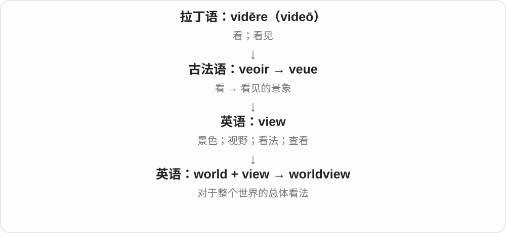

# 0178 · world — 世界；人世；领域

[逐词精讲目录](../00_逐词精讲目录.md) · [总目录](../00_总目录_按常用程度.md)

## 核心词根与来源

world 的古英语祖先 weorold 更早与“人的时代、存在”有关。现代可说全球，也可说某种生活领域。underworld、netherworld 保留上下世界的神话图像，worldbuilding 则是创作过程。

**WORLD：一整套人、环境与规则组成的天地**

地球上的人类社会是一种 world，一部小说搭出的社会也可以是一种。

- **世界与生活经验**：world · worldly · worldview
- **神话、幻想与游戏**：underworld · netherworld · otherworld · dreamworld · overworld
- **构建与跨域**：worldbuilding · transworld
- **world → worlds：整体天地与不同生活圈**：world · worlds

## 词形与演化规律

worldly 的 -ly 是形容词材料；worldbuilding 的 building 是构建，不是实体楼房。worldview 说观点，worldbuilding 说设定；它们都可在中文语境出现世界观，但英语不应混用。

古英语 weorold 的人、时代相关历史组合，现代可数不同世界、领域。

## 单词速览（按词族由简到繁）

同一基础词的相关扩展放在一起，先读基础形式，再读扩展；各组之间优先读常用的。具体词源关系见各词讲解。

| 单词 | 音标 | 核心意思 |
|---|---|---|
| [world](#w-1) | 英 /wɜːld/；美 /wɜːrld/ | 世界；人世；领域；生活环境 |
| [worlds](#w-12) | 英 /wɜːldz/；美 /wɜːrldz/ | 世界、天地；生活圈、领域〔复数〕 |
| [worldly](#w-3) | 英 /ˈwɜːldli/；美 /ˈwɜːrldli/ | 世俗的；见多识广的；人情练达的 |
| [worldview](#w-4) | 英 /ˈwɜːldvjuː/；美 /ˈwɜːrldvjuː/ | 世界观 |
| [worldbuilding](#w-11) | 英 /ˈwɜːldbɪldɪŋ/；美 /ˈwɜːrldbɪldɪŋ/ | 虚构世界构建；世界观设定 |
| [underworld](#w-2) | 英 /ˈʌndəwɜːld/；美 /ˈʌndərwɜːrld/ | 冥界；犯罪社会 |
| [netherworld](#w-5) | 英 /ˈneðəwɜːld/；美 /ˈneðərwɜːrld/ | 下界；冥界；幽暗隐秘的世界 |
| [dreamworld](#w-6) | 英 /ˈdriːmwɜːld/；美 /ˈdriːmwɜːrld/ | 梦境；幻想世界 |
| [otherworld](#w-7) | 英 /ˈʌðəwɜːld/；美 /ˈʌðərwɜːrld/ | 异界；另一个世界〔神话、文学〕 |
| [overworld](#w-8) | 英 /ˈəʊvəwɜːld/；美 /ˈoʊvərwɜːrld/ | 地上世界；游戏主地图世界 |
| [transworld](#w-9) | 英 /trænzˈwɜːld/；美 /trænzˈwɜːrld/〔按构词读法〕 | 跨世界的；涉及不同可能世界的〔哲学〕 |

## 逐词讲解

### 1. world — 世界；人世；领域；生活环境

**音标**：英 /wɜːld/；美 /wɜːrld/

**先抓住这个画面**

不只是一颗地球，也可以是你身处的一整套人、规则和日常经验。

**怎么拆**

古英语 weorold 更早的日耳曼语材料相当于“人的时代、存在”，包含人与年龄、时代相关成分；现代 word“单词”并不是它的拆分材料。

**怎么变成今天的意思**

**古英语 weorold → 中古英语 world**  
人世、世界

↓

**英语 world**  
世界；生活领域；某个整体环境

around the world 是全球，the world of music 是音乐界，a child’s world 是孩子的生活天地。worlds apart 是差异极大，a world of difference 是巨大差别。

**常见搭配与例句**

around the world；in the world；the world of；worlds apart。

> The news spread around the world.

消息传遍世界。

> She introduced me to the world of contemporary dance.

她带我走进当代舞的世界。

**别混淆**

Earth 是地球这颗行星，world 范围可包括人类社会、某一领域或虚构环境。a fictional world 不必是一颗独立行星。

### 2. worlds — 世界、天地；生活圈、领域〔复数〕

**音标**：英 /wɜːldz/；美 /wɜːrldz/

**先抓住这个画面**

同一颗地球上，不同人的生活圈可能像不同的世界；小说、游戏也可以造出多个世界。worlds 把这些整体分开数。

**怎么拆**

world + -s，/d/ 后读 /z/。world 承古英语 weorold，更早日耳曼材料相当于人、时代的组合，原有人的时代、存在等背景。

**怎么变成今天的意思**

**日耳曼人、时代相关材料 → 古英语 weorold → world**  
人的时代、存在 → 人所处的天地、世界

↓

**world + -s → worlds**  
多个世界；不同生活圈、领域

different worlds 不同世界、生活圈；imaginary worlds 想象的世界；the best of both worlds 两全其美。

**常见搭配与例句**

worlds apart 天差地别；the worlds of art and science 艺术与科学领域。

> The novel creates several imaginary worlds.

小说创造了几个想象中的世界。

> Their daily lives were worlds apart.

他们的日常生活天差地别。

**别混淆**

worlds 可以是比喻的领域，不一定是物理上的多个星球。the best of both worlds 说同时得到两方面的好处。

### 3. worldly — 世俗的；见多识广的；人情练达的

**音标**：英 /ˈwɜːldli/；美 /ˈwɜːrldli/

**先抓住这个画面**

经验不是只来自书上，而是从现实社会的钱、关系、规则里磨出来。

**怎么拆**

接古英语 woruldlīċ 等形式；现代对应 world + -ly，这里 -ly 造形容词。世间、世俗义与熟悉人情世故义依语境区分。

**怎么变成今天的意思**

**古英语 weorold → 中古英语 world**  
人世、世界

↓

**古英语 woruldlīċ → 英语 worldly**  
世间的、世俗的；后来也说熟谙世事

worldly possessions 是身外财物，a worldly person 是熟悉现实社会的人。可能肯定经验，也可批评过分看重物质。

**常见搭配与例句**

worldly possessions；worldly wisdom；a worldly manner。

> He sold most of his worldly possessions before moving abroad.

移居国外前，他卖掉了大部分身外财物。

> She was more worldly than her younger brother.

她比弟弟更懂人情世故。

**别混淆**

worldly 不是 worldwide“全球的”。worldly experience 是处世经验，worldwide experience 可说在世界各地的经历。

### 4. worldview — 世界观

**音标**：英 /ˈwɜːldvjuː/；美 /ˈwɜːrldvjuː/

**先抓住这个画面**

worldview 像一副长期戴着的眼镜：你认为世界怎样运转、什么值得重视，都通过它来理解。

**怎么拆**

world + view，是对德语 Weltanschauung 的意译式组合。

**怎么变成今天的意思**

它不只是一条意见，而是互相联系的一组基本认识，影响对许多事情的判断。

**常见搭配与例句**

shape someone’s worldview；a scientific worldview；different worldviews。

> Travel changed her worldview.

旅行改变了她的世界观。

> The novel brings two very different worldviews into conflict.

小说让两种很不相同的世界观发生冲突。

**别混淆**

opinion 可以是对一件小事的看法；worldview 是更整体、更基础的认识框架。

### 5. worldbuilding — 虚构世界构建；世界观设定

**音标**：英 /ˈwɜːldbɪldɪŋ/；美 /ˈwɜːrldbɪldɪŋ/

**先抓住这个画面**

为故事搭出不只一间房，而是一整套历史、地理、社会和运行规则。

**怎么拆**

world（世界）+ building（构建），用于创作中建立虚构环境与规则的活动；不表示真的施工造星球。

**怎么变成今天的意思**

**英语 world；building**  
并列组合的材料

↓

**world + building → worldbuilding**  
创作一个相互连贯的虚构世界

常见于奇幻、科幻、游戏创作。good worldbuilding 让细节相互支撑，不必把所有设定一次讲给读者。

**常见搭配与例句**

detailed worldbuilding；fantasy worldbuilding；worldbuilding notes。

> The novel is admired for its detailed worldbuilding.

小说因细致的虚构世界设定受到赞赏。

> She keeps maps and historical notes for her worldbuilding.

她为构建虚构世界保存地图和历史笔记。

**别混淆**

worldbuilding 是构建过程，worldview 是人看世界的观念；中文都可能出现“世界观”，英文职责不同。

### 6. underworld — 冥界；犯罪社会

**音标**：英 /ˈʌndəwɜːld/；美 /ˈʌndərwɜːrld/

**先抓住这个画面**

在日常可见秩序下面，还被想象或比喻存在另一套世界。

**怎么拆**

under-（在下）+ world（世界），神话里常说死者世界，后来也说隐秘犯罪圈子；不把现代犯罪群体说成真住在地下。

**怎么变成今天的意思**

**英语 under-；world**  
并列组合的材料

↓

**under- + world → underworld**  
下方世界；冥界或隐秘犯罪圈

the criminal underworld 是犯罪社会；the Greek underworld 是希腊神话冥界。两种义项需由主题定位。

**常见搭配与例句**

the criminal underworld；the underworld of myth；an underworld figure。

> The myth describes a journey to the underworld.

神话描写了一次冥界之旅。

> The novel explores the city’s criminal underworld.

小说探究城市的犯罪社会。

**别混淆**

underworld 不等于 underground 的所有用法，underground station 是地铁站，不是犯罪社会的车站。

### 7. netherworld — 下界；冥界；幽暗隐秘的世界

**音标**：英 /ˈneðəwɜːld/；美 /ˈneðərwɜːrld/

**先抓住这个画面**

神话把日常世界之下另设一处幽暗领域，也可比喻不为人熟悉的阴暗圈子。

**怎么拆**

nether-（下面、较低处）+ world，nether 是较旧、较文学的下方材料。

**怎么变成今天的意思**

**英语 nether-；world**  
并列组合的材料

↓

**nether- + world → netherworld**  
下界、冥界；幽暗领域

常比 underworld 更文学。a netherworld of secrets 可描绘隐秘混沌的生活，不必是具体宗教信仰。

**常见搭配与例句**

the netherworld；a shadowy netherworld；enter the netherworld。

> The poem imagines a cold and silent netherworld.

诗中想象了一个寒冷寂静的冥界。

> The story leads readers into a netherworld of secrets.

故事把读者带进一个隐秘幽暗的世界。

**别混淆**

netherworld 和 underworld 在冥界义可近，但不能由此以为 nether 能在日常所有 under 位置随意替换。

### 8. dreamworld — 梦境；幻想世界

**音标**：英 /ˈdriːmwɜːld/；美 /ˈdriːmwɜːrld/

**先抓住这个画面**

在想象里规则可以不同，现实中的困难也可能暂时不存在。

**怎么拆**

dream（梦、幻想）+ world（世界），组合说梦中的环境或脱离现实的想象。

**怎么变成今天的意思**

**英语 dream；world**  
并列组合的材料

↓

**dream + world → dreamworld**  
梦境构成的世界；不切实际的幻想

a beautiful dreamworld 可是艺术描绘；living in a dreamworld 常批评不顾现实条件。是否贬义依搭配。

**常见搭配与例句**

in a dreamworld；live in a dreamworld；a surreal dreamworld。

> The animation creates a strange and beautiful dreamworld.

动画创造了一个奇异美丽的梦境。

> You are living in a dreamworld if you think this will cost nothing.

如果你以为这毫无成本，那就是活在幻想里。

**别混淆**

dreamworld 不必等于 ideal 理想；人可以有理想同时正视现实，living in a dreamworld 则常暗示没看清现实。

### 9. otherworld — 异界；另一个世界〔神话、文学〕

**音标**：英 /ˈʌðəwɜːld/；美 /ˈʌðərwɜːrld/

**先抓住这个画面**

故事把日常世界之外另留一处：那里可能住着精灵、亡灵或其他存在。

**怎么拆**

other（另一个）+ world（世界），古英语及中古英语已有相应表达；具体神话中的世界设定各不相同。

**怎么变成今天的意思**

**英语 other；world**  
组合使用的两个材料

↓

**other + world → otherworld**  
日常世界以外的另一世界

多见神话、幻想文学或宗教研究，不是已经证实的物理地点名称。通常由故事背景定义它是什么。

**常见搭配与例句**

the otherworld；a journey to the otherworld；the realm of the otherworld。

> The hero enters the otherworld through a hidden cave.

主人公通过隐秘洞穴进入异界。

> The tale places the otherworld beyond the western sea.

传说把异界设在西海之外。

**别混淆**

otherworld 偏神话中的异界；another world 是更普通短语，可以只是一个差异很大的生活环境。

### 10. overworld — 地上世界；游戏主地图世界

**音标**：英 /ˈəʊvəwɜːld/；美 /ˈoʊvərwɜːrld/

**先抓住这个画面**

离开地牢、地下洞穴等局部场景，回到连接各处的地表区域。

**怎么拆**

over-（在上）+ world，与 underworld 形成空间对照；游戏中发展成主要外部地图环境的称呼。

**怎么变成今天的意思**

**英语 over-；world**  
并列组合的材料

↓

**over- + world → overworld**  
地下区域以外、上层或地表的世界

角色扮演游戏里 overworld 常连接城镇、入口与其他地点。不是所有游戏都按同一结构划分，也不要求地图完全开放。

**常见搭配与例句**

an overworld map；explore the overworld；return to the overworld。

> The player returned to the overworld after leaving the cave.

玩家离开洞穴后返回地表世界。

> The overworld map shows the towns and mountain passes.

主地图标出了城镇和山口。

**别混淆**

overworld 在游戏中是场景类型，open world 是一种更开放的设计概念，两者并不自动相等。

### 11. transworld — 跨世界的；涉及不同可能世界的〔哲学〕

**音标**：英 /trænzˈwɜːld/；美 /trænzˈwɜːrld/〔按构词读法〕

**先抓住这个画面**

把“现实里是这样”和“假如当初换个选择会怎样”放到不同可能情境中，再问其中的人或物是否仍是同一个。

**怎么拆**

英语 trans- + world。哲学里 world 常是“可能世界”，不是专指从地球去另一颗星球。

**怎么变成今天的意思**

**拉丁 trans／trans-**  
越过、穿过；在另一边

↓

**英语 trans- + world → transworld**  
跨越不同世界；模态哲学中跨可能世界

transworld identity 讨论一个对象能否在不同可能世界里保持同一身份。例如“如果她选择另一份工作，她还会是同一个人吗？”不同理论会以同一对象或相似对应者来解释，答案有争论。

**常见搭配与例句**

transworld identity；transworld identification；a transworld relation。

> The philosopher uses transworld identity to discuss what might have happened to the same person.

哲学家用跨世界同一性讨论同一个人原本可能经历什么。

> The seminar compared transworld identity with counterpart theory.

研讨课比较跨世界同一性与对应者理论。

**别混淆**

worldwide 常指遍及全世界；transworld 在这类哲学文本中是跨不同可能世界。counterpart theory 则用对应者处理相关问题。

## 这一组要分清什么

world：世界或领域；Earth：行星。worldly：世俗、练达；worldwide：全球范围。overworld 不自动等于 open world。

## 串起来练习

Her worldly experience helped her create a convincing fictional world.

现实处世经验帮助她创造了可信的虚构世界。
