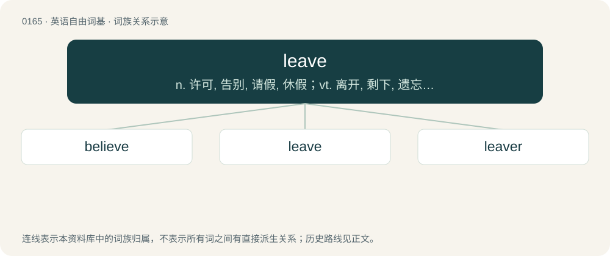

# 0179 · leave — n. 许可, 告别, 请假, 休假；vt. 离开, 剩下, 遗忘, 委托, 丢弃；vi. 出发, 离开, 生叶

[总目录](../00_总目录_按常用程度.md)

**类型**：英语自由词基　｜　**来源语言**：见词源记录

## 核心含义与来源

- 核心含义：n. 许可, 告别, 请假, 休假；vt. 离开, 剩下, 遗忘, 委托, 丢弃；vi. 出发, 离开, 生叶
- 英文含义：To cause or allow (something) to remain as available; to refrain from taking (something) away; to stop short of consuming or otherwise depleting (something) entirely.
- 词形：leave

**多个词源／构词路径**：同一拼写可能有不同来源；以下按词性和含义分别列出。

**来源记录 1**（动词；To cause or allow (something) to remain as available; to refrain from taking (something) away; to stop short of consuming or otherwise depleting (something) entirely.）

From Middle English leven, from Old English lǣfan (“to leave”), from Proto-West Germanic \*laibijan, from Proto-Germanic \*laibijaną (“to let stay, leave”), causative of \*lībaną (“to stay, remain”), from Proto-Indo-European \*leyp- (“to stick; fat”). Cognate with Old Frisian lēva (“to leave”), dialectal Dutch loven (“to have left over, save, keep”), Old Saxon lēvian, Old High German leiban (“to leave”), Old Norse leifa (“to leave over”) (whence Icelandic leifa (“to leave food uneaten”), Swedish leva (“to leave”)), lifna (“to be left”) (whence Danish levne). More at lave, belive. The noun is attested since the 19th century, with earliest references to billiards.

**来源记录 2**（名词；Permission to be absent; time away from one's work.）

From Middle English leve, from Old English lēaf (“permission, privilege”), from Proto-Germanic \*laubō, \*laubą (“permission, privilege, favour, worth”), from Proto-Indo-European \*lewbʰ- (“to love, hold dear”). Cognate with obsolete German Laube (“permission”), Swedish lov (“permission”), Icelandic leyfi (“permission”). Related to Dutch verlof, German Urlaub, Erlaubnis, Verlaub. See also love.

**来源记录 3**（动词；To give leave to; allow; permit; let; grant.）

From Middle English leven, from Old English līefan (“to allow, grant, concede; believe, trust, confide in”), from Proto-West Germanic \*laubijan, from Proto-Germanic \*laubijaną (“to allow, praise”), from Proto-Indo-European \*lewbʰ- (“to love, hold dear”). Cognate with German erlauben (“to allow”), German glauben (“to believe”), Icelandic leyfa (“to allow”).

**来源记录 4**（动词；To produce leaves or foliage.）

From Middle English leven, from lef (“leaf”). More at leaf.

## 词族图

## 单词速览（常用到不常用）

| 单词 | 音标 | 释义 |
|---|---|---|
| [believe](#w-1) | 英 /bɪˈliːv/；美 /bɪˈliv/ | v. 相信 |
| [leave](#w-2) | /ˈliːv/ | n. 许可, 告别, 请假, 休假；vt. 离开, 剩下, 遗忘, 委托, 丢弃；vi. 出发, 离开, 生叶 |
| [leaver](#w-3) | /ˈliːvə/ | n. 离开者（常指学校毕业生） |

## 逐词详解

### 1. believe

**词性**：动词　｜　**音标**：英 /bɪˈliːv/；美 /bɪˈliv/

**中文释义**：v. 相信

**英文义项**：To accept as true, particularly without absolute certainty (i.e., as opposed to knowing). / To accept that someone is telling the truth.

**构词拆分**：be- + leave (“to give leave or permission to, permit, allow, grant”)

**词源与演化**：

From Middle English beleven, bileven, from Old English belīefan (“to believe”), from Proto-West Germanic \*bilaubijan (“to believe”), equivalent to be- + leave (“to give leave or permission to, permit, allow, grant”). Cognate with Scots beleve (“to believe”), Old Frisian bilēva (“to permit”), Middle Dutch beloven (“to believe, entrust”), Middle Low German belö̂ven (“to believe”), Middle High German belouben (“to believe”). A related term in Old English was ġelīefan (“to be dear to; believe, trust”), from Proto-West Germanic \*galaubijan (“to have faith, believe”), from Proto-Germanic \*galaubijaną. Compare also Old English ġelēafa (“belief, faith, confidence, trust”), Old English lēof ("dear, valued, beloved, pleasant, agreeable" &gt; English lief). Related also to North Frisian leauwjen (“to believe”), Saterland Frisian leeuwe (“to believe”), West Frisian leauwe (“to believe”), Dutch geloven (“to believe”), German Low German glöven (“to believe”), German glauben (“to believe”), Gothic 𐌲𐌰𐌻𐌰𐌿𐌱𐌾𐌰𐌽 (galaubjan, “to hold dear, valuable, or satisfactory, approve of, believe”). The prepositionally transitive senses with in are a semantic loan from Latin crēdō in aliquem / aliquid.

**例句**：

> Since I don't believe in reincarnation, I believe that the only way to eliminate suffering is to die.

该用例对应义项：To ascribe existence to.

### 2. leave

**词性**：动词　｜　**音标**：/ˈliːv/

**中文释义**：n. 许可, 告别, 请假, 休假；vt. 离开, 剩下, 遗忘, 委托, 丢弃；vi. 出发, 离开, 生叶

**英文义项**：To cause or allow (something) to remain as available; to refrain from taking (something) away; to stop short of consuming or otherwise depleting (something) entirely. / To cause, to result in.

**词源与演化**：

From Middle English leven, from Old English lǣfan (“to leave”), from Proto-West Germanic \*laibijan, from Proto-Germanic \*laibijaną (“to let stay, leave”), causative of \*lībaną (“to stay, remain”), from Proto-Indo-European \*leyp- (“to stick; fat”). Cognate with Old Frisian lēva (“to leave”), dialectal Dutch loven (“to have left over, save, keep”), Old Saxon lēvian, Old High German leiban (“to leave”), Old Norse leifa (“to leave over”) (whence Icelandic leifa (“to leave food uneaten”), Swedish leva (“to leave”)), lifna (“to be left”) (whence Danish levne). More at lave, belive. The noun is attested since the 19th century, with earliest references to billiards.

**例句**：

> I'll leave the car in the station so you can pick it up there.

该用例对应义项：To intentionally place (something) to be received by another; to deliver (something) to a repository; to deposit.

### 3. leaver

**词性**：名词　｜　**音标**：/ˈliːvə/

**中文释义**：n. 离开者（常指学校毕业生）

**英文义项**：One who leaves. / Synonym of schoolie (“a senior student”).

**构词拆分**：From leave + -er.

**词源与演化**：

From leave + -er.

**例句**：

> He's a leaver, not a stayer: he'll never be happy tied down in one place.

该用例对应义项：One who leaves.
