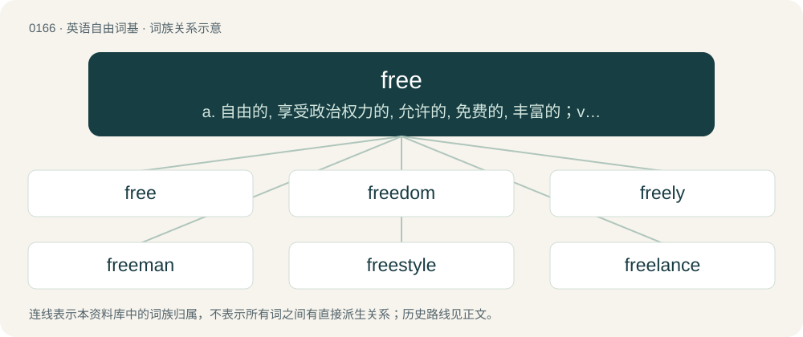

# 0181 · free — a. 自由的, 享受政治权力的, 允许的, 免费的, 丰富的；vt. 释放, 解放, 使自由；adv. 自由地, 免费

[总目录](../00_总目录_按常用程度.md)

**类型**：英语自由词基　｜　**来源语言**：见词源记录

## 核心含义与来源

- 核心含义：a. 自由的, 享受政治权力的, 允许的, 免费的, 丰富的；vt. 释放, 解放, 使自由；adv. 自由地, 免费
- 英文含义：Unconstrained.
- 词形：free

**多个词源／构词路径**：同一拼写可能有不同来源；以下按词性和含义分别列出。

**来源记录 1**（形容词；Unconstrained.）

From Middle English fre, from Old English frēo, frēoh, frī, friġ, frīoh (“free”), from Proto-West Germanic \*frī, from Proto-Germanic \*frijaz (“beloved, not in bondage”), from Proto-Indo-European \*priHós (“pleased, loved”), from \*preyH- (“to please; to love”). Related to friend. cognates, etc Germanic cognates include Scots fre (“free”), North Frisian frai, frei, fri, Frii (“free”), Saterland Frisian fräi (“free”), West Frisian frij (“free”), Dutch vrij (“free”), German frei (“free”), Low German free (“free”), Luxembourgish fräi (“free”), Vilamovian frȧj (“free”), Yiddish פֿרײַ (fray, “free”), Danish, Norwegian Bokmål, Norwegian Nynorsk, and Swedish fri (“free”), Faroese fríur (“free”), Gothic 𐍆𐍂𐌴𐌹𐍃 (freis, “free”). Other cognates include Cornish rydh (“free”), Welsh rhydd (“free”), Latin propriō (“to appropriate”), Czech přát (“to wish; to favour”), Polish sprzyjać (“to favour, foster”), Serbo-Croatian прѝјати, prìjati (“to please, taste, suit; to be agreeable, relish”), Slovak priať (“to wish”), Avestan 𐬟𐬭𐬌𐬌𐬀 (friia, “good, pleasant”), Persian فری (fari, “beloved, dear; agreeable, pleasing”), Sanskrit प्रिय (priya, “beloved”). Germanic and Celtic are the only Indo-European language branches in which the PIE word with the meaning of "dear, beloved" acquired the additional meaning of "free" in the sense of "not in bondage". This was an extension of the idea of "characteristic of those who are dear and beloved", in other words friends and tribe members (in contrast to unfree inhabitants from other tribes and prisoners of war, many of which were among the slaves – compare the Latin use of liberi to mean both "free persons" and "children of a family").

**来源记录 2**（动词；To make free; set at liberty; release.）

From Middle English freen, freoȝen, from Old English frēon, frēoġan (“to free; make free”), from Proto-West Germanic \*frijōn, from Proto-Germanic \*frijōną, from Proto-Indo-European \*preyH-, and is cognate with German freien, Dutch vrijen, Czech přát, Serbo-Croatian prijati, Polish sprzyjać.

## 词族图

## 单词速览（常用到不常用）

| 单词 | 音标 | 释义 |
|---|---|---|
| [free](#w-1) | 英 /fɹiː/；美 /fɹi/ | a. 自由的, 享受政治权力的, 允许的, 免费的, 丰富的；vt. 释放, 解放, 使自由；adv. 自由地, 免费 |
| [freedom](#w-2) | 英 /ˈfɹiːdəm/；美 /ˈfɹi.dəm/ | n. 自由, 坦率, 特权；\[法\] 自由, 自主, 免除 |
| [freely](#w-3) | 英 /ˈfɹiːli/；美 /ˈfɹili/ | adv. 自由地, 随意地, 无拘束地, 直率地, 坦白地, 慷慨地, 免费地, 大量地；\[计\] 浮动地 |
| [freeman](#w-4) | /ˈfɹiː.mən/ | n. 自由民, 公民, 正会员；\[法\] 自由民, 公民, 有公民权的人 |
| [freestyle](#w-5) | /ˈfɹiːˌstaɪl/ | n. 自由式 |
| [freelance](#w-6) | 英 /ˈfɹiːlɑːns/；美 /ˈfɹiˌlæns/ | n. 自由作家, 自由投稿, 自由职业者；a. 自由投稿的 |
| [freeway](#w-7) | /ˈfɹiː.weɪ/ | n. 高速公路 |
| [freebie](#w-8) | /ˈfɹiːbi/ | n. 免费的东西；免费赠品（尤指戏院赠券） |
| [freestanding](#w-9) | /ˈfriːstændiŋ/ | a. 独立式的, 不需依靠支撑物的 |
| [freeware](#w-10) | 英 /ˈfɹiːˌwɛə/；美 /ˈfɹiːˌwɛɹ/ | \[计\] 免费软件, 自由软件 |
| [freefall](#w-11) | /ˈfɹiːˌfɔːl/ | a. 自由落体的；n. 自由降落式（跳伞） |
| [freehand](#w-12) | /ˈfriːhænd/ | a. 徒手画的；adv. 徒手画地；\[计\] 手画线 |
| [freemason](#w-13) | /ˈfriːmeisn/ | n. 互济会会员；\[法\] 互济会 |
| [freestone](#w-14) | 英 /ˈfɹiːstəʊn/；美 /ˈfɹiːstoʊn/ | \[化\] 易切砂岩; 易劈石; 离核; 离核果实 |
| [freeborn](#w-15) | 英 /ˌfɹiːˈbɔːn/；美 /ˈfɹiˌboɹn/ | a. 生而自由的, 自由民的, 适合于自由民的 |
| [freeloader](#w-16) | 英 /ˈfɹiːləʊdə(ɹ)/；美 /ˈfɹiloʊdɚ/ | n. 不速之客, 揩油的人 |

## 逐词详解

### 1. free

**词性**：形容词　｜　**音标**：英 /fɹiː/；美 /fɹi/

**中文释义**：a. 自由的, 享受政治权力的, 允许的, 免费的, 丰富的；vt. 释放, 解放, 使自由；adv. 自由地, 免费

**英文义项**：Unconstrained. / Not imprisoned or enslaved.

**词源与演化**：

From Middle English fre, from Old English frēo, frēoh, frī, friġ, frīoh (“free”), from Proto-West Germanic \*frī, from Proto-Germanic \*frijaz (“beloved, not in bondage”), from Proto-Indo-European \*priHós (“pleased, loved”), from \*preyH- (“to please; to love”). Related to friend. cognates, etc Germanic cognates include Scots fre (“free”), North Frisian frai, frei, fri, Frii (“free”), Saterland Frisian fräi (“free”), West Frisian frij (“free”), Dutch vrij (“free”), German frei (“free”), Low German free (“free”), Luxembourgish fräi (“free”), Vilamovian frȧj (“free”), Yiddish פֿרײַ (fray, “free”), Danish, Norwegian Bokmål, Norwegian Nynorsk, and Swedish fri (“free”), Faroese fríur (“free”), Gothic 𐍆𐍂𐌴𐌹𐍃 (freis, “free”). Other cognates include Cornish rydh (“free”), Welsh rhydd (“free”), Latin propriō (“to appropriate”), Czech přát (“to wish; to favour”), Polish sprzyjać (“to favour, foster”), Serbo-Croatian прѝјати, prìjati (“to please, taste, suit; to be agreeable, relish”), Slovak priať (“to wish”), Avestan 𐬟𐬭𐬌𐬌𐬀 (friia, “good, pleasant”), Persian فری (fari, “beloved, dear; agreeable, pleasing”), Sanskrit प्रिय (priya, “beloved”). Germanic and Celtic are the only Indo-European language branches in which the PIE word with the meaning of "dear, beloved" acquired the additional meaning of "free" in the sense of "not in bondage". This was an extension of the idea of "characteristic of those who are dear and beloved", in other words friends and tribe members (in contrast to unfree inhabitants from other tribes and prisoners of war, many of which were among the slaves – compare the Latin use of liberi to mean both "free persons" and "children of a family").

**例句**：

> We had a wholesome, filling meal, free of meat. I would like to live free from care in the mountains.

该用例对应义项：Without; not containing (what is specified); exempt; clear; liberated.

### 2. freedom

**词性**：名词　｜　**音标**：英 /ˈfɹiːdəm/；美 /ˈfɹi.dəm/

**中文释义**：n. 自由, 坦率, 特权；\[法\] 自由, 自主, 免除

**英文义项**：The state of being free. / The lack of a specific constraint, or of constraints in general; a state of being free, unconstrained.

**构词拆分**：free + -dom

**词源与演化**：

From Middle English fredom, freedom, from Old English frēodōm (“freedom, state of free-will, charter, emancipation, deliverance”), from Proto-West Germanic \*frijadōm (“freedom”). Equivalent to free + -dom. Cognate with North Frisian fridoem (“freedom”), Dutch vrijdom (“freedom”), Low German frīdom (“freedom”), Middle High German vrītuom (“freedom”), Norwegian fridom (“freedom”).

**例句**：

> Having recently been released from prison, he didn't know what to do with his newfound freedom.

该用例对应义项：The state of being free.

### 3. freely

**词性**：形容词　｜　**音标**：英 /ˈfɹiːli/；美 /ˈfɹili/

**中文释义**：adv. 自由地, 随意地, 无拘束地, 直率地, 坦白地, 慷慨地, 免费地, 大量地；\[计\] 浮动地

**英文义项**：Free; frank. / Generous; noble; excellent; beautiful; lovely.

**构词拆分**：free + -ly

**词源与演化**：

From Middle English frely, freelich, from Old English frēolīc (“free, freeborn, glorious, stately, magnificent, noble, beautiful, charming”), equivalent to free + -ly. Compare Middle Low German vrilik, vrigelik (“free”), Middle High German vrīlich (“free”).

**例句**：

> Do Palestinians have the right to freely move around their own country?

### 4. freeman

**词性**：名词　｜　**音标**：/ˈfɹiː.mən/

**中文释义**：n. 自由民, 公民, 正会员；\[法\] 自由民, 公民, 有公民权的人

**英文义项**：A person who has received an honorary freedom of a city. / A person who is a citizen of a free country, as opposed to a subject of a tyranny or totalitarian dictatorship.

**构词拆分**：free + -man

**词源与演化**：

From Old English frēomann, equivalent to free + -man and paralleled by similar constructions in other Germanic languages. Doublet of preman.

**例句**：

> The narrator of the documentary was Morgan Freeman.

### 5. freestyle

**词性**：名词　｜　**音标**：/ˈfɹiːˌstaɪl/

**中文释义**：n. 自由式

**英文义项**：A swimming event in which the contestants may choose any stroke. / The swimming stroke commonly referred to as the front crawl or the Australian crawl.

**构词拆分**：free + style

**词源与演化**：

From free + style.

**例句**：

> Mary reluctantly agreed to listen to another one of Tom's freestyle raps.

### 6. freelance

**词性**：形容词　｜　**音标**：英 /ˈfɹiːlɑːns/；美 /ˈfɹiˌlæns/

**中文释义**：n. 自由作家, 自由投稿, 自由职业者；a. 自由投稿的

**英文义项**：Of or relating to a freelance; without a long-term employment contract.

**构词拆分**：free + lance

**词源与演化**：

From free + lance. Coined by Walter Scott (1771–1832) in Ivanhoe (1819; see quotation) to describe a medieval mercenary warrior or "free-lance" (indicating that the lance is not sworn to any lord's services). It changed to a figurative noun around the 1860s and was recognized as a verb in 1903 by authorities such as the Oxford English Dictionary. In modern times the term has morphed into an adjective, a verb, and an adverb, as well as the derivative noun freelancer.

**例句**：

> He was a freelance writer for several magazines.

该用例对应义项：Of or relating to a freelance; without a long-term employment contract.

### 7. freeway

**词性**：名词　｜　**音标**：/ˈfɹiː.weɪ/

**中文释义**：n. 高速公路

**英文义项**：A highway with grade-separated crossings (rather than level crossings) and designed (and only permitted) for high-speed motor-traffic running in two directions on one separate carriageway each / A toll-free highway.

**构词拆分**：free + way

**词源与演化**：

From free + way.

**例句**：

> There are many rest stops along the freeway for the convenience of travelers.

### 8. freebie

**词性**：名词　｜　**音标**：/ˈfɹiːbi/

**中文释义**：n. 免费的东西；免费赠品（尤指戏院赠券）

**英文义项**：Something which is free; a giveaway or handout.

**构词拆分**：free + -b- (epenthetic) + -ie；free + -bie

**词源与演化**：

From free + -b- (epenthetic) + -ie or free + -bie.

**例句**：

> I didn't buy a thing, but they were handing out some neat freebies and samples.

该用例对应义项：Something which is free; a giveaway or handout.

### 9. freestanding

**词性**：形容词　｜　**音标**：/ˈfriːstændiŋ/

**中文释义**：a. 独立式的, 不需依靠支撑物的

**英文义项**：Standing or set apart. / Not attached to anything.

**构词拆分**：free + standing

**词源与演化**：

From free + standing.

**例句**：

> The Leaning Tower of Pisa is a freestanding bell tower.

该用例对应义项：Standing or set apart.

### 10. freeware

**词性**：名词　｜　**音标**：英 /ˈfɹiːˌwɛə/；美 /ˈfɹiːˌwɛɹ/

**中文释义**：\[计\] 免费软件, 自由软件

**英文义项**：Complete and functional software that does not require payment or other compensation (such as viewing advertising) for its use. Freeware may be a proprietary license with no access to the source code.

**构词拆分**：free + -ware

**词源与演化**：

From free + -ware (clipping of "software"). Coined by Andrew Fluegelman.

### 11. freefall

**词性**：名词　｜　**音标**：/ˈfɹiːˌfɔːl/

**中文释义**：a. 自由落体的；n. 自由降落式（跳伞）

**英文义项**：A state of motion affected by no acceleration or force other than that of gravity. / A state of motion but allowing for the presence of incidental air resistance not caused intentionally by devices such parachutes or wings.

**构词拆分**：free + fall

**词源与演化**：

From free + fall.

**例句**：

> As civil war continues in Iraq, the U.S. president's approval ratings are in freefall.

该用例对应义项：A rapid, uncontrolled decline or worsening.

### 12. freehand

**词性**：形容词　｜　**音标**：/ˈfriːhænd/

**中文释义**：a. 徒手画的；adv. 徒手画地；\[计\] 手画线

**英文义项**：Drawn using the hand without any helping device.

**构词拆分**：free + hand

**词源与演化**：

From free + hand.

### 13. freemason

**词性**：名词　｜　**音标**：/ˈfriːmeisn/

**中文释义**：n. 互济会会员；\[法\] 互济会

**英文义项**：A member of a guild of skilled itinerant masons during the Middle Ages and early modern times.

**构词拆分**：free + mason

**词源与演化**：

From free + mason.

### 14. freestone

**词性**：名词　｜　**音标**：英 /ˈfɹiːstəʊn/；美 /ˈfɹiːstoʊn/

**中文释义**：\[化\] 易切砂岩; 易劈石; 离核; 离核果实

**英文义项**：Sedimentary rock: a type of stone that is composed of small particles and easily shaped, most commonly sandstone or limestone. / A stone fruit having a stone (pit) that is relatively free of the flesh.

**构词拆分**：free + stone

**词源与演化**：

From free + stone.

### 15. freeborn

**词性**：形容词　｜　**音标**：英 /ˌfɹiːˈbɔːn/；美 /ˈfɹiˌboɹn/

**中文释义**：a. 生而自由的, 自由民的, 适合于自由民的

**英文义项**：Born free rather than in bondage or as a slave

**构词拆分**：free + born

**词源与演化**：

From free + born.

### 16. freeloader

**词性**：名词　｜　**音标**：英 /ˈfɹiːləʊdə(ɹ)/；美 /ˈfɹiloʊdɚ/

**中文释义**：n. 不速之客, 揩油的人

**英文义项**：One who does not contribute or pay appropriately; one who gets a free ride, etc. without paying a fair share. / A person who takes expired unsold merchandise from the back of supermarket premises.

**构词拆分**：free + load + -er

**词源与演化**：

From free + load + -er, originally US 1930s.

**例句**：

> You're such a freeloader! You're always taking candy from me but you never give me any.
