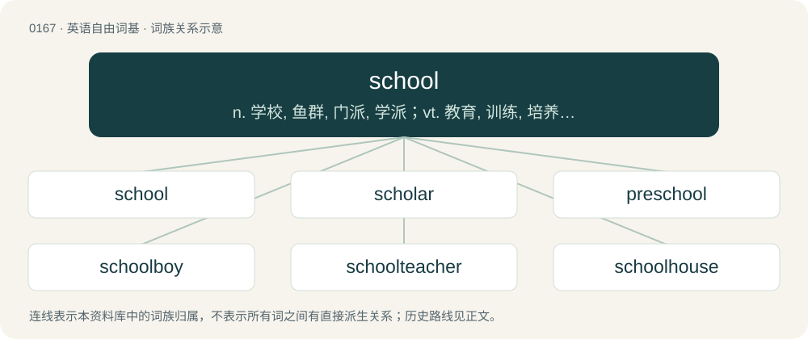

# 0182 · school — n. 学校, 鱼群, 门派, 学派；vt. 教育, 训练, 培养；vi. 成群地游

[总目录](../00_总目录_按常用程度.md)

**类型**：英语自由词基　｜　**来源语言**：见词源记录

## 核心含义与来源

- 核心含义：n. 学校, 鱼群, 门派, 学派；vt. 教育, 训练, 培养；vi. 成群地游
- 英文含义：An institution dedicated to teaching and learning; an educational institution.
- 词形：school

**多个词源／构词路径**：同一拼写可能有不同来源；以下按词性和含义分别列出。

**来源记录 1**（名词；An institution dedicated to teaching and learning; an educational institution.）

From Middle English scole, from Old English scōl (“place of education”), from Proto-West Germanic \*skōlu, from Late Latin schola, scola (“learned discussion or dissertation, lecture, school”), from Ancient Greek σχολή (skholḗ, “spare time, leisure”), from Proto-Indo-European \*seǵʰ- (“to hold, have, possess”). Doublet of schola and shul. Compare Old Frisian skūle, schūle (“school”) (West Frisian skoalle, Saterland Frisian Skoule), Dutch school (“school”), Low German School (“school”), Old High German scuola (“school”), German Schule (“school”), Old Norse skóli (“school”). Influenced in some senses by Middle English schole (“group of persons, host, company”), from Middle Dutch scole (“multitude, troop, band”). See school (“group”). Related also to Old High German sigi (German Sieg, “victory”), Old English siġe, sigor (“victory”).

**来源记录 2**（名词；A group of fish or a group of marine mammals such as porpoises, dolphins, or whales.）

From Middle English scole, schole (“group of persons, multitude, host, school of fish”), from Middle Dutch scole (“multitude, troop of people, swarm of animals”), from Old Dutch \*scola, \*skola (“troop, multitude”), from Proto-West Germanic \*skulu (“troop, group”), from Proto-Indo-European \*(s)kʷel- (“crowd, people”). Cognate with Middle Low German schōle (“multitude, troop”), Old English scolu (“troop or band of people, host, multitude, school of fish”). Doublet of shoal.

## 词族图

## 单词速览（常用到不常用）

| 单词 | 音标 | 释义 |
|---|---|---|
| [school](#w-1) | 英 /skuːl/；美 /skul/ | n. 学校, 鱼群, 门派, 学派；vt. 教育, 训练, 培养；vi. 成群地游 |
| [scholar](#w-2) | 英 /ˈskɒlə/；美 /ˈskɑlɚ/ | n. 学者, 奖学金获得者, 有文化者, 学习者 |
| [preschool](#w-3) | 美 /ˈpɹiːskuːl/ | a. 就学前的；n. 育幼院, 幼稚园 |
| [schoolboy](#w-4) | 美 /ˈskulˌbɔɪ/ | n. 男学生 |
| [schoolteacher](#w-5) | /ˈskuːltiːtʃə/ | n. 教师 |
| [schoolhouse](#w-6) | 美 /ˈskulˌhaʊs/ | n. 校舍 |
| [schoolmaster](#w-7) | 美 /ˈskulˌmæstəɹ/ | n. 男教师, 男校长, 教导者 |
| [schoolwork](#w-8) | 英 /ˈskuːlˌwɜːk/；美 /ˈskulˌwɝk/ | n. 学校作业, 家庭作业 |
| [schooler](#w-9) |  | 斯库勒（男子名） |
| [schoolyard](#w-10) | /ˈskuːljɑːd/ | n. 校园, 运动场 |
| [afterschool](#w-11) | /ˈɑːftəskuːl/ | a. 课外的,供课外活动用的 |
| [schoolmate](#w-12) | 英 /ˈskuːlˌmeɪt/；美 /ˈskulˌmeɪt/ | n. 同窗, 同学 |
| [schoolroom](#w-13) | /ˈskuːlruːm/ | n. 教室, 讲堂 |
| [schoolcraft](#w-14) | /ˈskuːlkrɑːft;-kræft/ | n. &lt;古&gt;学校教的知识 |

## 逐词详解

### 1. school

**词性**：名词　｜　**音标**：英 /skuːl/；美 /skul/

**中文释义**：n. 学校, 鱼群, 门派, 学派；vt. 教育, 训练, 培养；vi. 成群地游

**英文义项**：An institution dedicated to teaching and learning; an educational institution. / An educational institution providing primary and secondary education, prior to tertiary education (college or university).

**词源与演化**：

From Middle English scole, from Old English scōl (“place of education”), from Proto-West Germanic \*skōlu, from Late Latin schola, scola (“learned discussion or dissertation, lecture, school”), from Ancient Greek σχολή (skholḗ, “spare time, leisure”), from Proto-Indo-European \*seǵʰ- (“to hold, have, possess”). Doublet of schola and shul. Compare Old Frisian skūle, schūle (“school”) (West Frisian skoalle, Saterland Frisian Skoule), Dutch school (“school”), Low German School (“school”), Old High German scuola (“school”), German Schule (“school”), Old Norse skóli (“school”). Influenced in some senses by Middle English schole (“group of persons, host, company”), from Middle Dutch scole (“multitude, troop, band”). See school (“group”). Related also to Old High German sigi (German Sieg, “victory”), Old English siġe, sigor (“victory”).

**例句**：

> Divinity, history and geography are studied for two schools per week.

该用例对应义项：At Eton College, a period or session of teaching.

### 2. scholar

**词性**：名词　｜　**音标**：英 /ˈskɒlə/；美 /ˈskɑlɚ/

**中文释义**：n. 学者, 奖学金获得者, 有文化者, 学习者

**英文义项**：A student; one who studies at school or college, typically having a scholarship. / A specialist in a particular branch of knowledge.

**构词拆分**：school + -ar

**词源与演化**：

From Middle English scolar, scolare, scoler, scolere (also scholer), from Old English scōlere (“scholar, learner”), from Late Latin scholāris, from schola (“school”), from Ancient Greek σχολή (skholḗ, “spare time, leisure", later, "conversations and the knowledge gained through them during free time; the places where these conversations took place”), equivalent to school + -ar. Doublet of schooler, Schuyler, and escolar. Compare Saterland Frisian Sköiler, Middle Low German schö̂lære, schö̂lere, schö̂ler (&gt; modern German Low German Schöler), Dutch scholier, German Schüler.

**例句**：

> The English scholar is not conscious of his lack of common sense.

### 3. preschool

**词性**：形容词　｜　**音标**：美 /ˈpɹiːskuːl/

**中文释义**：a. 就学前的；n. 育幼院, 幼稚园

**英文义项**：Of or relating to the years of early childhood before attendance at primary school.

**构词拆分**：pre- + school

**词源与演化**：

From pre- + school.

**例句**：

> How do you know if your child is ready for preschool?

### 4. schoolboy

**词性**：名词　｜　**音标**：美 /ˈskulˌbɔɪ/

**中文释义**：n. 男学生

**英文义项**：A boy attending school.

**构词拆分**：school + boy

**词源与演化**：

From school + boy.

**例句**：

> Did you know the four-in-hand knot is also known as the schoolboy knot?

### 5. schoolteacher

**词性**：名词　｜　**音标**：/ˈskuːltiːtʃə/

**中文释义**：n. 教师

**英文义项**：A teacher working in a school.

**构词拆分**：school + teacher

**词源与演化**：

From school + teacher.

**例句**：

> Tom's dream is to be a schoolteacher.

### 6. schoolhouse

**词性**：名词　｜　**音标**：美 /ˈskulˌhaʊs/

**中文释义**：n. 校舍

**英文义项**：A building housing a school, especially a small or single-room one.

**构词拆分**：school + house

**词源与演化**：

From Middle English scolehous, scole-hous, equivalent to school + house. Compare West Frisian skoallehûs, skoalhûs (“schoolhouse”), Dutch schoolhuis (“schoolhouse”), German Schulhaus (“schoolhouse”).

**例句**：

> The teachers could not decide where to build the new schoolhouse.

### 7. schoolmaster

**词性**：名词　｜　**音标**：美 /ˈskulˌmæstəɹ/

**中文释义**：n. 男教师, 男校长, 教导者

**英文义项**：A male teacher. / A male teacher in charge of a school, usually a small one.

**构词拆分**：school + master

**词源与演化**：

From Middle English skolemayster, scolemaister, scol-meister, equivalent to school + master. Cognate with West Frisian skoalmaster (“schoolmaster”), Dutch schoolmeester (“schoolmaster”), Low German Schoolmeester, Schoolmeister (“schoolmaster”), German Schulmeister (“schoolmaster”).

**例句**：

> The war was a tough schoolmaster for the Athenians.

该用例对应义项：Anything that teaches.

### 8. schoolwork

**词性**：名词　｜　**音标**：英 /ˈskuːlˌwɜːk/；美 /ˈskulˌwɝk/

**中文释义**：n. 学校作业, 家庭作业

**英文义项**：Work done for school, including both in class and as homework.

**构词拆分**：school + work

**词源与演化**：

From school + work.

**例句**：

> I'm 40, but now that I'm back going for my degree I'm swamped with schoolwork.

该用例对应义项：Work done for school, including both in class and as homework.

### 9. schooler

**词性**：名词

**中文释义**：斯库勒（男子名）

**英文义项**：A student, or in some cases member, of a particular type of school or schooling. (ordinarily used in combinations such as "high schooler") / One who provides schooling; a teacher.

**构词拆分**：school + -er

**词源与演化**：

From school + -er. Compare the similarly formed doublet scholar and the name Schuyler.

**例句**：

> Those kids are all junior high schoolers.

该用例对应义项：A student, or in some cases member, of a particular type of school or schooling. (ordinarily used in combinations such as "high schooler")

### 10. schoolyard

**词性**：名词　｜　**音标**：/ˈskuːljɑːd/

**中文释义**：n. 校园, 运动场

**英文义项**：The grounds around a school. / An open field near a school used for recreation by the students.

**构词拆分**：school + yard

**词源与演化**：

From school + yard.

**例句**：

> I am standing in the middle of the schoolyard.

### 11. afterschool

**词性**：形容词　｜　**音标**：/ˈɑːftəskuːl/

**中文释义**：a. 课外的,供课外活动用的

**英文义项**：Taking place immediately after school classes. / Of or pertaining to a program intended to care for and educate children in the time immediately after school classes.

**构词拆分**：after- + school

**词源与演化**：

From after- + school.

### 12. schoolmate

**词性**：名词　｜　**音标**：英 /ˈskuːlˌmeɪt/；美 /ˈskulˌmeɪt/

**中文释义**：n. 同窗, 同学

**英文义项**：A person who was a fellow attendee at one's school. / A schoolfriend; a friend from one's school.

**构词拆分**：school + -mate

**词源与演化**：

From school + -mate.

**例句**：

> I've lost touch with all my old schoolmates: I only see them at class reunions.

该用例对应义项：A person who was a fellow attendee at one's school.

### 13. schoolroom

**词性**：名词　｜　**音标**：/ˈskuːlruːm/

**中文释义**：n. 教室, 讲堂

**英文义项**：A classroom, a room in a school used for instruction.

**构词拆分**：school + room

**词源与演化**：

From school + room.

**例句**：

> The girl was sobbing in the corner of the schoolroom.

### 14. schoolcraft

**词性**：名词　｜　**音标**：/ˈskuːlkrɑːft;-kræft/

**中文释义**：n. &lt;古&gt;学校教的知识

**英文义项**：The art or practice of education.

**构词拆分**：school + -craft

**词源与演化**：

From school + -craft.
