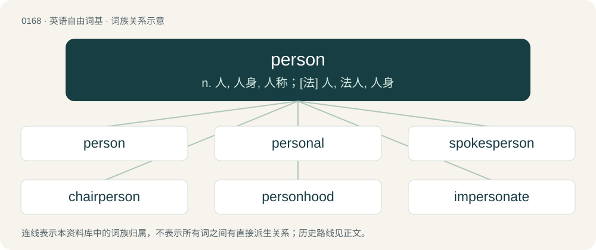

# 0184 · person — n. 人, 人身, 人称；\[法\] 人, 法人, 人身

[总目录](../00_总目录_按常用程度.md)

**类型**：英语自由词基　｜　**来源语言**：见词源记录

## 核心含义与来源

- 核心含义：n. 人, 人身, 人称；\[法\] 人, 法人, 人身
- 英文含义：An individual who has been granted personhood; usually a human being.
- 词形：person

**来源记录 1**（名词；An individual who has been granted personhood; usually a human being.）

From Middle English persoun, personne et al., from Anglo-Norman parsone, persoun et al. (Old French persone (“human being”), French personne), and its source Latin persōna (“mask used by actor; role, part, character”), perhaps a loanword from Etruscan 𐌘𐌄𐌓𐌔𐌖 (φersu, “mask”). In this sense, displaced native man, which came to mean primarily "adult male" in Middle English; see Old English mann. Displaced native Old English hād (“person, individual”). Doublet of parson and persona.

## 词族图

## 单词速览（常用到不常用）

| 单词 | 音标 | 释义 |
|---|---|---|
| [person](#w-1) | 英 /ˈpɜː.sən/；美 /ˈpɜɹ.sən/ | n. 人, 人身, 人称；\[法\] 人, 法人, 人身 |
| [personal](#w-2) | 英 /ˈpɜː.sə.nəl/；美 /ˈpɜɹ.sə.nəl/ | a. 私人的, 涉及隐私的, 有人性的, 人称的, 亲自的, 身体的；\[医\] 人的; 个人的, 自身的 |
| [spokesperson](#w-3) | 英 /ˈspəʊkspɜːɹsən/；美 /ˈspoʊksˌpɝsən/ | n. 发言人, 代言人 |
| [chairperson](#w-4) | /ˈtʃeəp\\\\ːs(e)n/ | n. 主席 |
| [personhood](#w-5) | /ˈpɝ.sən.hʊd/ | n. 做人,人格 |
| [impersonate](#w-6) | /ɪmˈpɜːsəneɪt/ | vt. 模仿, 扮演, 体现, 使人格化；\[法\] 体现, 模仿, 拟人 |
| [layperson](#w-7) | 美 /ˈleɪ.pɜɹ.sən/ | n. 外行 |
| [personify](#w-8) | /pə(ɹ)ˈsɒnɪfaɪ/ | vt. 看做人, 赋与人性, 使人格化, 体现, 是...的化身 |
| [businessperson](#w-9) | /ˈbɪznəspɜːsn/ | n. 商人 |

## 逐词详解

### 1. person

**词性**：名词　｜　**音标**：英 /ˈpɜː.sən/；美 /ˈpɜɹ.sən/

**中文释义**：n. 人, 人身, 人称；\[法\] 人, 法人, 人身

**英文义项**：An individual who has been granted personhood; usually a human being. / A character or part, as in a play; a specific kind or manifestation of individual character, whether in real life, or in literary or dramatic representation; an assumed character.

**词源与演化**：

From Middle English persoun, personne et al., from Anglo-Norman parsone, persoun et al. (Old French persone (“human being”), French personne), and its source Latin persōna (“mask used by actor; role, part, character”), perhaps a loanword from Etruscan 𐌘𐌄𐌓𐌔𐌖 (φersu, “mask”). In this sense, displaced native man, which came to mean primarily "adult male" in Middle English; see Old English mann. Displaced native Old English hād (“person, individual”). Doublet of parson and persona.

**例句**：

> I was able to speak to a technical support person and get the problem solved.

该用例对应义项：A worker in a specified function or specialty.

### 2. personal

**词性**：形容词　｜　**音标**：英 /ˈpɜː.sə.nəl/；美 /ˈpɜɹ.sə.nəl/

**中文释义**：a. 私人的, 涉及隐私的, 有人性的, 人称的, 亲自的, 身体的；\[医\] 人的; 个人的, 自身的

**英文义项**：Pertaining to persons (human beings as opposed to things or animals). / Of or pertaining to a particular person; relating to, or affecting, an individual, or each of many individuals

**构词拆分**：person + -al

**词源与演化**：

From Middle English personal, personele, from Anglo-Norman personel, personal, personell, Old French personal, personel, from Late Latin persōnālis (“of a person, personly”), equivalent to person + -al. Doublet of personnel.

**例句**：

> I can't believe you went through my drawers and looked at all my personal things!

该用例对应义项：Dealing with subjects about which one wishes (or people usually wish) to maintain privacy or discretion; not for public view; sensitive, intimate.

### 3. spokesperson

**词性**：名词　｜　**音标**：英 /ˈspəʊkspɜːɹsən/；美 /ˈspoʊksˌpɝsən/

**中文释义**：n. 发言人, 代言人

**英文义项**：A person who acts as the voice of another person or a group of people.

**构词拆分**：spoke (“past participle of speak”) + -s- + person

**词源与演化**：

From spoke (“past participle of speak”) + -s- + person.

**例句**：

> Tom's voluble enthusiasm for the company's product made him a natural spokesperson.

### 4. chairperson

**词性**：名词　｜　**音标**：/ˈtʃeəp\\\\ːs(e)n/

**中文释义**：n. 主席

**英文义项**：A chairman or chairwoman, someone who presides over a meeting, board, etc.

**构词拆分**：chair + -person；chair + person

**词源与演化**：

From chair + person, after chairman and chairwoman.

**例句**：

> She was the chairperson of the board and she presided over the meeting.

该用例对应义项：A chairman or chairwoman, someone who presides over a meeting, board, etc.

### 5. personhood

**词性**：名词　｜　**音标**：/ˈpɝ.sən.hʊd/

**中文释义**：n. 做人,人格

**英文义项**：The state or period of being a person. / The status of being considered as a person.

**构词拆分**：person + -hood

**词源与演化**：

From person + -hood.

**例句**：

> A majority of the present world's peoples delay the conferral of personhood (to children).

该用例对应义项：The status of being considered as a person.

### 6. impersonate

**词性**：动词　｜　**音标**：/ɪmˈpɜːsəneɪt/

**中文释义**：vt. 模仿, 扮演, 体现, 使人格化；\[法\] 体现, 模仿, 拟人

**英文义项**：To pretend to be (a different person); to assume the identity of, especially when there is an intent to deceive. / To operate with the permissions of a different user account.

**构词拆分**：in- + person + -ate

**词源与演化**：

From im- + person + -ate (verb-forming suffix).

**例句**：

> The conman managed to impersonate several executives.

该用例对应义项：To pretend to be (a different person); to assume the identity of, especially when there is an intent to deceive.

### 7. layperson

**词性**：名词　｜　**音标**：美 /ˈleɪ.pɜɹ.sən/

**中文释义**：n. 外行

**英文义项**：A person who is not a cleric. / One who is not intimately familiar with a given subject or activity.

**构词拆分**：lay (“non-clergy, nonclergy”) + person

**词源与演化**：

A lay (“non-clergy, nonclergy”) + person, along the lines of layman.

**例句**：

> The book was written for professionals, but an intelligent layperson could understand most of it.

该用例对应义项：One who is not intimately familiar with a given subject or activity.

### 8. personify

**词性**：动词　｜　**音标**：/pə(ɹ)ˈsɒnɪfaɪ/

**中文释义**：vt. 看做人, 赋与人性, 使人格化, 体现, 是...的化身

**英文义项**：To be an example of; to have all the attributes of. / To create a representation of (an abstract quality) in the form of a character or persona.

**构词拆分**：person + -ify

**词源与演化**：

From person + -ify, after French personnifier.

**例句**：

> Mozart could be said to personify musical genius.

该用例对应义项：To be an example of; to have all the attributes of.

### 9. businessperson

**词性**：名词　｜　**音标**：/ˈbɪznəspɜːsn/

**中文释义**：n. 商人

**英文义项**：A person in business, or one who works at a commercial institution.

**构词拆分**：business + person

**词源与演化**：

From business + person.

**例句**：

> What do you think: should we say businessperson instead of businessman?
