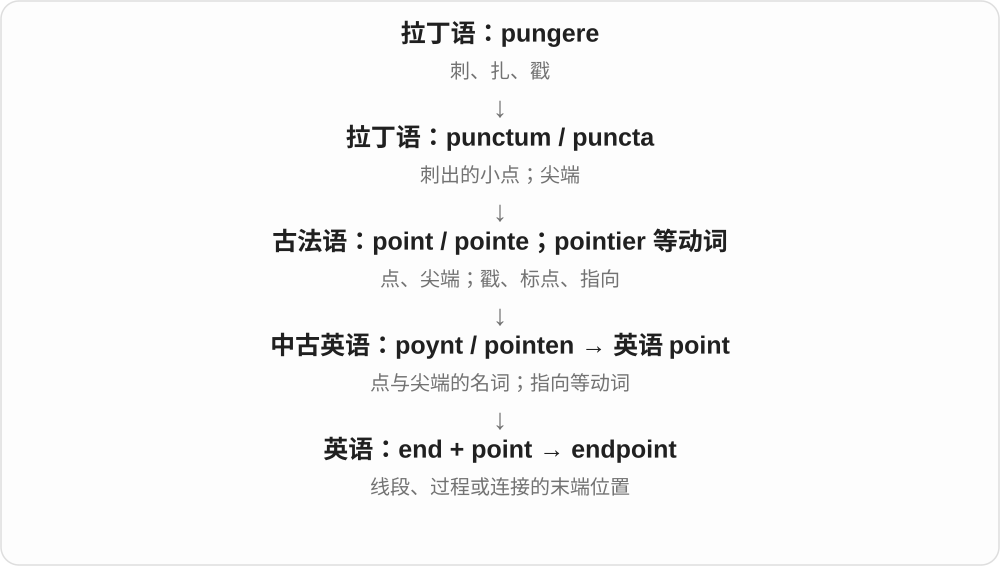

# 0186 · end — 端部；结束；目的

[逐词精讲目录](../00_逐词精讲目录.md) · [总目录](../00_总目录_按常用程度.md)

## 核心词根与来源

end 是古英语 ende 的后代。ending 看如何收尾，endless 看没有尽头，endgame 看最后阶段，bookend 回到实体两端并发展出首尾呼应的比喻。

**END：碰到边界，或走到过程最后**

绳子有端头，故事有结局，行动也有想达到的目的。

- **核心与收尾**：end · ending · endless
- **时间与阶段**：weekend · endgame · endpoint
- **翻转与两端**：upend · bookend
- **end → ended：结束；最终落到某种结果**：end · ended
- **end → ends：末端、结束与目的**：end · ends
- **bookend → bookends：支撑书列两端，也比喻前后呼应**：end · bookend · bookends
- **end 的文末注释组合**：end · endnote · endnotes
- **end + -ing → endings**：endings

## 词形与演化规律

at the end 与 in the end 分清位置时点和最终结果。-ing 不只表示现在进行；ending 可独立作结局名词。endless 的 -less 否定终点；upend 是翻动、打乱，不只是结束。

ended 的 -ed 读 /ɪd/；ended up 常说最后结果，ended in 常交代结局。

本族尽头词延续，目标义与事情所朝向的终点相连。

器物名转为安排在两端的动作，现代三单、名词复数同形。

end 给章节、文章末尾的位置，note 给补充说明。

ending 是 end 结束的动作、结果名词，后来是末尾部分；复数 -s，故事结局、词尾变化等都常见。

## 单词速览（按词族由简到繁）

同一基础词的相关扩展放在一起，先读基础形式，再读扩展；各组之间优先读常用的。具体词源关系见各词讲解。

| 单词 | 音标 | 核心意思 |
|---|---|---|
| [end](#w-1) | /end/ | 结束；末端；尽头；目的；使结束 |
| [ended](#w-11) | /ˈendɪd/ | 结束了；使结束了；最终落到某种结果；end 的过去式和过去分词 |
| [ends](#w-12) | /endz/ | 末端、结尾；目的〔复数〕；结束〔第三人称单数〕 |
| [ending](#w-3) | /ˈendɪŋ/ | 结尾；结局；词尾；结束过程 |
| [endings](#w-16) | 英、美 /ˈendɪŋz/ | 结局；末尾部分；词尾〔复数〕 |
| [endless](#w-4) | /ˈendləs/ | 无尽的；没完没了的 |
| [endgame](#w-5) | /ˈendɡeɪm/ | 残局；最后阶段；最终目标 |
| [endpoint](#w-6) | 英、美 /ˈendpɔɪnt/ | 终点；端点；网络端点 |
| [endnote](#w-15) | 英 /ˈendnəʊt/；美 /ˈendnoʊt/ | 尾注、章末注、文末注 |
| [endnotes](#w-14) | 英 /ˈendnəʊts/；美 /ˈendnoʊts/ | 尾注、章末注、文末注〔复数〕 |
| [weekend](#w-2) | 英 /ˌwiːkˈend/；美 /ˈwiːkend/ | 周末 |
| [upend](#w-9) | /ʌpˈend/ | 倒置；使彻底改变；打乱 |
| [bookend](#w-10) | /ˈbʊkend/ | 书挡；在两端呼应；首尾夹住 |
| [bookends](#w-13) | /ˈbʊkendz/ | 书立、挡书夹〔复数〕；放在前后两端、首尾呼应〔第三人称单数〕 |

## 逐词讲解

### 1. end — 结束；末端；尽头；目的；使结束

**音标**：/end/

**先抓住这个画面**

一根绳子有两端，一段时间走到尾端，一项行动也有想达到的目的。

**怎么拆**

接古英语 ende，经中古英语延续。现代名词与动词都常见，不需要把每种用法再拆成字母片段。

**怎么变成今天的意思**

**古英语 ende → 中古英语 ende**  
边端、尽头、结束

↓

**英语 end**  
末端；结束；目的等

the end of the road 是路尽头，end a meeting 是结束会议，to this end 是为此目的。ends and means 里 ends 说目的，means 说手段。

**常见搭配与例句**

at the end of；in the end；come to an end；to this end。

> The shop is at the end of the street.

商店在街道尽头。

> In the end, we decided to stay.

最后，我们决定留下。

> The two sides agreed to end the dispute.

双方同意结束争端。

**别混淆**

at the end 常指某个末端时点或位置；in the end 常说最终结果。I found it in the end 不是在某个物体底端找到。

### 2. ended — 结束了；使结束了；最终落到某种结果；end 的过去式和过去分词

**音标**：/ˈendɪd/

**先抓住这个画面**

走到事情的尾端，前面的过程收住了，是 ended。ended up 还会把目光带到最后：折腾一番，结果到了哪一步？

**怎么拆**

end + -ed；原词 /d/ 后读 /ɪd/，多一个音节。名词、动词延续古英语 ende 等本族词族，尾端与终止义相连。

**怎么变成今天的意思**

**古英语 ende 等 → end**  
末端、结束；使到尽头

↓

**end + -ed → ended**  
过去结束；最后处于某种结果

the meeting ended 会议结束了；ended the conversation 结束谈话；ended up doing 最后竟做了……；ended in a draw 以平局结束。

**常见搭配与例句**

ended well；ended up at the wrong station。

> The meeting ended earlier than we expected.

会议比我们预计的更早结束了。

> We took the wrong bus and ended up at the airport.

我们坐错公交，最后到了机场。

**别混淆**

ended up doing 常说最后的结果，有时带出乎意料的感觉；ended by doing 常说以某个动作收尾。具体意义要把 up、by、in 一起看。

### 3. ends — 末端、结尾；目的〔复数〕；结束〔第三人称单数〕

**音标**：/endz/

**先抓住这个画面**

一根绳子到头的地方、一件事做到最后的地方，是 ends；行动想要达到的结果，也可以称为 ends，也就是目的。

**怎么拆**

end + -s，/d/ 后读 /z/。end 继承古英语 ende，名动词有较老的历史；目标义与所朝向的终点相连，现代仍有多个固定表达。

**怎么变成今天的意思**

**古英语 ende → end**  
端点、尽头、终结

↓

**end + -s → ends；终点与目标扩展**  
多个末端、目的；单数主语结束

both ends 两端；ends at five 五点结束；to achieve certain ends 达到某些目的；make ends meet 收支相抵、维持生计。

**常见搭配与例句**

ends of the rope；the meeting ends soon。

> Hold both ends of the rope firmly.

牢牢抓住绳子的两端。

> The class ends at half past four.

这节课四点半结束。

**别混淆**

ends 的具体末端义容易看见；for their own ends 常说为了自己的目的。make ends meet 是收支能接得上的固定表达，作为整组记。

### 4. ending — 结尾；结局；词尾；结束过程

**音标**：/ˈendɪŋ/

**先抓住这个画面**

故事走到最后一幕，或一个词最末的那几段声音、字母。

**怎么拆**

end + -ing，接古英语 endung 等动作名词形式；现代有独立的结局、词尾用法。

**怎么变成今天的意思**

**古英语 ende → 中古英语 ende**  
边端、尽头、结束

↓

**古英语 endung → 英语 ending**  
结束这一动作；结尾部分

a happy ending 是好结局，a surprise ending 是意外结尾，a verb ending 是动词词尾。ending 不总是故事情节，也可说文本、词形结构。

**常见搭配与例句**

a happy ending；an alternative ending；a word ending。

> I liked the film, but the ending felt rushed.

我喜欢电影，不过结尾显得仓促。

> The lesson compares several common verb endings.

课程比较了几种常见动词词尾。

**别混淆**

end 是更宽的结束、端点，ending 常特别看最后怎样收束。finish a book 既可能写完也可能读完，the ending 是书里结尾本身。

### 5. endings — 结局；末尾部分；词尾〔复数〕

**音标**：英、美 /ˈendɪŋz/

**先抓住这个画面**

一段故事、一个词走到最后，落在尾部的那一段，就是 ending。不同故事的收尾、不同词形的尾部，都能数成 endings。

**怎么拆**

end 结束 + 完整 -ing → ending，形成动作、结果名词，再加 -s → endings。end 承古英语 ende 末端、边界词族，英语很早已有结束、末尾的名词形式。

**怎么变成今天的意思**

**英语 end 的结束动作 → ending**  
既能说走向结束，也能指最后部分

↓

**故事结局、词尾变化等结果义 → endings**  
现代复数数不同收尾、末端成分

happy endings 是圆满结局；alternative endings 是不同版本的结局；word endings 是词尾。

**常见搭配与例句**

happy endings；alternative endings；word endings。

> The class compared the endings of the two stories.

全班比较了这两个故事的结局。

> The exercise asks us to underline the word endings.

练习要求我们在词尾下面画线。

**别混淆**

endings 谈词形时，可以用 walked 的 -ed、cats 的 -s 来看末尾变化；谈故事时，则是在说情节怎样收住。先看讨论的对象。

### 6. endless — 无尽的；没完没了的

**音标**：/ˈendləs/

**先抓住这个画面**

找不到尽头，或等得太久，主观上像永远不会结束。

**怎么拆**

end + -less，接古英语 endelēas 等形式，-less 表没有终点。

**怎么变成今天的意思**

**古英语 ende → 中古英语 ende**  
边端、尽头、结束

↓

**古英语 endelēas → 英语 endless**  
没有尽头、终点的

an endless road 可是视觉上望不到头；endless questions 常是夸张说问题很多，并不在做数学无穷判断。

**常见搭配与例句**

endless possibilities；an endless wait；endless questions。

> The children asked endless questions.

孩子们问个没完。

> The new tool offers endless possibilities for creative work.

新工具为创作带来了无穷可能。

**别混淆**

endless 在日常常夸张；eternal 偏永恒的概念，continuous 偏持续不中断，不完全等同。

### 7. endgame — 残局；最后阶段；最终目标

**音标**：/ˈendɡeɪm/

**先抓住这个画面**

棋局剩下的棋子少了，每一步都朝最终结果收束；事情也可以进入这样一段。

**怎么拆**

end（末段）+ game（游戏、棋局），由棋类末段扩展到谈判、战略等最终阶段，也可问某行动的最终打算。

**怎么变成今天的意思**

**英语 end；game**  
并列组合的材料

↓

**end + game → endgame**  
棋局末段；复杂过程的最终阶段或目标

the endgame of negotiations 是谈判尾声，What’s the endgame? 是最终想达到什么。具体是阶段还是目标，要看句子。

**常见搭配与例句**

the final endgame；a chess endgame；the endgame of。

> The talks have entered their endgame.

会谈已进入最后阶段。

> The chess lesson focused on the endgame.

国际象棋课重点讲残局。

**别混淆**

endgame 不等于 game over：前者是仍在推进的最后阶段，后者常说已结束或失败。

### 8. endpoint — 终点；端点；网络端点

**音标**：英、美 /ˈendpɔɪnt/

**先抓住这个画面**

一条线或一次过程到这里结束；网络里也可指通信到达的那个接口位置。

**怎么拆**

end“末端” + point“点”，英语合成。

**怎么变成今天的意思**

几何里线段有端点；项目里是完成位置；API endpoint 常指供请求访问的具体地址或功能入口，不能一律译作时间上的结束。

**常见搭配与例句**

the endpoint of a line segment；an API endpoint；reach an endpoint。

> Mark both endpoints of the line segment.

把线段的两个端点都标出来。

> This endpoint returns a list of available rooms.

这个接口地址返回可用房间的列表。

**别混淆**

deadline 是截止时间；endpoint 更广，可以是空间、过程或网络中的位置。

### 9. endnote — 尾注、章末注、文末注

**音标**：英 /ˈendnəʊt/；美 /ˈendnoʊt/

**先抓住这个画面**

不把每条补充说明放在当页下面，而是统一收在章节、文章末尾，这样一条注叫 endnote。

**怎么拆**

end 末尾 + note 注释的英语组合；note 的标记材料经法语接拉丁 nota。

**怎么变成今天的意思**

**end + note**  
末尾位置与注释用途组合

↓

**endnote**  
收在章末、文末的说明

an endnote to the chapter 章节尾注；read the endnote 阅读尾注。

**常见搭配与例句**

add an endnote 加尾注；an endnote explaining the source 说明来源的尾注。

> An endnote explains where the quotation came from.

一条尾注说明了引文出处。

> She added an endnote about the translation.

她加了一条说明翻译情况的尾注。

**别混淆**

endnote 与 footnote 都能补说明、给出处，主要区别是集中放文末还是当页底部。

### 10. endnotes — 尾注、章末注、文末注〔复数〕

**音标**：英 /ˈendnəʊts/；美 /ˈendnoʊts/

**先抓住这个画面**

文章、章节后面集中列出的一组补充说明，是 endnotes。读正文时，可按标号到后面找到。

**怎么拆**

end + note → endnote，整词加 -s，/t/ 后读 /s/。

**怎么变成今天的意思**

**end + note → endnote**  
放在末尾的注释

↓

**endnote + -s → endnotes**  
多条章末、文末注释

chapter endnotes 章末注；endnotes and references 尾注与参考文献。

**常见搭配与例句**

consult the endnotes 查阅尾注；numbered endnotes 编号尾注。

> The endnotes appear after the final chapter.

尾注列在最后一章之后。

> I checked the endnotes for the original source.

我查阅尾注寻找原始来源。

**别混淆**

尾注可以含出处和解释，bibliography 常集中列文献资料；内容会重叠，组织用途不同。

### 11. weekend — 周末

**音标**：英 /ˌwiːkˈend/；美 /ˈwiːkend/

**先抓住这个画面**

一周常规工作、上课走到尾部，出现相应休息或另做安排的几天。

**怎么拆**

week（周）+ end（末端），从一周尾段的表达形成现代周末名称；普及与工作休息安排的历史有关。

**怎么变成今天的意思**

**英语 week；end**  
并列组合的材料

↓

**week + end → weekend**  
一周尾部、通常休息的时段

英式 at the weekend，美式 on the weekend 常见。具体休息日并非全世界一律相同，也有人周末照常工作。

**常见搭配与例句**

at the weekend；on the weekend；a weekend trip。

> What are you doing this weekend?

你这周末打算做什么？

> They booked a weekend trip to the coast.

他们订了一次周末海边短途旅行。

**别混淆**

weekend 是名词，也能作修饰语；weekly 是每周的，不是周末的。a weekly meeting 不保证在周六周日。

### 12. upend — 倒置；使彻底改变；打乱

**音标**：/ʌpˈend/

**先抓住这个画面**

把一个东西翻过去，原来的上下、秩序都换了位置。

**怎么拆**

up- + end，组合为翻到另一端、倒置的动词，再比喻打破原有安排。

**怎么变成今天的意思**

**英语 up-；end**  
并列组合的材料

↓

**up- + end → upend**  
翻到另一端；彻底打乱原结构

upend a box 可说把箱子倒过来；upend a routine 是打乱惯例。比喻可说创新也可说灾变，不保证全是坏事。

**常见搭配与例句**

upend a plan；upend an industry；upend a routine。

> The sudden move upended all our plans.

突然搬迁打乱了我们所有计划。

> She upended the bag to empty it.

她把包倒过来，倒空里面的东西。

**别混淆**

upend 强调整个布局被翻动，end 只是结束；一个新办法可能 upend 行业，而行业并没消失。

### 13. bookend — 书挡；在两端呼应；首尾夹住

**音标**：/ˈbʊkend/

**先抓住这个画面**

一排书两头各放一个支撑物，防止书倒开；故事也能用相似场景在首尾托住。

**怎么拆**

book（书）+ end（端部），先是书两端的支撑物，再转作动词表示夹在前后、形成呼应。

**怎么变成今天的意思**

**英语 book；end**  
并列组合的材料

↓

**book + end → bookend**  
书列两端的支撑物；首尾呼应

a pair of bookends 是一对书挡；two scenes bookend the film 是两场戏分立影片首尾。动词不表示把书的结尾剪掉。

**常见搭配与例句**

a pair of bookends；bookend a story；matching bookends。

> A pair of stone bookends held the books in place.

一对石书挡把书固定住。

> Similar scenes bookend the novel.

相似场景在小说首尾形成呼应。

**别混淆**

bookend 的 end 说两端位置，ending 是结尾内容。买 bookends 不是买一本书最后几页。

### 14. bookends — 书立、挡书夹〔复数〕；放在前后两端、首尾呼应〔第三人称单数〕

**音标**：/ˈbʊkendz/

**先抓住这个画面**

一列书两头各放支撑物，把书挡住，这对物件是 bookends。让一段故事前后都出现同样内容，也像两端放上相应支物。

**怎么拆**

book + end → bookend，器物名转为放在两端、形成首尾呼应的动词；现代加 -s，/d/ 后读 /z/。

**怎么变成今天的意思**

**book + end → bookend**  
书列两端的支物

↓

**器物名转动词；bookend + -s → bookends**  
多只书立；某内容放在前后两端

a pair of bookends 一对书立；bookends the film 在影片开头和结尾出现。

**常见搭配与例句**

metal bookends 金属书立；matching bookends 成对书立。

> Metal bookends supported the row of novels.

金属书立撑着那一排小说。

> The same song bookends the film.

同一首歌在电影开头和结尾呼应出现。

**别混淆**

动词 bookend 不要求真的有书；用在电影、文章时，突出前后两端的安排或呼应。

## 这一组要分清什么

in the end：最后结果；at the end of：在某物、某时段末端。endgame 是最后阶段，不等于已经 game over。

## 串起来练习

In the end, a different ending helped bookend the story more clearly.

最后，换一个结局让故事首尾呼应得更清楚了。
