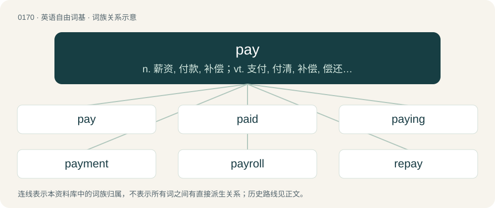

# 0186 · pay — n. 薪资, 付款, 补偿；vt. 支付, 付清, 补偿, 偿还, 对...有利, 为...涂防水物；vi. 付款, 付出代价, 偿还, 得到报应, 获得好处

[总目录](../00_总目录_按常用程度.md)

**类型**：英语自由词基　｜　**来源语言**：见词源记录

## 核心含义与来源

- 核心含义：n. 薪资, 付款, 补偿；vt. 支付, 付清, 补偿, 偿还, 对...有利, 为...涂防水物；vi. 付款, 付出代价, 偿还, 得到报应, 获得好处
- 英文含义：To give money or other compensation to in exchange for goods or services.
- 词形：pay

**多个词源／构词路径**：同一拼写可能有不同来源；以下按词性和含义分别列出。

**来源记录 1**（动词；To give money or other compensation to in exchange for goods or services.）

From Middle English payen, from Old French paiier (“pay”), from Medieval Latin pācāre (“to settle, satisfy”) from Latin pācāre (“to pacify”). In this sense, displaced native Old English ġield (“pay”) and ġieldan (“to pay”), whence Modern English yield.

**来源记录 2**（动词；To cover (the bottom of a vessel, a seam, a spar, etc.) with tar or pitch, or a waterproof composition of tallow, resin, etc.; to smear.）

From Old French peier, from Latin picāre (“to cover with pitch”).

## 词族图

## 单词速览（常用到不常用）

| 单词 | 音标 | 释义 |
|---|---|---|
| [pay](#w-1) | 英 /peɪ/ | n. 薪资, 付款, 补偿；vt. 支付, 付清, 补偿, 偿还, 对...有利, 为...涂防水物；vi. 付款, 付出代价, 偿还, 得到报应, 获得好处 |
| [paid](#w-2) | 英 /peɪd/ | a. 受雇的, 付清的；pay的过去式和过去分词 |
| [paying](#w-3) | /ˈpeɪ.ɪŋ/ | a. 支付的, 付款的, 有利的, 赢利的, 合算的；\[经\] 支付 |
| [payment](#w-4) | /ˈpeɪmənt/ | n. 付款, 支付的款项(或实物), 偿还, 报应, 惩罚；\[经\] 支付, 缴纳, 支付款额 |
| [payroll](#w-5) | 英 /ˈpeɪˌɹəʊl/；美 /ˈpeɪˌɹoʊl/ | n. 工资名单, 饷金名单, 发放的工资总额；\[计\] 工资表, 工资单 |
| [repay](#w-6) | /ɹiˈpeɪ/ | v. 偿还, 报答, 报复 |
| [payday](#w-7) | /ˈpeɪdeɪ/ | n. 发薪日, 发工资日, 交割日, 过户结帐日；\[法\] 发薪日 |
| [payable](#w-8) | /ˈpeɪəbl̩/ | a. 可付的, 到期的, 应付的, 有利益的；\[经\] 应付的 |
| [paycheck](#w-9) | 英 /ˈpeɪ.t͡ʃɛk/ | n. 付薪水的支票, 薪水 |
| [payload](#w-10) | 英 /ˈpeɪləʊd/；美 /ˈpeɪloʊd/ | n. 商务载重, 工资负担, 净载重量, 有效负荷, 弹头；\[化\] 负荷量 |
| [payer](#w-11) | 美 /ˈpeɪ.ɚ/ | n. 支付者, 付款人；\[经\] 付款人 |
| [paymaster](#w-12) | /ˈpeɪmɑːstə/ | n. 出纳员, 军需官；\[经\] 出纳员, 军需机 |
| [payphone](#w-13) | 美 /ˈpeɪˌfoʊn/ | n. 公用电话; 付费电话 |
| [overpay](#w-14) | 美 /oʊ.vɚ.peɪ/ | vt. 多付, 多给报酬；vi. 付得过多 |
| [paywall](#w-15) | 英 /ˈpeɪ.wɔːl/；美 /ˈpeɪ.wɔl/ | n. 网站的付费门槛 |
| [payee](#w-16) | /peiˈiː/ | n. 收款人, 领款人；\[经\] 受款人, 收款人 |
| [prepay](#w-17) | /.priːˈpei/ | vt. 先付, 预付, 预缴；\[经\] 预付, 先付 |
| [payless](#w-18) |  | 【英文】unpaid |
| [copay](#w-19) | 美 /ˈkoʊˌpeɪ/ | n. \[美国英语\]（指费用超过扣除款项由病人支付给保险公司的）共付医疗费\[亦称作 copayment\] |

## 逐词详解

### 1. pay

**词性**：动词　｜　**音标**：英 /peɪ/

**中文释义**：n. 薪资, 付款, 补偿；vt. 支付, 付清, 补偿, 偿还, 对...有利, 为...涂防水物；vi. 付款, 付出代价, 偿还, 得到报应, 获得好处

**英文义项**：To give money or other compensation to in exchange for goods or services. / To deposit into an account.

**词源与演化**：

From Middle English payen, from Old French paiier (“pay”), from Medieval Latin pācāre (“to settle, satisfy”) from Latin pācāre (“to pacify”). In this sense, displaced native Old English ġield (“pay”) and ġieldan (“to pay”), whence Modern English yield.

**例句**：

> He doesn't have money, but he pays rent in chores and housework.

该用例对应义项：To give money or other compensation to in exchange for goods or services.

### 2. paid

**词性**：形容词　｜　**音标**：英 /peɪd/

**中文释义**：a. 受雇的, 付清的；pay的过去式和过去分词

**英文义项**：Not free of charge; costing money. / Receiving pay.

**构词拆分**：pay + -ed

**词源与演化**：

From Middle English paid, payd, ipaid, ypayd, past participle of Middle English paien, payen (“to pay”), equivalent to pay + -ed.

**例句**：

> I thought his house would be nicer than this. I thought that motherf\*cker was paid.

该用例对应义项：Having money (i.e. rich, wealthy, etc.).

### 3. paying

**词性**：名词　｜　**音标**：/ˈpeɪ.ɪŋ/

**中文释义**：a. 支付的, 付款的, 有利的, 赢利的, 合算的；\[经\] 支付

**英文义项**：payment

**构词拆分**：From pay + -ing.

**词源与演化**：

From pay + -ing.

**例句**：

> As soon as there is any talk of paying, he cools down.

### 4. payment

**词性**：名词　｜　**音标**：/ˈpeɪmənt/

**中文释义**：n. 付款, 支付的款项(或实物), 偿还, 报应, 惩罚；\[经\] 支付, 缴纳, 支付款额

**英文义项**：The act of paying. / An instance of that act; a sum of money paid in exchange for goods or services, or the transaction that conveys it.

**构词拆分**：pay + -ment

**词源与演化**：

From Old French paiement. Equivalent to pay + -ment.

**例句**：

> Payment will be made at the end of the month.

该用例对应义项：The act of paying.

### 5. payroll

**词性**：名词　｜　**音标**：英 /ˈpeɪˌɹəʊl/；美 /ˈpeɪˌɹoʊl/

**中文释义**：n. 工资名单, 饷金名单, 发放的工资总额；\[计\] 工资表, 工资单

**英文义项**：A list of employees who receive salary or wages, together with the amounts due to each. / The total sum of money paid to employees.

**构词拆分**：pay + roll

**词源与演化**：

From pay + roll.

**例句**：

> The company had a large payroll.

该用例对应义项：the total amount of money paid in wages

### 6. repay

**词性**：动词　｜　**音标**：/ɹiˈpeɪ/

**中文释义**：v. 偿还, 报答, 报复

**英文义项**：Synonym of pay back in all senses. / To make worthwhile; to yield a result worth the effort; to pay off.

**构词拆分**：re- + pay

**词源与演化**：

From Old French repaier (“to pay back”), from re- + paiier (“to pay”), from Latin pācāre (“to settle, to make peaceful”), from pāx (“peace”) + -ō (forming verbs). Equivalent to re- + pay. Cognate with repacify and French repayer (“to pay again”).

**例句**：

> I'll repay this wrong asap.

该用例对应义项：Synonym of pay back in all senses.

### 7. payday

**词性**：名词　｜　**音标**：/ˈpeɪdeɪ/

**中文释义**：n. 发薪日, 发工资日, 交割日, 过户结帐日；\[法\] 发薪日

**英文义项**：The day of the week or month, or the specific day, on which an employee's wages or salary is paid.

**构词拆分**：pay + day

**词源与演化**：

From pay + day.

**例句**：

> I don't think that I should buy anything else until after payday.

### 8. payable

**词性**：形容词　｜　**音标**：/ˈpeɪəbl̩/

**中文释义**：a. 可付的, 到期的, 应付的, 有利益的；\[经\] 应付的

**英文义项**：Due to be paid. / Able to be paid.

**构词拆分**：pay + -able

**词源与演化**：

From pay + -able.

**例句**：

> Is value-added tax payable on planning application fees?

该用例对应义项：Due to be paid.

### 9. paycheck

**词性**：名词　｜　**音标**：英 /ˈpeɪ.t͡ʃɛk/

**中文释义**：n. 付薪水的支票, 薪水

**英文义项**：A periodic payment, usually in the form of a paper check, received by an employee from an employer for work performed.

**构词拆分**：From pay (“wages or salary”) + check (“a means of payment”).

**词源与演化**：

From pay (“wages or salary”) + check (“a means of payment”).

**例句**：

> He was delighted after getting his first paycheck, but subsequently blew it all on the horses.

该用例对应义项：A periodic payment, usually in the form of a paper check, received by an employee from an employer for work performed.

### 10. payload

**词性**：名词　｜　**音标**：英 /ˈpeɪləʊd/；美 /ˈpeɪloʊd/

**中文释义**：n. 商务载重, 工资负担, 净载重量, 有效负荷, 弹头；\[化\] 负荷量

**英文义项**：That part of a cargo that produces revenue. / The total weight of passengers, crew, equipment, and cargo carried by an aircraft or spacecraft.

**构词拆分**：pay + load

**词源与演化**：

From pay + load. From the early 20th century.

**例句**：

> Tucked inside the payload bay of Space Shuttle Discovery, the 24,000-pound telescope carried five science instruments.

### 11. payer

**词性**：名词　｜　**音标**：美 /ˈpeɪ.ɚ/

**中文释义**：n. 支付者, 付款人；\[经\] 付款人

**英文义项**：One who pays; specifically, the person by whom a bill or note has been, or should be, paid. / A swaption which gives its holder the option to enter into a swap in which they pay the fixed leg and receive the floating leg.

**构词拆分**：pay + -er

**词源与演化**：

From pay + -er (“subject of action”).

**例句**：

> Health insurance depends on both the payer and the provider.

该用例对应义项：One who pays; specifically, the person by whom a bill or note has been, or should be, paid.

### 12. paymaster

**词性**：名词　｜　**音标**：/ˈpeɪmɑːstə/

**中文释义**：n. 出纳员, 军需官；\[经\] 出纳员, 军需机

**英文义项**：An official in charge of payments to employees, troops, etc. / A person or body which demands loyalty or services in return for payment (especially as paid in advance).

**构词拆分**：pay + master

**词源与演化**：

From pay + master.

### 13. payphone

**词性**：名词　｜　**音标**：美 /ˈpeɪˌfoʊn/

**中文释义**：n. 公用电话; 付费电话

**英文义项**：A public telephone that requires prepayment to operate, generally via the insertion of coins or a credit card.

**构词拆分**：pay + phone

**词源与演化**：

From pay + phone.

**例句**：

> I only had ten cents in my pocket, so I couldn't use the payphone to call a cab.

该用例对应义项：A public telephone that requires prepayment to operate, generally via the insertion of coins or a credit card.

### 14. overpay

**词性**：动词　｜　**音标**：美 /oʊ.vɚ.peɪ/

**中文释义**：vt. 多付, 多给报酬；vi. 付得过多

**英文义项**：To pay too much. / To be more than an ample reward for.

**构词拆分**：over- + pay

**词源与演化**：

From over- + pay.

**例句**：

> Be careful not to overpay when buying second-hand items.

该用例对应义项：To pay too much.

### 15. paywall

**词性**：名词　｜　**音标**：英 /ˈpeɪ.wɔːl/；美 /ˈpeɪ.wɔl/

**中文释义**：n. 网站的付费门槛

**英文义项**：A system that restricts access to content with a purchase or a paid subscription.

**构词拆分**：pay + wall

**词源与演化**：

From pay + wall, by analogy with firewall.

**例句**：

> The premium content on this website is behind a paywall.

该用例对应义项：A system that restricts access to content with a purchase or a paid subscription.

### 16. payee

**词性**：名词　｜　**音标**：/peiˈiː/

**中文释义**：n. 收款人, 领款人；\[经\] 受款人, 收款人

**英文义项**：one to whom money is paid.

**构词拆分**：From pay + -ee.

**词源与演化**：

From pay + -ee.

**例句**：

> Tom wrote Mary's name as the cheque payee.

### 17. prepay

**词性**：动词　｜　**音标**：/.priːˈpei/

**中文释义**：vt. 先付, 预付, 预缴；\[经\] 预付, 先付

**英文义项**：To pay in advance, or beforehand

**构词拆分**：pre- + pay

**词源与演化**：

From pre- + pay.

**用法示例／搭配（非完整句）**：

> to prepay phone credit

该用例对应义项：To pay in advance, or beforehand

### 18. payless

**词性**：形容词

**英文义项**：unpaid

**构词拆分**：pay + -less

**词源与演化**：

From pay + -less.

### 19. copay

**词性**：动词　｜　**音标**：美 /ˈkoʊˌpeɪ/

**中文释义**：n. \[美国英语\]（指费用超过扣除款项由病人支付给保险公司的）共付医疗费\[亦称作 copayment\]

**英文义项**：To jointly pay with another or others.

**构词拆分**：From co- + pay.

**词源与演化**：

From co- + pay.
