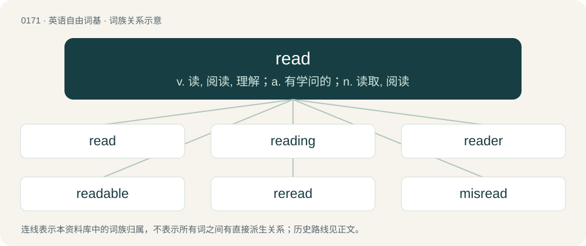

# 0187 · read — v. 读, 阅读, 理解；a. 有学问的；n. 读取, 阅读

[总目录](../00_总目录_按常用程度.md)

**类型**：英语自由词基　｜　**来源语言**：见词源记录

## 核心含义与来源

- 核心含义：v. 读, 阅读, 理解；a. 有学问的；n. 读取, 阅读
- 英文含义：To look at and interpret letters or other information that is written.
- 词形：read

**来源记录 1**（动词；To look at and interpret letters or other information that is written.）

From Middle English reden, from Old English rǣdan (“to counsel, advise, consult; interpret, read”), from Proto-West Germanic \*rādan, from Proto-Germanic \*rēdaną (“advise, counsel”), from Proto-Indo-European \*Hreh₁dʰ- (“to arrange”). Cognate with Scots rede, red (“to advise, counsel, decipher, read”), Saterland Frisian räide (“to advise, counsel”), West Frisian riede (“to advise, counsel”), Dutch raden (“to advise; guess”), German raten (“to advise; guess”), Danish råde (“to advise”), Swedish råda (“to advise, counsel”), Persian رده (rade, “to order, to arrange, class”). In West Germanic the verb had a sense “interpret”, which developed further into “interpret letters” in English and “interpret by intuition, guess” on the continent. Compare rede.

## 词族图

## 单词速览（常用到不常用）

| 单词 | 音标 | 释义 |
|---|---|---|
| [read](#w-1) | 英 /ɹiːd/；美 /ɹid/ | v. 读, 阅读, 理解；a. 有学问的；n. 读取, 阅读 |
| [reading](#w-2) | /ˈɹiːdɪŋ/ | n. 阅读, 知识, 读物；a. 阅读的 |
| [reader](#w-3) | 英 /ˈɹiː.də/；美 /ˈɹi.dɚ/ | n. 读者, 读物, 文选, 校对人, 讲师；\[计\] 阅读程序; 阅读器 |
| [readable](#w-4) | /ˈɹiː.də.bəl/ | a. 值得一读的, 易读的, 读起来津津有味的；\[电\] 可读的 |
| [reread](#w-5) | 英 /ɹiːˈɹiːd/ | vt. 重读, 再读 |
| [misread](#w-6) | present /mɪsˈɹiːd/ | vt. 读错, 看错 |
| [readability](#w-7) | 英 /ˌɹiːdəˈbɪlɪti/；美 /ˌɹidəˈbɪləti/ | n. 易读, 可读性；\[计\] 可读性 |
| [unread](#w-8) | /ˈʌn.ɹɛd/ | a. 没有人读过的, 读书不多的, 无学问的 |
| [proofread](#w-9) | /ˈpɹuːfɹiːd/ | vt. 校正, 校对 |
| [readme](#w-10) | 美 /ˈɹidmi/ | n. 自述文件；\[计\] 自述文件 |

## 逐词详解

### 1. read

**词性**：动词　｜　**音标**：英 /ɹiːd/；美 /ɹid/

**中文释义**：v. 读, 阅读, 理解；a. 有学问的；n. 读取, 阅读

**英文义项**：To look at and interpret letters or other information that is written. / To be understood or physically read in a specific way.

**词源与演化**：

From Middle English reden, from Old English rǣdan (“to counsel, advise, consult; interpret, read”), from Proto-West Germanic \*rādan, from Proto-Germanic \*rēdaną (“advise, counsel”), from Proto-Indo-European \*Hreh₁dʰ- (“to arrange”). Cognate with Scots rede, red (“to advise, counsel, decipher, read”), Saterland Frisian räide (“to advise, counsel”), West Frisian riede (“to advise, counsel”), Dutch raden (“to advise; guess”), German raten (“to advise; guess”), Danish råde (“to advise”), Swedish råda (“to advise, counsel”), Persian رده (rade, “to order, to arrange, class”). In West Germanic the verb had a sense “interpret”, which developed further into “interpret letters” in English and “interpret by intuition, guess” on the continent. Compare rede.

**例句**：

> Our school focuses primarily on the liberal arts (read "useless degrees").

该用例对应义项：Used to introduce a blunter, actually intended meaning.

### 2. reading

**词性**：名词　｜　**音标**：/ˈɹiːdɪŋ/

**中文释义**：n. 阅读, 知识, 读物；a. 阅读的

**英文义项**：The process of interpreting written language. / The process of interpreting a symbol, a sign or a measuring device.

**构词拆分**：read + -ing

**词源与演化**：

From Middle English reding, redynge, redunge, from Old English rǣding (“reading”), equivalent to read + -ing.

**例句**：

> He glanced across and took note of the speedometer reading.

该用例对应义项：A value indicated by a measuring device.

### 3. reader

**词性**：名词　｜　**音标**：英 /ˈɹiː.də/；美 /ˈɹi.dɚ/

**中文释义**：n. 读者, 读物, 文选, 校对人, 讲师；\[计\] 阅读程序; 阅读器

**英文义项**：A person who reads. / A person who reads a publication.

**构词拆分**：read + -er

**词源与演化**：

From Middle English reder, redar, redere, redare, from Old English rēdere, rǣdere (“a reader; scholar; diviner”), from Proto-West Germanic \*rādāri, equivalent to read + -er. Cognate with Saterland Frisian Räider (“advisor”), Dutch rader (“advisor”), German Rater (“advisor”).

**用法示例／搭配（非完整句）**：

> an early reader, a talented reader

该用例对应义项：A person who reads.

### 4. readable

**词性**：形容词　｜　**音标**：/ˈɹiː.də.bəl/

**中文释义**：a. 值得一读的, 易读的, 读起来津津有味的；\[电\] 可读的

**英文义项**：Legible, possible to read or at least decipher. / Which can be read—i.e. accessed or played—by a certain technical type of device.

**构词拆分**：read + -able

**词源与演化**：

From read + -able.

**例句**：

> These assembly instructions aren't readable, I still don't have a clue how to start!

该用例对应义项：Enjoyable to read, of an acceptable stylistic quality or at least functionally composed.

### 5. reread

**词性**：动词　｜　**音标**：英 /ɹiːˈɹiːd/

**中文释义**：vt. 重读, 再读

**英文义项**：To read again. / To read or interpret in a new way.

**构词拆分**：re- + read

**词源与演化**：

From re- + read.

**例句**：

> It's a good idea to always reread email before sending it.

### 6. misread

**词性**：动词　｜　**音标**：present /mɪsˈɹiːd/

**中文释义**：vt. 读错, 看错

**英文义项**：To read wrongly; misconstrue; misinterpret; mistake the sense or significance of.

**构词拆分**：mis- + read

**词源与演化**：

From Middle English misreden, from Old English misrǣdan (“to advise wrongly; read wrongly”), equivalent to mis- + read. Cognate with Saterland Frisian misräide (“to go wrong, fail”), Dutch misraden (“to guess wrongly”), German missraten (“to fail; go wrong; become wayward”). For the noun, compare Old English misrǣd (“misguidance; misconduct”).

**例句**：

> He misread the data.

该用例对应义项：read or interpret wrongly

### 7. readability

**词性**：名词　｜　**音标**：英 /ˌɹiːdəˈbɪlɪti/；美 /ˌɹidəˈbɪləti/

**中文释义**：n. 易读, 可读性；\[计\] 可读性

**英文义项**：The property of being capable of being read; legibility. / The property of being easy or engaging to read.

**构词拆分**：readable + -ity；read + -ability

**词源与演化**：

From readable + -ity or read + -ability.

**例句**：

> The book had a clever plot, but lacked readability.

该用例对应义项：The property of being easy or engaging to read.

### 8. unread

**词性**：形容词　｜　**音标**：/ˈʌn.ɹɛd/

**中文释义**：a. 没有人读过的, 读书不多的, 无学问的

**英文义项**：Not having been read. / Not having read; uneducated.

**构词拆分**：un- + read

**词源与演化**：

From un- + read.

**例句**：

> The book I got for my 18th birthday remained unread until my retirement.

该用例对应义项：Not having been read.

### 9. proofread

**词性**：动词　｜　**音标**：/ˈpɹuːfɹiːd/

**中文释义**：vt. 校正, 校对

**英文义项**：To check a written text for errors in spelling, grammar, syntax, and punctuation.

**构词拆分**：proof + read

**词源与演化**：

From proof + read.

**例句**：

> I should proofread my manuscripts.

该用例对应义项：read for errors

### 10. readme

**词性**：名词　｜　**音标**：美 /ˈɹidmi/

**中文释义**：n. 自述文件；\[计\] 自述文件

**英文义项**：A text file meant to be read before taking any significant action with the items it accompanies.

**构词拆分**：read + me

**词源与演化**：

From read + me.
