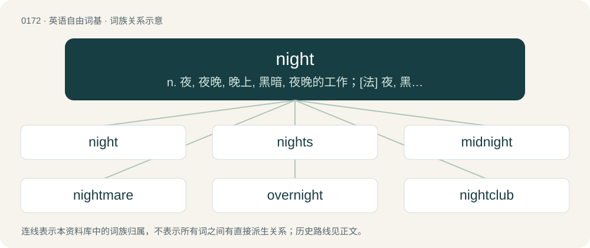

# 0188 · night — n. 夜, 夜晚, 晚上, 黑暗, 夜晚的工作；\[法\] 夜, 黑夜, 黑暗

[总目录](../00_总目录_按常用程度.md)

**类型**：英语自由词基　｜　**来源语言**：见词源记录

## 核心含义与来源

- 核心含义：n. 夜, 夜晚, 晚上, 黑暗, 夜晚的工作；\[法\] 夜, 黑夜, 黑暗
- 英文含义：The time when the Sun is below the horizon when the sky is dark.
- 词形：night

**来源记录 1**（名词；The time when the Sun is below the horizon when the sky is dark.）

From Middle English nighte, night, nyght, niȝt, naht, from Old English niht, from Proto-West Germanic \*naht (“night”), from Proto-Germanic \*nahts (“night”), from Proto-Indo-European \*nókʷts (“night”). Cognates Cognate with Scots nicht (“night”), Yola neeght, nieght, nyeght (“night”), North Frisian naacht, Nacht, noach, nåcht (“night”), Saterland Frisian Noacht (“night”), West Frisian nacht (“night”), Cimbrian and Dutch nacht (“night”), German and Low German Nacht (“night”), Luxembourgish Nuecht (“night”), Mòcheno nòcht (“night”), Vilamovian naocht (“night”), Yiddish נאַכט (nakht, “night”), Danish nat (“night”), Faroese nátt (“night”), Icelandic nátt, nótt (“night”), Norwegian Bokmål, Norwegian Nynorsk, and Swedish natt (“night”), Scanian nøtt (“night”), Gothic 𐌽𐌰𐌷𐍄𐍃 (nahts, “night”); also Breton noz (“night”), Cornish and Welsh nos (“night”), Irish anocht (“tonight”), Manx noght (“tonight”), Scottish Gaelic a-nochd, an nochd (“tonight”), Latin nox (“night”) (whence English nox, a doublet), Greek νύχτα (nýchta, “night”), Albanian natë (“night”), Latgalian and Latvian nakts (“night”), Lithuanian naktis (“night”), Belarusian ноч (noč, “night”), Bulgarian нощ (nošt, “night”), Czech, Polish, and Slovak noc (“night”), Macedonian ноќ (noḱ, “night”), Russian ночь (nočʹ, “night”), Serbo-Croatian ноћ, noć (“night”), Slovene noč (“night”), Ukrainian ніч (nič, “night”), Tocharian A nakcu (“last night; at night”), Tocharian B nekcīye (“last night; at night”), Hittite 𒉈𒆪𒊻 (nekuz, “evening, nightfall; dawn, twilight”), Sanskrit नक्त् (nákt).

## 词族图

## 单词速览（常用到不常用）

| 单词 | 音标 | 释义 |
|---|---|---|
| [night](#w-1) | 英 /ˈnaɪ̯t/ | n. 夜, 夜晚, 晚上, 黑暗, 夜晚的工作；\[法\] 夜, 黑夜, 黑暗 |
| [nights](#w-2) | /naɪts/ | n. 每夜, 在任何夜晚 |
| [midnight](#w-3) | /ˈmɪd(ˌ)naɪt/ | n. 午夜, 子夜, 半夜；a. 午夜的, 半夜的 |
| [nightmare](#w-4) | 英 /ˈnaɪt.mɛə/；美 /ˈnaɪt.mɛɚ/ | n. 梦魇, 恶梦, 可怕的事物(或情景、人物)；\[医\] 梦魇, 恶梦 |
| [overnight](#w-5) | /əʊvə(ɹ)ˈnaɪt/ | n. 前一天晚上, 一夜的逗留；a. 通宵的, 晚上的, 前夜的；adv. 在前一夜, 整夜, 昨晚一晚上 |
| [nightclub](#w-6) | /ˈnʌɪtklʌb/ | n. 夜总会 |
| [goodnight](#w-7) |  | int. 晚安；再见 |
| [nightly](#w-8) | /ˈnaɪtli/ | a. 每夜的, 夜间的；adv. 每夜 |
| [fortnight](#w-9) | 英 /ˈfɔːt.naɪt/；美 /ˈfɔɹt.naɪt/ | n. 两星期 |
| [nighttime](#w-10) | /ˈnaɪtˌtaɪm/ | n. 夜间 |
| [nightlife](#w-11) | /ˈnaɪtˌlaɪf/ | n. 夜生活 |
| [nightfall](#w-12) | /ˈnaɪt.fɔl/ | n. 傍晚, 黄昏, 日暮 |
| [nightstand](#w-13) | /ˈnaitstænd/ | n. &lt;美&gt;床头几 |
| [nighter](#w-14) | /naɪt/ | n. 夜, 夜间, 夜晚；日暮, 晚上, 黄昏；a. 夜间的, 夜晚的；夜间发生(或出现、看见)的 |
| [weeknight](#w-15) | /ˈwiːknait/ | n. 周日夜晚(指周末休息日以外的每个夜晚) |
| [nightcrawler](#w-16) |  | na. 〈美〉夜间爬出来的大蚯蚓；\[网络\] 夜行者；蓝魔人；蓝恶魔 |
| [nightgown](#w-17) | /ˈnaɪtˌɡaʊn/ | n. 女式睡衣, 孩子穿的睡衣, 妇女穿的睡衣 |
| [nightshade](#w-18) | /ˈnaɪt.ʃeɪd/ | n. 茄属植物；\[医\] 茄属植物 |
| [nighthawk](#w-19) | 英 /ˈnʌɪthɔːk/；美 /ˈnaɪthɑk/ | n. 夜鹰, 夜生活者 |
| [nightcap](#w-20) | 美 /ˈnaɪtˌkæp/ | n. 临睡前喝的酒, 睡帽 |
| [nightline](#w-21) |  | 【英文】An overnight telephone counselling service, typically for students. |
| [nightlight](#w-22) | 美 /ˈnaɪtˌlaɪt/ | 【英文】A small, dim light or lamp left on overnight. |
| [nightwear](#w-23) | 英 /ˈnaɪt.wɛə/；美 /ˈnaɪt.wɛ(ə)ɹ/ | n. 睡衣 |
| [nightie](#w-24) | /ˈnaɪti/ | n. 女式睡衣, 孩子穿的睡衣, 妇女穿的睡衣 |
| [nightjar](#w-25) | 英 /ˈnaɪtd͡ʒɑː/；美 /ˈnaɪtd͡ʒɑɹ/ | n. \[鸟\]欧夜鹰, 蚊母鹰 |

## 逐词详解

### 1. night

**词性**：名词　｜　**音标**：英 /ˈnaɪ̯t/

**中文释义**：n. 夜, 夜晚, 晚上, 黑暗, 夜晚的工作；\[法\] 夜, 黑夜, 黑暗

**英文义项**：The time when the Sun is below the horizon when the sky is dark. / The period of darkness beginning at the end of evening astronomical twilight when the sun is 18 degrees below the horizon, and ending at the beginning of morning astronomical twilight.

**词源与演化**：

From Middle English nighte, night, nyght, niȝt, naht, from Old English niht, from Proto-West Germanic \*naht (“night”), from Proto-Germanic \*nahts (“night”), from Proto-Indo-European \*nókʷts (“night”). Cognates Cognate with Scots nicht (“night”), Yola neeght, nieght, nyeght (“night”), North Frisian naacht, Nacht, noach, nåcht (“night”), Saterland Frisian Noacht (“night”), West Frisian nacht (“night”), Cimbrian and Dutch nacht (“night”), German and Low German Nacht (“night”), Luxembourgish Nuecht (“night”), Mòcheno nòcht (“night”), Vilamovian naocht (“night”), Yiddish נאַכט (nakht, “night”), Danish nat (“night”), Faroese nátt (“night”), Icelandic nátt, nótt (“night”), Norwegian Bokmål, Norwegian Nynorsk, and Swedish natt (“night”), Scanian nøtt (“night”), Gothic 𐌽𐌰𐌷𐍄𐍃 (nahts, “night”); also Breton noz (“night”), Cornish and Welsh nos (“night”), Irish anocht (“tonight”), Manx noght (“tonight”), Scottish Gaelic a-nochd, an nochd (“tonight”), Latin nox (“night”) (whence English nox, a doublet), Greek νύχτα (nýchta, “night”), Albanian natë (“night”), Latgalian and Latvian nakts (“night”), Lithuanian naktis (“night”), Belarusian ноч (noč, “night”), Bulgarian нощ (nošt, “night”), Czech, Polish, and Slovak noc (“night”), Macedonian ноќ (noḱ, “night”), Russian ночь (nočʹ, “night”), Serbo-Croatian ноћ, noć (“night”), Slovene noč (“night”), Ukrainian ніч (nič, “night”), Tocharian A nakcu (“last night; at night”), Tocharian B nekcīye (“last night; at night”), Hittite 𒉈𒆪𒊻 (nekuz, “evening, nightfall; dawn, twilight”), Sanskrit नक्त् (nákt).

**例句**：

> Most animals are awake at day and sleep at night.

该用例对应义项：The time when the Sun is below the horizon when the sky is dark.

### 2. nights

**词性**：副词　｜　**音标**：/naɪts/

**中文释义**：n. 每夜, 在任何夜晚

**英文义项**：At night (during night-time, especially on a regular basis).

**构词拆分**：night + -s (adverbial genitive suffix)

**词源与演化**：

Inherited from Middle English nightes, from Old English nihtes (“at night, by night”), equivalent to night + -s (adverbial genitive suffix). Cognate with Old Frisian nachtes, Old Saxon nahtes, German nachts (all “nights, at night”).

**例句**：

> I work nights, my brother only afternoons, and my son days.

该用例对应义项：At night (during night-time, especially on a regular basis).

### 3. midnight

**词性**：名词　｜　**音标**：/ˈmɪd(ˌ)naɪt/

**中文释义**：n. 午夜, 子夜, 半夜；a. 午夜的, 半夜的

**英文义项**：The middle of the night: the sixth temporal hour, equidistant between sunset and sunrise. / Twelve o'clock at night exactly.

**构词拆分**：mid- + night

**词源与演化**：

From Middle English midnight, from Old English midniht, from Proto-Germanic \*midjanahts (“midnight”), equivalent to mid- + night. Cognate with Saterland Frisian Midnoacht (“midnight”), Old High German mittinaht (“midnight”), Danish midnat (“midnight”), Swedish midnatt (“midnight”), Icelandic miðnætti (“midnight”). Compare also Saterland Frisian Middernoacht (“midnight”), Dutch middernacht (“midnight”), German Mitternacht (“midnight”).

**例句**：

> Thanks to its sonar, the narwhal can remain active even at midnight, unhindered by the darkness.

该用例对应义项：The middle of the night: the sixth temporal hour, equidistant between sunset and sunrise.

### 4. nightmare

**词性**：名词　｜　**音标**：英 /ˈnaɪt.mɛə/；美 /ˈnaɪt.mɛɚ/

**中文释义**：n. 梦魇, 恶梦, 可怕的事物(或情景、人物)；\[医\] 梦魇, 恶梦

**英文义项**：A very unpleasant or frightening dream. / Any bad, miserable, difficult or terrifying situation or experience that arouses anxiety, terror, agony or great displeasure.

**构词拆分**：night + mare (“evil spirit believed to afflict a sleeping person”)

**词源与演化**：

From Middle English nyghtmare, from Old English \*nihtmare, equivalent to night + mare (“evil spirit believed to afflict a sleeping person”). Cognate with Scots nichtmare and nichtmeer, Dutch nachtmerrie, Middle Low German nachtmār, German Nachtmahr.

**例句**：

> Cleaning up after identity theft can be a nightmare of phone calls and letters.

该用例对应义项：Any bad, miserable, difficult or terrifying situation or experience that arouses anxiety, terror, agony or great displeasure.

### 5. overnight

**词性**：形容词　｜　**音标**：/əʊvə(ɹ)ˈnaɪt/

**中文释义**：n. 前一天晚上, 一夜的逗留；a. 通宵的, 晚上的, 前夜的；adv. 在前一夜, 整夜, 昨晚一晚上

**英文义项**：Occurring between dusk and dawn. / Complete before the next morning.

**构词拆分**：over + night

**词源与演化**：

Inherited from Middle English overnyght, from Old English ofer niht (“through the night, overnight”), equivalent to over + night. Verbal use (late 19th c.) may have been influenced by German übernachten (16th c.), though it could also have developed independently. Compare also Dutch overnachten (“to overnight”), Middle Low German ȫvernachten (“to overnight”), West Frisian oernachtsje (“to overnight”), Saterland Frisian uurnoachtje (“to overnight”).

**例句**：

> They sent their kids to overnight camp.

该用例对应义项：For which participants stay overnight.

### 6. nightclub

**词性**：动词　｜　**音标**：/ˈnʌɪtklʌb/

**中文释义**：n. 夜总会

**英文义项**：To visit a nightclub (or nightclubs) for entertainment.

**构词拆分**：night + club

**词源与演化**：

From night + club.

**例句**：

> Tom was able to hear the music from nightclub down the street.

### 7. goodnight

**词性**：名词

**中文释义**：int. 晚安；再见

**英文义项**：An instance of saying “good night”; a nighttime farewell.

**构词拆分**：good + night

**词源与演化**：

From good + night.

**例句**：

> My son went upstairs to his bedroom after kissing me goodnight.

### 8. nightly

**词性**：形容词　｜　**音标**：/ˈnaɪtli/

**中文释义**：a. 每夜的, 夜间的；adv. 每夜

**英文义项**：Happening or appearing in the night; night-time; nocturnal. / Performing, occurring, or taking place every night.

**构词拆分**：night + -ly

**词源与演化**：

From Middle English nyȝtly, nihtlich, nihtlic, from Old English nihtlīċ, nihtelīċ (“nocturnal, nightly, of the night, at night”), equivalent to night + -ly. Cognate with Scots nichtlie (“nightly”), West Frisian nachtlik (“nightly, nocturnal”), Dutch nachtelijk (“nightly, nocturnal”), German nächtlich (“nocturnal, nightly”), Danish natlig (“nightly”), Swedish nattlig (“nightly, nocturnal”).

**例句**：

> The dog demanded to go out for his nightly walk.

该用例对应义项：Performing, occurring, or taking place every night.

### 9. fortnight

**词性**：名词　｜　**音标**：英 /ˈfɔːt.naɪt/；美 /ˈfɔɹt.naɪt/

**中文释义**：n. 两星期

**英文义项**：A period of 2 weeks.

**构词拆分**：fourteen + night

**词源与演化**：

From Middle English fourtenyght, fourtene nyght, from Old English fēowertīene niht (literally “fourteen nights"; the Anglo-Saxons counted by nights), equivalent to fourteen + night. Compare sennight.

**例句**：

> Most major tennis tournaments last a fortnight.

该用例对应义项：a period of fourteen consecutive days

### 10. nighttime

**词性**：名词　｜　**音标**：/ˈnaɪtˌtaɪm/

**中文释义**：n. 夜间

**英文义项**：The hours of darkness between sunset and sunrise; the night.

**构词拆分**：night + time

**词源与演化**：

From Middle English nyght tyme, nyȝttyme, equivalent to night + time. Compare Dutch nachttijd, German Nachtzeit, Danish nattetid, Swedish nattetid. Compare also Middle English nyȝter tyme (“nighttime”), from Old Norse náttartími, nætrtími (“nighttime”).

**例句**：

> My nighttime routine includes showering, brushing my teeth, and washing my face.

### 11. nightlife

**词性**：名词　｜　**音标**：/ˈnaɪtˌlaɪf/

**中文释义**：n. 夜生活

**英文义项**：Nocturnal activities, especially visiting nightclubs.

**构词拆分**：night + life

**词源与演化**：

From night + life.

**例句**：

> Rio de Janeiro boasts the best nightlife in South America.

该用例对应义项：Nocturnal activities, especially visiting nightclubs.

### 12. nightfall

**词性**：名词　｜　**音标**：/ˈnaɪt.fɔl/

**中文释义**：n. 傍晚, 黄昏, 日暮

**英文义项**：The close of the day; the coming of night. / Nocturnal emission.

**构词拆分**：night + fall

**词源与演化**：

From night + fall. Cf. dewfall.

**用法示例／搭配（非完整句）**：

> at nightfall

该用例对应义项：The close of the day; the coming of night.

### 13. nightstand

**词性**：名词　｜　**音标**：/ˈnaitstænd/

**中文释义**：n. &lt;美&gt;床头几

**英文义项**：A small table or cabinet, often with one or more drawers or shelves, placed beside the head of a bed.

**构词拆分**：night (“the conventional time for a person to be in bed”) + stand (“an object which supports things”)

**词源与演化**：

From night (“the conventional time for a person to be in bed”) + stand (“an object which supports things”).

**例句**：

> He always kept a full glass of water on the nightstand.

该用例对应义项：A small table or cabinet, often with one or more drawers or shelves, placed beside the head of a bed.

### 14. nighter

**词性**：名词　｜　**音标**：/naɪt/

**中文释义**：n. 夜, 夜间, 夜晚；日暮, 晚上, 黄昏；a. 夜间的, 夜晚的；夜间发生(或出现、看见)的

**英文义项**：Someone or something who does something for a certain number of nights

**构词拆分**：night + -er

**词源与演化**：

From night + -er.

### 15. weeknight

**词性**：名词　｜　**音标**：/ˈwiːknait/

**中文释义**：n. 周日夜晚(指周末休息日以外的每个夜晚)

**英文义项**：The evening of a weekday.

**构词拆分**：week + night

**词源与演化**：

From week + night.

**例句**：

> You should go to bed earlier on a weeknight than over the weekend.

### 16. nightcrawler

**词性**：名词

**中文释义**：na. 〈美〉夜间爬出来的大蚯蚓；\[网络\] 夜行者；蓝魔人；蓝恶魔

**英文义项**：An earthworm of the species Lumbricus terrestris, known for its large size and nocturnal surfacings. / More generally, any arbitrarily large earthworm, especially those favored in angling.

**构词拆分**：night + crawler

**词源与演化**：

From night + crawler.

### 17. nightgown

**词性**：名词　｜　**音标**：/ˈnaɪtˌɡaʊn/

**中文释义**：n. 女式睡衣, 孩子穿的睡衣, 妇女穿的睡衣

**英文义项**：A long loose robe worn mainly by women for sleeping in. / A dressing gown.

**构词拆分**：By surface analysis, night + gown

**词源与演化**：

From Middle English nyght gowne. By surface analysis, night + gown.

**例句**：

> Mary was still wearing a nightgown when Tom got to her house at noon.

### 18. nightshade

**词性**：名词　｜　**音标**：/ˈnaɪt.ʃeɪd/

**中文释义**：n. 茄属植物；\[医\] 茄属植物

**英文义项**：Any of the poisonous plants belonging to the genus Solanum, especially black nightshade or woody nightshade. / Any plant of the wider Solanaceae family, including the nightshades as well as tomato, potato, eggplant, and deadly nightshade.

**构词拆分**：night + shade

**词源与演化**：

From Middle English nyȝtschade, niȝteschode, nyght shade, from Old English nihtsċada, from Proto-West Germanic \*nahtskadō (“nightshade”), corresponding to night + shade. Compare Dutch nachtschade (“nightshade”), German Nachtschatten (“nightshade”).

**例句**：

> Where can I buy a deadly nightshade plant?

### 19. nighthawk

**词性**：名词　｜　**音标**：英 /ˈnʌɪthɔːk/；美 /ˈnaɪthɑk/

**中文释义**：n. 夜鹰, 夜生活者

**英文义项**：A nightjar, especially Caprimulgus europaeus (Eurasian nightjar). / A New World nightjar of the genus Chordeiles, especially Chordeiles minor.

**构词拆分**：night + hawk

**词源与演化**：

From night + hawk.

### 20. nightcap

**词性**：名词　｜　**音标**：美 /ˈnaɪtˌkæp/

**中文释义**：n. 临睡前喝的酒, 睡帽

**英文义项**：A warm cloth cap worn while sleeping, often with pajamas, being common attire in northern Europe before effective home heating became widespread. / A beverage drunk before bed that is usually alcoholic.

**构词拆分**：night + cap

**词源与演化**：

From night + cap.

**例句**：

> I'll make myself a nightcap of whisky and lemon before heading to bed.

该用例对应义项：A beverage drunk before bed that is usually alcoholic.

### 21. nightline

**词性**：名词

**英文义项**：An overnight telephone counselling service, typically for students. / A fishing line set out to catch fish overnight.

**构词拆分**：night + line

**词源与演化**：

From night + line.

### 22. nightlight

**词性**：名词　｜　**音标**：美 /ˈnaɪtˌlaɪt/

**英文义项**：A small, dim light or lamp left on overnight. / Light that shines at night, such as moonlight or starlight.

**构词拆分**：night + light

**词源与演化**：

From night + light.

**例句**：

> He put a small nightlight in the bathroom to find his way around in the dark.

该用例对应义项：A small, dim light or lamp left on overnight.

### 23. nightwear

**词性**：名词　｜　**音标**：英 /ˈnaɪt.wɛə/；美 /ˈnaɪt.wɛ(ə)ɹ/

**中文释义**：n. 睡衣

**英文义项**：Clothes worn at nighttime or in bed, such as pyjamas

**构词拆分**：night + -wear

**词源与演化**：

From night + -wear.

### 24. nightie

**词性**：名词　｜　**音标**：/ˈnaɪti/

**中文释义**：n. 女式睡衣, 孩子穿的睡衣, 妇女穿的睡衣

**英文义项**：A woman's nightgown or nightdress for wearing to bed.

**构词拆分**：From night + -ie (diminutive suffix).

**词源与演化**：

From night + -ie (diminutive suffix).

**例句**：

> I was too embarrassed to answer the door in my nightie.

该用例对应义项：A woman's nightgown or nightdress for wearing to bed.

### 25. nightjar

**词性**：名词　｜　**音标**：英 /ˈnaɪtd͡ʒɑː/；美 /ˈnaɪtd͡ʒɑɹ/

**中文释义**：n. \[鸟\]欧夜鹰, 蚊母鹰

**英文义项**：Any of various medium-sized nocturnal birds, of the family Caprimulgidae from the order Caprimulgiformes, that feed predominantly on moths and other large flying insects.

**构词拆分**：night + jar (“a discordant sound”)

**词源与演化**：

From night + jar (“a discordant sound”), due to the bird's harsh call.
