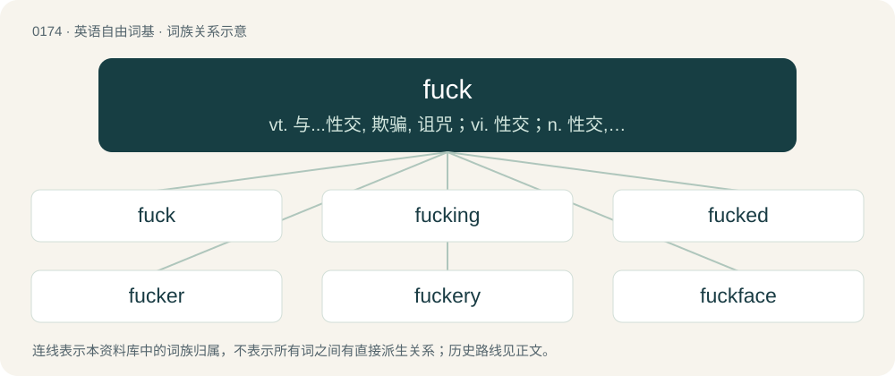

# 0190 · fuck — vt. 与...性交, 欺骗, 诅咒；vi. 性交；n. 性交, 些微, 杂种

[总目录](../00_总目录_按常用程度.md)

**类型**：英语自由词基　｜　**来源语言**：见词源记录

## 核心含义与来源

- 核心含义：vt. 与...性交, 欺骗, 诅咒；vi. 性交；n. 性交, 些微, 杂种
- 英文含义：To have sexual intercourse; to copulate.
- 词形：fuck

**来源记录 1**（动词；To have sexual intercourse; to copulate.）

From Middle English \*fukken, probably of Germanic origin: either from Old English \*fuccian or Old Norse \*fukka, both from Proto-Germanic \*fukkōną, from Proto-Indo-European \*pewǵ- (“to strike, punch, stab”). Compare windfucker and its debated etymology. Possibly attested in a 772 CE charter that mentions a place called Fuccerham, which may mean "hām (“home”) of the fucker" or "hamm (“pasture”) of the fucker"; a John le Fucker in a record from 1278 may just be a variant of Fulcher; compare Fucher, Foker, etc. The earliest unambiguous use of the word in a clearly sexual context, in any stage of English, appears to be in court documents from Cheshire, England, which mention a man called Roger Fuckebythenavele (possibly tongue-in-cheek or directly suggestive of a depraved sexual act) on 8 December 1310. It was first listed in a dictionary in 1598. Scots fuk or fuck is attested slightly earlier, probably reinforcing the Northern Germanic/Scandinavian origin theory. From 1500 onward, the word has been in continual use, superseding jape and sard and largely displacing swive. See windfucker and fuckwind for more information. A range of folk-etymological backronyms, such as fornication under consent of the king and for unlawful carnal knowledge, are all demonstrably false. Verb sense 7 from related sense feck.

## 词族图

## 单词速览（常用到不常用）

| 单词 | 音标 | 释义 |
|---|---|---|
| [fuck](#w-1) | 英 /ˈfʌʔ(k)/；/ˈfʌk/ | vt. 与...性交, 欺骗, 诅咒；vi. 性交；n. 性交, 些微, 杂种 |
| [fucking](#w-2) | 美 /ˈfʌkɪŋ/；/ˈfʌkiŋ/ | a. 该死的, 难完成的, 难做的, 低劣的, 讨厌的, 丑恶的, 混乱的, 乱糟糟的 |
| [fucked](#w-3) | /fʌkt/ | a. 受骗的 |
| [fucker](#w-4) | /ˈfʌk.ə(ɹ)/ | n. 笨蛋, 傻瓜 |
| [fuckery](#w-5) | /ˈfʌkəɹi/ | 【英文】Nonsense, bullshit, or underhanded trickery. |
| [fuckface](#w-6) | 美 /ˈfʌkˌfeɪs/ | 【英文】An ugly or otherwise undesirable or annoying person. |
| [fuckhead](#w-7) | /ˈfʌkˌhɛd/ | \[网络\] 指愚笨或不是好人 |
| [fuckable](#w-8) | /ˈfʌkəbl̩/ | 可以亵渎的 |
| [clusterfuck](#w-9) | 英 /ˈklʌs.təˌfʌk/；美 /ˈklʌs.tɚˌfʌk/ | 【英文】A chaotic situation where everything seems to go wrong, often caused by communication failure, a complex environment, or incompetence. |
| [fuckwit](#w-10) | /ˈfʌkwɪt/ | 【英文】A very stupid person. |
| [fucktard](#w-11) | 美 /ˈfʌktɑɹd/ | 【英文】An extraordinarily stupid person. |
| [mindfuck](#w-12) | 英 /maɪnd.fʌk/ | n. &lt;俚&gt;高度兴奋状态 |

## 逐词详解

### 1. fuck

**词性**：动词　｜　**音标**：英 /ˈfʌʔ(k)/；/ˈfʌk/

**中文释义**：vt. 与...性交, 欺骗, 诅咒；vi. 性交；n. 性交, 些微, 杂种

**英文义项**：To have sexual intercourse; to copulate. / To have sexual intercourse with.

**词源与演化**：

From Middle English \*fukken, probably of Germanic origin: either from Old English \*fuccian or Old Norse \*fukka, both from Proto-Germanic \*fukkōną, from Proto-Indo-European \*pewǵ- (“to strike, punch, stab”). Compare windfucker and its debated etymology. Possibly attested in a 772 CE charter that mentions a place called Fuccerham, which may mean "hām (“home”) of the fucker" or "hamm (“pasture”) of the fucker"; a John le Fucker in a record from 1278 may just be a variant of Fulcher; compare Fucher, Foker, etc. The earliest unambiguous use of the word in a clearly sexual context, in any stage of English, appears to be in court documents from Cheshire, England, which mention a man called Roger Fuckebythenavele (possibly tongue-in-cheek or directly suggestive of a depraved sexual act) on 8 December 1310. It was first listed in a dictionary in 1598. Scots fuk or fuck is attested slightly earlier, probably reinforcing the Northern Germanic/Scandinavian origin theory. From 1500 onward, the word has been in continual use, superseding jape and sard and largely displacing swive. See windfucker and fuckwind for more information. A range of folk-etymological backronyms, such as fornication under consent of the king and for unlawful carnal knowledge, are all demonstrably false. Verb sense 7 from related sense feck.

**例句**：

> We decided to switch things around and have him fuck me tonight.

该用例对应义项：To insert one's penis, a dildo, etc., into a person or a specified orifice or cleft sexually; to penetrate.

### 2. fucking

**词性**：名词　｜　**音标**：美 /ˈfʌkɪŋ/；/ˈfʌkiŋ/

**中文释义**：a. 该死的, 难完成的, 难做的, 低劣的, 讨厌的, 丑恶的, 混乱的, 乱糟糟的

**英文义项**：An act of sexual intercourse, especially one lacking passion or a feeling of sincere love. / An act of mistreatment.

**构词拆分**：fuck + -ing

**词源与演化**：

From fuck + -ing.

**例句**：

> I got a good fucking out of her, but I doubt we'll have another date.

该用例对应义项：An act of sexual intercourse, especially one lacking passion or a feeling of sincere love.

### 3. fucked

**词性**：形容词　｜　**音标**：/fʌkt/

**中文释义**：a. 受骗的

**英文义项**：Irreparably or catastrophically broken. / In trouble; in a hopeless situation.

**构词拆分**：fuck + -ed

**词源与演化**：

From fuck + -ed.

**例句**：

> Man, I was mixing all sorts of drinks, and by the end of the night I was so fucked!

该用例对应义项：Very drunk.

### 4. fucker

**词性**：名词　｜　**音标**：/ˈfʌk.ə(ɹ)/

**中文释义**：n. 笨蛋, 傻瓜

**英文义项**：An undesirable person. / A person.

**构词拆分**：fuck + -er

**词源与演化**：

From fuck + -er (agent suffix).

**例句**：

> She was a good fucker, but to tell the truth, I had had enough for the night.

该用例对应义项：One who fucks.

### 5. fuckery

**词性**：名词　｜　**音标**：/ˈfʌkəɹi/

**英文义项**：Nonsense, bullshit, or underhanded trickery. / A brothel.

**构词拆分**：fuck + -ery

**词源与演化**：

From fuck + -ery.

**用法示例／搭配（非完整句）**：

> an endless stream of fuckery

该用例对应义项：Nonsense, bullshit, or underhanded trickery.

### 6. fuckface

**词性**：名词　｜　**音标**：美 /ˈfʌkˌfeɪs/

**英文义项**：An ugly or otherwise undesirable or annoying person.

**构词拆分**：fuck + face

**词源与演化**：

From fuck + face.

### 7. fuckhead

**词性**：名词　｜　**音标**：/ˈfʌkˌhɛd/

**中文释义**：\[网络\] 指愚笨或不是好人

**英文义项**：A stupid or otherwise undesirable person.

**构词拆分**：fuck + head

**词源与演化**：

From fuck + head. Dysphemistically modelled after dickhead.

### 8. fuckable

**词性**：形容词　｜　**音标**：/ˈfʌkəbl̩/

**中文释义**：可以亵渎的

**英文义项**：Capable of, or suitable for, being fucked; sexually attractive.

**构词拆分**：fuck + -able

**词源与演化**：

From fuck + -able.

### 9. clusterfuck

**词性**：名词　｜　**音标**：英 /ˈklʌs.təˌfʌk/；美 /ˈklʌs.tɚˌfʌk/

**英文义项**：A chaotic situation where everything seems to go wrong, often caused by communication failure, a complex environment, or incompetence. / A sexual orgy.

**构词拆分**：cluster + fuck

**词源与演化**：

From cluster + fuck. Reportedly coined by Hippie poet Ed Sanders as Mongolian Cluster Fuck. First attested in c. 1965 in East Village Other.

**例句**：

> Unexpected changes led to a huge clusterfuck.

### 10. fuckwit

**词性**：名词　｜　**音标**：/ˈfʌkwɪt/

**英文义项**：A very stupid person. / A contemptible person.

**构词拆分**：fuck + wit

**词源与演化**：

From fuck + wit.

### 11. fucktard

**词性**：名词　｜　**音标**：美 /ˈfʌktɑɹd/

**英文义项**：An extraordinarily stupid person.

**构词拆分**：fuck + -tard

**词源与演化**：

Blend of fuck(ing) + retard, or fuck + -tard.

**例句**：

> That fucktard spilled soda all over my keyboard!

该用例对应义项：An extraordinarily stupid person.

### 12. mindfuck

**词性**：名词　｜　**音标**：英 /maɪnd.fʌk/

**中文释义**：n. &lt;俚&gt;高度兴奋状态

**英文义项**：Something that intentionally destabilizes, confuses, or manipulates the mind of another person.

**构词拆分**：mind + fuck

**词源与演化**：

Compound of mind + fuck.
