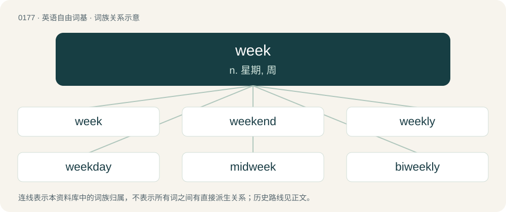

# 0194 · week — n. 星期, 周

[总目录](../00_总目录_按常用程度.md)

**类型**：英语自由词基　｜　**来源语言**：见词源记录

## 核心含义与来源

- 核心含义：n. 星期, 周
- 英文含义：Any period of seven consecutive days.
- 词形：week

**多个词源／构词路径**：同一拼写可能有不同来源；以下按词性和含义分别列出。

**来源记录 1**（名词；Any period of seven consecutive days.）

From Middle English wyke, weke, from Old English wice, wucu (“week”), from Proto-West Germanic \*wikā, from Proto-Germanic \*wikǭ (“sequence; week”), from Proto-Indo-European \*weyg-, \*weyk- (“to bend, curve”). Related to weak and dialectal English wick (“corner”); see Proto-Germanic \*wīk(w)aną (“to bend, yield, cease”). Cognates Cognate with Scots ouk, oulk (“week”), Yola wick, wik (“week”), North Frisian waag, Week, weg (“week”), Saterland Frisian Wiek, Wíek (“week”), West Frisian wike (“week”), Bavarian Wochn (“week”), Cimbrian boch, bòcha (“week”), Dutch week (“week”), German Woche (“week”), German Low German Week (“week”), Limburgish waek, Wéëk (“week”), Luxembourgish Woch (“week”), Mòcheno boch (“week”), Vilamovian woch (“week”), Yiddish וואָך (vokh, “week”), Danish uge (“week”), Elfdalian wiku, wikå (“week”), Faroese and Icelandic vika (“week”), Jamtish vuku (“week”), Norwegian Bokmål uke (“week”), Norwegian Nynorsk veke, vika, viku, vukku, vuku (“week”), Scanian uga (“week”), Swedish vecka (“week”), Gothic 𐍅𐌹𐌺𐍉 (wikō, “sequence; week”); also Cornish gwigh (“periwinkles, whelks”), Irish faocha, faochóg (“periwinkle”), Latin vicis (“alteration, turn; time”), Ancient Greek εἴκω (eíkō, “to yield”), Albanian vig (“bier, litter, stretcher”), Northern Kurdish avêtin, avitin, avîtin, havêtin, havîtin (“to cast, hurl, throw”), Persian آویختَن (âvixtan, “to hang, suspend”), بیختن (bēxtan / bixtan, “to sieve, sift”). Related also to Old English wīcan (“to yield, give way”), English weak and wick.

**来源记录 2**（感叹词；The squeal of a pig.）

Imitative.

## 词族图

## 单词速览（常用到不常用）

| 单词 | 音标 | 释义 |
|---|---|---|
| [week](#w-1) | /wiːk/ | n. 星期, 周 |
| [weekend](#w-2) | 英 /wiːˈkɛnd/；美 /ˈwiˌkɛnd/ | n. 周末, 周末休假 |
| [weekly](#w-3) | /ˈwiːk.li/ | n. 周刊, 周报；a. 每周的, 一周一次的, 周刊的；adv. 每周, 一周一次 |
| [weekday](#w-4) | /ˈwiːkdeɪ̯/ | n. 周日, 平日；\[计\] 工作日 |
| [midweek](#w-5) | /ˈmid.wiːk/ | n. 周中, 星期三；a. 周中的, 星期三的 |
| [biweekly](#w-6) | /baɪˈwiːkli/ | n. 双周刊；a. 两周一次的, 每周二次的；adv. 每两周一次地, 每周二次地 |
| [weeknight](#w-7) | /ˈwiːknait/ | n. 周日夜晚(指周末休息日以外的每个夜晚) |
| [workweek](#w-8) | /ˈwəːkwiːk/ | n. 一星期工作时间 |
| [weeklong](#w-9) | /ˈwiːklɔŋ;-lɔːŋ/ | a. 为时一周的,持续一星期的 |

## 逐词详解

### 1. week

**词性**：名词　｜　**音标**：/wiːk/

**中文释义**：n. 星期, 周

**英文义项**：Any period of seven consecutive days. / A period of seven days beginning with Sunday or Monday.

**词源与演化**：

From Middle English wyke, weke, from Old English wice, wucu (“week”), from Proto-West Germanic \*wikā, from Proto-Germanic \*wikǭ (“sequence; week”), from Proto-Indo-European \*weyg-, \*weyk- (“to bend, curve”). Related to weak and dialectal English wick (“corner”); see Proto-Germanic \*wīk(w)aną (“to bend, yield, cease”). Cognates Cognate with Scots ouk, oulk (“week”), Yola wick, wik (“week”), North Frisian waag, Week, weg (“week”), Saterland Frisian Wiek, Wíek (“week”), West Frisian wike (“week”), Bavarian Wochn (“week”), Cimbrian boch, bòcha (“week”), Dutch week (“week”), German Woche (“week”), German Low German Week (“week”), Limburgish waek, Wéëk (“week”), Luxembourgish Woch (“week”), Mòcheno boch (“week”), Vilamovian woch (“week”), Yiddish וואָך (vokh, “week”), Danish uge (“week”), Elfdalian wiku, wikå (“week”), Faroese and Icelandic vika (“week”), Jamtish vuku (“week”), Norwegian Bokmål uke (“week”), Norwegian Nynorsk veke, vika, viku, vukku, vuku (“week”), Scanian uga (“week”), Swedish vecka (“week”), Gothic 𐍅𐌹𐌺𐍉 (wikō, “sequence; week”); also Cornish gwigh (“periwinkles, whelks”), Irish faocha, faochóg (“periwinkle”), Latin vicis (“alteration, turn; time”), Ancient Greek εἴκω (eíkō, “to yield”), Albanian vig (“bier, litter, stretcher”), Northern Kurdish avêtin, avitin, avîtin, havêtin, havîtin (“to cast, hurl, throw”), Persian آویختَن (âvixtan, “to hang, suspend”), بیختن (bēxtan / bixtan, “to sieve, sift”). Related also to Old English wīcan (“to yield, give way”), English weak and wick.

**例句**：

> A 4-day week consists of Monday, Tuesday, Wednesday, and Thursday.

该用例对应义项：A subdivision of the month into longer periods of work days punctuated by shorter weekend periods of days for markets, rest, or religious observation such as a sabbath.

### 2. weekend

**词性**：动词　｜　**音标**：英 /wiːˈkɛnd/；美 /ˈwiˌkɛnd/

**中文释义**：n. 周末, 周末休假

**英文义项**：To spend the weekend.

**构词拆分**：week + end

**词源与演化**：

From week + end. Originally a Northern England regionalism (see 1903 quotation), in more general use from late 19th century. Compare Saterland Frisian Wiekeneende (“weekend”), West Frisian wykein (“weekend”), Dutch weekeinde (“weekend”), German Low German Wekenenn (“weekend”), German Wochenende (“weekend”).

**例句**：

> We'll weekend at the beach.

该用例对应义项：To spend the weekend.

### 3. weekly

**词性**：形容词　｜　**音标**：/ˈwiːk.li/

**中文释义**：n. 周刊, 周报；a. 每周的, 一周一次的, 周刊的；adv. 每周, 一周一次

**英文义项**：Of or relating to a week. / Happening once a week, or every week.

**构词拆分**：week + -ly (adverbial suffix)；week + -ly (adjectival suffix)

**词源与演化**：

From Middle English wykely (adverb), equivalent to week + -ly (adverbial suffix) or week + -ly (adjectival suffix). Compare Dutch wekelijks (“weekly”), German wöchentlich (“weekly”), Danish ugentlig (“weekly”), Norwegian ukentlig (“weekly”), Icelandic vikulega (“weekly”), Swedish veckovis (“weekly”).

**例句**：

> He's going for his weekly check-up at the hospital.

该用例对应义项：Happening once a week, or every week.

### 4. weekday

**词性**：名词　｜　**音标**：/ˈwiːkdeɪ̯/

**中文释义**：n. 周日, 平日；\[计\] 工作日

**英文义项**：Monday, Tuesday, Wednesday, Thursday or Friday, but not Saturday or Sunday. / Saturday, Sunday, Monday, Tuesday, Wednesday, Thursday, but not Friday.

**构词拆分**：By surface analysis, compound of week + day

**词源与演化**：

Inherited from Middle English wykeday, from Old English wicdæġ (“weekday”), from Proto-West Germanic \*wikadag, from Proto-Germanic \*wikadagaz (“weekday”). By surface analysis, compound of week + day. Compare West Frisian wikedei (“weekday”), Dutch weekdag (“weekday”), German Low German Wekendag (“weekday”), German Wochentag (“weekday”), Danish ugedag (“weekday”), Swedish veckodag (“weekday”), Norwegian ukedag (“weekday”), Faroese vikudagur (“weekday”), Icelandic vikudagur (“weekday”).

**例句**：

> Outside, there’s a long line to get in, even on a weekday afternoon.

### 5. midweek

**词性**：名词　｜　**音标**：/ˈmid.wiːk/

**中文释义**：n. 周中, 星期三；a. 周中的, 星期三的

**英文义项**：The middle of the week. / Midweek worship service, held by many congregations and in addition to a Sunday morning service.

**构词拆分**：mid- + week

**词源与演化**：

From mid- + week. Compare Saterland Frisian Midwiek (“Wednesday”, literally “midweek”), German Low German Middeweek (“Wednesday”, literally “midweek”), German Mittwoch (“Wednesday”, literally “midweek”).

**例句**：

> This Wednesday is churchwide midweek; men's is the next one.

该用例对应义项：Midweek worship service, held by many congregations and in addition to a Sunday morning service.

### 6. biweekly

**词性**：名词　｜　**音标**：/baɪˈwiːkli/

**中文释义**：n. 双周刊；a. 两周一次的, 每周二次的；adv. 每两周一次地, 每周二次地

**英文义项**：Something that is published or released once every two weeks.

**构词拆分**：bi- + week + -ly；bi- + weekly

**词源与演化**：

From bi- + week + -ly. The sense referring to twice a week can be analyzed as bi- + weekly.

**例句**：

> The local paper is a biweekly.

该用例对应义项：Something that is published or released once every two weeks.

### 7. weeknight

**词性**：名词　｜　**音标**：/ˈwiːknait/

**中文释义**：n. 周日夜晚(指周末休息日以外的每个夜晚)

**英文义项**：The evening of a weekday.

**构词拆分**：week + night

**词源与演化**：

From week + night.

**例句**：

> You should go to bed earlier on a weeknight than over the weekend.

### 8. workweek

**词性**：名词　｜　**音标**：/ˈwəːkwiːk/

**中文释义**：n. 一星期工作时间

**英文义项**：The range of days of the week that are normally worked.

**构词拆分**：work + week

**词源与演化**：

From work + week.

**例句**：

> The International Labour Organization defines a workweek exceeding 48 hours as excessive.

### 9. weeklong

**词性**：形容词　｜　**音标**：/ˈwiːklɔŋ;-lɔːŋ/

**中文释义**：a. 为时一周的,持续一星期的

**英文义项**：Lasting for (approximately) one week.

**构词拆分**：week + -long

**词源与演化**：

From week + -long.
