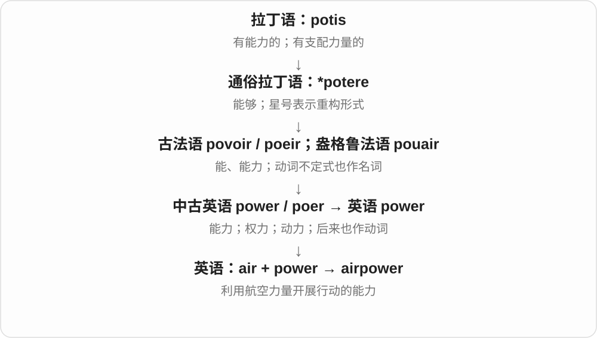

# 0195 · air — 空气；空中；航空；公开播出

[逐词精讲目录](../00_逐词精讲目录.md) · [总目录](../00_总目录_按常用程度.md)

## 核心词根与来源

空气义 air 经法语、拉丁语接古希腊 āēr。现代作为自由词基能组成空气、航空、广播等多支词；音乐曲调等同形用法另按词条辨认。

**AIR：先分清空气物质、飞行空间和公开传播**

气囊用充气，航邮走空中，节目 airing 是播出；同一个 air 在不同组合里选不同义。

- **基本空气与流动**：air · airing · airy · airless · airflow · airstream · airspeed · airfoil
- **充气、喷绘与隔气**：airbag · airbrush · airlock · airtight
- **飞行场所、结构及人员**：airport · airfield · airstrip · airspace · airway · aircraft · airplane · airframe · airship · airborne · midair · airman · aircrew
- **航空运输和服务**：airline · airliner · airfare · airlift · airdrop · airmail
- **传播、行动与其他组合**：airplay · airtime · airstrike · airpower · airhead
- **airport → airports：空中交通的港口**：airport · airports
- **airline → airlines：空中线路到航空公司**：air · line · airline · airlines
- **line → lining：排列与加衬里分义**：line · lining
- **air → aired：通风、公开表达与播出**：aired

## 词形与演化规律

air → airing、airy、airless 先看基本状态；airflow、airstream、airspeed、airfoil 抓空气运动。airbag、airbrush、airlock 看空气装置，airstrip、airframe、airman 等看航空，airdrop、airmail、airlift 看运输，airplay、airtime 看播出。airbus 小写旧类名与品牌、airsoft 专门运动本页暂不展开。

air 与 port 组合，像港口承接船舶一样承接飞机。

英语 air 与 line 的组合，航空运输公司义后来固定。

现代同写 lining，近源分支应分别看。

air 空气经法语、拉丁接希腊 aēr；名词作动词，放到空气中，引申公开表达，再用于广播等播出。air + -ed，读 /d/。

## 单词速览（按词族由简到繁）

同一基础词的相关扩展放在一起，先读基础形式，再读扩展；各组之间优先读常用的。具体词源关系见各词讲解。

| 单词 | 音标 | 核心意思 |
|---|---|---|
| [line](#w-40) | 英、美 /laɪn/ | 线；一行；队列；路线；沿线排；加衬里 |
| [lining](#w-42) | /ˈlaɪnɪŋ/ | 内衬、衬里、内层；加衬、沿边排列〔现在分词、动名词〕 |
| [airline](#w-4) | 英 /ˈeəlaɪn/；美 /ˈerlaɪn/ | 航空公司 |
| [airlines](#w-41) | 英 /ˈeəlaɪnz/；美 /ˈerlaɪnz/ | 航空公司；航空运输线路等〔复数〕 |
| [air](#w-1) | 英 /eə/；美 /er/ | 空气；天空；通风；公开表达；播出 |
| [airport](#w-2) | 英 /ˈeəpɔːt/；美 /ˈerpɔrt/ | 机场 |
| [airports](#w-39) | 英 /ˈeəpɔːts/；美 /ˈerpɔːrts/ | 机场〔airport 的复数〕 |
| [aircraft](#w-3) | 英 /ˈeəkrɑːft/；美 /ˈerkræft/ | 航空器；飞行器 |
| [airplane](#w-5) | 英 /ˈeəpleɪn/；美 /ˈerpleɪn/ | 飞机〔常见美式用词〕 |
| [aired](#w-43) | 英 /eəd/；美 /erd/ | 通风了；公开表达了；播出了〔过去式、过去分词〕 |
| [airborne](#w-6) | 英 /ˈeəbɔːn/；美 /ˈerbɔrn/ | 在空中的；由空气传播的；空运的 |
| [airing](#w-7) | 英 /ˈeərɪŋ/；美 /ˈerɪŋ/ | 通风、晾晒；公开讨论；播出 |
| [airfield](#w-9) | 英 /ˈeəfiːld/；美 /ˈerfiːld/ | 飞行场；飞机起降场 |
| [airspace](#w-10) | 英 /ˈeəspeɪs/；美 /ˈerspeɪs/ | 空域；领空；空气间隙 |
| [airy](#w-11) | 英 /ˈeəri/；美 /ˈeri/ | 通风宽敞的；轻盈的；轻飘飘、不当回事的 |
| [airway](#w-12) | 英 /ˈeəweɪ/；美 /ˈerweɪ/ | 气道；航路 |
| [airflow](#w-13) | 英 /ˈeəfləʊ/；美 /ˈerfloʊ/ | 气流；空气流动 |
| [airliner](#w-14) | 英 /ˈeəlaɪnə/；美 /ˈerlaɪnər/ | 大型客机；航线客机 |
| [airstrike](#w-15) | 英 /ˈeəstraɪk/；美 /ˈerstraɪk/ | 空袭；空中打击 |
| [airtime](#w-16) | 英 /ˈeətaɪm/；美 /ˈertaɪm/ | 广播或电视播出时间；通话时长；腾空或飞行时间〔依语境〕 |
| [airtight](#w-17) | 英 /ˈeətaɪt/；美 /ˈertaɪt/ | 密不透气的；严密无漏洞的 |
| [airbag](#w-18) | 英 /ˈeəbæɡ/；美 /ˈerbæɡ/ | 安全气囊；充气缓冲袋 |
| [airman](#w-19) | 英 /ˈeəmən/；美 /ˈermən/ | 航空人员；空军人员；飞行员〔按语境〕 |
| [airship](#w-20) | 英 /ˈeəʃɪp/；美 /ˈerʃɪp/ | 飞艇 |
| [airlift](#w-21) | 英 /ˈeəlɪft/；美 /ˈerlɪft/ | 空运；用飞机或直升机运送 |
| [airplay](#w-22) | 英 /ˈeəpleɪ/；美 /ˈerpleɪ/ | 电台、电视播放 |
| [airfare](#w-23) | 英 /ˈeəfeə/；美 /ˈerfer/ | 机票价格；航空票价 |
| [airstrip](#w-24) | 英 /ˈeəstrɪp/；美 /ˈerstrɪp/ | 简易跑道；小型起降场 |
| [airframe](#w-26) | 英 /ˈeəfreɪm/；美 /ˈerfreɪm/ | 机体；航空器主要结构 |
| [airbrush](#w-27) | 英 /ˈeəbrʌʃ/；美 /ˈerbrʌʃ/ | 喷笔；喷绘；修饰、抹去〔照片或叙述〕 |
| [airlock](#w-29) | 英 /ˈeəlɒk/；美 /ˈerlɑːk/ | 气闸；隔气过渡室；气塞〔另义〕 |
| [airspeed](#w-30) | 英 /ˈeəspiːd/；美 /ˈerspiːd/ | 空速；相对周围空气的速度 |
| [airdrop](#w-31) | 英 /ˈeədrɒp/；美 /ˈerdrɑːp/ | 空投；从空中投送 |
| [aircrew](#w-32) | 英 /ˈeəkruː/；美 /ˈerkruː/ | 机组人员；飞行机组 |
| [airmail](#w-33) | 英 /ˈeəmeɪl/；美 /ˈermeɪl/ | 航空邮件；航空邮寄 |
| [airfoil](#w-34) | 英 /ˈeəfɔɪl/；美 /ˈerfɔɪl/ | 翼型；能与气流作用产生升力的翼形结构 |
| [airstream](#w-35) | /ˈeəstriːm/（英）；/ˈerstriːm/（美） | 气流 |
| [airpower](#w-36) | 英 /ˈeəˌpaʊə/；美 /ˈerˌpaʊər/ | 空中力量；航空作战能力 |
| [airhead](#w-37) | 英 /ˈeəhed/；美 /ˈerhed/ | 没头脑的人〔贬义〕；空运据点〔另义〕 |
| [airless](#w-38) | 英 /ˈeələs/；美 /ˈerləs/ | 没有空气的；闷热不通风的 |
| [midair](#w-25) | 英 /ˌmɪdˈeə/；美 /ˌmɪdˈer/ | 在空中；半空 |

## 逐词讲解

### 1. line — 线；一行；队列；路线；沿线排；加衬里

**音标**：英、美 /laɪn/

**先抓住这个画面**

一根拉长的绳，可以变成纸上的痕迹，也可以变成一排人。

**怎么拆**

现代词融合古英语 līne 与法语 ligne；法语路线明确接拉丁 līnea“麻线”。“加衬里”另接古英语 līn“亚麻布”，不是把一条细线放进衣服。

**怎么变成今天的意思**

**拉丁 līnum → līneus → līnea**  
亚麻 → 亚麻制的 → 麻线、绳、线条

↓

**古法语 ligne 与古英语 līne 在中古英语中合流**  
绳索、行列、线条；古英语形式还保留日耳曼语言的传承

↓

**英语 line**  
线、行、队列、路线；沿线排列

↓

**独立动词路线：古英语 līn〔亚麻布〕 → 英语 line**  
用布覆盖里面 → 给……加衬里

draw a line 是画线，stand in line 是排队，train line 是铁路线路。line a box 则是给盒子里面铺一层东西。

**常见搭配与例句**

a straight line；in line；a line of text；line a tray with…。

> Draw a line between the two points.

在这两个点之间画一条线。

> We waited in line outside the museum.

我们在博物馆外排队等候。

> Line the tray with baking paper.

在烤盘里铺上烘焙纸。

**别混淆**

row 常是一横排；line 可指队列、连续痕迹或联系路线。衬里义要另按布料画面理解。

### 2. lining — 内衬、衬里、内层；加衬、沿边排列〔现在分词、动名词〕

**音标**：/ˈlaɪnɪŋ/

**先抓住这个画面**

衣服里面贴着身体的那一层布，是 lining。lining a box 是给盒子里铺一层；lining the road 则可能说东西沿道路排开。

**怎么拆**

衬里动词 line 接古英语 lin 亚麻布；线条、排列的 line 有古英语 line 与法语 ligne 等合流材料，最终也与亚麻、线有关。现代 line 去 e 加完整 -ing；加衬动作转衬里名词。

**怎么变成今天的意思**

**古英语 lin 亚麻布 → line 加衬 → lining**  
用布覆盖里面 → 衬里的材料、内层

↓

**另支 line 排列；line 去 e + -ing → lining**  
沿线排列；或正在给东西加衬

a silk lining 丝绸内衬；the lining of a coat 外套衬里；trees lining the road 沿路排列的树。

**常见搭配与例句**

lining a drawer 给抽屉铺衬；a silver lining 困境里的一线好处〔比喻〕。

> The coat has a soft cotton lining.

这件外套有柔软的棉质内衬。

> Tall trees were lining both sides of the road.

道路两旁排列着高树。

**别混淆**

lining 最常见名词是里面的一层，不是普通线条。silver lining 借乌云边亮光说困境中的好处，要整体理解。

### 3. airline — 航空公司

**音标**：英 /ˈeəlaɪn/；美 /ˈerlaɪn/

**先抓住这个画面**

想象在天空中经营固定线路：不只是一架飞机，而是一整套载客或运货的服务。

**怎么拆**

air + line；早期可指两点间不随地形绕弯的直线，后来用于航空运输公司。

**怎么变成今天的意思**

**希腊 aer，属格 aeros**  
空气

↓

**拉丁 aer → 法语 air → 英语 air**  
空气

↓

**air + line → airline**  
直达路线 → 航空运输企业

a budget airline 是廉价航空公司；an airline operates flights 是航空公司运营航班。line 在这里借用了运输线路、运营服务的概念，现代最常见的 airline 就是公司。

**常见搭配与例句**

a budget airline；an international airline；airline staff；airline tickets。

> The airline has added two new routes.

这家航空公司新增了两条航线。

> We compared fares from several airlines.

我们比较了几家航空公司的票价。

**别混淆**

airline 是公司，airliner 是大型客机，airport 是机场。订票的人经常把这三个对象一起提到，但别混成同一个。

### 4. airlines — 航空公司；航空运输线路等〔复数〕

**音标**：英 /ˈeəlaɪnz/；美 /ˈerlaɪnz/

**先抓住这个画面**

飞机沿线路把人、货从一地送到另一地，运营这种服务的公司便叫 airlines。现代最常见是在数航空公司。

**怎么拆**

air + line → airline，再加 -s，/n/ 后读 /z/。早期 airline 可指不随地面地形绕弯的直线，后来发展航空运输公司名称。

**怎么变成今天的意思**

**air + line → airline**  
空中的线、直线概念；后有航空运输线路、公司

↓

**airline + -s → airlines**  
多家航空公司或多条相应线路

different airlines 不同航空公司；major airlines 主要航空公司；airline tickets 机票，前置修饰常用单数。

**常见搭配与例句**

airlines serving the island 为岛屿提供航班服务的航空公司；compare airlines 比较航空公司。

> Three airlines offer flights to the island.

三家航空公司提供前往这座岛的航班。

> We compared the baggage rules of several airlines.

我们比较了几家航空公司的行李规定。

**别混淆**

airlines 是公司或线路名称；flights 是一次次航班。两家 airlines 可以各运营许多 flights。

### 5. air — 空气；天空；通风；公开表达；播出

**音标**：英 /eə/；美 /er/

**先抓住这个画面**

本来是围在身边、看不见却能呼吸的东西；让东西接触空气，就有通风、公开的感觉。

**怎么拆**

空气义经法语 air、拉丁 aer 接希腊 aer；现代 air 本身已不能再拆成有意义的英语小块。

**怎么变成今天的意思**

**希腊 aer，属格 aeros**  
空气

↓

**拉丁 aer → 法语 air → 英语 air**  
空气

↓

**英语 air 的动词及广播用法**  
让空气接触 → 通风；把意见说出来；通过无线电播出

fresh air 是新鲜空气；air the room 是通风；air concerns 是把担忧公开讲出来；on air 是正在播出。an air of mystery 的神秘气质、put on airs 的摆架子还涉及法语表示神态的另一历史用法，远源有争议，别硬说所有义项都由空气一条线变来。

**常见搭配与例句**

fresh air；in the air；air an opinion；on air；up in the air〔尚未确定〕。

> Open the window and let some fresh air in.

打开窗户，让新鲜空气进来。

> The meeting gave everyone a chance to air their concerns.

会议让每个人都有机会说出自己的担忧。

> The interview will air on Sunday evening.

这段访谈将在周日晚间播出。

**别混淆**

air 和 heir 继承人同音。air concerns 是表达担忧，不是让担忧消失；clear the air 才常比喻消除误会、把话说开。

### 6. airport — 机场

**音标**：英 /ˈeəpɔːt/；美 /ˈerpɔrt/

**先抓住这个画面**

把海港换成飞机的港口：飞机在这里到达、离开，旅客和货物在这里转接。

**怎么拆**

air + port 港口；用水上交通的港口意象给航空设施命名。

**怎么变成今天的意思**

**希腊 aer，属格 aeros**  
空气

↓

**拉丁 aer → 法语 air → 英语 air**  
空气

↓

**air + port → airport**  
空中的运输港口 → 机场

机场不只是跑道，还包括用于航空起降和运营的设施。大型机场会有航站楼、行李处理和交通连接；小机场的设施则可能简单得多。

**常见搭配与例句**

at the airport；an international airport；airport security；an airport terminal。

> We arrived at the airport before sunrise.

我们在日出前到了机场。

> A train connects the airport to the city center.

有一条铁路连接机场和市中心。

**别混淆**

airport 是整体机场，terminal 是航站楼。一个机场可以有多个航站楼；airfield 更偏重起降场地。

### 7. airports — 机场〔airport 的复数〕

**音标**：英 /ˈeəpɔːts/；美 /ˈerpɔːrts/

**先抓住这个画面**

飞机起降、旅客和货物进出的交通节点，是 airports；它把港口承接船舶的画面用到了航空。

**怎么拆**

air + port → airport，再加 -s，/t/ 后读 /s/。air 的较早背景是希腊、拉丁空气词，port 的交通港口义经法语接拉丁 portus；现代复合词说明航空用途。

**怎么变成今天的意思**

**air 空气、航空 + port 港口 → airport**  
航空交通的港口 → 机场

↓

**airport + -s → airports**  
多个机场

international airports 国际机场；regional airports 地区机场；airports near the city 城市附近的机场。

**常见搭配与例句**

buses connecting the airports；airports with several terminals。

> The city is served by two airports.

这座城市有两个机场提供航空服务。

> A direct bus connects the two airports.

有一班直达公共汽车连接这两个机场。

**别混淆**

airport 是整个机场，terminal 是航站楼或相关终点设施；一个 airport 可以有几个 terminals。复合词前面的 air 说明运输方式。

### 8. aircraft — 航空器；飞行器

**音标**：英 /ˈeəkrɑːft/；美 /ˈerkræft/

**先抓住这个画面**

只要是用于在空气中飞行的交通器具，就可能进入这个大类。

**怎么拆**

air + craft；craft 在这里沿用船只、运载工具的用法，不是手工艺品。

**怎么变成今天的意思**

**希腊 aer，属格 aeros**  
空气

↓

**拉丁 aer → 法语 air → 英语 air**  
空气

↓

**air + craft → aircraft**  
空中运载工具 → 航空器

飞机、直升机、滑翔机等都可称 aircraft。它既是可数名词，又是单复数同形：one aircraft、three aircraft，不加一个 s。

**常见搭配与例句**

a passenger aircraft；a military aircraft；several aircraft；an aircraft engine。

> Several aircraft were parked near the hangar.

几架航空器停在机库附近。

> The aircraft can carry both passengers and cargo.

这架飞机既能载客，也能运货。

**别混淆**

airplane 是 aircraft 的一种；helicopter 也是 aircraft，但通常不叫 airplane。用更宽的类名时，范围会变化。

### 9. airplane — 飞机〔常见美式用词〕

**音标**：英 /ˈeəpleɪn/；美 /ˈerpleɪn/

**先抓住这个画面**

把不太日常的 aero- 换成人人熟悉的 air，飞机的名称变得更顺口。

**怎么拆**

由 aeroplane 改形，以英语 air 替换 aero-；今天也容易按 air + plane 理解。

**怎么变成今天的意思**

**希腊 aer，属格 aeros**  
空气

↓

**拉丁 aer → 法语 air → 英语 air**  
空气

↓

**法语 aéroplane → 英语 aeroplane**  
飞机名称的前身

↓

**英语 airplane**  
把 aero- 改成 air 的形式

an airplane ticket 是机票，by airplane 是乘飞机。日常也直接说 plane。这里的 plane 是飞机的短称；不要再把 airplane 机械翻成“空气平面”。

**常见搭配与例句**

fly an airplane；a passenger airplane；an airplane engine；by airplane。

> The airplane circled the airport before landing.

飞机在机场上空盘旋了一圈后降落。

> She had never traveled by airplane before.

她以前从没坐过飞机。

**别混淆**

airplane 和 aeroplane 是同一类飞机的两种叫法；aircraft 的范围更大。

### 10. aired — 通风了；公开表达了；播出了〔过去式、过去分词〕

**音标**：英 /eəd/；美 /erd/

**先抓住这个画面**

把衣服、房间接触空气，是 aired；把意见公开拿出来说，或把节目播到公众面前，也用这个词。先用“从里面放到外面”的现代画面记。

**怎么拆**

air + -ed → aired，/eə/、/er/ 后读 /d/。空气 air 经法语、拉丁接希腊 aēr，名词作动词先说暴露于空气，后来公开表达、广播等用法分别发展。

**怎么变成今天的意思**

**air 空气名 → air 动词通风、接触空气**  
从具体物质名转成相应动作

↓

**air 公开表达、广播 + -ed → aired**  
展示给外界、向公众传播的后续用法

aired the room 是给房间通风；aired concerns 是公开提出关切；the programme aired 是节目播出了。

**常见搭配与例句**

aired the room；aired concerns；the programme aired。

> She aired the room before the guests arrived.

客人来之前，她给房间通了风。

> The interview aired on Sunday evening.

访谈在周日晚上播出了。

**别混淆**

air 还有曲调、神态等其他名词来源线；这里 aired 先从空气、公开传播这一组常见动词义理解。

### 11. airborne — 在空中的；由空气传播的；空运的

**音标**：英 /ˈeəbɔːn/；美 /ˈerbɔrn/

**先抓住这个画面**

borne 是被承载：东西离了地，由空气或飞行器带着走。

**怎么拆**

air + borne；borne 是 bear 承载的过去分词，不是 born 出生。

**怎么变成今天的意思**

**希腊 aer，属格 aeros**  
空气

↓

**拉丁 aer → 法语 air → 英语 air**  
空气

↓

**air + borne → airborne**  
被空气承载的 → 在空中或通过空气传播

The plane is airborne 说飞机已经离地；airborne dust 是飘在空气中的灰尘；airborne troops 指通过航空方式投入行动的部队。具体是悬浮、传播还是运输，要看名词。

**常见搭配与例句**

become airborne；airborne dust；airborne particles；airborne troops。

> The plane was airborne within a minute.

不到一分钟，飞机就已经升空了。

> The filter captures airborne dust.

过滤器会捕捉空气中悬浮的灰尘。

**别混淆**

airborne 不表示所有东西都靠翅膀主动飞。灰尘被气流带着，也是 airborne。

### 12. airing — 通风、晾晒；公开讨论；播出

**音标**：英 /ˈeərɪŋ/；美 /ˈerɪŋ/

**先抓住这个画面**

衣物拿出来接触空气，问题也拿出来给大家听；节目则被播给观众。

**怎么拆**

air + -ing，从名词空气与动词通风、公开、广播的不同用法名词化。不是每次都在说飞行。

**怎么变成今天的意思**

**希腊 āēr → 拉丁 āēr → 法语 air**  
空气

↓

**英语 air**  
空气、空中；通风、公开、播出等动词义

↓

**air + -ing → airing**  
让空气接触；让公众听到、看到

give the room an airing 是给房间通风，give an issue an airing 是让问题公开讨论；the first airing of a show 是节目首次播出。

**常见搭配与例句**

give something an airing；a public airing；a television airing。

> The blankets needed a good airing.

毯子需要好好晾一晾。

> The proposal received a public airing at the meeting.

提议在会上得到公开讨论。

**别混淆**

airing 是通风、公开讨论等活动，airfare 是机票价；air 前半不总意味着航空运输。

### 13. airfield — 飞行场；飞机起降场

**音标**：英 /ˈeəfiːld/；美 /ˈerfiːld/

**先抓住这个画面**

先有一块能让飞机起飞、降落的平坦地面，再谈周围建了什么设施。

**怎么拆**

air + field 场地；不是空中的田野，而是供飞行使用的地面。

**怎么变成今天的意思**

**希腊 aer，属格 aeros**  
空气

↓

**拉丁 aer → 法语 air → 英语 air**  
空气

↓

**air + field → airfield**  
用于飞机起降的场地

a military airfield 是军用飞行场；a small airfield 可能只有简单的跑道和机库，不一定有大型客运航站楼。这个词把重点放在起降场地。

**常见搭配与例句**

a military airfield；a disused airfield；land at an airfield。

> The plane landed at a small airfield outside town.

飞机降落在城外一处小型飞行场。

> The former military airfield is now used by a flying club.

那处原军用飞行场如今由一家飞行俱乐部使用。

**别混淆**

airport 通常让人想到完整的机场运营设施；airfield 更突出场地，两者有重叠，并非一条绝对的大小分界。

### 14. airspace — 空域；领空；空气间隙

**音标**：英 /ˈeəspeɪs/；美 /ˈerspeɪs/

**先抓住这个画面**

地面上方的一块天空，也可以像地面区域一样被划分、管理。

**怎么拆**

英语 air + space；air 指空气、大气，space 指其中的一定范围。

**怎么变成今天的意思**

**拉丁语 spatium**  
空间、范围、距离；也指一段时间，远源尚有不同解释

↓

**古法语 espace / 盎格鲁法语 space → 中古英语 space → 现代 space**  
空间、间隔、时间段；后来包括太空和抽象活动领域

↓

**英语 air + space → airspace**  
大气中的指定范围；也可指充满空气的间隙

controlled airspace 是受空中交通管理规则约束的空域。a country’s airspace 可指一国领空；在建筑等技术语境中，airspace 也可能只是空气层。

**常见搭配与例句**

controlled airspace；enter someone’s airspace；restricted airspace。

> The flight was diverted around restricted airspace.

航班绕开了受限制空域。

> A narrow airspace separates the two glass panels.

两块玻璃之间留有一道狭窄的空气间隙。

**别混淆**

airspace 在大气内谈区域；outer space 指外层空间，概念和法律范围不同。

### 15. airy — 通风宽敞的；轻盈的；轻飘飘、不当回事的

**音标**：英 /ˈeəri/；美 /ˈeri/

**先抓住这个画面**

像屋里留了很多空气，感觉开阔轻松；也可能轻到没有分量。

**怎么拆**

air + -y；从有空气、通风，扩展到轻盈或轻率。

**怎么变成今天的意思**

**希腊 aer，属格 aeros**  
空气

↓

**拉丁 aer → 法语 air → 英语 air**  
空气

↓

**air + -y → airy**  
有空气感的 → 宽敞、轻盈；轻率

an airy room 是通风、开阔的房间；an airy dress 可以说裙子轻薄飘逸；an airy dismissal 常含批评，说对方轻描淡写地把问题打发了。

**常见搭配与例句**

a light and airy room；an airy space；an airy manner；an airy dismissal。

> The apartment is bright and airy.

这套公寓明亮又通透。

> His airy dismissal of the problem annoyed the team.

他对问题那种轻描淡写的态度惹恼了团队。

**别混淆**

airy 用在房间上常是夸奖，用在承诺或态度上却可能说太轻浮、不认真。不能统一翻成空气多。

### 16. airway — 气道；航路

**音标**：英 /ˈeəweɪ/；美 /ˈerweɪ/

**先抓住这个画面**

给空气留一条路，是身体气道；给飞机规划一条路，是空中航路。

**怎么拆**

air + way 路径；根据 air 指空气还是航空，形成两类常见含义。

**怎么变成今天的意思**

**希腊 aer，属格 aeros**  
空气

↓

**拉丁 aer → 法语 air → 英语 air**  
空气

↓

**air + way → airway**  
空气通过的路径；飞机航行的路线

the upper airway 在身体语境指上气道；a busy airway 在航空语境指繁忙航路。Airways 也常出现在航空公司名称中，这时是公司的名字部分，不要按器官理解。

**常见搭配与例句**

the upper airway；airway obstruction；an airway route；Airways〔公司名中〕。

> The diagram shows the upper airway.

图中展示了上气道。

> The aircraft joined a busy airway over the coast.

飞机在海岸上空进入了一条繁忙航路。

**别混淆**

airway 是供空气或飞机通过的路，airline 通常是航空公司。二者有关联，但不是同义替换。

### 17. airflow — 气流；空气流动

**音标**：英 /ˈeəfləʊ/；美 /ˈerfloʊ/

**先抓住这个画面**

不只是屋里有没有空气，而是空气沿哪条路、以多大流量流动。

**怎么拆**

英语 air + flow 流动；从流体运动的画面理解即可。

**怎么变成今天的意思**

**希腊 aer，属格 aeros**  
空气

↓

**拉丁 aer → 法语 air → 英语 air**  
空气

↓

**air + flow → airflow**  
空气的流动

improve airflow 是让空气更顺畅地通过；block airflow 是挡住气流。电脑散热、房间通风和汽车设计都能用到这个词。

**常见搭配与例句**

improve airflow；restrict airflow；airflow through a space；airflow around a wing。

> The new vents improve airflow through the room.

新通风口改善了房间里的空气流动。

> Dust can restrict airflow inside a computer.

灰尘可能阻碍电脑内部的气流。

**别混淆**

air 是物质，airflow 是它的运动。一个密闭空间里有空气，也可能几乎没有有效的空气流动。

### 18. airliner — 大型客机；航线客机

**音标**：英 /ˈeəlaɪnə/；美 /ˈerlaɪnər/

**先抓住这个画面**

不是经营航班的公司，而是那架沿航线运送乘客的飞机。

**怎么拆**

air + liner；liner 原与按固定航线运营的船有关，再转用于航空器。

**怎么变成今天的意思**

**希腊 aer，属格 aeros**  
空气

↓

**拉丁 aer → 法语 air → 英语 air**  
空气

↓

**liner 航线客轮 + air → airliner**  
沿航线运送乘客的飞机

a passenger airliner 常指商业载客飞机；a jet airliner 是喷气式客机。它通常比小型私人飞机更让人联想到航空公司的客运服务。

**常见搭配与例句**

a commercial airliner；a jet airliner；a passenger airliner。

> The airliner can seat more than three hundred passengers.

这架客机可以搭载三百多名乘客。

> The photograph shows an early jet airliner.

照片中是一架早期喷气式客机。

**别混淆**

airline 是航空公司，airliner 是客机。an airline owns airliners：公司拥有飞机。

### 19. airstrike — 空袭；空中打击

**音标**：英 /ˈeəstraɪk/；美 /ˈerstraɪk/

**先抓住这个画面**

打击从空中到来，新闻里用一个复合词概括这类攻击。

**怎么拆**

air（空中）+ strike（打击），可作名词，也见动词用法。strike 不是罢工这一义，因此不是航空员工停工。

**怎么变成今天的意思**

**英语 air；strike〔打击〕**  
并列组合的两部分

↓

**air + strike〔打击〕 → airstrike**  
来自空中的军事打击

an airstrike on a target 是对某目标的空袭，reports of airstrikes 是空袭报道；具体战况要看报道，词本身不提供详情。

**常见搭配与例句**

an airstrike on；reports of airstrikes；carry out an airstrike。

> The newspaper reported an airstrike near the border.

报纸报道了边境附近的一次空袭。

> The documentary examines the effects of airstrikes on the town.

纪录片考察了空袭对小镇的影响。

**别混淆**

airstrike 是攻击，airline strike 常可能是航空业罢工；strike 的义项由整体组合和上下文决定。

### 20. airtime — 广播或电视播出时间；通话时长；腾空或飞行时间〔依语境〕

**音标**：英 /ˈeətaɪm/；美 /ˈertaɪm/

**先抓住这个画面**

节目占了频道的十分钟，这十分钟就是 airtime。air 在这里先让人想到 on the air“正在播出”，而不是天气。

**怎么拆**

英语 air 与 time 合成；air 可指广播传播，也可指空中状态，因此形成播出时长与飞行、腾空时间等不同具体用法。

**怎么变成今天的意思**

**英语 air；time**  
广播中的传播空间，或空中；时间

↓

**英语 airtime**  
用于播出的时长；也用于通话、飞行等相关时长

记者说议题得到 more airtime，可能指更多播出或讨论机会。手机套餐中曾常用它说通话时长；运动视频中还可能说离地腾空多久。场景决定 air 的哪一义在起作用。

**常见搭配与例句**

get airtime；buy airtime；equal airtime；mobile airtime。

> The documentary received an hour of airtime.

这部纪录片获得了一小时播出时间。

> The interview gave the issue more airtime than usual.

这次访谈给了这个议题比平时更多的讨论时间。

**别混淆**

airtime 不总是飞机飞了多久，也不等于所有屏幕使用时间。on air 与 in the air 的两种画面要分开。

### 21. airtight — 密不透气的；严密无漏洞的

**音标**：英 /ˈeətaɪt/；美 /ˈertaɪt/

**先抓住这个画面**

像盖子扣得严丝合缝，连空气都钻不进去；再比喻理由也找不出缝隙。

**怎么拆**

air + tight 严密的；tight 在这里不是紧张或时间紧。

**怎么变成今天的意思**

**希腊 aer，属格 aeros**  
空气

↓

**拉丁 aer → 法语 air → 英语 air**  
空气

↓

**air + tight → airtight**  
空气通不过的 → 论证严密的

an airtight container 是密封容器；an airtight argument 是严密的论证；an airtight alibi 是看起来无懈可击的不在场证明。比喻义抓住的是“漏洞进不来”。

**常见搭配与例句**

an airtight container；an airtight seal；an airtight argument；an airtight alibi。

> Store the biscuits in an airtight container.

把饼干放在密封容器里保存。

> Her argument seemed airtight until a new fact emerged.

在新事实出现之前，她的论证看起来无懈可击。

**别混淆**

airtight 说封闭严密，airless 说缺空气或不通风。容器可以密封但里面仍装着空气。

### 22. airbag — 安全气囊；充气缓冲袋

**音标**：英 /ˈeəbæɡ/；美 /ˈerbæɡ/

**先抓住这个画面**

平时收着的袋状装置，碰撞时迅速鼓起，在人和车内硬物之间提供缓冲。

**怎么拆**

air + bag，按充气袋结构命名；车辆义最常见，也有其他场景的充气缓冲装置。不是旅客带上飞机的行李。

**怎么变成今天的意思**

**英语 air；bag**  
并列组合的两部分

↓

**air + bag → airbag**  
充气形成缓冲的袋状装置

a driver airbag 是驾驶员安全气囊，a side airbag 是侧气囊。名称不保证所有碰撞都会触发，核心词义是辅助缓冲保护装置。

**常见搭配与例句**

a driver airbag；a side airbag；an airbag system。

> The car is equipped with front and side airbags.

汽车配有前部和侧面安全气囊。

> The mechanic inspected the airbag system.

技师检查了安全气囊系统。

**别混淆**

airbag 安全气囊，air baggage、hand baggage 等才与航空行李相关；air 选空气、充气这一支。

### 23. airman — 航空人员；空军人员；飞行员〔按语境〕

**音标**：英 /ˈeəmən/；美 /ˈermən/

**先抓住这个画面**

工作与航空、空军联系起来，但不只坐在驾驶舱的人。

**怎么拆**

air + man，man 在职业词中有各自历史沿用；airman 可泛指航空相关人员，部分军事体系还有特定身份、等级用法。

**怎么变成今天的意思**

**英语 air；man〔从业者〕**  
并列组合的两部分

↓

**air + man〔从业者〕 → airman**  
航空、空军相关人员

a young airman 是年轻航空或空军人员；具体是飞行员、维修或其他岗位，需要上下文。不能仅从词尾 man 决定每个制度中的性别范围。

**常见搭配与例句**

an experienced airman；a retired airman；an airman’s account。

> The memoir was written by a former airman.

回忆录由一位前航空人员撰写。

> The exhibition records the experiences of wartime airmen.

展览记录了战时航空人员的经历。

**别混淆**

pilot 明确驾驶航空器，airman 范围可能更宽。airman 与 airline employee 又不是所有语境都同义。

### 24. airship — 飞艇

**音标**：英 /ˈeəʃɪp/；美 /ˈerʃɪp/

**先抓住这个画面**

想象一艘浮在空中的长船：充气体提供浮力，再靠动力和控制装置航行。

**怎么拆**

air + ship；早期可泛指空中航行器，现代通常指能够操纵、由动力推进的飞艇。

**怎么变成今天的意思**

**希腊 aer，属格 aeros**  
空气

↓

**拉丁 aer → 法语 air → 英语 air**  
空气

↓

**air + ship → airship**  
空中的船 → 动力飞艇

飞艇常有一个巨大的气囊状主体，下方或内部安置人员和设备。它和普通热气球的区别不只是大小，而是典型地具备动力和操纵能力。

**常见搭配与例句**

a passenger airship；a rigid airship；an airship hangar。

> The airship moved slowly above the stadium.

飞艇缓缓地从体育场上空驶过。

> The museum contains photographs of early passenger airships.

博物馆收藏了早期载客飞艇的照片。

**别混淆**

airship 不是任何飞机的常用同义词。现代说 airplane，一般不会让人想到巨大的充气飞艇。

### 25. airlift — 空运；用飞机或直升机运送

**音标**：英 /ˈeəlɪft/；美 /ˈerlɪft/

**先抓住这个画面**

地面道路走不通，就把人或物资从空中抬过去。

**怎么拆**

air + lift 提起、运送；可作名词，也可作动词。

**怎么变成今天的意思**

**希腊 aer，属格 aeros**  
空气

↓

**拉丁 aer → 法语 air → 英语 air**  
空气

↓

**air + lift → airlift**  
通过空中提运 → 空运行动

an emergency airlift 是紧急空运；airlift supplies 是用飞机运送物资；airlift somebody to hospital 是用航空器把人转送到医院，常见于救援报道。

**常见搭配与例句**

airlift supplies；an emergency airlift；airlift people out of an area。

> Helicopters airlifted food to the isolated villages.

直升机把食物空运到了与外界隔绝的村庄。

> The airlift continued after the roads were cut off.

道路中断后，空运仍在继续。

**别混淆**

airlift 强调运输行动，尤其紧急或地面受阻时；ordinary flight 只说普通飞行或航班。

### 26. airplay — 电台、电视播放

**音标**：英 /ˈeəpleɪ/；美 /ˈerpleɪ/

**先抓住这个画面**

歌不只是存在唱片或歌单里，而是被广播机构播给听众。

**怎么拆**

air（广播、播送所用的空中传送意象）+ play（播放），形成广播播放的名词。

**怎么变成今天的意思**

**英语 air；play**  
并列的构词材料

↓

**air + play → airplay**  
音乐等经电台、电视播出的播放

get airplay 是获得电台等播放机会；heavy airplay 是频繁播出。通常不可数，不把流媒体所有点击一律叫 airplay。

**常见搭配与例句**

receive airplay；radio airplay；get little airplay。

> The song received little airplay at first.

这首歌最初很少在电台播出。

> Local radio gave the band regular airplay.

当地电台经常播放这支乐队的歌。

**别混淆**

airplay 关注广播播出，playlist 是播放清单；进入清单不一定等于已获得某种广播播放量。

### 27. airfare — 机票价格；航空票价

**音标**：英 /ˈeəfeə/；美 /ˈerfer/

**先抓住这个画面**

fare 本来就是乘车乘船的钱，放到 air 后就成了乘飞机的钱。

**怎么拆**

air + fare 交通票价；不是 air + fair 公平。

**怎么变成今天的意思**

**希腊 aer，属格 aeros**  
空气

↓

**拉丁 aer → 法语 air → 英语 air**  
空气

↓

**air + fare → airfare**  
航空旅行所付的票款

compare airfares 是比较机票价格；airfare included 表示费用包含机票。它通常说价格或费用，而不是作为凭证的那张纸或电子票。

**常见搭配与例句**

low airfares；return airfare；airfare included；the cost of airfare。

> The package includes accommodation but not airfare.

套餐包含住宿，但不包含机票费用。

> Airfares tend to be higher during the holiday period.

假日期间的机票价格往往更高。

**别混淆**

airfare 是价格，air ticket 是机票。说 the airfare is high 是票价高，不是飞机飞得高。

### 28. airstrip — 简易跑道；小型起降场

**音标**：英 /ˈeəstrɪp/；美 /ˈerstrɪp/

**先抓住这个画面**

地上留一条够飞机起降的带状区域，设施比完整机场简单。

**怎么拆**

air（航空）+ strip（狭长带），不是 strip“脱衣”这一动词。

**怎么变成今天的意思**

**英语 air；strip〔狭长带〕**  
并列组合的两部分

↓

**air + strip〔狭长带〕 → airstrip**  
供航空器起降的简易带状场地

a remote airstrip 是偏远简易机场跑道，a grass airstrip 是草地跑道。名称通常强调简易，不保证每处都未铺装。

**常见搭配与例句**

a remote airstrip；a grass airstrip；land at an airstrip。

> The small plane landed on a remote airstrip.

小飞机降落在一处偏远简易起降场。

> The island’s airstrip lies beside the coast.

岛上的简易跑道位于海岸旁。

**别混淆**

runway 是起降跑道更泛，airstrip 常连同简易小场地一起说；大型 airport 可有多条 runway，不通常整体叫 airstrip。

### 29. airframe — 机体；航空器主要结构

**音标**：英 /ˈeəfreɪm/；美 /ˈerfreɪm/

**先抓住这个画面**

先把飞机的机身、机翼等结构看成一个承载整体，再与发动机等装置区分。

**怎么拆**

air（航空）+ frame（主体框架），不只指框架上几根梁，也常包括整体机体结构。

**怎么变成今天的意思**

**英语 air；frame**  
并列组合的两部分

↓

**air + frame → airframe**  
航空器的主要结构整体

airframe inspection 是机体检查，airframe design 是机体结构设计。具体工程边界依材料、体系定义，核心区别是结构体与动力装置等。

**常见搭配与例句**

airframe design；an airframe inspection；airframe components。

> Engineers inspected the airframe for damage.

工程师检查了机体是否受损。

> The museum displays an unfinished airframe.

博物馆陈列着一副尚未完工的机体。

**别混淆**

airframe 机体结构，aircraft 航空器整体；机体没有发动机也可被讨论，但不是完整可飞飞机的同义词。

### 30. airbrush — 喷笔；喷绘；修饰、抹去〔照片或叙述〕

**音标**：英 /ˈeəbrʌʃ/；美 /ˈerbrʌʃ/

**先抓住这个画面**

用气流把细小颜料喷出去，之后也借来形容把照片、历史叙述修得看不见原样。

**怎么拆**

air + brush，工具虽名 brush，实际以气体喷涂而非普通刷毛涂抹；修图、改写叙述义从这种加工意象延伸。

**怎么变成今天的意思**

**英语 air；brush**  
并列组合的两部分

↓

**air + brush → airbrush**  
气体喷涂工具 → 修图、修饰叙述

airbrush a model 是喷绘模型，airbrush a photo 是修饰照片；airbrush someone out of history 是在历史叙述里抹去某人。数字修图也可能沿用动词。

**常见搭配与例句**

an airbrush artist；airbrush a photo；airbrush out of。

> The artist used an airbrush to paint the model.

艺术家用喷笔给模型上色。

> The article argues that their contribution was airbrushed out of history.

文章认为他们的贡献在历史叙述中被抹去了。

**别混淆**

airbrush 是特定喷绘工具与相应比喻，paint 是上色更泛；不需要真的拿喷笔，仍可说某段历史被 airbrushed。

### 31. airlock — 气闸；隔气过渡室；气塞〔另义〕

**音标**：英 /ˈeəlɒk/；美 /ˈerlɑːk/

**先抓住这个画面**

两个空气环境之间先设一间过渡空间，让一边的门不会直接把内外全接通。

**怎么拆**

air + lock，lock 在这里有隔断通道、闸的意义，不只是金属门锁。流体管道中的 airlock 又可指空气堵塞。

**怎么变成今天的意思**

**英语 air；lock〔闸、隔断〕**  
并列组合的两部分

↓

**air + lock〔闸、隔断〕 → airlock**  
隔开不同环境的过渡室；空气造成的堵塞

a spacecraft airlock 是航天器气闸，a cleanroom airlock 是洁净室过渡间；a pipe airlock 则可能是管中气塞，物件类型不同。

**常见搭配与例句**

a spacecraft airlock；enter an airlock；an airlock in a pipe。

> The astronauts entered through the airlock.

宇航员经气闸进入。

> An airlock separates the cleanroom from the corridor.

气闸过渡间把洁净室与走廊隔开。

**别混淆**

airlock 是隔气过渡结构或气塞，airtight 是不透气的性质；一个房间气密良好，不代表它本身就是气闸。

### 32. airspeed — 空速；相对周围空气的速度

**音标**：英 /ˈeəspiːd/；美 /ˈerspiːd/

**先抓住这个画面**

人在跑步机上走，脚下地面也在动；飞机的空气环境也能流动，所以要区分对空气和对地面。

**怎么拆**

air + speed，测的是相对空气的速度，不只是任何在空中发生的速度数值。

**怎么变成今天的意思**

**英语 air；speed**  
并列组合的两部分

↓

**air + speed → airspeed**  
飞行器相对周围空气的运动速度

an airspeed indicator 是空速表，maintain airspeed 是保持相对空气速度。航空还分不同空速表达，普通阅读先分清参照物。

**常见搭配与例句**

an airspeed indicator；indicated airspeed；true airspeed。

> The diagram distinguishes airspeed from ground speed.

图中区分了空速与地速。

> The pilot checked the airspeed indicator.

飞行员看了一眼空速表。

**别混淆**

airspeed 对空气，ground speed 对地面；逆风、顺风会让两者不同，不拿一个表名就当飞行操作说明。

### 33. airdrop — 空投；从空中投送

**音标**：英 /ˈeədrɒp/；美 /ˈerdrɑːp/

**先抓住这个画面**

地面道路到不了，物资从飞行器上送下来，到需要的地区。

**怎么拆**

air（空中）+ drop（投下、落下），名词和动词都常见。不是每一件从手里掉落的东西都叫空投。

**怎么变成今天的意思**

**英语 air；drop**  
并列组合的两部分

↓

**air + drop → airdrop**  
从空中投送物品、人员等

an airdrop of supplies 是物资空投，airdrop food 是空投食品。其他行业会借用分发的比喻；手机功能 AirDrop 又是具体产品名称，别当这个普通词的词源。

**常见搭配与例句**

an airdrop of supplies；airdrop food；an emergency airdrop。

> An airdrop brought supplies to the isolated village.

一次空投把物资送到了与外界隔绝的村庄。

> The aircraft airdropped food after the roads were blocked.

道路受阻后，飞机空投了食物。

**别混淆**

airdrop 强调从空中投送，airlift 强调用航空器运送；运到机场再卸下的物资不必叫 airdrop。

### 34. aircrew — 机组人员；飞行机组

**音标**：英 /ˈeəkruː/；美 /ˈerkruː/

**先抓住这个画面**

把一架航空器上负责执行飞行任务的人看作一个团队。

**怎么拆**

air + crew 一组共同工作的人员；把船员等 crew 用法扩展到航空。

**怎么变成今天的意思**

**希腊 aer，属格 aeros**  
空气

↓

**拉丁 aer → 法语 air → 英语 air**  
空气

↓

**air + crew → aircrew**  
在飞机上执行任务的工作人员

aircrew 常出现在航空、尤其军用飞行语境，指飞行员及其他机上执行任务的人员。aircrew training 是机组训练。它不是所有乘客的总称，具体包含哪些岗位取决于飞行任务。

**常见搭配与例句**

aircrew members；aircrew training；experienced aircrew。

> The aircrew reviewed the weather before departure.

机组在出发前查看了天气情况。

> All aircrew members took part in the briefing.

所有机组成员都参加了任务简报。

**别混淆**

aircrew 是机组，passengers 是乘客；cabin crew 特别指客舱服务与安全工作的乘务组，范围较具体。

### 35. airmail — 航空邮件；航空邮寄

**音标**：英 /ˈeəmeɪl/；美 /ˈermeɪl/

**先抓住这个画面**

信件、包裹的运输段走飞机，而不是海运、陆路慢慢送。

**怎么拆**

air + mail（邮政邮件），这里 mail 不是 male“男性”；可作名词、动词，也常见 air mail 分写。

**怎么变成今天的意思**

**英语 air；mail**  
并列组合的两部分

↓

**air + mail → airmail**  
经航空运输的邮政邮件、寄送方式

send by airmail 是用航空邮件寄，an airmail letter 是航空信。区别的是运输方式，不等于发邮件这一数字通信行为。

**常见搭配与例句**

by airmail；an airmail letter；airmail postage。

> She sent the documents by airmail.

她用航空邮件寄出文件。

> The old envelope still had an airmail label.

旧信封上还贴着航空邮件标签。

**别混淆**

airmail 是实体邮政航空运输，email 是电子邮件；mail 的历史与现代通信分支不能只按有没有空中无线信号来分。

### 36. airfoil — 翼型；能与气流作用产生升力的翼形结构

**音标**：英 /ˈeəfɔɪl/；美 /ˈerfɔɪl/

**先抓住这个画面**

机翼不是随便一块板，它的截面形状会影响空气怎样流过、产生怎样的力。

**怎么拆**

air + foil，foil 在此接翼面、薄片结构相关用法，不是 foil“挫败”这个动词。英式也常写 aerofoil。

**怎么变成今天的意思**

**英语 air；foil〔翼面、薄片结构〕**  
并列组合的两部分

↓

**air + foil〔翼面、薄片结构〕 → airfoil**  
与气流相互作用的翼形结构、剖面形状

an airfoil section 是翼型剖面，airfoil design 是翼型设计。普通阅读先知道它在谈空气动力外形，不靠一个词包办全部升力原理。

**常见搭配与例句**

airfoil design；an airfoil section；airfoil shape。

> The model uses a different airfoil shape.

模型采用了不同翼型。

> Students compared two airfoil sections in the diagram.

学生比较图中的两种翼型剖面。

**别混淆**

airfoil 强调翼形结构、截面外形，airframe 是机体主体结构；研究翼型不等于已经描述整架飞机。

### 37. airstream — 气流

**音标**：/ˈeəstriːm/（英）；/ˈerstriːm/（美）

**先抓住这个画面**

空气不是只静静占着地方，也能像水流一样沿某个方向连续移动。

**怎么拆**

air + stream（流），用水流意象形容空气的连续运动。小写普通词与品牌、专有名称需分开。

**怎么变成今天的意思**

**英语 air；stream**  
并列组合的两部分

↓

**air + stream → airstream**  
连续流动的一股空气

the airstream around a wing 是机翼周围气流；语音学也可谈说话所需气流。方向、速度仍由具体描述给出。

**常见搭配与例句**

an airstream around；in the airstream；the direction of the airstream。

> The smoke made the airstream visible.

烟让气流变得可见。

> The diagram shows the airstream around the wing.

图中画出了机翼周围的气流。

**别混淆**

airstream 常突出一股流动空气，airspace 是一片空域；流动的东西和划出的空间不是同一类对象。

### 38. airpower — 空中力量；航空作战能力

**音标**：英 /ˈeəˌpaʊə/；美 /ˈerˌpaʊər/

**先抓住这个画面**

airpower 把目光放在天空：一个国家或军队能用航空力量完成多少任务。

**怎么拆**

air 空中 + power 力量，英语复合词，也常写作两个词 air power。

**怎么变成今天的意思**

不只看有多少飞机，还可涉及侦察、运输、支援等能力。在历史或军事文章里，它通常不是“空气推动物体的力”。

**常见搭配与例句**

the use of airpower；airpower capabilities；the limits of airpower。

> The lecture examined the changing role of airpower.

讲座讨论了空中力量作用的变化。

> The book considers both the advantages and the limits of airpower.

这本书同时讨论了空中力量的优势与局限。

**别混淆**

air force 是空军这一组织；airpower 是空中力量或能力，来源不必只限于某个名叫空军的组织。

### 39. airhead — 没头脑的人〔贬义〕；空运据点〔另义〕

**音标**：英 /ˈeəhed/；美 /ˈerhed/

**先抓住这个画面**

骂人时把头里想成只剩空气，讽刺对方没认真思考。

**怎么拆**

air + head，贬义用法用空气代替头脑的比喻；军事空运据点义则把 head 当立足点，仿 bridgehead、beachhead 等，不来自骂人。

**怎么变成今天的意思**

**并行构词：air + head〔头脑〕；air + head〔据点〕**  
空气填头的嘲讽意象；空运行动的立足点

↓

**英语同形 airhead**  
没头脑的人；另指空运据点

日常口语骂人义更常见，带不礼貌评价；历史军事文本里的 airhead 可能指空运行动据点。

**常见搭配与例句**

call someone an airhead；an airhead character；an airhead in a historical account。

> The comedy presents him as a lovable airhead.

喜剧把他写成一个可爱却没头脑的人。

> She disliked being called an airhead because she was quiet.

她不喜欢别人因为她安静就说她没头脑。

**别混淆**

airhead 的人物义不是乐于做梦的 daydreamer 的中性替换；文学角色看似心不在焉，也不必被评价成愚蠢。

### 40. airless — 没有空气的；闷热不通风的

**音标**：英 /ˈeələs/；美 /ˈerləs/

**先抓住这个画面**

空气好像不流动，人一走进去就觉得闷。

**怎么拆**

air + -less，没有空气或缺少空气流通。

**怎么变成今天的意思**

**希腊 aer，属格 aeros**  
空气

↓

**拉丁 aer → 法语 air → 英语 air**  
空气

↓

**air + -less → airless**  
无空气的 → 不通风、令人憋闷的

an airless room 在普通描述里通常不是物理上的真空，而是空气不流通、令人憋闷。an airless world 在太空话题中才可能真正说没有大气。

**常见搭配与例句**

an airless room；an airless office；an airless planet。

> We waited in a small, airless room.

我们在一间又小又不通风的房间里等着。

> The novel creates an airless atmosphere of suspicion.

小说营造出一种猜忌重重、令人窒息的氛围。

**别混淆**

stuffy 和 airless 都能形容闷；airless 有时还用于文学比喻，形容封闭到缺乏活力的环境。

### 41. midair — 在空中；半空

**音标**：英 /ˌmɪdˈeə/；美 /ˌmɪdˈer/

**先抓住这个画面**

还没落到地面，也不搁在支撑面上，东西正处在空中。

**怎么拆**

mid（中间）+ air，形成空中、半空的整体表达；不是必须位于大气层高度的精确中点。

**怎么变成今天的意思**

**英语 mid；air**  
并列组合的两部分

↓

**mid + air → midair**  
处在空中、离地状态

in midair 是在半空，a midair collision 是空中相撞，catch a ball in midair 是球落地前接住。也有 mid-air 拼法。

**常见搭配与例句**

in midair；a midair collision；suspended in midair。

> The dancer seemed to pause in midair.

舞者仿佛在半空停了一瞬。

> She caught the falling leaf in midair.

她在半空接住了飘落的叶子。

**别混淆**

midair 关注离地、在空中，midday 是一天中午；mid- 给出中间感觉，但整体对象不同。

## 这一组要分清什么

airspeed 对空气、ground speed 对地面；airdrop 空投、airlift 空运。airbrush 既可喷绘也可把内容修饰抹去；airing 不一定是航空。

## 串起来练习

The airdrop reached the village near the airstrip, while a radio airing reported the delivery.

空投物资送到简易跑道附近的村庄，广播节目报道了这次投送。
