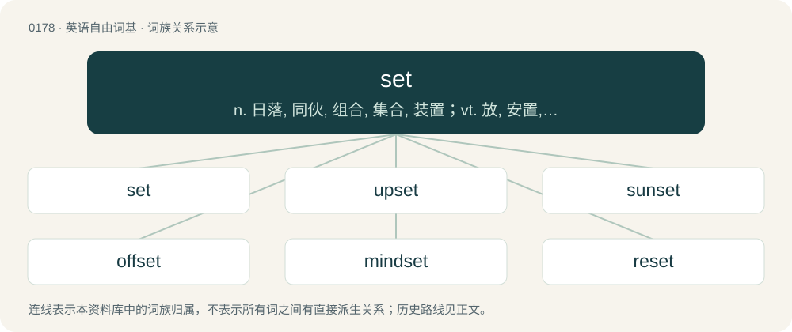

# 0195 · set — n. 日落, 同伙, 组合, 集合, 装置；vt. 放, 安置, 放置, 设定, 使凝结, 点燃, 确定, 点缀, 使就位, 树立, 分配, 调整；vi. 日落, 凝固, 定型, 搁住, 结果, 适合

[总目录](../00_总目录_按常用程度.md)

**类型**：英语自由词基　｜　**来源语言**：见词源记录

## 核心含义与来源

- 核心含义：n. 日落, 同伙, 组合, 集合, 装置；vt. 放, 安置, 放置, 设定, 使凝结, 点燃, 确定, 点缀, 使就位, 树立, 分配, 调整；vi. 日落, 凝固, 定型, 搁住, 结果, 适合
- 英文含义：To put (something) down, to rest.
- 词形：set

**多个词源／构词路径**：同一拼写可能有不同来源；以下按词性和含义分别列出。

**来源记录 1**（动词；To put (something) down, to rest.）

From Middle English setten, from Old English settan, from Proto-West Germanic \*sattjan, from Proto-Germanic \*satjaną, from Proto-Indo-European \*sodéyeti, causative of \*sed- (“to sit”). Cognate with Dutch zetten, German setzen, Danish sætte, Norwegian Bokmål sette, Icelandic and Norwegian Nynorsk setja, Swedish sätta, Faroese seta.

**来源记录 2**（名词；A punch for setting nails in wood.）

From Middle English set, sette, from Old English set (“seat, place of residence, camp, settlement, entrenchment, stable, pen”), from Proto-West Germanic \*set (“seat”), from Proto-Germanic \*setą (“seat”).

**来源记录 3**（形容词；Fixed in position.）

From Middle English sett, from Old English ġesett, past participle of settan.

**来源记录 4**（名词；A young plant fit for setting out; a slip; shoot.）

From Middle English set, sete, sette (“that which is set, the act of setting, seat”), from Old English set (“setting, seat, a place where people remain, habitation, camp, entrenchment, a place where animals are kept, stall, fold”) and Old English seten (“a set, shoot, slip, branch; a nursery, plantation; that which is planted or set; a cultivated place; planting, cultivation; a setting, putting; a stopping; occupied land”), related to Old English settan (“to set”). Compare Middle Low German gesette (“a set, suite”), Old English gesetl (“assembly”). According to Skeat, in senses denoting a group of things or persons, representing an alteration of sept, from Old French sette (“a religious sect”), from Medieval Latin secta (“retinue”), from Latin secta (“a faction”). See sect. It is quite possible that the modern word is more of a merger between both, however.

**来源记录 5**（动词；To divide a class group in a subject according to ability）

(This etymology is missing or incomplete. Please add to it, or discuss it at the Etymology scriptorium. )

## 词族图

## 单词速览（常用到不常用）

| 单词 | 音标 | 释义 |
|---|---|---|
| [set](#w-1) | /sɛt/ | n. 日落, 同伙, 组合, 集合, 装置；vt. 放, 安置, 放置, 设定, 使凝结, 点燃, 确定, 点缀, 使就位, 树立, 分配, 调整；vi. 日落, 凝固, 定型, 搁住, 结果, 适合 |
| [upset](#w-2) | 英 /ʌpˈsɛt/ | a. 弄翻的, 混乱的, 心烦的；vt. 弄翻, 颠覆, 推翻, 打乱, 使不适, 使心烦；vi. 翻倒 |
| [sunset](#w-3) | /ˈsʌnˌsɛt/ | n. 日落, 晚年 |
| [offset](#w-4) | 英 /ˈɒf.sɛt/；美 /ˈɔf.sɛt/ | n. 抵消, 把...并列, 旁系, 支管, 用胶印法印；vt. 弥补, 抵消, 胶印；vi. 装支管 |
| [mindset](#w-5) | 美 /ˈmaɪn(d)ˌsɛt/ | n. 心态；倾向；习惯；精神状态 |
| [reset](#w-6) | /ɹiːˈsɛt/ | n. 重新设定, 重新组合, 重排版；vt. 重新设定, 重置, 重新组合；vi. 重置, 清零 |
| [onset](#w-7) | 英 /ˈɒnˌsɛt/；/ˈɔnˌsɛt/ | n. 开始, 攻击, 进攻；\[医\] 起始, 开始 |
| [headset](#w-8) | /ˈhɛdsɛt/ | n. (一副)耳机；\[电\] 头载机组 |
| [subset](#w-9) | 英 /ˈsʌbˌsɛt/ | n. 子集；\[计\] 子集; 子设备 |
| [outset](#w-10) | /ˈaʊtsɛt/ | n. 着手, 开头, 最初 |
| [handset](#w-11) | /ˈhæn(d)sɛt/ | n. 电话听筒 |
| [setter](#w-12) | 英 /ˈsɛt.ə/；美 /ˈsɛt.ɚ/ | n. 从事安装的人, 调节器, (警察)眼线 |
| [preset](#w-13) | 英 /pɹiːˈsɛt/ | vt. 事先调整；n. 预调装置；\[计\] 边框形式 |
| [setlist](#w-14) | 美 /ˈsɛtˌlɪst/ | 【英文】A list of the songs to be played by a particular band or musical act for a particular show or tour. |
| [inset](#w-15) | /ˈɪnsɛt/ | vt. 嵌入；n. 插入物, 插页, 插图 |
| [chipset](#w-16) | 美 /ˈt͡ʃɪpˌsɛt/ | 芯片集 |
| [playset](#w-17) |  | 玩具套装 |
| [typeset](#w-18) | /ˈtaɪpˌsɛt/ | vt. 排版 |
| [toolset](#w-19) | 美 /ˈtulˌsɛt/ | n. 工具箱；成套工具 |
| [superset](#w-20) | /ˈsjuːpəset/ | n. \[数\]超集 |
| [ruleset](#w-21) | 美 /ˈɹulˌsɛt/ | 【英文】A set of rules. |

## 逐词详解

### 1. set

**词性**：动词　｜　**音标**：/sɛt/

**中文释义**：n. 日落, 同伙, 组合, 集合, 装置；vt. 放, 安置, 放置, 设定, 使凝结, 点燃, 确定, 点缀, 使就位, 树立, 分配, 调整；vi. 日落, 凝固, 定型, 搁住, 结果, 适合

**英文义项**：To put (something) down, to rest. / To attach or affix (something) to something else, or in or upon a certain place.

**词源与演化**：

From Middle English setten, from Old English settan, from Proto-West Germanic \*sattjan, from Proto-Germanic \*satjaną, from Proto-Indo-European \*sodéyeti, causative of \*sed- (“to sit”). Cognate with Dutch zetten, German setzen, Danish sætte, Norwegian Bokmål sette, Icelandic and Norwegian Nynorsk setja, Swedish sätta, Faroese seta.

**例句**：

> Paramount Pictures has set Jennifer Love Hewitt for a movie called Two Can Play This Game.

该用例对应义项：To arrange the casting of a movie.

### 2. upset

**词性**：形容词　｜　**音标**：英 /ʌpˈsɛt/

**中文释义**：a. 弄翻的, 混乱的, 心烦的；vt. 弄翻, 颠覆, 推翻, 打乱, 使不适, 使心烦；vi. 翻倒

**英文义项**：Angry, distressed, or unhappy / Feeling unwell, nauseated, or ready to vomit.

**构词拆分**：up- + set

**词源与演化**：

From Middle English upset (“the act of setting up; establishment”), from Middle English upsetten, corresponding to up- + set. Cognate with Middle Low German upset (“setup; arrangement”).

**例句**：

> My children often get upset with their classmates.

该用例对应义项：Angry, distressed, or unhappy

### 3. sunset

**词性**：名词　｜　**音标**：/ˈsʌnˌsɛt/

**中文释义**：n. 日落, 晚年

**英文义项**：The moment each evening when the sun disappears below the western horizon. / The changes in color of the sky before and after sunset.

**构词拆分**：sun + set

**词源与演化**：

From Middle English son-sett, Sonne set, equivalent to sun + set. In Gower's Confessio Amantis, before 1393.

**例句**：

> The tax increase legislation included a sunset clause requiring renewal to prevent the tax increase from expiring.

该用例对应义项：A set termination date.

### 4. offset

**词性**：名词　｜　**音标**：英 /ˈɒf.sɛt/；美 /ˈɔf.sɛt/

**中文释义**：n. 抵消, 把...并列, 旁系, 支管, 用胶印法印；vt. 弥补, 抵消, 胶印；vi. 装支管

**英文义项**：Anything that acts as counterbalance; a compensating equivalent. / A form of countertrade arrangement, in which the seller agrees to purchase within a set time frame products of a certain value from the buying country. This kind of agreement may be used in large international public sector contracts such as arms sales.

**构词拆分**：off- + set

**词源与演化**：

From off- + set, used to construct the noun form of the verb to set off. Compare Middle English ofsetten (“to encumber, harass, beset, besiege”), from Old English ofsettan (“to press, oppress, overwhelm, crush”).

**例句**：

> There is a small offset between the switch and the indicator which some users found confusing.

该用例对应义项：The distance by which one thing is out of alignment with another.

### 5. mindset

**词性**：名词　｜　**音标**：美 /ˈmaɪn(d)ˌsɛt/

**中文释义**：n. 心态；倾向；习惯；精神状态

**英文义项**：A way of thinking; an attitude or opinion, especially a habitual one.

**构词拆分**：From mind + set.

**词源与演化**：

From mind + set.

**例句**：

> Earth Day is a way of propagating and celebrating the environmentalist mindset.

该用例对应义项：A way of thinking; an attitude or opinion, especially a habitual one.

### 6. reset

**词性**：动词　｜　**音标**：/ɹiːˈsɛt/

**中文释义**：n. 重新设定, 重新组合, 重排版；vt. 重新设定, 重置, 重新组合；vi. 重置, 清零

**英文义项**：To set back to the initial state. / To set to zero.

**构词拆分**：re- + set

**词源与演化**：

From re- + set.

**例句**：

> Reset instruments and dials.

该用例对应义项：set to zero

### 7. onset

**词性**：名词　｜　**音标**：英 /ˈɒnˌsɛt/；/ˈɔnˌsɛt/

**中文释义**：n. 开始, 攻击, 进攻；\[医\] 起始, 开始

**英文义项**：The initial phase of a disease or condition, in which symptoms first become apparent. / The initial portion of a syllable, preceding the syllable nucleus.

**构词拆分**：on- + set

**词源与演化**：

From on- + set. Compare Old English onsettan (“to impose; oppress, bear down”). For semantic parallels for the meaning to assault, compare cognate Russian насе́сть pf (naséstʹ), наседа́ть impf (nasedátʹ).

**用法示例／搭配（非完整句）**：

> the onset of schizophrenia

该用例对应义项：The initial phase of a disease or condition, in which symptoms first become apparent.

### 8. headset

**词性**：名词　｜　**音标**：/ˈhɛdsɛt/

**中文释义**：n. (一副)耳机；\[电\] 头载机组

**英文义项**：A pair of headphones or earphones, or a singular headphone or earphone, typically with an attached microphone. / Any electronic device worn on the head.

**构词拆分**：head + set

**词源与演化**：

From head + set.

**例句**：

> My virtual reality headset is broken because it fell on the ground.

### 9. subset

**词性**：名词　｜　**音标**：英 /ˈsʌbˌsɛt/

**中文释义**：n. 子集；\[计\] 子集; 子设备

**英文义项**：A set A such that every element of A is also an element of S. / A group of things or people, all of which are in a specified larger group.

**构词拆分**：sub- + set

**词源与演化**：

From sub- + set.

**例句**：

> We asked a subset of the population of the town for their opinion.

该用例对应义项：A group of things or people, all of which are in a specified larger group.

### 10. outset

**词性**：名词　｜　**音标**：/ˈaʊtsɛt/

**中文释义**：n. 着手, 开头, 最初

**英文义项**：An onset; the beginning or initial stage of something.

**构词拆分**：out- + set

**词源与演化**：

From out- + set, replacing earlier outsetting.

**例句**：

> He agreed and understood from the outset, so don't bother explaining again.

该用例对应义项：An onset; the beginning or initial stage of something.

### 11. handset

**词性**：动词　｜　**音标**：/ˈhæn(d)sɛt/

**中文释义**：n. 电话听筒

**英文义项**：To typeset by hand.

**构词拆分**：hand + set

**词源与演化**：

From hand + set.

**例句**：

> The customer gets the best possible price for his old handset.

### 12. setter

**词性**：名词　｜　**音标**：英 /ˈsɛt.ə/；美 /ˈsɛt.ɚ/

**中文释义**：n. 从事安装的人, 调节器, (警察)眼线

**英文义项**：A typesetter. / One who sets something, such as a challenge or an examination.

**构词拆分**：set + -er

**词源与演化**：

From Middle English settere, equivalent to set + -er. Compare West Frisian setter, Dutch zetter, German Low German Setter, German Setzer. The hunting dogs are so named because when they scent the game, they set (that is, strike a certain stance).

**例句**：

> The setter of this crossword has been known to throw us all for a loop occasionally.

该用例对应义项：One who sets something, such as a challenge or an examination.

### 13. preset

**词性**：动词　｜　**音标**：英 /pɹiːˈsɛt/

**中文释义**：vt. 事先调整；n. 预调装置；\[计\] 边框形式

**英文义项**：To set something in advance.

**构词拆分**：pre- + set

**词源与演化**：

From pre- + set.

**例句**：

> I preset it the right way, so don't change any settings.

该用例对应义项：To set something in advance.

### 14. setlist

**词性**：名词　｜　**音标**：美 /ˈsɛtˌlɪst/

**英文义项**：A list of the songs to be played by a particular band or musical act for a particular show or tour.

**构词拆分**：set + list

**词源与演化**：

From set + list.

### 15. inset

**词性**：名词　｜　**音标**：/ˈɪnsɛt/

**中文释义**：vt. 嵌入；n. 插入物, 插页, 插图

**英文义项**：A smaller thing set into a larger thing, such as a small picture inside a larger one. / Anything inserted.

**构词拆分**：in- + set

**词源与演化**：

From Middle English insetten, from Old English insettan (“to set in, institute, appoint”), equivalent to in- + set. Cognate with Dutch inzetten (“to insert, set in”), Low German insetten (“to set in”), German einsetzen (“to insert, employ”), Danish indsætte (“to insert”), Swedish insätta (“to inset, induct, institute”), Icelandic innsetja (“to install”).

**用法示例／搭配（非完整句）**：

> a map of the whole state with city maps as insets

该用例对应义项：A smaller thing set into a larger thing, such as a small picture inside a larger one.

### 16. chipset

**词性**：名词　｜　**音标**：美 /ˈt͡ʃɪpˌsɛt/

**中文释义**：芯片集

**英文义项**：A group of integrated circuits that are designed to work together, and are usually marketed as a single product.

**构词拆分**：chip + set

**词源与演化**：

From chip + set.

**例句**：

> What exactly is a motherboard chipset?

### 17. playset

**词性**：名词

**中文释义**：玩具套装

**英文义项**：A themed collection of similar toys designed to work together to enact some action or event. / A unitary structure for children to play on, typically including a slide, and often swings, ropes to climb on, and other things found as separate structures at public playgrounds.

**构词拆分**：play + set

**词源与演化**：

From play + set.

**例句**：

> I bought a dinosaur playset for my nephew.

### 18. typeset

**词性**：动词　｜　**音标**：/ˈtaɪpˌsɛt/

**中文释义**：vt. 排版

**英文义项**：to set or compose written material into type / to be set or composed into type

**构词拆分**：type + set

**词源与演化**：

From type + set.

**例句**：

> My book will be typeset nicely.

该用例对应义项：set in type

### 19. toolset

**词性**：名词　｜　**音标**：美 /ˈtulˌsɛt/

**中文释义**：n. 工具箱；成套工具

**英文义项**：A collection of tools; a toolkit. / A set of utility programs, subroutines or similar software.

**构词拆分**：tool + set

**词源与演化**：

From tool + set.

### 20. superset

**词性**：名词　｜　**音标**：/ˈsjuːpəset/

**中文释义**：n. \[数\]超集

**英文义项**：(symbol: ⊇) With respect to another set, a set such that each of the elements of the other set is also an element of the set. / Two or more different physical exercises performed back to back (i.e., without a period of rest between them). The exercises may employ the same muscle group, or opposing muscle groups.

**构词拆分**：super- + set

**词源与演化**：

From super- + set.

**例句**：

> The set of characters "LBPG" is a superset of the set of characters "PG".

该用例对应义项：(symbol: ⊇) With respect to another set, a set such that each of the elements of the other set is also an element of the set.

### 21. ruleset

**词性**：名词　｜　**音标**：美 /ˈɹulˌsɛt/

**英文义项**：A set of rules.

**构词拆分**：rule + set

**词源与演化**：

From rule + set.
