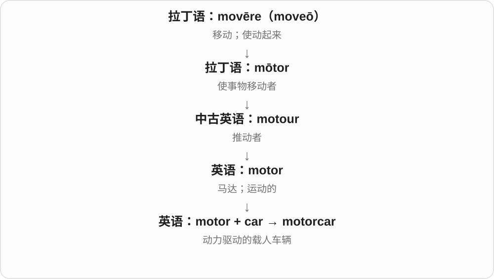

# 0196 · car — 有轮车辆；汽车及铁路车辆

[逐词精讲目录](../00_逐词精讲目录.md) · [总目录](../00_总目录_按常用程度.md)

## 核心词根与来源

car 经法语 carre 上接拉丁 carrus 与高卢语车辆词。carmaker 讲制造，carpool 的 pool 讲共享，carport 讲遮护结构，railcar、boxcar 讲铁路用法。

**CAR：先认车辆，再看路上汽车还是轨道车厢**

今天最熟悉汽车，但历史起点比现代发动机早；dining car、boxcar 都要选铁路车厢义。

- **基本汽车与产业、使用**：car · carmaker · carpool · carport
- **铁路及既有复合词**：railcar · boxcar · streetcar · motorcar · supercar · sidecar
- **有轮车辆与道路：career 的同源背景**：car · career
- **车运的旧词族到今天的 carry、carrier**：car · carry · carrier
- **cargo：车载、装载材料中的货物**：car · carry · cargo
- **car → cars：汽车与轨道车辆车厢**：car · cars
- **carry → carrying：把东西带在身上或承载着**：carry · carrying
- **carry → carried → carrying：承载与携带**：carry · carried · carrying
- **carry → carries：把东西带着走、承载信息**：carry · carries
- **carry → carrier → carriers：承载、运输的人或物**：carry · carrier · carriers
- **career → careers：职业历程；快速冲行的同形动词**：career · careers

## 词形与演化规律

car → carmaker、carpool、carport；railcar → boxcar 相邻，streetcar、motorcar、supercar、sidecar 各按既有用途解释。

career 经法语 carrière 道路、赛道等接与 carrus 车辆有关的道路名称；与 car 有更早同源联系，但职业义不是现代英语 car 加 -eer。

carry 经法语运输动词接 carrus 等车的旧词族；现代 carry 远不止用车搬运。carry 的 y 变 i 再加 -er 得 carrier。

cargo 经西班牙语 cargar 装载相关名词接拉丁 carricare 装车，与 car、carry 共享更早车辆材料。

car 经法语接拉丁 carrus 运货车，更早与高卢语车辆词有关；现代汽车义只是后来的主要分支。

用车运输的法语词族，扩大为携带、承载；加 ing 保留 y。

车辆运输背景扩展成多种承载动作，y 的变化看后接词尾。

法语运输词接拉丁、古高卢车的词族，三单改 y 为 i 加 es。

carry 改 y 为 i 加完整 er，复数再加 s，按承载对象形成专义。

道路、赛道材料经法语，扩展人生行进路线义，动词保留快速行进画面。

## 单词速览（按词族由简到繁）

同一基础词的相关扩展放在一起，先读基础形式，再读扩展；各组之间优先读常用的。具体词源关系见各词讲解。

| 单词 | 音标 | 核心意思 |
|---|---|---|
| [car](#w-1) | 英 /kɑː/；美 /kɑːr/ | 汽车；车厢、铁路车辆〔尤美式〕 |
| [career](#w-11) | 英 /kəˈrɪə/；美 /kəˈrɪr/ | 职业生涯；快速冲行〔动词〕 |
| [careers](#w-20) | 英 /kəˈrɪəz/；美 /kəˈrɪrz/ | 职业生涯、事业道路〔复数〕；快速冲行〔第三人称单数〕 |
| [cars](#w-15) | 英 /kɑːz/；美 /kɑːrz/ | 汽车；车厢、缆车车厢等；car 的复数 |
| [carry](#w-12) | 英 /ˈkæri/；美 /ˈkæri/ | 搬、携带；承载、传播；继续进行、执行；备有、销售等 |
| [carried](#w-17) | /ˈkærid/ | 携带、搬运、承载、传播〔carry 的过去式、过去分词〕 |
| [carrying](#w-16) | 英 /ˈkæriɪŋ/；美 /ˈkæriɪŋ/ | 正在携带、承载；输送、传播；carry 的 -ing 形式 |
| [carrier](#w-13) | 英 /ˈkæriə/；美 /ˈkæriər/ | 承运人、运输公司；运载工具；携带者；通信运营商等 |
| [carriers](#w-19) | 英 /ˈkæriəz/；美 /ˈkæriərz/ | 承运人、运输公司；运营商；携带者、承载物〔复数〕 |
| [carries](#w-18) | /ˈkæriz/ | 携带、运载、承载；传递、包含〔第三人称单数〕 |
| [cargo](#w-14) | 英 /ˈkɑːɡəʊ/；美 /ˈkɑːrɡoʊ/ | 货物；船、飞机等运载的一批货 |
| [carpool](#w-4) | 英 /ˈkɑːpuːl/；美 /ˈkɑːrpuːl/ | 合乘安排、合乘群体；拼车 |
| [carport](#w-7) | 英 /ˈkɑːpɔːt/；美 /ˈkɑːrpɔːrt/ | 有顶敞式车棚 |
| [carmaker](#w-8) | 英 /ˈkɑːmeɪkə/；美 /ˈkɑːrmeɪkər/ | 汽车制造商 |
| [streetcar](#w-2) | 英 /ˈstriːtkɑː/；美 /ˈstriːtkɑːr/ | 有轨电车〔主要用于北美〕 |
| [supercar](#w-3) | 英 /ˈsuːpəkɑː/；美 /ˈsuːpərkɑːr/ | 超级跑车；高性能豪华跑车 |
| [sidecar](#w-5) | 英 /ˈsaɪdkɑː/；美 /ˈsaɪdkɑːr/ | 摩托车边斗；边车 |
| [boxcar](#w-6) | 英 /ˈbɒkskɑː/；美 /ˈbɑːkskɑːr/ | 有篷铁路货车；封闭式货运车厢 |
| [motorcar](#w-9) | 英 /ˈməʊtəkɑː/；美 /ˈmoʊtərkɑːr/ | 汽车（较旧式） |
| [railcar](#w-10) | 英 /ˈreɪlkɑː/；美 /ˈreɪlkɑːr/ | 铁路车辆、车厢；自走式轨道客车〔部分用法〕 |

## 逐词讲解

### 1. car — 汽车；车厢、铁路车辆〔尤美式〕

**音标**：英 /kɑː/；美 /kɑːr/

**先抓住这个画面**

最常见是路上开的汽车；放进 railway、passenger 等语境，也可能是火车车厢。

**怎么拆**

经古法语、盎格鲁诺曼 carre 到中古英语，接拉丁 carrus“运货车”，更早与高卢语车辆词有关。起初并不专指现代汽车。

**怎么变成今天的意思**

**古法语 carre → 中古英语 carre**  
有轮车辆；上接拉丁 carrus 与高卢语相关词

↓

**英语 car**  
汽车；部分铁路语境的车厢、车辆

drive a car 开汽车，a passenger car 可是乘用汽车，也可在铁路语境说客车车厢；a dining car 是餐车车厢。对象看上下文。

**常见搭配与例句**

drive a car；a car park；a passenger car；a dining car。

> We left the car outside the hotel.

我们把车停在酒店外。

> The train has a dining car.

这趟列车有餐车。

**别混淆**

car 日常汽车与 carriage、railcar 的地区用法不同；不能把 train car 看成开进火车里的一辆轿车。

### 2. career — 职业生涯；快速冲行〔动词〕

**音标**：英 /kəˈrɪə/；美 /kəˈrɪr/

**先抓住这个画面**

把多年工作看成一路走过的历程，而不只眼下一个职位，就是 career。旧的道路、疾驰画面在动词 career 中仍很明显。

**怎么拆**

法语 carriere 道路、赛道经意大利语、普罗旺斯语等路径，接拉丁语与 carrus 车辆相关的车行道路材料。由行进路线扩展为人生、职业历程。

**怎么变成今天的意思**

**车辆相关道路材料 → 法语 carriere → 英语 career**  
道路、赛道；快速行进的路程

↓

**生涯义与保留的动词**  
职业历程；快速冲行

a career in medicine 医学职业生涯；change careers 转行；career development 职业发展；career down a hill 疾冲下坡。

**常见搭配与例句**

a long teaching career；a career change。

> She built a successful career in engineering.

她在工程领域建立了成功的职业生涯。

> The empty cart careered down the slope.

空车沿斜坡疾冲而下。

**别混淆**

job 常指一份工作、岗位，career 常把工作历程、发展方向合起来看。一段 career 可以包括先后从事的多份 jobs。

### 3. careers — 职业生涯、事业道路〔复数〕；快速冲行〔第三人称单数〕

**音标**：英 /kəˈrɪəz/；美 /kəˈrɪrz/

**先抓住这个画面**

一个人多年工作的走向像一条路，是 career；几个人各自走过的职业道路，就是 careers。作动词时它还保留在路上猛冲的老画面。

**怎么拆**

career 经法语 carriere 的道路、赛道材料，较远接拉丁车辆、车行道路词族。现代直接加 -s，英音 /ə/ 后接 /z/，美音保留 /r/。

**怎么变成今天的意思**

**车行道路材料 → 法语 carriere → career**  
赛道、行进路程 → 人生与职业历程

↓

**career + -s → careers**  
多段或多人的职业生涯；某物快速冲行

careers in teaching 教学领域的职业道路；change careers 改行；careers across the field 快速冲过田野。

**常见搭配与例句**

their early careers 他们职业生涯的早期；different careers 不同职业道路。

> They began their careers at the same school.

他们在同一所学校开始了职业生涯。

> The exhibition explores the careers of three artists.

这个展览回顾了三位艺术家的创作生涯。

**别混淆**

jobs 是一份份工作，careers 常把多年经历连成发展道路。动词 careers 较少见，遇到车或人猛冲的句子时可辨认即可。

### 4. cars — 汽车；车厢、缆车车厢等；car 的复数

**音标**：英 /kɑːz/；美 /kɑːrz/

**先抓住这个画面**

日常最常见的是几辆汽车；铁路、缆车语境里，car 还可以指载人、载货的一节车厢。

**怎么拆**

car + -s，词尾 /z/。经古法语、盎格鲁诺曼 carre 等接拉丁 carrus 运货车，更早与高卢语车辆名称有关，名称早于现代汽车。

**怎么变成今天的意思**

**高卢语相关车辆词 → 拉丁 carrus → 法语 carre 等 → car**  
运货车辆等 → 后来的各种车、车厢

↓

**car + -s → cars**  
多辆汽车；若干节车厢等

parked cars 停着的汽车；electric cars 电动汽车；rental cars 租来的车；railroad cars 铁路车厢〔美式常见〕；cable cars 缆车。

**常见搭配与例句**

two cars；cars on the road。

> The street was lined with parked cars.

街道两旁停满了汽车。

> The train has six passenger cars.

这列火车有六节客运车厢。

**别混淆**

cars 在道路语境通常是汽车，在 a train with six cars 中常是六节车厢。carriages 在许多英式铁路场景也能指客运车厢，搭配随地区、用途变化。

### 5. carry — 搬、携带；承载、传播；继续进行、执行；备有、销售等

**音标**：英 /ˈkæri/；美 /ˈkæri/

**先抓住这个画面**

把东西托在身上或工具上带走，是 carry；一条电线、一个声音也能把东西或信息从一处带到另一处。

**怎么拆**

经盎格鲁法语 carier、古北法语 carrier 等运输动词，接拉丁、古高卢车的词族。原有用车运的背景，进入英语后范围扩大到承载、携带、输送等。

**怎么变成今天的意思**

**车的拉丁、高卢材料 → 法语运输动词**  
用车辆运送、带走

↓

**英语 carry**  
携带、承载、传播；再有多种固定搭配

carry a bag 提包；carry a message 传递信息；carry on 继续；carry out a plan 执行计划；carry a product 店铺备售某产品。

**常见搭配与例句**

carry it upstairs；carry responsibility；carry on working。

> Could you help me carry this box upstairs?

你能帮我把这个箱子搬上楼吗？

> Sound carries well across the water.

声音在水面上传得很远。

> We need more time to carry out the plan.

我们需要更多时间执行计划。

**别混淆**

carry 强调携带、承载的过程；bring、take 还涉及朝某参照点来或去。carry out 是执行，carry on 是继续，搭配中的小词改变动作方向。

### 6. carried — 携带、搬运、承载、传播〔carry 的过去式、过去分词〕

**音标**：/ˈkærid/

**先抓住这个画面**

人把箱子带走、车辆把乘客送走、声音传到远处，都可以用 carried；共同点是某样东西随着承载它的人或媒介到了另一处。

**怎么拆**

carry 的 y 前是辅音 r，加 -ed 时变 y 为 i，形成 carried，词尾读 /d/，整体通常两个音节。carry 经盎格鲁法语、古北法语运输动词，接较早车的拉丁、高卢词族。

**怎么变成今天的意思**

**车的词族 → 法语运输动词 → carry**  
用车运 → 更广的承载、携带

↓

**carry → carried**  
y 变 i 加 ed；带去了、被运载

carried the bags 提包；carried passengers 运送乘客；carried the sound 传播声音；carried out the plan 执行计划。

**常见搭配与例句**

carried upstairs；carried across the water。

> He carried the heavy box upstairs.

他把那个重箱子搬上了楼。

> The wind carried their voices across the water.

风把他们的说话声传过了水面。

**别混淆**

carried out 常是执行、完成安排，作为整个短语学。carrying 保留 y；carried 变 i，两者由所接词尾决定。

### 7. carrying — 正在携带、承载；输送、传播；carry 的 -ing 形式

**音标**：英 /ˈkæriɪŋ/；美 /ˈkæriɪŋ/

**先抓住这个画面**

把东西带在身上、托住并运送，是 carrying；车承载旅客，声音、消息被传送，也能延伸这个画面。

**怎么拆**

carry + -ing，直接保留 y，写 carrying。carry 经盎格鲁法语、古北法语运输动词接车的拉丁、高卢词族，原有用车运的背景，英语后来扩大到各种携带、承载。

**怎么变成今天的意思**

**车的拉丁、高卢词族 → 法语运输动词 → carry**  
用车运输 → 携带、承载、输送

↓

**carry + -ing → carrying**  
进行中的携带、运输；承担等

carrying a bag 提着包；carrying passengers 运载旅客；carrying out a plan 执行计划；carrying on with work 继续工作。

**常见搭配与例句**

carrying something heavy；carrying the message further。

> She was carrying a large bag in each hand.

她两只手各提着一个大包。

> The team is carrying out a survey of local buildings.

团队正在开展一项当地建筑调查。

**别混淆**

carry 侧重把东西带着、承载着，bring 常交代朝参照点带来。carry out a task 是执行任务；carry on doing 是继续做，短语各按整体用法记。

### 8. carrier — 承运人、运输公司；运载工具；携带者；通信运营商等

**音标**：英 /ˈkæriə/；美 /ˈkæriər/

**先抓住这个画面**

共同点是把东西承载、送到另一处：人送邮件，船载飞机，通信公司传送信号。carrier 不只是一种职业。

**怎么拆**

carry 的 y 变 i 加 -er，较早泛指运输的人或物；后来按承载的对象，形成航运、通信、生物等专门用法。

**怎么变成今天的意思**

**carry + -er → carrier**  
携带、运送的人或东西

↓

**按运载对象与领域专门化**  
承运公司、运输装置、通信运营商、携带者等

a mail carrier 邮递员；a cargo carrier 货运公司或载货工具；an aircraft carrier 航空母舰；a mobile carrier 移动通信运营商；a pet carrier 宠物提箱。

**常见搭配与例句**

choose a carrier；a carrier of information。

> The carrier will deliver the package tomorrow.

承运公司明天会递送包裹。

> She placed the kitten in a pet carrier.

她把小猫放进宠物提箱。

**别混淆**

carrier 的 -er 既可落到人，也可落到物或公司。判断时先看它携带、运送的是什么；手机语境 carrier 通常指网络运营商。

### 9. carriers — 承运人、运输公司；运营商；携带者、承载物〔复数〕

**音标**：英 /ˈkæriəz/；美 /ˈkæriərz/

**先抓住这个画面**

把东西从这里带到那里，或者替某种内容提供承载通道，就是 carriers 的角色。

**怎么拆**

carry 改 y 为 i 加完整 -er → carrier，再加 -s。carry 经法语接车辆、运输材料，carrier 先指携带、运送的人或物，再按领域专门化。

**怎么变成今天的意思**

**carry + -er → carrier**  
运送、携带 → 承载者

↓

**carrier + -s → carriers**  
多家承运公司、运营商；多个携带者、承载物

air carriers 航空承运公司；mobile carriers 移动通信运营商；pet carriers 宠物运输箱。

**常见搭配与例句**

carriers of information 信息的载体；several carriers 几家承运商或运营商。

> Several carriers offer flights on this route.

几家航空公司提供这条航线的航班。

> The shop sells lightweight pet carriers.

店里卖轻便的宠物运输箱。

**别混淆**

carriers 可以是人、公司，也可以是物或技术通道，具体承载什么由上下文说明。carrier 拼写有 rr，是原来的 carry 保留下来。

### 10. carries — 携带、运载、承载；传递、包含〔第三人称单数〕

**音标**：/ˈkæriz/

**先抓住这个画面**

把东西带在身边，或让它随着自己到别处，是 carries 的核心。物理上可以载人、运货，信息上可以传声音、带含义。

**怎么拆**

carry 改 y 为 i 加 -es，末尾读 /z/。carry 经盎格鲁法语 carier、古北法语 carrier 等运输动词，接拉丁、古高卢车的词族。

**怎么变成今天的意思**

**法语运输动词 → carry**  
用车运的背景 → 泛指携带、承载

↓

**carry → carries**  
改 y 为 i 加 es；某人、某物承载、传递

carries a bag 提着包；carries passengers 运载乘客；carries information 传递信息。

**常见搭配与例句**

carries a meaning 带有含义；carries on working 继续工作，属于 carry on 搭配。

> The ferry carries passengers across the river.

渡船把乘客运过河。

> Each symbol carries a different meaning.

每个符号都带有不同的含义。

**别混淆**

carries 不只说手提，也可说船载、信号传输、消息包含。carries on 与 carries out 等短语要把小词一起读。

### 11. cargo — 货物；船、飞机等运载的一批货

**音标**：英 /ˈkɑːɡəʊ/；美 /ˈkɑːrɡoʊ/

**先抓住这个画面**

人上船是乘客，装进货舱、准备运到别处的东西是 cargo。重点是作为运输对象的一批货。

**怎么拆**

借西班牙语 cargo 装载、负担，来自 cargar 装载，上接晚期拉丁 carricare 给车装货及 carrus 车辆。与 carry、car 同源；cargo 是经过西班牙语单独借入的形式。

**怎么变成今天的意思**

**拉丁 carrus → carricare → 西班牙语 cargar／cargo**  
车辆 → 装载 → 所装的一批货

↓

**英语 cargo**  
运输货物；船、机等所载货物

air cargo 航空货物；a cargo ship 货船；a cargo of grain 一船、批谷物；load cargo 装货；cargo space 货舱空间。

**常见搭配与例句**

unload the cargo；a cargo terminal。

> The ship arrived with a cargo of grain.

船载着一批谷物抵达了。

> The aircraft has extra space for cargo.

飞机有额外的货物空间。

**别混淆**

cargo 常作货物统称，a cargo of ... 可数一批装载物。luggage 常说旅客行李，不是每件随身行李都在日常叫 cargo。

### 12. carpool — 合乘安排、合乘群体；拼车

**音标**：英 /ˈkɑːpuːl/；美 /ˈkɑːrpuːl/

**先抓住这个画面**

几个人路线差不多，把座位、车和出行需求凑到一起用。

**怎么拆**

car + pool，pool 在这里是共同汇集、共享资源，不是游泳池。名词再可作动词。

**怎么变成今天的意思**

**car；pool〔共同汇集、共享〕**  
并列构词部分

↓

**carpool**  
共同乘车的安排、人群；合乘

join a carpool 加入合乘，carpool to work 拼车上班。可能轮流开，也可按其他方式安排，词不规定唯一费用规则。

**常见搭配与例句**

join a carpool；carpool to work；a carpool arrangement。

> We carpool to work three days a week.

我们每周三天拼车上班。

> She joined a carpool with two neighbors.

她加入了两位邻居的合乘安排。

**别混淆**

carpool 合乘，car rental 租车；合租一辆车和几个人同程乘坐可能交叉，但不是同一概念。

### 13. carport — 有顶敞式车棚

**音标**：英 /ˈkɑːpɔːt/；美 /ˈkɑːrpɔːrt/

**先抓住这个画面**

车有屋顶遮雨晒，却不像完整车库那样四面围住。

**怎么拆**

car + port，20世纪建筑命名，与法语 porte cochère 车辆入口的表达背景有关；不是让汽车开到海港 port。

**怎么变成今天的意思**

**car；port〔车辆遮护入口相关命名〕**  
并列构词部分

↓

**carport**  
有顶、至少部分侧面敞开的停车结构

a covered carport 有顶车棚，park under the carport 停在车棚下。可连着房屋，也有独立结构。

**常见搭配与例句**

a covered carport；park under a carport；an attached carport。

> They parked the car under the carport.

他们把车停在车棚下。

> The house has a carport beside the kitchen entrance.

房子的厨房入口旁有一个车棚。

**别混淆**

carport 通常侧面开放，garage 更常围合成车库；名称看建筑形式、用途，不只按停几辆车分。

### 14. carmaker — 汽车制造商

**音标**：英 /ˈkɑːmeɪkə/；美 /ˈkɑːrmeɪkər/

**先抓住这个画面**

把汽车设计、生产出来的企业，而不是只负责开车、卖二手车的人。

**怎么拆**

car + maker，maker 是 make + -er，去 e 接后缀；常用于汽车制造企业。

**怎么变成今天的意思**

**car；maker〔make + -er〕**  
并列构词部分

↓

**carmaker**  
制造汽车的企业、制造者

a major carmaker 主要汽车制造商，an electric carmaker 电动汽车制造商。企业也可外包部分生产，词义重点是制造业务身份。

**常见搭配与例句**

a major carmaker；an electric carmaker；a domestic carmaker。

> The carmaker announced a new electric model.

汽车制造商宣布了一款新电动车型。

> Several carmakers displayed prototypes at the show.

几家汽车制造商在展会上展出了原型车。

**别混淆**

carmaker 制造商，car dealer 经销商，driver 驾驶者；同一产业链里的角色不同。

### 15. streetcar — 有轨电车〔主要用于北美〕

**音标**：英 /ˈstriːtkɑː/；美 /ˈstriːtkɑːr/

**先抓住这个画面**

沿街道上的轨道行驶、供乘客上下的城市车辆。

**怎么拆**

street + car；这里的 car 保留车辆、车厢的意思，这种组合早于今天把 car 主要理解为小汽车的习惯。

**怎么变成今天的意思**

**拉丁语 sternere → 过去分词 stratus**  
铺开、铺下 → 铺好的、展开的

↓

**拉丁语 (via) strata → 早期日耳曼语借词 → 古英语 strēt / strǣt**  
铺好的道路；不同古英语方言词形

↓

**中古英语 strete → 英语 street**  
街道；街上活动和生活的场景

↓

**英语 street + car → streetcar**  
街道上沿轨道行驶的客运车辆

今天多指城市有轨电车；早期街车也可能由马牵引，不能把所有历史上的 streetcar 都想成电动。

**常见搭配与例句**

take a streetcar；a streetcar line；a streetcar stop。

> We took the streetcar to the market.

我们乘有轨电车去了市场。

> The old photograph shows a horse pulling a streetcar.

那张老照片里，一匹马正拉着一辆街道轨道车。

**别混淆**

streetcar 大致对应英国英语 tram；不是一辆碰巧停在街上的普通汽车。

### 16. supercar — 超级跑车；高性能豪华跑车

**音标**：英 /ˈsuːpəkɑː/；美 /ˈsuːpərkɑːr/

**先抓住这个画面**

性能、设计和价格都远超普通汽车的跑车类别称呼，而不是任何跑得较快的车。

**怎么拆**

英语 super- + car。现代汽车文化中的构词，不存在一套全球统一的数字门槛能单靠单词决定归类。

**怎么变成今天的意思**

**拉丁 super**  
在上方、超过、越过

↓

**英语构词成分 super-**  
超出一般程度；在上、额外或超过某界限

↓

**英语 super- + car → supercar**  
超常性能的汽车 → 超级跑车

常见于汽车评论和展览。它暗示高性能、昂贵和稀有等特征；具体哪些车被算进去，媒体和厂商用法会不同。

**常见搭配与例句**

a supercar manufacturer；a supercar collection。

> The exhibition displayed several historic supercars.

展览展出了几辆具有历史意义的超级跑车。

> The engineer discussed the supercar’s cooling system.

工程师讨论了这辆超级跑车的冷却系统。

**别混淆**

sports car 范围更广；supercar 通常把性能与定位推到更高层级。

### 17. sidecar — 摩托车边斗；边车

**音标**：英 /ˈsaɪdkɑː/；美 /ˈsaɪdkɑːr/

**先抓住这个画面**

摩托车旁接出一个额外座舱，乘客坐在骑手侧边。

**怎么拆**

side（侧面）+ car（车、车厢），按连接位置形成名称。另有同名鸡尾酒及技术比喻，各需看语境，不从器材外形硬推统一来历。

**怎么变成今天的意思**

**英语 side；car**  
并列组合的两个材料

↓

**side + car → sidecar**  
接在摩托车旁的载人车斗

a motorcycle with a sidecar 是带边斗摩托车。软件语境也借来称与主组件并列运行的辅助组件；这是比喻，不是一定存在物理车辆。

**常见搭配与例句**

a motorcycle sidecar；ride in a sidecar；a sidecar attachment。

> The child rode in the motorcycle’s sidecar.

孩子坐在摩托车边斗里。

> The museum has an old motorcycle with a sidecar.

博物馆有一辆带边斗的旧摩托车。

**别混淆**

sidecar 的汽车材料指附加座舱，不是任何停在旁边的汽车；普通描述需保留对象类型。

### 18. boxcar — 有篷铁路货车；封闭式货运车厢

**音标**：英 /ˈbɒkskɑː/；美 /ˈbɑːkskɑːr/

**先抓住这个画面**

像一个大箱子放在轨道轮组上，货物装在封闭车厢里。

**怎么拆**

box + car，car 取铁路车辆、车厢义，不是轿车后备箱。

**怎么变成今天的意思**

**box；car〔铁路车厢〕**  
并列构词部分

↓

**boxcar**  
箱体状封闭铁路货车车厢

a freight boxcar 货运有篷车，load a boxcar 装货进车厢；通常美式铁路用语。

**常见搭配与例句**

a freight boxcar；load a boxcar；an empty boxcar。

> Workers loaded crates into the boxcar.

工人把货箱装进有篷货运车厢。

> A line of empty boxcars stood beside the warehouse.

仓库旁停着一排空货运车厢。

**别混淆**

boxcar 是铁路货运车厢，car trunk 是汽车后备箱；两者都能装货，却不是同一对象。

### 19. motorcar — 汽车（较旧式）

**音标**：英 /ˈməʊtəkɑː/；美 /ˈmoʊtərkɑːr/

**先抓住这个画面**

motorcar 的画面是历史上给马车结构加上动力，从此不需要马拉。

**怎么拆**

motor + car，明确这是靠机械动力行驶的车。

**怎么变成今天的意思**

现代普通说 car 已经够了，motorcar 常带历史、传统或较正式语气。

**常见搭配与例句**

an early motorcar；a vintage motorcar；motorcar production。

> The museum owns several early motorcars.

博物馆收藏了几辆早期汽车。

> The photograph shows a family beside their new motorcar.

照片里，一家人站在新汽车旁。

**别混淆**

motorcar 通常是汽车；motorcycle 是摩托车，不能都译成同一种车。

### 20. railcar — 铁路车辆、车厢；自走式轨道客车〔部分用法〕

**音标**：英 /ˈreɪlkɑː/；美 /ˈreɪlkɑːr/

**先抓住这个画面**

car 放到轨道上，就往铁路车辆理解；某些地区、专业材料又特指自己带动力的客车。

**怎么拆**

rail（轨道）+ car（车辆），不把普通汽车义生搬成一辆在火车旁开的轿车。

**怎么变成今天的意思**

**rail；car**  
并列构词部分

↓

**railcar**  
铁路车辆；在部分语境中特指自走式客车

a passenger railcar 客运铁路车辆。美式可广说铁路车厢、车辆，部分英式和技术用法偏自走式客车；按地区与上下文判断。

**常见搭配与例句**

a passenger railcar；a historic railcar；railcar maintenance。

> The museum restored a historic railcar.

博物馆修复了一辆历史铁路车辆。

> Passengers boarded the small railcar at the village station.

乘客在村站登上小型轨道客车。

**别混淆**

railcar 范围、含义随地区，boxcar 常明确封闭式铁路货车车厢；不能一律规定 railcar 必须有动力。

## 这一组要分清什么

car 可以是铁路车厢；carmaker 制造、dealer 经销、driver 驾驶；carpool 的 pool 不指游泳池；railcar 地区义别一刀切。

## 串起来练习

The carmaker’s staff carpool to the factory, where a historic railcar is on display.

汽车制造商的员工拼车到工厂，厂里展出了一辆历史铁路车辆。
