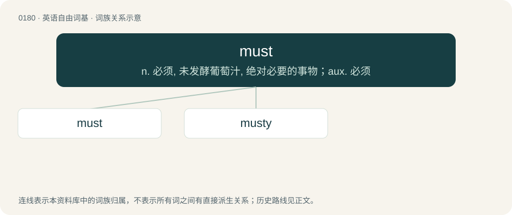

# 0197 · must — n. 必须, 未发酵葡萄汁, 绝对必要的事物；aux. 必须

[总目录](../00_总目录_按常用程度.md)

**类型**：英语自由词基　｜　**来源语言**：见词源记录

## 核心含义与来源

- 核心含义：n. 必须, 未发酵葡萄汁, 绝对必要的事物；aux. 必须
- 英文含义：To do as a requirement; indicates that the sentence subject is required as an imperative or directive to execute the sentence predicate, with failure to do so resulting in a failure or negative consequence.
- 词形：must

**多个词源／构词路径**：同一拼写可能有不同来源；以下按词性和含义分别列出。

**来源记录 1**（动词；To do as a requirement; indicates that the sentence subject is required as an imperative or directive to execute the sentence predicate, with failure to do so resulting in a failure or negative consequence.）

From Middle English moste ("must", literally, "had to", the past tense of Middle English moten (“to have to”)), from Old English mōste (“had to”), 1st & 3rd person singular past tense of mōtan (“to be allowed, be able to, have the opportunity to, be compelled to, must, may”), from Proto-Germanic \*mōtaną. Cognate with Dutch moest (“had to”), German musste (“had to”), Swedish måste (“must, have to, be obliged to”). More at mote.

**来源记录 2**（名词；The property of being stale or musty.）

From Middle English must, from Old English must and Old French must, most, both from Latin mustum.

## 词族图

## 单词速览（常用到不常用）

| 单词 | 音标 | 释义 |
|---|---|---|
| [must](#w-1) | /məst/ | n. 必须, 未发酵葡萄汁, 绝对必要的事物；aux. 必须 |
| [musty](#w-2) | 英 /ˈmʌsti/ | a. 发霉的, 霉臭的, 落伍的 |

## 逐词详解

### 1. must

**词性**：动词　｜　**音标**：/məst/

**中文释义**：n. 必须, 未发酵葡萄汁, 绝对必要的事物；aux. 必须

**英文义项**：To do as a requirement; indicates that the sentence subject is required as an imperative or directive to execute the sentence predicate, with failure to do so resulting in a failure or negative consequence. / To do with certainty; indicates that the speaker is certain that the subject will have executed the predicate.

**词源与演化**：

From Middle English moste ("must", literally, "had to", the past tense of Middle English moten (“to have to”)), from Old English mōste (“had to”), 1st & 3rd person singular past tense of mōtan (“to be allowed, be able to, have the opportunity to, be compelled to, must, may”), from Proto-Germanic \*mōtaną. Cognate with Dutch moest (“had to”), German musste (“had to”), Swedish måste (“must, have to, be obliged to”). More at mote.

**例句**：

> She's being taken to the police car now , so they must be going to arrest her.

该用例对应义项：To do with certainty; indicates that the speaker is certain that the subject will have executed the predicate.

### 2. musty

**词性**：形容词　｜　**音标**：英 /ˈmʌsti/

**中文释义**：a. 发霉的, 霉臭的, 落伍的

**英文义项**：Affected by dampness or mould; damp, mildewed, mouldy. / Having an odour or taste of mould; also (generally), having a stale or unfresh odour or taste.

**构词拆分**：must (“mould; mustiness”) + -y (suffix meaning ‘having the quality of’ forming adjectives)

**词源与演化**：

The adjective is derived from Late Middle English musty; further origin uncertain, possibly from one of the following: \* From Anglo-Norman muste, moste, variants of moiste, muiste (“moist”), from Old French moiste (“clammy, damp, moist, wet”) (modern French moite (“muggy; sticky, sweaty”)), from a blend of Vulgar Latin \*mucidus (from Latin mūcidus (“mouldy, musty”), from Old Latin mūceō (“to be mouldy or musty”) + -idus (suffix meaning ‘tending to’, forming adjectives)) + Latin mustum (“unfermented or partially fermented grape juice, must; new wine”) (from mustus (“fresh; young; unfermented”), from Proto-Indo-European \*mus-, \*mews- (“damp; moss”)). \* From another language derived from the above Latin words (compare the cognates below). \* A variant of Middle English mosty, moisti (“damp, humid, wet, moisty; of fruit: moist and juicy”) \[and other forms\] (perhaps influenced by must (“fruit (usually grape) juice which has been or will be fermented”)), from moist, moiste (“damp, humid; moist, wet; well-irrigated, well-watered; liquid; of ale: new; (figuratively) not withered, fresh; carnal, lascivious; raw, undisciplined”) (from Old French moiste: see above) + -i (suffix forming adjectives). Compare Middle French moisi (“mouldy”), an adjective use of the past participle of moisir (“(to cause) to go mouldy, to moulder”) (modern French moisir), from Latin mūcēre, the present active infinitive of Old Latin mūceō (“to be mouldy or musty”): see above. The English word is analysable as must (“mould; mustiness”) + -y (suffix meaning ‘having the quality of’ forming adjectives); however, must is thought to be a back-formation from musty. The noun and verb are derived from the adjective. Cognates \* Catalan mústic, musti (“wilted, withered; gloomy, sad”) \* Galician murcho, mucho (“wilted, withered”) \* Old Occitan moste (Occitan moste, mosti, musti (“damp, wet”) (Gascon)) \* Portuguese murcho (“wilted, withered; gloomy, sad”) \* Spanish mustio (“wilted, withered; gloomy, sad”)

**用法示例／搭配（非完整句）**：

> musty food musty furniture a musty odour

该用例对应义项：Having an odour or taste of mould; also (generally), having a stale or unfresh odour or taste.
